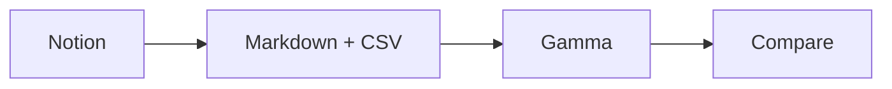

# Round trip

# 01 · Text and formatting

Fixture RT-2026-11-05. Synthetic content for Notion → Gamma → export comparison.

**Bold** *italic* ~~strike~~ <u>underline</u> `inline_code(x)` [Gamma repository](https://github.com/tim4431/Gamma) red text yellow background. Unicode: α β λ → 中文 café 🧪. Literal delimiters: $5, A & B, <tag>.

## 02 · Nested structure

### Third-level heading

- Bullet A
    - Nested A.1
        - Nested A.1.a
- Bullet B
1. Number one
    1. Nested number one
    2. Nested number two
2. Number two

> Quote fixture: preserve punctuation, nesting and links.
> 

---

## 03 · Tables and code

| Case | Input | Expected |
| --- | --- | --- |
| Unicode | λ, café, 中文 | Preserved |
| Escaping | A & B | No double escaping |

```python
def round_trip(x):
    return {"value": x, "ok": True}

print(round_trip("λ"))
```

## 04 · Gamma-specific source fixtures

Mermaid and SVG sources below test code preservation; native PDF ink, PDF highlights and block embeds require Gamma-side fixtures.



```xml
<svg xmlns="http://www.w3.org/2000/svg" width="240" height="80">
  <rect width="240" height="80" fill="#e0f2fe"/>
  <text x="20" y="45">Round trip λ</text>
</svg>
```

## 05 · Native blocks and linked pages

Native equation, media, subpages and database fixtures follow.

$$
E=mc^2
$$

<aside>
♻️

Roundtrip callout: preserve emoji, background and nested text.

</aside>

[Groups](Round%20trip/Groups%2040f85cc797e780d39341dde6003507bc.csv)

## Expandable heading fixture

Child content under toggle heading.

- Toggle fixture
    - Nested toggle child

[Child A — structure](Round%20trip/Child%20A%20%E2%80%94%20structure%2040f85cc797e780f5bf59d8539ae0d55d.md)

[Child B — media and links](Round%20trip/Child%20B%20%E2%80%94%20media%20and%20links%2040f85cc797e780afb790f0033486043e.md)

[Cases](Round%20trip/Cases%2040f85cc797e7808590f6e03efdcb070c.csv)