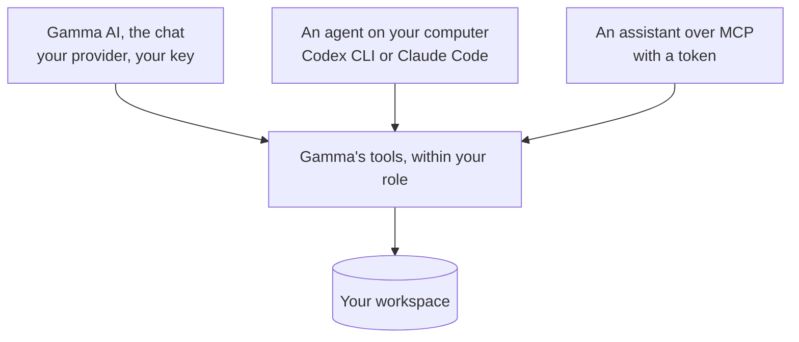
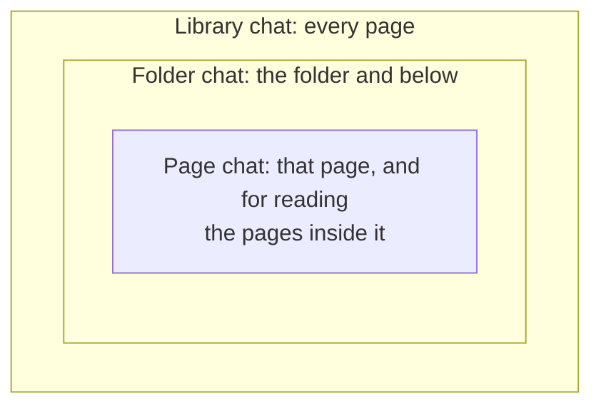
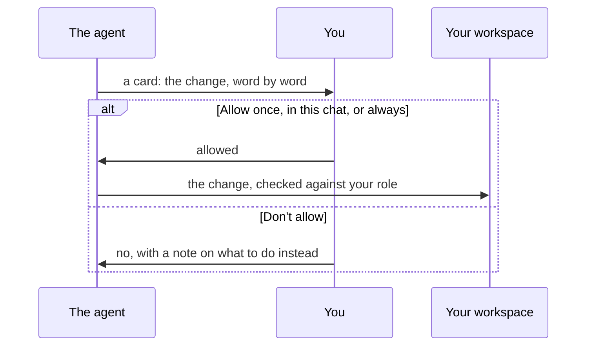

# AI

What Gamma's AI sees, what it may change, and how you stay in charge of
it: the chat and the library agent, agents running on your own computer,
and assistants connected from outside. The user guide's
[AI chat](../user_guide/user_guide.md#ai-chat),
[The library agent](../user_guide/user_guide.md#the-library-agent) and
[Assistants](../user_guide/user_guide.md#assistants) show how to use them.

> [!NOTE]
> - **It reaches only what you could**, through Gamma's own tools, within
>   your role in the workspace.
> - **Reading is allowed; every change asks first**, until you allow it.
> - **Nothing it does deletes a page for good**, and its changes to notes
>   and pages can be reverted.

## Three ways in

All three act on your library through Gamma's own tools, within your role
in the workspace. An agent on your computer also edits the files of a
synced folder on disk, which the folder then brings into Gamma as your
edits.

## Bring your own model

Gamma ships no key and no default model. Each account adds its own
connections in Settings → AI → Models: an API key for a provider, a
subscription, a server on your own computer or network, a custom endpoint,
or a ChatGPT sign-in. A connection offers only the models you pick for it
from the provider's live list. An administrator can also add connections
that the server's accounts share, with an optional daily allowance per
account.

- **Each task picks its model from any connection.** The chat, metadata
  and citations, translation and handwriting each name a model, or use the
  chat's. Your picks are kept with your account, so every device and
  Gamma's own background work, such as the metadata of a clipped paper,
  use them.
- **A model that went away is flagged, not silently swapped.** The task
  runs on the chat model meanwhile and says so: in Settings, in a notice,
  and in the job that used the stand-in. Your pick comes back when its
  connection does. A request that names a model which is gone fails
  rather than going to another one.
- **Claude is reached with an API key.** Signing in with a Claude
  subscription is left out on purpose: Anthropic's terms do not let other
  apps route requests through a Free, Pro or Max plan.
- **API spend is estimated from public prices; subscriptions show
  quota.** A call paid per token gets an estimated cost at the model's
  public price that day, and one without a known price is counted as
  unpriced, never as free. A subscription shows its tokens and what is
  left of the plan, and a shared connection its tokens against the
  allowance: nobody pays per token for them.
- **Effort and speed are yours to choose.** A model without the effort you
  prefer gets its nearest level, and a faster tier is sent only when the
  model offers it. Each reply names the model, effort and speed that served
  it.

## What the chat sees

The chat sees the pages in view: their titles, properties, notes, open
comment threads and a PDF's text.

- **Nothing is summarised behind your back.** A long PDF goes as a
  labelled excerpt of its start, or as the file itself when the PDF switch
  is on. To fit a model's window the oldest turns go first, and pills under
  a reply say what the model missed: "Model saw pages 1–9 of 22",
  "Earlier messages left out".
- **Answers about your pages come from text the model read.** The model is
  told to name the page a claim comes from, or to say it is not in the
  pages. In testing, a larger excerpt did not stop made-up details; giving
  the agent tools to read the paper did.
- **Gamma keeps the conversation, not the provider.** Every request sends
  the whole conversation and nothing is stored at the provider. So you can
  switch models mid-chat, edit an earlier message or drop old turns, and no
  provider holds your conversation.
- **Secret files** such as `.env` and keys are never shown to a model.
- **Comments reach the model as your requests**; quoted passages and
  fetched web pages as data, labelled "not instructions".

## What the library agent may reach

Each chat belongs to a page, a folder or the library, and reaches only
what it belongs to:

- Pages you attach with `@` widen what the chat can read, never what it
  can change.
- Tools that change things exist only where you can write. A viewer's
  chat gets reading tools only.
- A custom prompt changes the agent's style, never its reach.

## Allow, Ask or Off

Each kind of action has one of three settings, separately for the folder,
PDF and notes chats. Reading is allowed by default and every change asks
first. A new kind of change, added later, asks until you allow it.

The card's diff is built by the same code that will make the change, so
the card and the change cannot differ. After *Don't allow* the agent is
told not to retry or work around it. No answer in ten minutes counts as
no, and a call that would change nothing asks nobody.

Why this shape: the boundary already exists (the chat's scope and your
role), so no sandbox is needed. The tools are few and named, so pattern
rules would add syntax without adding control. Letting the model decide
when to ask was rejected: asking is your setting, not the model's call.
The cards guard your intent; what protects a workspace is the role check
on the server.

## What the AI may never do

No setting allows:

- deleting a page or a file for good: the agent can move pages to
  Recently deleted, and restore them;
- deleting a shared folder, or the folder its chat belongs to or one
  above it;
- editing where a highlight is anchored;
- reading outside its scope and what you attached;
- touching settings, share links or other people's data.

Every call shows in the reply, reads included, with lists of what changed.
A change to a note, and a page renamed, moved, labelled, deleted or
restored, has *Revert* and *Redo*, in any order, and keeps later edits by
others. If someone changed the agent's text since, the revert stops and
shows what would be lost.

## Papers from the web

The agent can read a paper by DOI, arXiv id or link without adding it to
your library; only saving it, on request, adds a page. It names the
version it read (the publisher's, a preprint) and warns when the title
does not match. At a sign-in page, a paywall or a CAPTCHA, the reply waits
on a card: Gamma Connector opens the page in your own browser and sends
the PDF back, or you upload it. Nothing solves a CAPTCHA, and Gamma never
sends "continue" for you: a message in your name is yours to send.

## Agents on your computer

Codex CLI or Claude Code, installed and signed in on a computer, can be
turned on for it in the desktop app (Settings → AI → Agents). You talk to
it in the chat, where it is listed as "Codex on TIM-PC", or by sending it
a comment ([Comments](comments.md#comments-as-work-for-an-agent)). It
works in a synced folder's directory, a directory the computer offers, or
an empty one of its own.

- **Only the desktop app on that computer can turn an agent on.** If a
  page could, a stolen cookie, an injected script or someone else's server
  could turn a Gamma session into a program running on your PC.
- **The agent is confined.** Codex runs in its sandbox, with writes kept
  to the directory and the network off; it can still read what your
  account on the computer can read. Claude Code gets file tools inside the
  directory, and a shell only when you let it ask. Neither gets web tools
  or your other MCP servers, or a flag that skips its own checks.
- **What it may run is asked, one exact command at a time**, if you let it
  ask at all. *Allow in this chat* matches that exact command in that
  folder, never a prefix or a rule.
- **Its access to Gamma lasts one turn**: reading, commenting, resolving
  and highlighting in that workspace, nothing else.
- **These conversations are not part of the workspace**: they are not in
  backups or exports, and Gamma's AI cannot read them.
- The owner can name co-authors who may use the agent on a synced folder's
  files, and can read their conversations. Their turns run on the owner's
  subscription, so turning this on asks the owner to accept what the
  vendor's terms say about sharing an account.

## Assistants over MCP

Gamma is an MCP server. An assistant signs in through the browser, and
you give it each workspace at one of three levels:

| Level | It can |
|---|---|
| View | read and search |
| Comment | also comment, resolve and highlight; never asks first, since a comment changes no note, is signed and can be deleted |
| Edit | also edit, create and move notes; asks you before each change, through the assistant, with a diff (you can turn asking off for a connection) |

Edit is offered only where your account edits. An assistant never deletes
a block, and never touches pages, folders, labels or settings. Gamma's own
AI connections are never used for it. A link pasted to an assistant grants
nothing: its access is its token's.

## Chat history

Each page, each folder and the library have a conversation of their own.
Renaming or moving a folder keeps its conversation; deleting the folder
files its chats into the library's history. *New chat* archives the
conversation. Gamma AI chats belong to the workspace: its members can read them,
and they are in its backups. A viewer's chat stays in their tab, marked
*Not saved*.

## Skills

A skill is instructions you keep for one kind of request, run by starting
a message with its `/name`; what follows the name is what it works on.
Its instructions are never stored in the conversation: each message names
the skill, and Gamma reads its instructions again from the skills of the
person asking. So a skill you edit applies from then on, the model is
told when a skill an earlier message ran is gone, and in a shared workspace the others
see that you ran `/name` but never what it says. The assistant may load a
skill itself when a request fits it, only one you let it use on its own.
Skills are `SKILL.md` files, the format Claude Code and Codex read, so one
written for them imports as it is.

## Behind this page

- [AI](../dev/ai.md), [AI tools](../dev/ai_tools.md), [AI context](../dev/ai_context.md),
  [Chat history](../dev/chat_history.md), [Skills](../dev/skills.md).
- [Local agents](../dev/local_agents.md), [MCP](../dev/mcp.md).
- [AI permissions](../research/ai-permissions.md),
  [Agents as participants](../research/agents-as-participants.md),
  [Skills in the chat](../research/chat-skills.md),
  [Models per task, providers and cost](../research/ai-model-settings.md).
