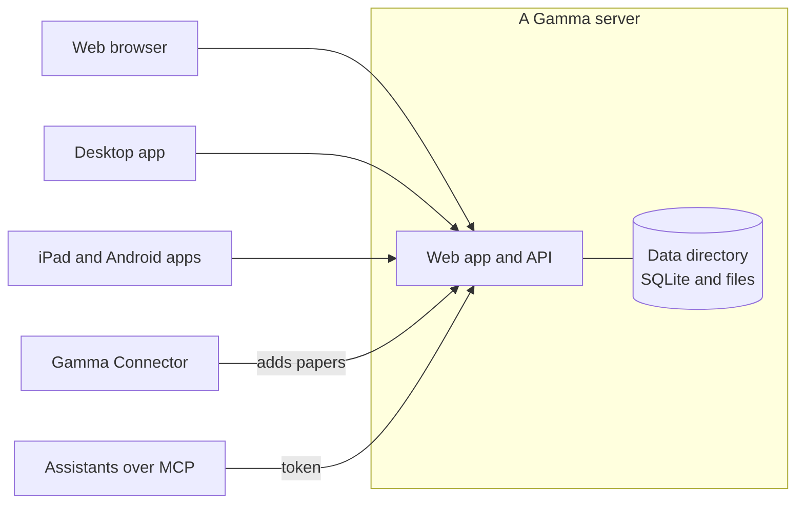
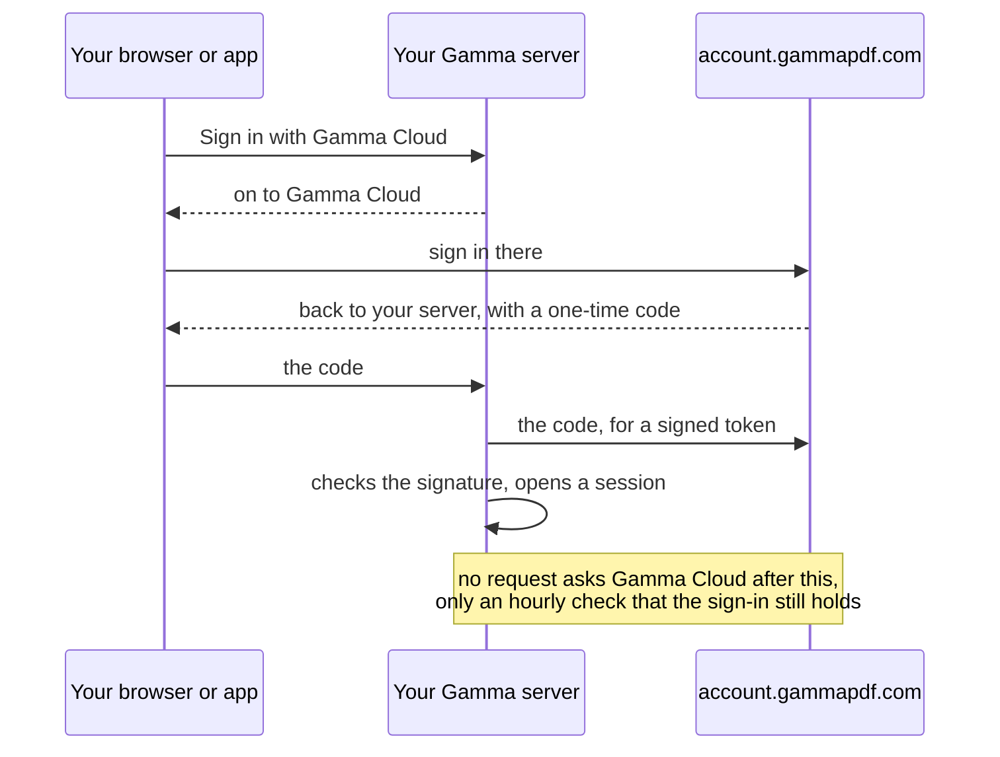
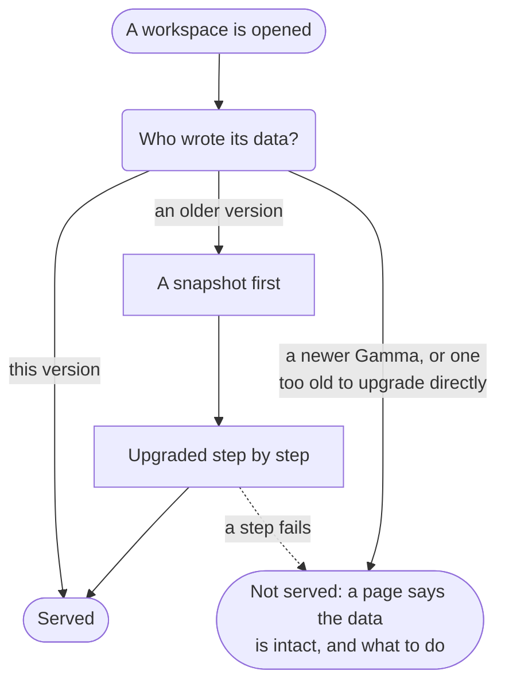

# Architecture

How Gamma is put together: one server and the apps around it, where your
data is kept, what Gamma Cloud adds, and what an upgrade promises. The
README's [install section](../../README.md#install) covers setting it up.

> [!NOTE]
> - **Your library lives on one server you choose.** Every app is a window
>   onto a server, and the desktop, iPad and Android apps carry one of
>   their own.
> - **It is plain SQLite and files** in one data directory, with no
>   telemetry.
> - **Gamma Cloud is optional**, and holds no notes and no files.
> - **An upgrade takes a snapshot first**, and refuses data it does not
>   understand rather than guess.

## One server, many windows

Gamma is a self-hosted app. One server, the same one in a Docker image, on
a NAS or inside an app, serves both the web app and its API. Every other
part is a window onto a server, or a small client of its API.



- **The desktop app** starts a server of its own on this computer, with its
  own data directory, and opens other servers by address: a NAS, a hosted
  Gamma. It adds what only a desktop can do: synced folders, files opened
  from disk, and agents running on this computer.
- **The iPad and Android apps** run the same server on the device, so they
  work with no connection. The native side is only a window, a pen layer
  for the stylus, sign-in and file hand-off, so each web feature reaches
  the tablets once rather than being built twice.
- **Gamma Connector**, the browser extension, finds the paper on a web page
  and hands it to your server. Where the server cannot fetch the PDF
  itself, the extension downloads it with your browser's sign-in.
- **Assistants** such as Codex and Claude Code connect over MCP with a
  token ([AI](ai.md#assistants-over-mcp)).

Servers are independent: nothing passes between two of them except what
you set up, such as an offline copy ([Sync](sync.md#offline-copies)). A
tablet syncs its copies only while the app is open, since iOS and Android
suspend apps in the background.

## Where your data is kept

Everything is SQLite databases and files under one data directory:

```text
data/
├── users.db                accounts, sessions, workspaces, members, share links
└── workspaces/<random id>/
    ├── pages.db            every block, the change log, AI chats, tabs and recents
    ├── data.db             what can be rebuilt: the search index, covers, translations
    └── uploads/            files, named by their content, so each is stored once
```

- **A workspace is the unit.** One process owns a workspace's files and
  the people editing it. A shared database server was declined: every
  deployment, the desktop app included, would have to run one. The limit
  accepted in its place is that one workspace cannot outgrow one process's
  writes.
- **A rename moves no file.** Accounts and workspaces are named by random
  ids, never by a name someone can change.
- **Paths on your computer stay on your computer.** The desktop app keeps
  its synced folders' paths outside every workspace, so no backup carries
  one to a server that could then read a file it should not.
- A PDF read where it lies on your disk is not copied in, counts toward no
  quota and is in no backup.

## Gamma Cloud

Gamma Cloud is optional: a Gamma server runs without it. It adds one
account for every server, and somewhere to keep a library online:

| Part | What it is |
|---|---|
| `account.gammapdf.com` | one account for every Gamma server: sign-in, plans, your settings profile. It holds no notes and no files |
| `app.gammapdf.com` | a shared Gamma server, where online libraries and published pages live |
| `<username>-user.gammapdf.com` | a Gamma server of your own, on the Pro plan |
| `<username>-pages.gammapdf.com` | your published pages |

**A Gamma Cloud sign-in is a sign-in to your server.** The server checks
the token itself and makes the same session a password would:



- **The server's administrator decides who gets in**: only accounts
  already linked, also new people, or only those invited. An existing
  account is linked to a cloud sign-in of the same username only where the
  administrator chose that; otherwise its owner links it with its
  password, since a name alone would hand the account to whoever holds
  that name in the cloud.
- **One address for everyone.** People are told `app.gammapdf.com`; at
  sign-in a Pro owner is sent on to their own server. Each server has a
  host name of its own, which also keeps one customer's pages apart from
  another's in the browser.
- The operator sees counts, sizes and recent log lines of a hosted server,
  never its content.

The plans are on [gammapdf.com/pricing](https://gammapdf.com/pricing).

## Upgrades

An upgrade either finishes with a snapshot behind it, or changes nothing
and tells you why:



- **A snapshot comes first.** An upgrade cut short resumes at the step that
  did not finish.
- **Refuse rather than guess.** The page shown in place of the app says
  what to do: update Gamma, or restore the snapshot taken before.
- **One workspace at a time.** Each is upgraded when it is first opened,
  and one that fails is refused while the others are served.
- An offline copy and its origin pause while their data formats differ,
  so two versions never write into each other.

## Privacy

There is no telemetry and no analytics, and your data stays in the data
directory you chose. Apart from a check for a newer release (which a
self-hosted server can turn off), Gamma makes a network request only for
something you use: fetching a paper, your AI provider, translation,
Zotero, a Gamma Cloud sign-in. The [privacy policy](../../PRIVACY.md) lists
each one, and what Gamma Cloud keeps.

## Running your own server

- **At the root of its own host name**, never under a path.
- **A token goes only to the address it was made for.** A request from one
  Gamma to another refuses a redirect, except a file download, which
  follows one without the token. Nothing a server says becomes an address
  or a trust decision without you.
- **Plain http** is refused for a new link to a public host (a synced
  folder, an offline copy). Addresses on your own network, Tailscale and
  `.local` names are allowed after you confirm once.
- **A NAS with a certificate it signed itself** can be trusted by its
  fingerprint in the desktop app; a renewed certificate asks again.
- **Moving a server** to a new address moves the links that point at it
  (synced folders, offline copies), after a dry run and your confirmation.

## Behind this page

- [Developer guide](../dev/README.md) and [Repository](../dev/repository.md).
- [Desktop](../dev/desktop.md), [iPad](../dev/ipad.md), [Android](../dev/android.md),
  [Extension](../dev/extension.md).
- [Storage and accounts](../dev/user_db.md), [Migrations](../dev/migrations.md).
- [Gamma Cloud](../dev/cloud.md), [Cloud accounts](../dev/cloud_accounts.md).
- [HTTPS for a NAS](../dev/https.md), [Network proxy](../dev/network_proxy.md).
- [Scaling on SQLite](../research/scaling.md), [iPad web shell](../research/ipad-web-shell.md).
