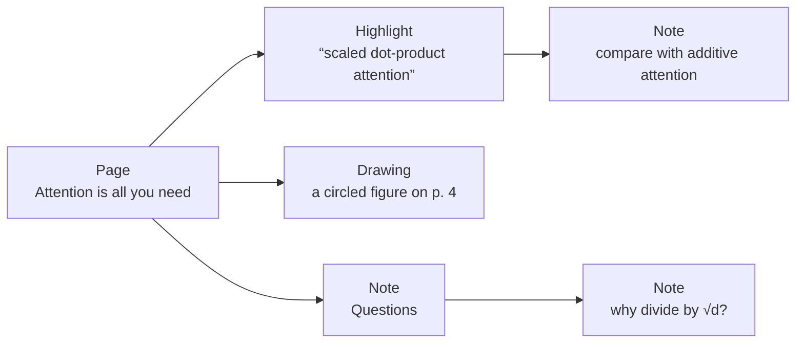

# Blocks and pages

What Gamma stores when you write, and why a page is the only container.
Everything you make in a workspace is a block: a note, a highlight, a
drawing, a sheet of paper, a page. The rest of Gamma (sharing, search, the
AI, sync, export) reads that one shape.

## Everything is a block

A block has an id, a parent, a place among its siblings, its text (in
Markdown) and a set of properties. Blocks nest, so a page and all that is
on it form one tree:



**What a block is follows from what it carries.** No block stores a type.
One that carries strokes is a drawing; one with a box on the page is a
text box; likewise a picture, a sheet of paper, a recording, a highlight.
A block that carries none of these is a note. So the note under a
highlight is simply its child, and moving, folding, linking and commenting
work the same on both.

This is the shape Notion, Logseq and Craft settled on. Properties are left
untyped on purpose, so two features never fight over a column.

## A page

A page is a block at the top of the library, and its title is the block's
text. Everything keys on the page's id: opening, sharing, exporting,
search, the AI's context, links, tabs, recents and chats. All of it works
on a page that holds nothing but text.

**There are no page types.** A page is not "a note" or "a paper". A card
describes it by what it carries: *PDF*, *Page*, or the kind of file it
shows (*LaTeX*, *Picture*). A page-type field was considered twice and
dropped both times: what a page carries already says what it is.

## The document, and files in notes

A page shows at most **one document** beside its notes. Any number of
other files can sit in its notes as **file chips**. The two are kept apart
on purpose:

| | A file chip | The document |
|---|---|---|
| How many | any number, in any note | one per page |
| What it is | content: download it, open it in a tab | what the page shows beside the notes |
| Comes from | a file dropped or pasted into the notes | the paperclip in the page header, or a file added to the library |

The document decides the viewer. A PDF opens in the reader, with
highlights, ink and translation; text and code in a read-only code view
whose lines you can mark; a picture in a view whose regions you can mark;
audio and video in a player; any other file as a card with Download. A
page without one shows its notes alone. The layout is the same for every
page: only whether a viewer appears differs.

- **One page per stored file.** Adding the same file to the library again
  opens the page it already has.
- **Dropping a file on an open page adds a chip.** Only the paperclip
  replaces a page's document.
- **A Markdown file becomes notes**, never a stored document: its headings
  and lists become blocks you edit.
- **Add to library** on a chip makes the file's own page, filed in the
  folder of the page it was dropped on, not inside that page. The same
  paper turns up under several projects and needs one identity with one
  set of highlights.

**The bibliographic record** (title, authors, year, DOI) belongs to the
page, not to its PDF, just as a Zotero item owns its attachment. So a page
can carry the record of a paper you only cite.

## Pages inside pages

A page can sit inside another page, as in Notion. A **sub-page** is an
ordinary page that names the page it is inside, with its own notes,
document, chat, share link and place in Recently deleted. Only where it is
listed changes:

```text
Thesis                       folders: Writing          labels: draft
└── Chapter 2                (filed with Thesis)       labels: review
    └── Figures              (filed with Thesis)       labels: —
```

- **Filed where its top page is.** A sub-page has no folders of its own.
  Labels stay its own, since a label is a tag, not a place.
- **It goes where its page goes.** Deleting a page takes the pages inside
  it to Recently deleted as one entry, and restoring brings them back.
- **Reached** by its `[[link]]`, by the list of pages inside under its
  parent's notes, by the path above its title, and by Quick open, where it
  reads "Thesis › Chapter 2".
- **`/page` makes one** and links it where you typed. Deleting the link
  leaves the page in place.

A sub-page is a page that names its parent, not a zoom into a block's
children as in Logseq, so everything keyed on a page keeps working on it.

## Notebooks

A notebook is a page with sheets of paper. A sheet is a block with a paper
(size, orientation, pattern, background), and drawings, text boxes and
pictures belong to the nearest sheet above them. Because sheets are blocks
and not a page count, two devices that each add a page while offline both
keep it. Whether a page shows as a notebook or as notes is each reader's
own choice.

## Notes are Markdown

A note's text is plain Markdown, so it stays readable in Obsidian, on
GitHub and in any export:

- `- ` makes a bullet. A paragraph can have children, and a folded one is
  a toggle.
- A quote is `>` on every line; a callout is `> [!note] Title`.
- Math is `$…$` and `$$…$$`; a diagram is a fenced `mermaid` or `svg` block.
- Dates, people and page links are readable text (`@2026-10-09`, `@alice`,
  `[[page]]`), which the app draws as chips.

## Who made a block

A block made by Gamma's AI, by an assistant over MCP or by an agent on your
computer says so (*Highlighted by Codex on TIM-PC, for tim*), and no app
can forge the mark. It still belongs to the account it acted for, so
permissions and notifications read the account. Undo keeps the mark;
Duplicate drops it, because the copy is yours.

Every block's properties can be read in its **Properties** popover. You
change one through the thing it belongs to: a highlight's menu, the
record's ⓘ popover, the paperclip.

## Behind this page

- [Block-centric design](../dev/block_centric.md): the target model and
  how the code got there.
- [Documents](../dev/documents.md): the formats, the stored shape and the
  viewers.
- [Home library](../dev/home_library.md#sub-pages) and
  [Sub-pages](../research/sub-pages.md): the sub-page rules and the shapes
  weighed.
- [Notebooks](../dev/notebooks.md), [Mentions and reminders](../dev/mentions.md).
- [Data model survey](../research/data-model.md) and
  [Block properties](../research/block-properties.md).
