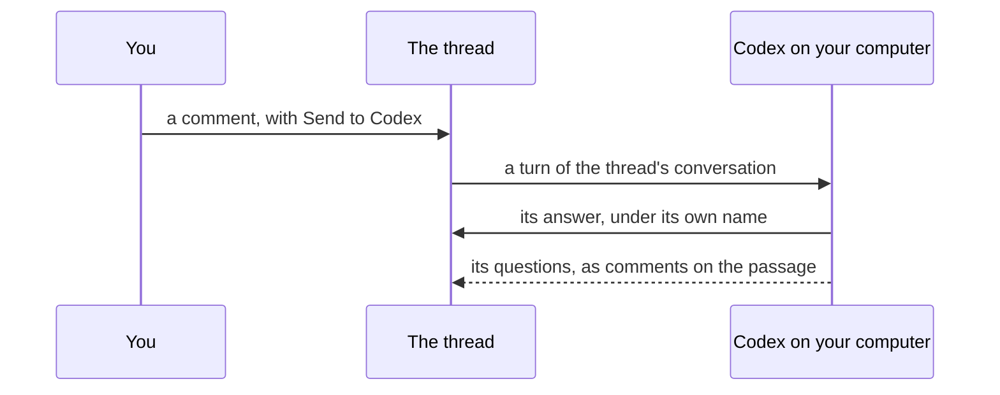

# Comments and the inbox

How discussion is kept apart from the notes, who hears about what, and why
a comment is also how you give work to an agent. The user guide's
[Comments and inbox](../user_guide/user_guide.md#comments-and-inbox) shows
how to use them.

## A thread hangs on one thing

A comment thread hangs on one block: a note, a highlight, a drawing, a
region of a picture, a range of lines in a text file, or the page itself
for a remark on the whole file. A thread is open or resolved, can be
reopened, and takes replies.

> [!IMPORTANT]
> **Comments live beside the notes, never inside them.** A comment changes
> no note and does not move the page's "modified" time. So everything that
> reads notes (exports, search, the AI's context, sync, undo) works the
> same whether a page has comments or not.

- A thread follows its block when the block moves to another page.
- When its block is deleted, the thread is hidden, and comes back if the
  delete is undone. Seven days later it is deleted for good.
- A drawing with a thread on it takes no more strokes, so the thread keeps
  talking about what it was opened on.

## Who may comment

| | Comment | Delete a comment |
|---|---|---|
| Owner of the workspace | yes | anyone's |
| Editors and viewers | yes | their own |
| Signed-in people a share link admits | yes | their own |
| Visitors of a link without an account, or with a guest account | no | — |

Viewers may comment because a comment changes no one's notes: it is
signed, and its author can delete it. A comment written by an agent
belongs to the account it acted for and names the agent beside it.

## Mentions and reminders

Typing `@` in a note offers dates, people and pages, stored as readable
text (`@2026-10-09`, `@alice`, `[[page]]`) that the app draws as chips
([Blocks and pages](blocks.md#notes-are-markdown)).

- **A name becomes a person** only when a member of the workspace has that
  username. The cost of naming people by username is that renaming an
  account leaves its old mentions as plain text.
- **A reminder's time has no time zone**: your browser decides when it is
  due. A due reminder shows as a card in the corner of any Gamma window,
  and dismissing it holds in every browser.

## The inbox

Each account has one Inbox across all its workspaces and shares. It
collects a mention of you, a reply in a thread you are in, a comment on a
page you follow, your thread resolved by someone else, and an invitation
or a request to join.

**You follow the pages you make, edit or comment on**, each set to all
comments or only replies and mentions. The owner of a personal workspace
follows every page in it.

Three rules keep the Inbox quiet:

1. **A comment reaches you once**: as a mention if it names you, else as a
   reply, else as a comment on a page you follow.
2. **You never hear about what you wrote yourself**, but you do hear about
   what your agent wrote.
3. **An item that no longer leads anywhere is archived on its own**: the
   note no longer names you, the page is gone, the share stopped.

There is no e-mail and no mobile push. A browser can ring a system
notification for a new item while a Gamma tab is open (Settings →
Appearance, off by default).

## Comments as work for an agent

Gamma has no separate place for feedback to an agent. A thread already is
a request about a passage, so an agent on your computer, or an assistant
connected over MCP, reads open threads and highlights as its to-do list.

- Tick *Send to Codex* (or type `@codex`) under a comment, and it becomes
  a turn of that thread's conversation with the agent. A thread sent is
  always answered: if the agent wrote nothing, Gamma posts its last
  message, or says it finished without a reply.
- **Only your own comment, typed in Gamma, starts a turn**: never one that
  came through a share, a token or the agent itself.
- **Other people's comments reach the agent as quoted data**, not as
  instructions. That lowers the risk of a comment steering the agent,
  without removing it.
- While a thread on a file read from your disk is open, Gamma keeps the
  version of the PDF or picture it was opened on, so the comment still
  points at the right place after a rebuild.

More on agents is on the [AI](ai.md#agents-on-your-computer) page.

## What comments do not reach

Comments do not travel with sync: an offline copy, a published page and a
Zotero link carry none, and each server keeps its own threads. A Gamma
export, a backup and *Add to my library* copy the threads with their
pages. The other exports leave them out, but the annotated PDF can print
open threads as cards beside the page.

## Behind this page

- [Comments](../dev/comments.md): threads, the lifecycle, the inbox and
  following as built.
- [Mentions and reminders](../dev/mentions.md), [Annotations](../dev/annotations.md).
- [Agents as participants](../research/agents-as-participants.md) and
  [Comments inbox](../research/comments-inbox.md).
