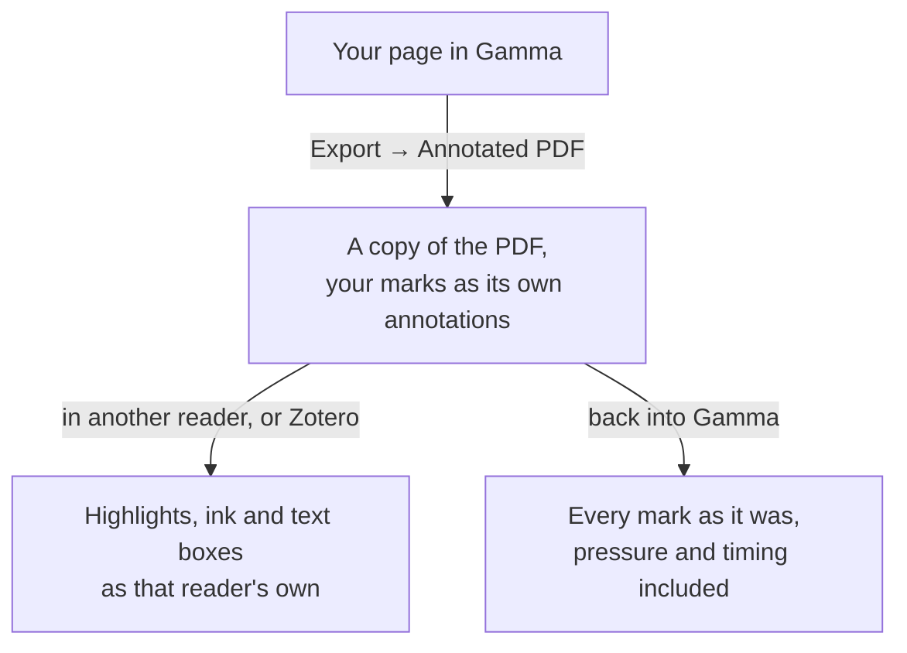

# Formats and portability

What leaves Gamma in which shape, what comes back intact, and how long
work such as an export or an import is kept from getting in your way. The
user guide's [Import and export](../user_guide/user_guide.md#import-and-export)
lists every format and how to use it.

## Your notes stay readable without Gamma

Notes are stored as Markdown ([Blocks and pages](blocks.md#notes-are-markdown)):
math in dollars, diagrams as fenced blocks, mentions and links as readable
text. Files are stored as you added them, except that annotations another
app wrote into a PDF become Gamma's own marks
([Reading](reading.md#your-marks-live-beside-the-pdf)). So a page exported
to Markdown reads well anywhere, and a synced folder's notes open in
Obsidian or any editor as they are.

## What comes back intact

Each way out keeps as much as the other side can hold. Gamma's own export
keeps the most.

| Route | What survives | What does not |
|---|---|---|
| Gamma export, imported into a Gamma | pages, notes, chats and files, with their ids; importing it again adds nothing | a page's or a folder's export leaves out kept translations |
| Annotated PDF, opened again in Gamma | highlights in their style, ink with its pressure and timing, text boxes, pictures | recordings |
| Annotated PDF, in another reader | the PDF's own highlight, underline, squiggly, strikeout, ink, text and stamp annotations | pressure (ink is drawn at one width), Gamma's own fields |
| Obsidian vault | notes, folders as directories, labels as tags | on the way back, text after a heading nests under it, and highlights come back as quotes |
| Notion zip | notes and their pictures, for Notion's importer | PDFs and recordings; importing it again makes the pages twice, since Notion keeps no ids |
| Notability note | the PDF or the sheets, handwriting with pressure and tilt, text boxes, pictures, typed notes, .m4a recordings | highlights, recordings in other formats |
| GoodNotes notebook | the PDF or the sheets, highlights as highlighter strokes, handwriting, text boxes, pictures | pressure (GoodNotes' pen has one width), the notes, recordings |
| Zotero RDF | the library as Zotero's import reads it, the exact inverse of Gamma's Zotero import | annotations, which are drawn into the exported PDFs; chats and comments |

- **Every import says what it left out.** Its last step lists the pages it
  skipped and what each one lost, rather than dropping anything quietly.
- **An export holds to what you may see.** An export made through a share
  link contains only the shared pages.

## The annotated PDF

*Export → Annotated PDF* writes a copy of the original PDF with your marks
as the PDF's own annotations, so any PDF reader shows them and Zotero can
read them. The original stored in Gamma is never changed.

- **Each mark becomes its PDF kind**: highlights become highlight,
  underline, squiggly or strikeout marks, area highlights squares, ink ink,
  text boxes free text, and pictures stamps.
- **Notes and comments can come along.** Notes print as cards in a
  widened column beside each page or in the page's own free space, open
  comment threads as cards beside the page. A shown translation is written
  into the copy.
- **Gamma also writes keys of its own** that other readers ignore, so
  importing the PDF into Gamma again brings back pressure, timing and
  colours exactly.

Highlights, drawings, typed notes and stamps made in other PDF apps are
imported when a paper is added, and an image stamp becomes a picture.

## Long work: background tasks

Some work takes minutes: importing a library, exporting a folder, taking
a snapshot. It runs as a task you can watch, not as one long request,
since a request that goes quiet for long is cut off by proxies on the way
and would show you an error for work that succeeded.

| | Runs on the server | Runs in this tab |
|---|---|---|
| Examples | imports and exports, snapshots and restores, looking up many papers' records | a PDF loading, uploads, translating a page, handwriting sent to the AI, changes to many pages at once |
| Outlives the tab | yes, and shows on every device | no: closing the tab stops it |
| Shown | in Background tasks, with progress and Stop | the same list, with Stop |

A stop is honoured up to the point where stopping would leave things half
done. A server restart marks a running task as interrupted, rather than
pretending it finished.

## Behind this page

- [Import and export](../dev/import_export.md): every format's pipeline.
- [PDF typesetting](../dev/pdf_typesetting.md): the annotated PDF and the
  notes as PDF.
- [Background tasks](../dev/tasks.md) and [Long operations](../research/long-operations.md).
- [Obsidian](../research/obsidian.md), [Notion round trip](../research/notion-roundtrip.md),
  [Notability format](../research/notability-format.md).
