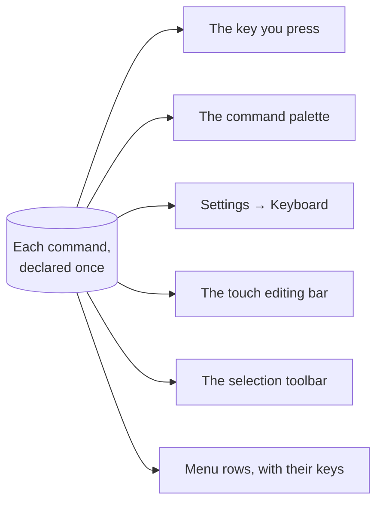

# Interaction

How Gamma behaves under a mouse, a finger, a pen and a keyboard, and the
rules that make it behave the same way everywhere. How it looks is on
[Look and feel](look.md).

## One app on every device

The desktop app, the iPad and Android apps and a browser all run the same
web app. Every interaction a mouse has works under a finger through the
same code, with the same controls at the same sizes. There is no separate
touch version of a feature, and a problem found on one device is fixed
once, in the shared code.

| With a mouse | With a finger |
|---|---|
| right-click | hold still for half a second |
| double-click | double tap |
| hover shows a row's "⋯" and a note's handle | they are always shown |

- **Every row and card has a "⋯" button**, the visible way into the menu
  a right-click or a held finger opens.
- **A control hidden until hover takes no taps while hidden**, so a stray
  tap never lands on something invisible.
- **A held finger opens Gamma's menu only**, never the system's callout
  for a link or a picture, and the lift that follows does not also open
  what was underneath.

The pen has a rule of its own, *a stylus does what is armed*
([Reading and marking](reading.md#pen-finger-and-mouse)).

## Menus and popups

- **A menu opens where it stays.** It never appears on one side of its
  button and then jumps to the other. Near the window's edge it opens on
  the button's far side, rather than over the button, where a second press
  would land on a row.
- **One kind of menu everywhere**: an icon column, a label, and the row's
  shortcut where it has one. Destructive rows are red. There is no system
  drop-down list anywhere.
- **Picking one thing from a long list** is always the same window: a
  field at the top, the matches in sections under it, ↑ ↓ to move, Enter
  to take, Esc to close. Quick Open (Ctrl+P), the command palette and every
  page picker work this way.

## Dialogs

- **Escape closes a dialog**, and so does a press on the dimmed backdrop,
  but only when the press both starts and ends there, so selecting text
  with a drag that ends outside does not close it.
- **A dialog holding work asks before it closes**: an edited draft, an
  import in progress. The footer's Cancel stays direct: it is the labelled
  way to stop.
- **A failure is said where it happened**, in one line above the button
  that caused it, with *Try again* where that helps. A success goes to the
  status pill, never into the form.

## The keyboard

**Every command is declared once**, with its name, its default keys and
when it applies, and everything that offers a command reads that one list:

So a key, a palette entry, a toolbar button and a menu row can never
disagree, and a key you rebind changes everywhere at once, on every device
you sign in on.

- **Default keys are few on purpose**: the ones every editor shares
  (search, Quick Open, undo and redo, the formatting marks) and a handful
  more. Everything else starts unbound and is reached from the command
  palette (Ctrl+Shift+P) until you give it keys.
- **A command that edits is never offered on a page you may only read.**
- **Notes take their commands from familiar editors**: VS Code's line
  commands (move, duplicate, delete line), with the note as the line, and
  Obsidian's formatting keys.

The user guide's [cheat sheet](../user_guide/user_guide.md#shortcut-cheat-sheet)
is checked against the catalog, so it lists every default key.

## The note editor

- **Markdown renders as you type.** Clicking rendered text opens the
  editor with the caret on the character you clicked, and keeps that line
  under the pointer.
- **Each note has a gutter**, as in Notion: *+* to add a note below, and a
  handle to drag it or open its menu.
- **Typing `/`, `[[` or `@`** opens a menu at the caret: commands, page
  links, and dates and people. These menus appear at once, so typing never
  waits on them.
- **Plain text is a paragraph**, with no dot and no label. Only a block
  that is something else (a highlight, a drawing, a list item) shows a
  marker.

## Where a setting lives

Each setting belongs either to your account or to this device:

| Follows your account, on every device | Stays with this device |
|---|---|
| theme, language, colours and highlighters | interface size |
| keyboard shortcuts, toolbar order, pen presets and handwriting habits | whether fingers draw, pressure, the eraser's kind and size |
| reading and editing, translation, AI behaviour | notification permission |

A new setting belongs to the account unless it only makes sense on this
device or names something that exists only on this server. Your AI keys
stay on the server they were added to.

## Your language

The interface is in English or Chinese, every visible string of the web
app included, and a setting can be found by its English name in either
language. What you write, the AI's replies and the translated PDF have
their own language settings. LaTeX commands, shell commands you copy and
templates inserted into your notes stay in English on purpose.

## Learning the app

A new account starts with a Welcome page to practise on and a Sketchbook
notebook. Tours in the account menu walk through each part on the real
controls, and many offer themselves once, when the part they explain first
matters: the library tour once the library has grown, for example.

## Behind this page

- [UI design conventions](../dev/ui-design.md): the shared controls, one
  behaviour for mouse and finger, menus, dialogs and the note editor.
- [Keyboard shortcuts](../dev/hotkeys.md): the command catalog.
- [Settings](../dev/settings.md): where each preference is stored.
- [Interface language](../dev/i18n.md), [Onboarding](../dev/onboarding.md).
