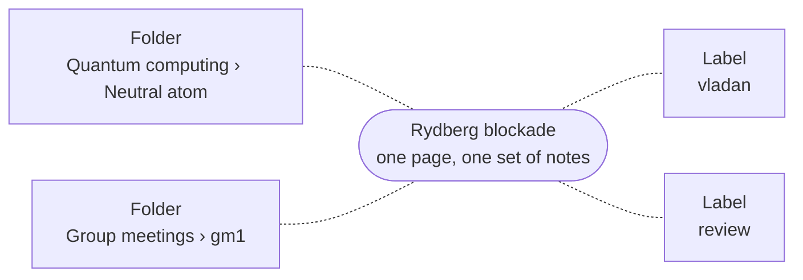
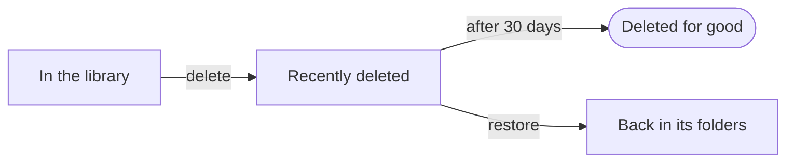

# The library

How pages are organized: folders and labels, pages inside pages, pins,
recents and Recently deleted. How to use each is in the user guide's
[Library](../user_guide/user_guide.md#library); this page is the model
behind it.

## Folders and labels

A page can be filed in several folders and carry several labels, and it is
still one page, with one set of notes and highlights wherever it is opened
from:

- **Folders nest; labels are flat.** A folder is for a topic or something
  you are preparing, a label for a word you will search for: a method, an
  author, a lab.
- **Filing never copies.** A page in no folder sits at the library's root.
- **Filing into a subfolder moves the page down.** A page filed in
  *Quantum computing* and then in *Neutral atom*, below it, ends up in
  *Neutral atom* only, not at both levels. (Zotero keeps it in both.)
- **"In a folder" means in it or anywhere below it.** One rule serves a
  folder's view, its share link, its export, a search limited to it and
  its AI chat.
- **Deleting a folder keeps its pages**, in their other folders or at the
  root, unless you choose to delete them too. Its AI chats move into the
  library chat's history. Deleting a label takes it off every page.

Each folder and label is a block of its own, which pages point at by id.
So a rename is one change that touches no page, an empty folder exists for
everyone, and a share or a chat survives its folder being renamed. (They
used to be text paths written on each page, and a rename rewrote every
page.)

## Pages inside pages

A page inside another page ([Blocks and pages](blocks.md#pages-inside-pages))
is filed with its top page. The library's lists and folder counts show
library pages only, and a page with pages inside it says "N pages inside".
Dropping a sub-page on a folder is refused; *Move to library* takes it out,
into its former top page's folders. Labels stay each page's own, so a
label's list includes the sub-pages that carry it.

## Files from a folder on your computer

A **synced folder** in the desktop app can keep a directory on your
computer, such as a LaTeX project or a repository, as a folder of the
library. Each file you choose to track is a page at its path, in whatever
format it is, and differs from a library page in a few ways:

| | A library page | A file of a synced folder |
|---|---|---|
| Listed in | the library, recents, label counts | its folder only; found by opening it, by search or by Quick open |
| Filed in | any folders you like | exactly one: its directory's |
| Named by | its title | its file name |
| Renamed or moved by | you, in Gamma | the disk (notes can also be renamed and moved in Gamma) |
| Goes away when | you delete it | the file is deleted or no longer tracked |

You can still label, pin, annotate and comment on any file. *Add to
library* makes a file a paper of the library while it stays at its path;
*Save a copy to library* keeps a frozen copy of a PDF, such as the version
you submitted. How the files and Gamma stay in step is on
[Sync and offline](sync.md#a-folder-on-your-computer).

## Pinned and recent

- **Pins belong to the workspace.** Every member sees the pinned pages and
  folders, newest pin first.
- **Recents belong to you**: the pages you last opened in each workspace,
  the same on every device. Removing one removes it everywhere. The list
  syncs as a whole, last write winning, because merging two lists would
  bring back an entry you had removed.

## Sorting and filtering

- **A sort belongs to its view.** A folder without a sort of its own takes
  its nearest parent's. Custom order is the folders' own order, the same
  for every member.
- **A label opened inside a folder keeps the folder**: it is that folder
  narrowed to the label.
- **The filter box never hides anything.** Matches rise to the top and the
  rest dims. It reads titles and folder and label names; the search
  (Ctrl+Shift+F) reads notes and the text of files too.

## Recently deleted

- **For 30 days a deleted page is no page at all.** Search, links, shares
  and the AI pass it by; a link to it shows its title struck through, with
  *Restore*. Its files still count toward storage until it is gone.
- **The pages inside it go with it**, as one entry, and come back with it.
- **Restore** puts a page back in the folders it was in. A folder deleted
  meanwhile is skipped. A sub-page deleted on its own comes back inside its
  page if that page still exists, else at the root.
- The AI can move pages to Recently deleted and restore them when you ask,
  but never deletes a page for good.

## Who may organize

| | Browse | Organize (file, rename, move, delete, restore) |
|---|---|---|
| Owner and editors of the workspace | everything | yes |
| Viewers of the workspace | everything | no |
| Visitors of a shared folder | that folder | no |
| Visitors of a shared page | no library | no; an edit link can make pages inside the shared page |

An edit link never changes a page's own place: it cannot refile a page,
move it into or out of another page, or replace its document. A folder's
AI chat can rename folders and make and apply labels, and asks before
deleting a folder or a label.

## Behind this page

- [Home library](../dev/home_library.md): folders and labels, sub-pages,
  the listing, pins, recents and Recently deleted as built.
- [Work folders](../dev/work_folders.md): the library rule and what Gamma
  may change in a synced folder.
- [Any file as a page](../research/file-explorer.md): the shapes weighed
  for files on disk.
