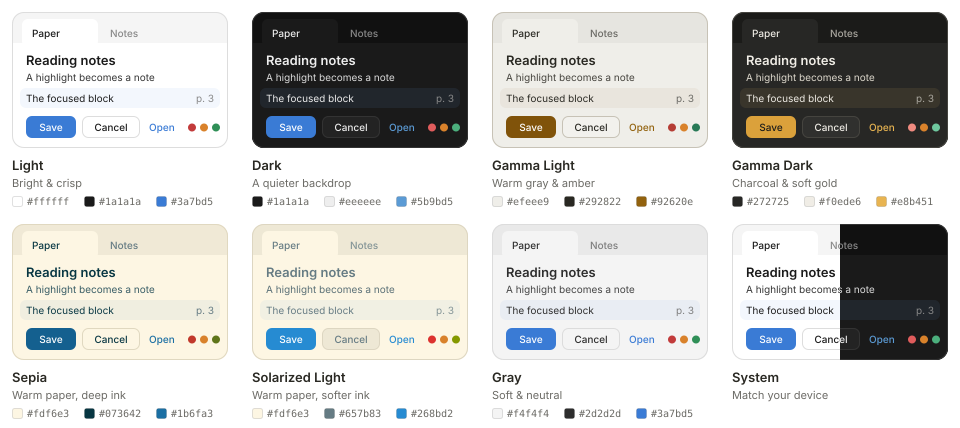
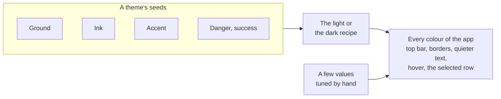
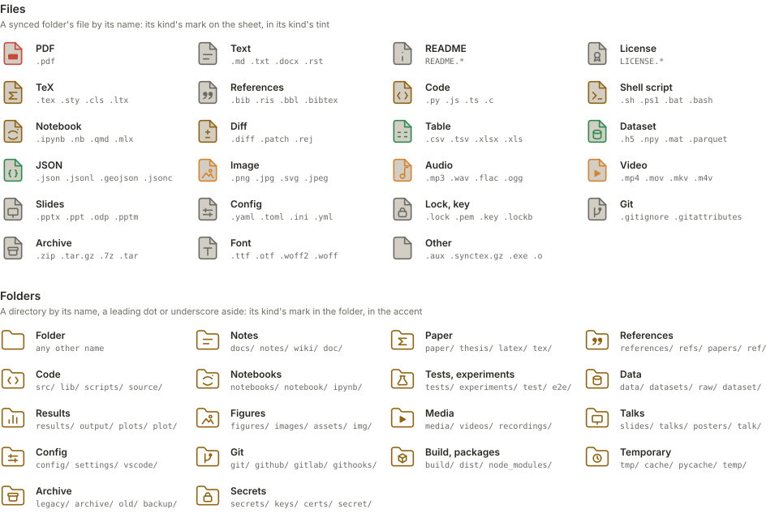

# Look and feel

How Gamma looks, and the few rules that keep every window, menu and dialog
looking like one app. The pictures on this page are drawn from the app's
own colour values, so they show what the app shows. The values themselves,
sizes and timings included, are in the developer guide's
[UI design conventions](../dev/ui-design.md#tokens).

## Themes

You pick a theme in Settings → Appearance; System follows the device
between Light and Dark. The theme belongs to your account, so every
browser you sign in on draws in it from the app's first screen.

**A theme starts from a handful of colours, its seeds**, and every other
colour is mixed from them:

The light recipe steps each surface from the ground toward the ink; the
dark one takes the chrome and the wells toward black and raised surfaces
toward the ink. A new theme can be its seeds and nothing else, and every
part of the app follows it, the desktop app's own bar included. Amber
always marks warnings and conflicts, and the dimming behind a dialog is
plain black in every theme.

**Contrast can only get better.** A check measures text contrast in every
theme for the pairs that matter: text on the page and on the top bar,
quieter text, links in the accent, the label on the main button. The pairs
still below WCAG AA are recorded, and a change may raise any ratio but
lower none.

**The page you read keeps its print.** In Light and Dark a PDF page is
shown as printed. Gamma Light multiplies the page onto its paper, so white
paper takes the tint and the print keeps its colour; Gray, Sepia and
Solarized Light also soften the print a little. Gamma Dark turns the page
over onto its charcoal, and *Flip page colors* turns the page dark in any
theme.

## Surfaces

Each region of the window paints one surface role, so the notes, the chat
and the library read as one app inside one frame:

| Role | Where |
|---|---|
| Chrome | the top bar and its tabs, the Settings rail, collapsed side bars |
| Content | the library, the notes, every docked window, dialogs |
| Quiet fill | a hovered row, code, a table head, a chat bubble |
| Selected | the focused note: a faint tint of the accent over the content |
| Floating | menus, popovers and tips, lifted by a shadow |
| Field | a text field that must stand out on the content, such as the chat's composer |

The active tab is cut out of the chrome: it is the page's own surface and
runs straight into the page under it. "Floating" means lifted, not
lighter: in a light theme a menu is the same white as the page and its
shadow sets it apart, so a control that must stand out on the content
carries a border.

## Type and size

- **One face for the interface**: Inter, shipped with the app, so no font
  is fetched from a third party and it works offline. Chinese, Japanese and
  Korean fall back to the system's faces. One monospace face serves code,
  math source, key caps and paths.
- **A small scale of sizes, each with a job**, from captions and key caps
  up to the page title, and nothing smaller than 11 px.
- **Weights say what a thing is**: 400 for text, 500 for controls, 600 for
  headings, labels and what is active. 700 is only **bold** in your notes.
- **Labels keep their own case.** Section names are in sentence case and
  never set in capitals.
- **Numbers that change keep their width**, so counts and times do not
  jiggle as they tick.
- **Interface size** (Settings → Appearance) scales text and controls
  together; a PDF keeps its own zoom. Ctrl (⌘ on a Mac) and scroll over the
  notes or the chat sizes their text for the session.
- **One size set for mouse and finger.** A touch screen does not get bigger
  buttons. A thin target such as a resize grip gets a larger area to hit,
  not a larger look.

## Shape, depth and icons

- **Corners grow rounder as a thing grows**: tags, then rows and chips,
  then buttons and menus, then cards and dialogs, and pills fully round.
- **Depth has three steps**: raised controls, what floats (menus, popovers,
  tips), and dialogs.
- **Icons are one stroke set**, drawn the same weight at every size, so a
  small icon and a large one side by side look equally heavy. A close
  button is always the round × icon.
- **File icons are drawn in the same set.** A file is the library's sheet
  and a directory the library's folder, each with a small mark for its
  kind; one mark serves both, so a `.py` file and a `src/` folder carry the
  same code brackets. A file takes one of a few kind colours (red for
  PDFs, the accent for code and TeX, green for tables and data, amber for
  pictures and recordings); folders are all in the accent. Gamma draws these
  itself, since a code editor's filled, brand-coloured logos would be the
  one foreign set in the app.

## Buttons

One hierarchy, the same on every surface:

| Button | Look | For |
|---|---|---|
| Primary | solid accent | the one main action of a surface: Save, Copy link, Invite, Log in |
| Secondary | framed, on the raised surface | every other action |
| Ghost | no frame until hovered | a toolbar's text button, a quiet extra |
| Danger | outlined in red | a destructive action beside others: Delete…, Leave…, Stop sharing |
| Danger, primary | solid red | the click that confirms a destructive action |

A button whose Alt+click does something else shows that other action while
Alt is held over it, so you see the outcome before you click.

## Motion

Motion says where a thing comes from and where it goes. It never decorates
and never makes you wait.

- **Coming is slower than going.** A menu or a dialog arrives a little
  more slowly than it leaves; hover and press are the quickest.
- **Things grow from where they open**: a menu from the point or button it
  opens from, a dialog from its middle, each first seen where it stays
  ([Interaction](interaction.md#menus-and-popups)).
- **Only a badge or a switch overshoots**, once. Nothing else bounces.
- **A theme changes in one frame**, every colour together.
- **Reduced motion** (the system setting) ends every animation at once.
  Spinners keep turning slowly, so a wait never looks like a hang.

## Colours you draw with

Highlights, highlighter strokes, pens and text boxes draw from one
palette, which you edit in Settings → Appearance › Colors: named groups of
colours, each colour with its own transparency. Each place that offers
colours shows one group of your choice.

> [!IMPORTANT]
> **A stored colour is the colour itself, not a slot.** A highlight keeps
> the colour it was made in; Gamma never stores "palette colour 2" to look
> up later. A slot would show each member of a shared workspace their own
> palette's colour, make every export and assistant need your palette, and
> let one edited swatch silently recolour years of highlights. The cost is
> that a changed swatch affects only what you make from then on.

- **A light colour is drawn as a line in a deeper tone**, so an underline
  in pale yellow does not vanish.
- **A dark page gets its own version of each colour.** A pastel wash on a
  near-black page becomes a mid-tone the text cannot be read on, so on a
  flipped page the same hue is drawn saturated, mostly transparent. It is
  computed, so colours imported from other apps get the same treatment.
- **Colours have names**: a swatch reads "Pink" or "Sky blue", from the
  nearest of a fixed set of reference colours.

## The brand

The mark is a capital gamma in warm off-white on a dark plate, held
between two amber arcs, with the two branches of a standing wave crossing
behind it. One SVG file is the only editable copy, and every icon is
generated from it: the desktop app, the iPad and Android launchers, the
browser extension, the assistant plugins and the store artwork. The logo
sets "Gamma" in bold beside "PDF" in amber, in Inter.

The brand's colours are not the app's theme colours. Gamma Light and
Gamma Dark carry the brand's warm paper, charcoal and amber into the app;
the other themes keep their own accents.

## Behind this page

- [UI design conventions](../dev/ui-design.md): the tokens, the shared
  controls, the motion recipes and the checks that hold them; how a file
  icon's mark is drawn and a new kind added
  ([File icons](../dev/ui-design.md#file-icons)).
- [Settings](../dev/settings.md): where each preference is stored, and the
  text highlighters.
- [One colour palette](../research/color-palette.md): what came before the
  palette and why it stores concrete colours.
- [Brand sources](../../design/brand/README.md): the mark, the logo and how
  every icon is generated.
