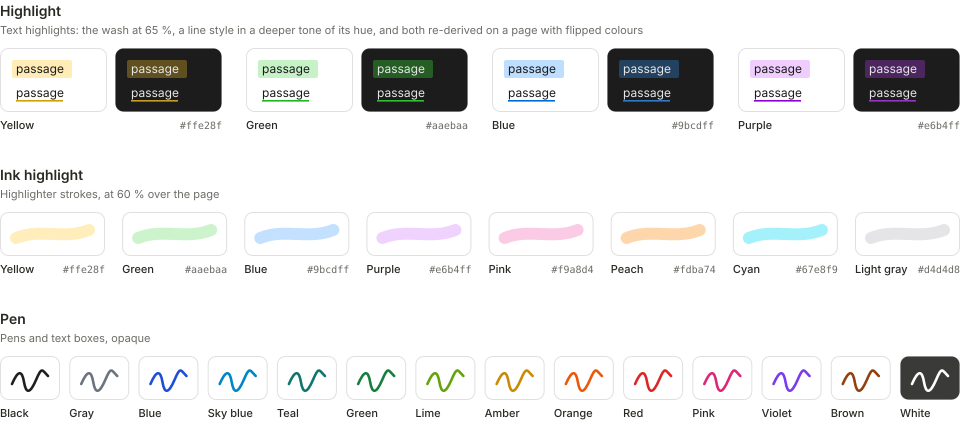

# Look and feel

How Gamma looks, and the few rules that keep every window, menu and dialog
looking like one app. The two pictures on this page are drawn from the app's
own colour values by `frontend/tools/designSheets.mjs`, and a test fails
when they fall behind, so they show what the app shows.

## Themes

Gamma has seven themes, plus System, which follows the device between Light
and Dark. You pick one in Settings → Appearance. The theme belongs to your
account, so every browser you sign in on draws in it from the app's first
screen.

**A theme starts from a handful of colours**, its seeds:

- the ground, the surface you read on;
- the ink, the body text;
- the accent;
- the colours for danger and for success.

Every other colour is mixed from those seeds by one of two recipes, one for
light themes and one for dark: the top bar, borders, quieter text, hover and
the selected row. The light recipe steps each surface from the ground
toward the ink. The dark one takes the chrome and the wells toward black and
raised surfaces toward the ink. Each theme also lists by hand the few
values where the recipe would visibly differ from the colours it was tuned
to. A new theme can be its seeds and nothing else,
and every part of the app follows it, including the desktop app's own bar. The browser extension cannot know your account's theme, so
it follows the system's light or dark.

A few colours are the same in every theme. Amber marks warnings and
conflicts, and the dimming behind a dialog or a zoomed picture is plain
black at a fixed strength.

**Contrast can only get better.** A check measures text contrast in every
theme for the pairs that matter: text on the page and on the top bar,
quieter text, links in the accent, the label on the main button. Some pairs
are still below WCAG AA: quieter text in most themes, the accent in Light
and Gray, and Solarized Light's soft body text. Those are recorded, and a
change may raise any ratio but lower none.

**The page you read keeps its print.** In Light and Dark a PDF page is shown
as printed. In Gamma Light the page is multiplied onto the theme's paper,
so white paper takes the tint and the print keeps its colour. Gray, Sepia
and Solarized Light do the same with the print softened a little, so black
ink reads as a warm charcoal. Gamma Dark turns the page over onto its
charcoal.
*Flip page colors* (Settings → Appearance) turns the page dark in any theme.

## Surfaces

Each region of the window paints one surface role, so the notes, the chat
and the library read as one app inside one frame:

| Role | Where |
|---|---|
| Chrome | the top bar and its tabs, the Settings rail, collapsed side bars |
| Content | the library, the notes, every docked window (notes, chat, comments, files), dialogs |
| Quiet fill | a hovered row, code, a table head, a chat bubble |
| Selected | the focused note: the accent at 6 % over the content (11 % in a dark theme) |
| Floating | menus, popovers and tips, lifted by a shadow |
| Field | a text field that must stand out on the content, such as the chat's composer |

The active tab is cut out of the chrome: it is the page's own surface and
runs straight into the page under it. "Floating" means "lifted", not
"lighter": in a light theme a menu is the same white as the page, and its
shadow sets it apart. So a control that must stand out on the content
(a card, a field, a secondary button) carries a border.

## Type

- **One face for the interface**: Inter, shipped with the app. No font
  is fetched from a third party, so it works offline and in the desktop
  app. Chinese, Japanese and Korean text falls back to the system's faces.
- **One monospace face** for code, math source, key caps and folder paths.
- **One page face** for the translated PDF page: a serif with lining
  figures (Times New Roman first), so digits read as digits beside the
  formulas cropped from the page, then the serif faces of Chinese, Japanese
  and Korean.
- **Eight sizes, each with a job.** Nothing is smaller than 11 px.

  | Size | Job |
  |---|---|
  | 11 px | captions, badges, key caps |
  | 12 px | hints, section labels, tabs, small buttons |
  | 13 px | the default: buttons, menus, dialog fields |
  | 14 px | list rows, text fields, chat messages |
  | 15 px | the notes' reading text |
  | 17 px | pane and section titles |
  | 20 px | the page title |
  | 24 px | the largest headings |

- **Weights**: 400 for text, 500 for controls, 600 for headings, labels and
  what is active. 700 is only **bold** in your notes.
- **Labels keep their own case.** Section names are in sentence case and
  never set in capitals, so only acronyms ("PDF") are capitals.
- **Numbers that change keep their width.** Counts, times and page numbers
  use tabular figures, so they do not jiggle as they tick.

## Size

- **Interface size** (Settings → Appearance, 70 to 160 %) scales text and
  controls together. A PDF keeps its own zoom.
- **Text size** of the notes or the chat: hold Ctrl (⌘ on a Mac) and scroll
  over it. It lasts for the session; a reload goes back to 100 %.
- **One size set for mouse and finger.** A touch screen does not get bigger
  buttons. A thin target such as a resize grip gets a larger area to hit,
  not a larger look. The exceptions are the editing bar only a touch
  screen shows, whose buttons are 36 px, and a text box's handles on a
  touch screen.

## Shape, depth and icons

- **Corners** come from five steps: 4 px for tags and key caps, 6 px for
  icon buttons, rows and chips, 8 px for buttons, fields, menus and
  popovers, 12 px for cards, panels and dialogs, and fully round for pills.
- **Depth** has three steps: raised controls (buttons, chips, the composer),
  what floats (menus, popovers, tips, floating toolbars), and dialogs. A
  dark theme shades with black, a light one with a little of its ink.
- **Icons** are one stroke set on a 24-unit grid, at three sizes: 14 px
  beside text, 16 px in buttons and toolbars, 20 px in pane headers and
  empty states. The stroke is drawn 1.6 px wide at every size, so a 14 and
  a 20 side by side look equally heavy. A close button is always the round
  × icon, never the letter.

## Buttons

One hierarchy, the same on every surface:

| Button | Look | For |
|---|---|---|
| Primary | solid accent | the one main action of a surface: Save, Copy link, Invite, Log in |
| Secondary | framed, on the raised surface | every other action |
| Ghost | no frame until hovered | a toolbar's text button, a quiet extra |
| Danger | outlined in red | a destructive action beside others: Delete…, Leave…, Stop sharing |
| Danger, primary | solid red | the click that confirms a destructive action |

A button whose Alt+click does something else shows that other action while
Alt is held over it, so you see the outcome before you click. The chat's
New chat, which becomes Discard chat, is the model.

## Motion

Motion says where a thing comes from and where it goes. It never decorates
and never makes you wait.

- **Coming is slower than going.** A menu or a dialog arrives in 240 ms and
  leaves in 160 ms; a toast arrives in 400 ms. Hover and press take 100 ms.
- **Things grow from where they open.** A menu grows from the point or the
  button it opens from, a popover from its button's corner, a dialog from
  its middle. A menu is first seen where it stays: it never appears on one
  side of its button and then jumps to the other.
- **Popups under the caret appear at once.** The `/`, `[[` and `@` menus
  and the selection bar fade in over 100 ms, so typing never waits on one.
- **Only a badge or a switch overshoots**, once. Nothing else bounces.
- **A theme changes in one frame.** Every colour switches together, so no
  button eases from the old theme's colour while the rest has changed.
- **Reduced motion** (the system setting) ends every animation at once.
  Spinners keep turning slowly, so a wait never looks like a hang.

## Colours you draw with

Highlights, highlighter strokes, pens and text boxes draw from one palette,
which you edit in Settings → Appearance › Colors. It is a set of named
groups of colours, each with its own transparency: up to 12 groups of up to
24 colours. Each of the four places that offer colours (text highlights,
the highlighter, the pen, text boxes) shows one group of your choice. A new
account has the three groups above: the four classic highlight colours, the
highlighter's eight, and the pens' fourteen.

**A stored colour is the colour itself, not a slot.** A highlight keeps the
colour it was made in. Gamma never stores "palette colour 2" and looks it
up later. This was decided because of what a slot would do:

- in a shared workspace, each member would see their own palette's colour;
- every export and every assistant would need your palette to know a colour;
- editing a swatch would silently recolour years of highlights.

The cost is that a changed swatch affects only what you make from then on,
which is also what the Colors pane says.

**A light colour is drawn as a line in a deeper tone.** An underline, wavy
line or strikethrough in pale yellow would vanish, so a line takes a deeper
tone of the same hue. A colour already dark enough is drawn as it is.

**A dark page gets its own version of each colour.** A pastel wash on a
near-black page turns into a mid-tone the text cannot be read on (about
2.4:1 on yellow). On a flipped page Gamma draws the same hue saturated, at
a middle lightness and mostly transparent, for about 7:1. Colours imported
from other apps get the same treatment, since it is computed and not a
lookup table.

**Colours have names.** A swatch reads "Pink" or "Sky blue", from the
nearest of a fixed set of reference colours, so a colour you mixed yourself
is named for what it looks like.

## The brand

The mark is a capital gamma in warm off-white (`#eeebe4`) on a dark plate
(`#1e1e1c`), held between two amber (`#e8a020`) arcs, with the two branches
of a standing wave crossing behind it. One SVG file is the only editable
copy. Every icon is generated from it: the
desktop app, the iPad and Android launcher icons, the browser extension,
the assistant plugins and the store artwork. The logo sets "Gamma" in bold
beside "PDF" in amber at regular weight, in Inter.

The brand's colours are not the app's theme colours. The Gamma Light and
Gamma Dark themes carry the brand's warm paper, charcoal and amber into the
app; the other themes keep their own accents.

## Behind this page

- [UI design conventions](../dev/ui-design.md): the tokens, the shared
  controls, the motion recipes and the checks that hold them.
- [Settings](../dev/settings.md): where each preference is stored, and the
  text highlighters.
- [One colour palette](../research/color-palette.md): what came before the
  palette and why it stores concrete colours.
- [Brand sources](../../design/brand/README.md): the mark, the logo and how
  every icon is generated.
