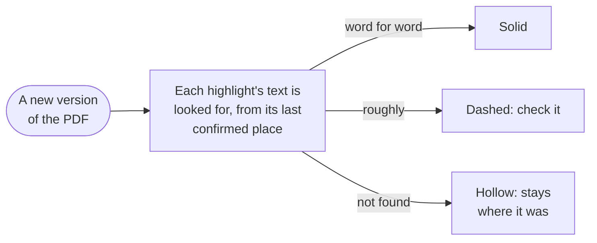

# Reading and marking

How the marks you make on a paper are kept: highlights, handwriting, text
boxes, pictures and recordings, and how translation and a paper's record
are made trustworthy. The user guide's
[Highlight and annotate](../user_guide/user_guide.md#highlight-and-annotate)
and [Draw and type on the page](../user_guide/user_guide.md#draw-and-type-on-the-page)
show how to use them.

## Your marks live beside the PDF

Everything you put on a PDF is a block of the page, stored beside the
file: highlights, drawings, text boxes, pictures. Gamma never writes your
marks into the file, so it can always be downloaded clean, and
*Export → Annotated PDF* writes a copy with them as the PDF's own
annotations ([Formats](formats.md#the-annotated-pdf)).

The one change Gamma makes to a file: annotations another app wrote into
a PDF become Gamma's own marks when it is added, and by default leave the
stored file, so they are not drawn twice (Settings → Reading & editing can
keep the file as it came).

## Highlights hold on to their text

A highlight is a block that remembers the passage it marks: where it sits
on the page, and the text it covers. On a picture a highlight is a region
of the picture's pixels; on a text file it is a range of lines. Its colour
is stored as the colour itself ([Look and feel](look.md#colours-you-draw-with)),
and its style is a wash, an underline, a wavy line or a strikethrough.

### A new version of the PDF

When a PDF is replaced (by hand, by a LaTeX build pushed from your
computer, by the Zotero link or by a synced folder), the server looks for
each highlight's text, with a little of the text around it, in the new
file:

| Look | Means | What you do |
|---|---|---|
| Solid | found word for word | nothing |
| Dashed | found roughly, alike enough by your setting, or an area whose place is an estimate | check it: its card shows how alike it reads, where it was and the words that changed; *Accept*, *Move…* or *Discard* |
| Hollow | not found | nothing is lost: it stays where it was, with its notes; its card may offer the closest match |

The rules follow from how people revise papers:

- **The text counts for more than its place.** A passage reworded where it
  was still wins while it reads very alike; below that, an exact copy
  elsewhere wins. So after figures are renumbered, "Fig. 3" lands on the
  new Fig. 3, not on the old sentence that now says "Fig. 4".
- **A run starts from the last place someone confirmed**, never from a
  dashed guess.
- **Short passages must match exactly**, since a rough match of three
  words is a guess.
- **Areas follow what is inside them**: the text they hold, then the
  picture under them, then the page's other highlights.
- **Only highlights move.** Drawings, text boxes and pictures stay where
  they are.

Other tools keep a highlight that lost its text in a separate list of
orphans. Gamma keeps it on the page, hollow, since the page is where you
look. On two versions of one paper with 76 highlights, matching by how
alike the text reads placed 72, none wrongly; the 4 left were passages gone
from the new version. A generous threshold costs you a highlight to check,
never a silent wrong one.

### Links to a passage

When the AI cites a paper, its `p. N` link opens the page and highlights
the quoted passage. An approximate match says so, and never bends numbers,
symbols or negations. A passage that is ambiguous or missing gives a
message, not a highlight. Links are stored without a server's address, so
they survive a move to another server.

## Handwriting

A stroke keeps what the pen did: its tool, its look, and every sample with
its pressure, tilt and time. The width is worked out once and stored with
the samples, so every view and every export draws the same line, and a
stroke is never smoothed again after you lift the pen.

Strokes on one page gather into a **group**: one block in the notes, with a
picture of the strokes and a caption that search and the AI read. When two
people change one group at once, the changes merge stroke by stroke.

No open ink format is both good storage and something other apps
exchange, so Gamma stores the raw points in a file of its own and exchanges
through the PDF's own ink annotations and SVG. It never makes up a time it
did not record.

### Pen, finger and mouse

The rule fits in one sentence: **a stylus does what is armed.**

| | A tool armed on the strip | Nothing armed |
|---|---|---|
| Stylus on a PDF | that tool | what a mouse does: a drag selects text, a tap clicks or picks a stroke |
| Stylus on paper (a notebook, a sheet) | that tool | writes with the last pen, since paper has no text to select |
| Finger | scrolls and zooms (*Draws with: Pen only*, the default on touch screens) | scrolls and zooms |
| Mouse | that tool | selects text |

- The eraser end and the barrel button erase at any time.
- While a pen is down anywhere, a finger's touch counts as a palm.
- A double tap with two fingers undoes, with three redoes.

Browsers give a stylus no text selection of its own, so Gamma builds one,
by one path for every device. Letting a pen pan when it misses text was
rejected: it breaks selecting from the margin and lets a palm start a
pinch.

## Text boxes and pictures

A text box and a picture are blocks too, whose text and caption search,
exports and the AI read like any note.

- **Each belongs to the nearest sheet above it** in the notes, else its
  PDF page.
- **Pictures lie under text boxes**, and both under handwriting.
- **A picture's edits never change its file.** Crop, flip, turn and
  opacity are kept with the block.

The lasso's Convert menu sends handwriting to the chat's model. **Redraw
as shapes** turns figures into clean, editable shapes and leaves what the
model is unsure of as it is. **Convert to text** writes Markdown with LaTeX
into a text box, and says `[illegible]` rather than guess. Either applies
as one undo step.

## Recordings in step with the notes

Every stroke and every new note carries the clock time it was made, and a
recording only remembers when it began. So playback lines up with ink
from an iPad or a second browser as well as with this one, and tapping
anything plays from just before it was written. Audio is saved in
five-minute pieces, so a crash loses five minutes at most.

## Translation in place

The 文A button translates the PDF page in view over the original lines, so
the layout never moves.

- **Formulas inside a sentence are never sent as text.** They go to the
  model as placeholders and are drawn back as crops of the original
  glyphs, so a formula cannot come back as plausible nonsense.
- **Left as printed**: reference lists, figure labels, display equations
  and author lines.
- **Terms stay consistent**: each paper gets a short brief, and each
  workspace keeps a glossary per language.
- **Kept translations belong to the workspace**, so a paper read again
  shows its translation without asking a model.

## A record you can trust

Gamma looks up a paper's record (title, authors, year, DOI) from arXiv,
then the DOI, the ISBN, a search of Crossref, the web page it came from,
and the AI last. A record found from the text alone is **confirmed** only
when the PDF is that work's title page. When nothing ties it that way and
AI is set up, the AI picks among the candidates, and the record says it
was confirmed by AI. Otherwise it is flagged with a red "!" and a line
saying why.

A flagged record never renames the page, and an identifier the AI made up
is checked and dropped. The balance is deliberate: a record wrongly
confirmed gets cited unchecked, while one wrongly flagged costs a click.

## Behind this page

- [Highlights after a PDF replacement](../dev/highlight_relocation.md) and
  [Highlight anchoring](../research/highlight-anchoring.md).
- [Handwriting](../dev/handwriting.md), [Pen logic](../research/pen-logic.md),
  [Handwriting and AI](../dev/handwriting_ai.md).
- [Text boxes](../dev/text_boxes.md), [Pictures](../dev/pictures.md),
  [Recordings](../dev/recording.md).
- [PDF translation](../dev/translation.md), [PDF citations](../dev/pdf_citations.md),
  [Paper metadata](../dev/paper_metadata.md) and
  [Metadata trust](../research/metadata-trust.md).
