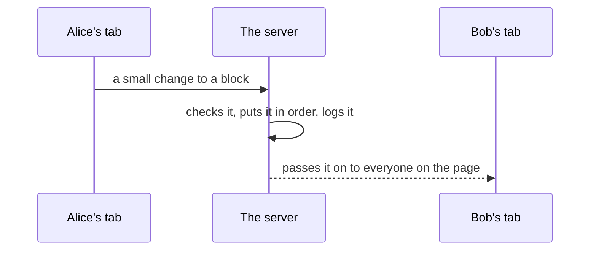
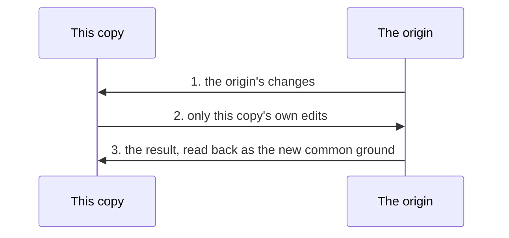
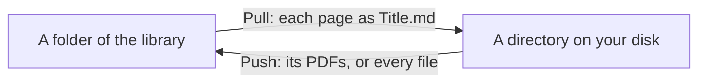

# Sync and offline

Gamma keeps the same notes in step in several ways: between people editing
at once, between a server and an offline copy, between the library and a
folder on your disk, and with a Zotero library. Each has its own rule for
who wins a clash. Between two copies, what loses is kept where you can
take it back; between people editing at once, the edits are merged.

| Between | When both sides changed the same thing |
|---|---|
| People editing a page at once | the edits are merged; when two people replace the same characters at once, the server's order decides |
| An offline copy and its server | an edit beats a delete; the same characters go by the server's order; every choice the sync made alone is listed |
| A synced folder and the disk | the file wins; Gamma's text is kept as a conflict |
| The Zotero link | Gamma's value is sent; Zotero's is kept as a conflict |
| Your settings between servers | the newer change wins |

## Editing together

Editors send small changes to blocks. The server checks each batch, puts
it in order, logs it and passes it on:

- **Two people in one note both keep their typing.** Edits to different
  notes or different properties never meet. In one note the texts are
  merged; only replacing the very same characters at the same moment goes
  by the server's order, and two insertions at one place both stay.
- **An edit on its way to a note someone just deleted brings the note
  back**, with your text.
- **Undo is yours alone.** It never takes back someone else's later
  change, and says when it left one in place: "kept what someone else
  changed since".
- **Presence is sent, never stored**: avatars and carets. Folding and the
  open editor are personal.
- **An edit that cannot be saved is retried** for as long as the tab is
  open; closing the tab during an outage can lose what was not sent yet.

The merge has rare limits: a word typed right beside text you deleted, in
one save, can go with another person's delete over the same place.

A CRDT was considered and rejected: it would be a second source of truth
that every writer (importers, the AI's tools, the Connector) would have to
go through. Writes travel as ordinary requests and the live connection
only passes them on, so who may write is checked in one place.

## Offline copies

An offline copy (a clone) is a workspace on one server, usually the
desktop or iPad app's own, that keeps in step with a workspace on another
server, the origin. The origin is the authority, and a round of sync goes
in three steps:

- **What travels**: pages and notes, folders and labels, files, deletions,
  drawings, text boxes and pictures. **What stays**: preferences, AI chats,
  comments, covers.
- **An edit beats a delete**, for a page and for a note, and a move counts
  as an edit.
- **Every choice the sync makes alone is listed** as a conflict you can
  open: a text clash offers *Local* and *Remote* (and *Merged* where it
  merged them), the others say what was kept. Sync never stops for a
  conflict, and picking a side is an ordinary edit.
- **Two-way or receive only.** A copy you may only view receives only. A
  copy syncs live, on a timer or by hand.
- **A sync cut short loses nothing** and applies nothing twice.

The copy compares trees rather than replaying a log, so a copy that was
away longer than the log reaches back needs no special case. The words
for it (pull, push, force, detach) are git's.

## A folder on your computer

In the desktop app, a **synced folder** pairs a folder of the library with
a directory on disk. It has two switches, and a round pushes, then pulls:

Each page becomes `<Title>.md` beside its PDF, its highlights as quote
callouts. Ink, text boxes and pictures stay in Gamma.

- **The file wins.** When the file and Gamma changed the same words, the
  file's stand, and Gamma's are kept as a conflict (*This file* or
  *Gamma*). No conflict copies are written into your directory.
- **Gamma patches files, never re-renders them.** It writes only over the
  bytes it last read, so formatting you added by hand survives. Replaced
  bytes go to a history kept for a week.
- **Removing needs evidence.** A file must be missing from two scans in a
  row before its page goes to Recently deleted, and a file that comes back
  brings its page back, so switching a git branch loses nothing.
- **A mass removal waits for you.** When more than half of a folder's
  files would go at once, as after a branch switch or a disk going away
  file by file, the round stops before it writes anything until you say
  *Go on*.
- **An unplugged disk is offline**, never "every file deleted": the folder
  carries a small `.gamma` marker, and a sync stops while the marker is
  missing or different.
- **Turning sync off never moves or deletes a file.**

What Markdown cannot say (a highlight's rectangles, ink, text boxes) stays
in Gamma's database, with no sidecar file beside your PDFs, as Zotero and
Sioyek also choose. A file moved or renamed on disk is followed by its file
id and its text, so its page moves with it. A folder that pushes every file
is a work folder: each file you track is a page that follows the disk
([Library](library.md#files-from-a-folder-on-your-computer)).

**One PDF from disk.** *Push from a file on this computer…* makes a page
follow one PDF, such as a LaTeX build's output. Gamma never writes to it,
and the page's highlights are found again in each new version
([Reading](reading.md#a-new-version-of-the-pdf)).

**Opened files.** A PDF opened from your computer in the desktop app is
read where it lies, as a page under *Opened files*, and always goes to
this computer's own server, never to a remote one: a paper opened on a
train is not sent to your NAS.

## The Zotero link

A personal workspace can be kept in step with one zotero.org library (your
own or a group's), with Gamma acting as another Zotero client:

| Gamma | Zotero |
|---|---|
| folders | collections |
| labels | tags |
| paper pages and their record | items |
| the page's PDF | the item's PDF attachment |
| highlights, ink and text boxes on the PDF | annotations |
| the page's notes | one "Notes from Gamma" note on the item |
| Recently deleted | Zotero's trash |

- **Gamma never deletes in Zotero**: it moves items to Zotero's trash, so
  Zotero's own users can bring back anything Gamma trashed. An edit beats
  a delete, both ways.
- **Annotations travel only while both sides hold the same PDF.**
  Otherwise they wait; they are never trashed.
- **When both changed one field**, text fields are merged where they can
  be; otherwise Gamma's value is sent and Zotero's kept as a conflict, with
  *Take Zotero's*.
- Comments, chats, notebooks and recordings stay in Gamma.

It is an engine of its own rather than another offline copy, because
Zotero keeps a version per item and refuses stale writes, with no log to
merge from.

## Settings that follow you

With Gamma Cloud, your account's settings (theme, language, shortcuts,
highlighters, palette) follow you between servers, merged one setting at a
time against the last copy both sides agreed on. A setting changed on both
sides takes the value of the profile changed more recently. The first time two different sets
meet, you choose which to keep. AI connections and keys never leave their
server.

## Behind this page

- [Collaboration](../dev/collab.md) and [Collaboration research](../research/collaboration.md).
- [Mirrors](../dev/mirror.md): offline copies and publishing.
- [Synced vaults](../dev/synced_vaults.md), [Work folders](../dev/work_folders.md),
  [Vaults research](../research/vaults.md).
- [Zotero link](../dev/zotero_sync.md) and [Zotero sync research](../research/zotero-sync.md).
- [Cloud accounts](../dev/cloud_accounts.md): the preference profile.
