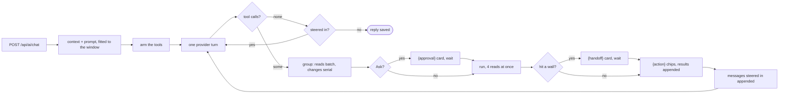

# AI: providers, chat, and the library agent

The AI stack in one place — provider storage and protocols, the `/api/ai/chat`
request/stream shape, and the library agent: what it can reach, how the tool
loop runs, and what the user controls. The tools themselves are catalogued in
[ai_tools.md](ai_tools.md); how long papers reach the model is
[ai_context.md](ai_context.md). Code: `gamma/ai_settings.py`,
`gamma/ai_protocols/` (one adapter per wire), `gamma/ai_client.py`,
`gamma/ai_catalog.py`, `gamma/ai_context.py`, `gamma/ai_tools/`,
`gamma/chatgpt_oauth.py`, `gamma/routers/ai.py`. PDF translation
(`gamma/routers/translate.py`), the handwriting selection's Redraw as
shapes and Convert to text (`gamma/routers/ink_ai.py`) and the stored chat
conversations have their own documents: [translation.md](translation.md),
[handwriting_ai.md](handwriting_ai.md) and
[chat_history.md](chat_history.md).

## Provider and models

There are NO env API keys; providers are GUI entries: each account's own
(Settings → AI → Models, its Connections section), plus the server's shared
ones an admin adds (below). An account's entries are stored under the
reserved account-wide `ai-settings` pref in `users.db` — a LIST of
`{id, name, protocol, api_key, base_url, models, test_model, billing?}`
managed via `POST/PUT/DELETE /api/ai/providers[/{id}]` (`billing`: how its
calls are paid for, an override "Token usage" describes). Every change to the list is
one read-modify-write transaction (`ai_settings.update_provider_entries`,
over `db.update_pref`), never a list read earlier and saved back. So a
ChatGPT sign-in, which stores its entry before asking for its first models,
or a token refresh writing back its entry's tokens never drops a key another
tab added meanwhile. An entry offers exactly the
models picked for it (from the provider's live listing in the form): there is
no built-in default model, so an entry with none picked offers nothing and its
Test button says so (migration step 15 wrote the old defaults into entries
that had relied on them). The connect dialog (`settings/ProviderForm.jsx`,
its state `useProviderEditor` in `settings/providerEditor.js`) picks the
live list's first model when nothing is picked yet. That is still a pick
from the provider's own listing, never a model name in code, and a new
connection is never saved offering nothing. Its Models step is a
searchable checklist of that listing, each model with what the catalogs
know of it (context window, pictures, price per million tokens:
`POST /api/ai/model-catalog`'s `facts`), and an "Add by name" field that is
always there, for a model the list doesn't show or an endpoint that lists
none. A saved name the listing lacks stays in the list, tagged "not
listed". The same live listing is the dialog's key check ("Key works · 14
models available", "Reached · 14 models available" for an endpoint without
a key, or the provider's refusal). The key field's placeholder and its
"Get a key at …" link come from the adapter or the `SERVICES` preset
(`key_placeholder`, `key_url`, sent with the protocols in
`GET /api/ai/settings`). Both are empty for a sign-in protocol and hidden for
a custom endpoint. A local server's preset and a custom endpoint may be
saved without a key ("Other services"). A connection made in the dialog is
tested right after it is saved. A saved entry never switches between sign-in and
API key (`PUT` with such a protocol is a 400). The generic prefs endpoints
refuse the key; the only read path is the masked `GET /api/ai/settings` (last-4
hint, never the key), guests can't write. `POST /api/ai/providers/{id}/test`
probes an entry with a tiny live completion for the settings list's Test button
— result in-body, never an HTTP error, and it clears the OAuth refresh backoff
so an expired ChatGPT grant is re-tried immediately. The probe's model:
the entry's optional `test_model` (editable under the Models step's More
options), else the `model` sent with the request, else the entry's first
model. The client sends the model the first task on that connection uses,
metadata first (the cheap utility model), then chat, translation and
handwriting (`probeModel` in `ai/aiModels.js`), or none when no task uses
the connection. With
`tools_model`, one of the entry's picked models (a 400 otherwise), the probe
is instead the check of whether that model calls tools, and the result
carries the stored verdict as `tools` ("Models that can't call tools"
below). A failed probe carries the failure's `kind` (see "Chat endpoint";
`no_model` when the entry has none picked) and an `auth` flag when the kind
is `auth`, so the row renders the chat
error card's headline and fix ("OpenAI rejected the API key — Update key"),
the upstream body only on hover. For a ChatGPT sign-in a 401 first renews the
token once, so `auth` means OpenAI refused the grant or the renewed token was
refused too. A 403 that refuses the server's network, not the credential,
is `blocked` (see "Chat endpoint"). While OpenAI can't be reached to renew
it, the kind is `unreachable` (see "The chatgpt protocol (OAuth)"). Upstream error
details are summarized before display everywhere (`upstream_detail` in
`ai_client.py`): JSON bodies reduce to their message field, HTML error pages
(a proxy's 502 page) to their `<title>`.

`POST /api/ai/health` ({provider_id, mode, model}; "" = first entry) is the
login connection check (Settings → AI → Models → Connection check → "Check
at login", account pref `gamma-ai-login-check`, default `ping`). The client
checks every connection a task's model goes through (`connectionsInUse` in
`ai/aiModels.js`), one request each, and keeps each answer by connection
(App's `aiHealth`). Mode `"ping"` verifies the credential for free: a
connection with a quota asks its quota endpoint (a ChatGPT sign-in's usage
endpoint, OpenCode Go's `/usage`, `ai_protocols.quota_reader`), any other
API key lists `/v1/models`, and both 401 on a dead credential (404/405 =
gateway without a listing → ok-but-unverified, no false alarm). OpenCode's
listing answers without a key, so only its quota endpoint checks one, and
its 403 ("This key doesn't cover OpenCode Go.", the reader's `refusal`)
reads as `auth`. Mode `"test"` runs the same tiny completion as the Test
button, with the same `model` (`probeModel`). In both modes a sign-in's 401
is answered as the Test probe's is: renewed once, `auth` when OpenAI refuses
the grant or the renewed token is refused too, `unreachable` while OpenAI
can't be reached. The answer is always in-body
(`{configured, ok, auth?, kind?, error?}`). A failure turns its
connection's status dot red in Settings with the fix, and the first one
renders as a warning strip in the chat window with the chat error card's
headline for its `kind` ("OpenAI rejected the API key"; see "Chat
endpoint") and a Fix… button that opens that entry's form (Settings →
Network proxy for `blocked`, for an admin), dismissed or cleared by a
passing Test / provider edit. The usage
query answers a `blocked` 403 in-body too, `auth: false`, its reason naming
the proxy setting; the model list's error says the same.

`ai_runtime(user)` in `gamma/ai_settings.py` builds the per-request config and
model registry from the account's own entries followed by the server's shared
ones (`_registry`; ids are `<entryId>:<model>`, a shared entry's
`server:<id>:<model>`; the wire format comes from the entry's `protocol`,
never from the provider id). Each provider conf and each registry row
carries its connection's `billing`. It adds the model each task uses
(`roles`, "Models for each task" below), and `default` is the chat task's
model: the account's chat pick while it is offered, else the account's own
first model, else the server's first. AI endpoints must use it, not module-level config
constants for credentials or model routing, and resolve a request's model
with `resolve_model(rt, requested, role)`. Each
protocol's default base URL is the provider's own (`config.AI_BASE_URLS`);
another endpoint is a connection's own base URL, and no environment
variable moves the default (an `ANTHROPIC_BASE_URL` a shell exports is not
read either).

There is no active connection. Every model picked on any connection the
account may use is offered everywhere, and each task picks its own from
any connection ("Models for each task").

Named services (`SERVICES` in `gamma/ai_protocols/services.py`, sent as
`services` with the settings) are form presets, data rather than code: a
protocol plus a fixed endpoint and its key hints. An entry made from one
stores only protocol + base URL; `service_of(conf)` recognizes the pair
again, and `provider_label` names the entry after the service when it has
no name of its own. `service_id(entry)` names which service a connection
is: the preset's id, else the protocol's while the entry points at the
protocol's own endpoint (`openai`, `anthropic`, a `chatgpt` sign-in), else
`custom`. It rides each masked entry and each registry row as `service`,
and picks the connection's logo ("Logos" below). An entry made from a
preset that has since been dropped reads as a custom endpoint: named by
its protocol, billed per token unless it says otherwise, and still allowed
to go without a key. See "Other services" below for the list and what a
preset's optional fields change. The `openai` wire follows the endpoint
(`is_openai_platform` in `ai_protocols/openai.py`): only OpenAI itself gets
`max_completion_tokens`, the Responses API for tool calls, and the
gpt-/o-family filter on its model listing. Compatible servers get
`max_tokens`, Chat Completions tools and their full listing (minus
embedding/audio/image models). Anthropic subscription sign-in is
deliberately absent: Anthropic's terms forbid third-party apps from routing
requests through Free/Pro/Max plan credentials, so Claude is reached with a
Console API key. Google's terms forbid the same for Gemini CLI's sign-in,
and Google has suspended accounts for it. That sign-in is still offered,
at the developer's request, with the warning on its card ("The Gemini
sign-in" below); the supported way is the Gemini API key preset.

The Connections section also exposes `POST /api/ai/providers/{id}/usage`,
for any connection with a quota reader (`ai_protocols.quota_reader`: a
ChatGPT sign-in's own, OpenCode Go's from its preset, "Other services"). It
reads normalized subscription windows (`used_percent`, `remaining_percent`,
and reset time) without exposing the bearer token or key. Opening an AI
pane queries them automatically for those connections (`quota` on each
of `GET /api/ai/settings`' providers, which the client reads as
`provider.quota`; the Usage button remains available for a manual
refresh), and Settings → AI → Usage draws them in its Subscriptions tile.
Each window is one compact summary line above the same progress meter used
for storage quota, filled by the percentage used. Each provider row also
opens its model configuration, where models can be fetched, added, or
removed. A connection without a reader gets an explicit unavailable result,
because pay-per-token providers do not share a portable quota API. A
rejected credential answers in-body (`{available: false, auth: true}`, "sign
in again" for a sign-in, "update it" for a key), and a status the reader
words as the plan refusing the key (OpenCode Go's 403) answers `auth:
false` with that reason. An expired ChatGPT sign-in answers so rather than
dumping the upstream 401 or 403. A
401 first renews the token once: it reads as expired when OpenAI refuses the
grant or the renewed token is refused too, and a renewal that can't reach
OpenAI answers `auth: false` with a "couldn't reach OpenAI" reason.
The account request deliberately uses the administrator-controlled ChatGPT
protocol URL, not an entry field, and OAuth entries cannot edit their API key
or base URL; this prevents a settings request from redirecting a bearer token.
The ChatGPT account endpoint is provider-specific and may require maintenance
if its upstream contract changes.

### Models for each task

Each task names the model it runs on, from any connection, in the
account's reserved `ai-models` pref (`users.db`, account-wide,
`db.USER_PREF_KEYS`). The generic `/api/prefs` endpoints refuse it, profile
sync never copies it, and only the two writes below change it:

```json
{"chat": "<entry>:<model>", "metadata": "", "translate": "engine:microsoft",
 "ink": "", "favorites": ["<entry>:<model>"], "chat_migrated": false}
```

- **The tasks** (`ai_settings.ROLES`): `chat` (the chat, its generated
  titles and structured notes), `metadata` (the AI's pick among the records
  a paper names, its own reading of the metadata, the slide citation),
  `translate` (PDF translation: a model, or a set-up service as
  `engine:<id>`) and `ink` (Redraw as shapes and Convert to text).
  Dictation is no task: it keeps its own transcription pref, and
  `/api/ai/models`' `transcriber` names the connection it goes through
  (`transcriber_of`, the chat model's connection first).
- **A pick** is a registry id, or `""` to follow the chat model. The chat's
  own `""` is the first model offered, the account's own before the
  server's.
- **`favorites`**: the chat models, at most 50: the models the chat's
  chip lists first, which Settings → AI → Models lists as Chat models
  ("The model menu").
- **`chat_migrated`**: the chat pick is still the one migration step 71
  wrote from the old one-connection pref, `ai-provider` (that entry's first
  model).

`resolve_roles` turns the pref into `ai_runtime()["roles"]`, one `{pick,
model, state}` per task. `state` is one of:

- `ok`: the pick is offered (for translate, or a configured service);
- `follows`: no pick;
- `missing`: the pick is no longer offered. Its connection was removed, its
  model unpicked, a shared entry no longer admits the account, or a service
  is no longer set up.

`model` is the pick while `ok`, else the chat model (for chat itself the
first model offered), else `""`. Translation with no model offered at all
resolves to the free service instead, so an account with services alone
keeps translating. A missing pick keeps its stored value, so it comes back
when its access does: the same entry picks the model again, or a shared
entry admits the account again. A connection removed and made again is a
new entry, and the old pick stays missing.

**The routing rule** (`resolve_model(rt, requested, role)`):

- A request that names a model gets that model: its registry id, or a bare
  model name exactly one offered model has. Any other name raises
  `ModelUnavailable`. Such a request never goes to another model. Every
  route answers it the same way: one exception handler in `app.py` turns
  it into a 400 `{"detail": "<model> is no longer offered", "kind":
  "model_unavailable"}`. A stream's error line carries `{"error", "kind"}`
  (`ai_client.failure_kind` reads `error.kind`). The client reads the
  top-level `kind` (`app/translateClient.js`, the chat's error card).
- A request that names no model gets its task's model, the chat model
  while the task's own pick is unset or missing.
- With no model offered at all, a route answers the standard 503 "AI not
  configured" first, a named model included.

The callers pass their task: the chat and `/ai/chat/context` `chat`;
metadata's extraction, record pick and slide citation `metadata`;
translation's chunk, brief and lookup `translate`; the ink routes `ink`.
Only the chat and translation take a model in the request. The chat, its
titles and structured notes send the model the chip shows, and a
translation job sends the translate task's model as the job started and
keeps it ([translation.md](translation.md#the-request)). `/metadata/fetch`,
the metadata batch job (and so the upload's lookups and the extension
clip's background lookup), `/metadata/cite` and `/ai/ink/*` take no
`model` or `cite_model`: the account's task model always decides.

`routed(rt, role, requested, entry)` says what a task ran on: `{role, model,
fallback}`, `fallback` true when the request named no model and the task's
pick is missing, so the chat model stood in. It comes back on
`/metadata/fetch` (once an AI call ran), on the metadata batch job's
result (the last lookup's, `fallback` when any lookup fell back), on
`/metadata/cite` and on `/ai/translate`'s final object.

**Writing.** `PUT /api/ai/models/roles` takes any of `chat`, `metadata`,
`translate` and `ink` (a registry id offered, `""`, or for translate a
configured `engine:<id>`; a role left out is unchanged) and
`favorites_add` / `favorites_remove`, never a whole favorites list. A pick
not offered, or a 51st favorite, is a 400 and writes nothing. A chat pick
clears `chat_migrated`. It is one read-modify-write (`set_roles` over
`db.update_pref`) and answers `{roles, favorites, chat_migrated}`.
`POST /api/ai/models/import` is the client's one-time move of a browser's
old picks (`{chat, metadata, translate}`, from the localStorage keys
`gamma-chat-model`, `gamma-meta-model` and `gamma-translate-model`). In one
read-modify-write (`import_roles`) it takes each only while the account's
own is unset, chat also while `chat_migrated` is set (taking it clears
that), and skips a pick not offered. It answers `{taken: [role], roles,
favorites, chat_migrated}`. Both are for any account, a guest's too, among
the models it may use; never a link visitor (401) or an integration
token (403).

**Notices.** A missing pick raises a notice per task (`notices.py`:
`ai-model-chat`, `ai-model-metadata`, `ai-model-translate`, `ai-model-ink`;
tone `warn`, pane `ai`, action "Choose model"). Its fingerprint is the pick,
so it shows once per pick that went missing: "The metadata model gpt-x is
no longer available; the chat model is used instead." One source,
`ai_model_missing`, returns the list of them (`for_user` flattens a
source's list): it reads the pref first, and only when a task has a pick
the registry, built without renewing a sign-in (`model_roles`).

**The client** (`frontend/src/ai/`). `useAiModels.js` owns the state:
`/api/ai/models` (`aiInfo`), the roles, the favorites, `setRole` and
`toggleFavorite`. The order of its requests is the pure `modelsSync.js`
(`createModelsSync`, tested in `tests/aiModels.test.mjs`): reads dropped
after a write, late write answers dropped, an account switch aborting what
is in flight, and the old picks' import run once.

- It reads the list again when the window comes back (focus or
  visibility, at most every 15 s) and after a connection is saved.
- A pick shows at once and the server's answer replaces it. A read that
  started before the tab's last write is dropped and read again once the
  writes settle, and a write answered after a later one is dropped too.
- Another account, or signing out, aborts what is in flight.
- A share link's view reads but never writes or imports.
- After the account's first read it moves this browser's old picks once
  (the old chat pick only as a registry id), then deletes those keys
  (and `gamma-chat-model-by-key`), once the request succeeded.

`aiModels.js` holds the pure rules (`tests/aiModels.test.mjs`):
`resolveRoles` (the server's rule), `modelFor(info, role)`, `roleStatus`
(a task row's line) and `taskRow` (the row's hint and class, shared by
Settings → AI and Translate with), `tasksAffectedBy` and `removalNotice`
(what removing a connection does to the tasks), `connectionsInUse`,
`probeModel` and `importLegacyPicks`.

The client never parses a registry id. `/api/ai/models` carries `missing:
{"<registry id>": {model, connection}}` for every id a task or a favorite
names that is not offered (`ai_settings.missing_picks`): `connection` is
the entry's name while the entry exists (its model unpicked, its sign-in
gone, a shared entry that no longer admits the account), else `""`. A
translation service picked is left out. `modelName`, `connectionName` and
`modelTitle` read names from `models[]` or `missing`.

`tests/shared/ai_models.json` holds the cases both sides pass: `roles`
(`ai_settings.resolve_roles` ↔ `resolveRoles`, and with `without`, what
removing a connection leaves, `tasksAffectedBy`), `sums`
(`ai_client.add_usage` ↔ `addUsage` in `chat/tokenUsage.js`, "Token
usage") and `keyless` (`ai_settings.key_optional` ↔ `keyOptional` in
`settings/aiServices.js`, "Keyless entries").

What the user meets when a pick goes missing:

- Settings → AI → Models: the task's row is red and says "claude-sonnet-4-6
  (Work key) is no longer available. Using gpt-6-astra (ChatGPT) instead."
  ("a removed connection" when `missing` names no connection), and its
  button says Choose…, amber.
- The notice above, with Choose model.
- A translation job that ran on the stand-in ends its task row with "used
  gpt-6-astra: the translation model is unavailable", and the open page's
  metadata lookup its own with "used gpt-6-astra: the metadata model is
  unavailable" (from `routed`).
- A chat request that names a model no longer offered gets the error card
  "That model is no longer offered", with Choose model (Settings → AI →
  Models) and Switch model.

Removing a connection asks first, and the confirm says what each affected
task will use instead ("Metadata & citations will use gpt-6-astra
(ChatGPT) instead."), or, with no model left, "AI features stop until you
add a connection."

### The model menu

`ai/ModelMenu.jsx` is the one model menu: `ModelPicker` (its search box
and list, on a surface of the caller's: the chat's model panel),
`ModelMenuList` (the two in a `ContextMenu`, the open menu) and
`TaskModelMenu` (a task's row in Settings → AI → Models, and "Translate
with" in Settings → Language & translation, the same `translate` task).
`TaskModelMenu` is a `MenuSelect` that opens `ModelMenuList` through its
`listbox` slot (`shared/ui/Menus.jsx`). Its groups, in order (`menuGroups`
in `ai/modelMenu.js`, `tests/modelMenu.test.mjs`):

- the current pick when it is no longer offered, marked unavailable;
- a task's "Use chat model (X)" ("Default: Microsoft (free)" for
  translation with no model offered);
- the chat models (the favorites), in the order they were added, under
  "Chat models" (one no longer offered stays, so its star can come off);
- one group per connection, in the registry's order, under its logo and
  named with its billing tag (a favorite in it too, unless `once`: the
  chat's panel lists each model once, a favorite in the chat models alone);
- for translation, the services.

A search box filters every group by each word typed (the model, its
connection, its id; `matchesWords` in `modelMenu.js`, the one filter the
connect dialog's searches use too). The focus stays in it: the arrow keys move through the
rows, Enter picks, Escape closes. Opened by a finger's press it takes no
focus (`touchTyping`), so no on-screen keyboard covers the list. A row shows a "no tools" tag (the model's
own check, its reason on hover), for the handwriting task "can't convert to
text" on a model that sees no pictures (Redraw as shapes still works with
it), an eye for pictures, the context window ("200k") and, on a connection
paid per token, the price per million tokens in and out ("$3 / $15"). These
facts are one component, `ModelFacts` (`modelFacts` in `modelMenu.js`),
which the connect dialog's model checklist shows too, with one formatter
(`fmtTokens`, `fmtPrice` in `chat/tokenUsage.js`); the dialog shows prices
only for a pay-per-token connection, and its checklist lines each fact up
in a column of its own (`data-fact`, a subgrid), under the model's name on
a phone. Its star, a `ctlBtn` sized to
`--ctl-icon-btn-xs`, adds the model to the chat models or takes it off. A task row whose pick is missing
turns its trigger amber (`.aiTaskMissing .uiSelectBtn`), and so does
Dictation's when nothing transcribes.

The facts are `/api/ai/models`' `context`, `images` and `price` per model,
from the caches alone (`ai_catalog.facts`: a cold cache gives nulls and
starts its fetch for the next read; `price` only for billing `api`). No
model name or price is written in the code, and an unknown fact is left
out.

Settings → AI → Models has a **Chat models** row under Chat (`ChatModels`
in `ai/ModelMenu.jsx`): the models the chat's model chip lists first.
Each model is a chip with its connection's logo and a remove button. One no longer offered stays,
marked unavailable, until it is removed. "Add model…" opens the model
menu: a pick adds the model and closes the menu, and a star adds or
removes a model and leaves the menu open. Both writes are
`favorites_add` / `favorites_remove` ("Models for each task"). The Chat
row above it is still the one model a new chat starts with.

### The model chip

The composer's model chip (`chat/ModelChip.jsx`) reads the model and its
effort ("GPT-5 · high"), led by the logo of the model's connection where
one is drawn and followed by the speed's glyph. A press opens one panel
above it (a `MenuSelect` whose `listbox` slot is the panel, `popup`
"dialog"), in three bands:

- **the models**: for Gamma AI the model menu's `ModelPicker` with `once`:
  the search box, the chat models first, each with its connection, then
  every connection's others, a star adding one to the chat models; for a
  computer's agent its own models, a row each. A pick sets the account's
  chat model (Gamma AI's, so every device follows) and closes the panel;
- **the knobs** the picked model takes, each a heading over a `Segmented`
  as wide as the panel: Reasoning effort (Default, then the model's
  levels) and Speed (Default, then the tiers its provider sells, each with
  its glyph). A computer agent's Default names its own ("Default (high)").
  A knob changed leaves the panel open, so effort and speed are set in one
  visit; a model without levels or tiers has no such band
  (`effortKnob` / `speedKnob` build both sides' knobs);
- **Manage models…** (Gamma AI's): Settings → AI → Models.

Who answers is not the chip's: that is the header's agent picker ("The
picker").

### Other services

The connect dialog's first step shows every way to connect as a tile with
its logo, in three groups (`serviceSections` in `settings/aiServices.js`,
pure, `tests/aiServices.test.mjs`), with a search box over them:

- "Sign in or subscription": the sign-in protocols (ChatGPT, Gemini), then
  the presets billed as a subscription;
- "API key": the key protocols (Anthropic, OpenAI API), then the
  pay-per-token presets;
- "On your computer or network": the local presets, then "Custom
  endpoint" and its API format.

A vendor's presets in one group are one tile, and its plans (`plan`) are a
segmented control under it (Qwen's international and China endpoints).
Each tile (`GlyphChoices`, settings/SettingsKit.jsx) is the logo beside the
name and, under it, the billing tag, every tile one height and as many to
a row as fit (two in the dialog, one on a phone); each group's caption has
its icon (a subscription's sparkles, a key, a computer). A preset's
`note`, or a protocol's (`Protocol.note`, sent with the protocols: the
Gemini sign-in's terms warning), is a line under its tile's plans. The
chat's setup card keeps its own tiles (`aiServiceTiles` in
`settings/aiServices.js`: the protocols without a note, then Other), so
the Gemini sign-in is offered only in the dialog, under its warning. All
presets ride the `openai` wire. The branches for OpenAI's
and Anthropic's own endpoints (`is_openai_platform`,
`is_anthropic_platform`) never apply to them.

| Vendor | Plans (base URL) |
|---|---|
| DeepSeek | API key (`https://api.deepseek.com`) |
| Kimi | API key (`https://api.moonshot.ai`), China (`https://api.moonshot.cn`), Kimi Code subscription (`https://api.kimi.com/coding/v1`) |
| Qwen | Model Studio international (`https://dashscope-intl.aliyuncs.com/compatible-mode/v1`), China (`https://dashscope.aliyuncs.com/compatible-mode/v1`), Coding Plan subscription (`https://coding-intl.dashscope.aliyuncs.com/v1`, China `https://coding.dashscope.aliyuncs.com/v1`) |
| GLM | Z.ai (`https://api.z.ai/api/paas/v4`), Zhipu China (`https://open.bigmodel.cn/api/paas/v4`), GLM Coding Plan subscription (`…/api/coding/paas/v4` on either host) |
| OpenRouter | API key (`https://openrouter.ai/api/v1`) |
| OpenCode | Zen, pay as you go (`https://opencode.ai/inference/openai/v1`), Go subscription (`https://opencode.ai/inference/go/openai/v1`) |
| Gemini | API key (`https://generativelanguage.googleapis.com/v1beta/openai`) |
| Groq | API key (`https://api.groq.com/openai/v1`) |
| Ollama | on this computer or network (`http://localhost:11434/v1`), no key |

A coding-plan subscription is an API key the vendor's console makes for
its plan, pointed at the plan's own endpoint, so it is an ordinary key
entry, billed as a subscription (Kimi Code, the Qwen and GLM Coding Plans).
Alibaba's terms allow the Qwen Coding Plan only inside coding tools; the
preset's `note` says so under the plan. OpenCode's Console translates
between wire formats, so Chat Completions reaches every text model it
serves: Zen bills credits per token and lists its models publicly with
their prices; Go is a monthly subscription with 5-hour, weekly and monthly
limits. Both OpenCode presets send `User-Agent: Gamma` and, on a call with
a prompt-cache key (the chat's, already a hash of the conversation), that
key as `x-opencode-session`, as OpenCode asks third-party clients to.
Gemini answers a rejected key with a 400, which reads as `other`, not
`auth`. Ollama is an address preset: the network guards still apply. A
preset dropped later (xAI, Mistral and LM Studio were) leaves its saved
entries working as custom endpoints.

A preset's optional fields are read by host-independent code, and
`GET /api/ai/settings` spells out `billing`, `usage`, `quota` (whether a
quota reader reads it), `key_optional` and `versioned` for each one. An absent field changes nothing:

- `catalog`: the models.dev provider key, added to `Protocol.catalog_hints`
  for hosts that name none (`dashscope.aliyuncs.com` → `alibaba-cn`): model
  facts and prices ("Token usage").
- `cache_key`: the endpoint takes OpenAI's `prompt_cache_key` (Kimi).
- `max_tokens`: the chat's reply cap (`ai_catalog.reply_cap`). These
  vendors' models count their thinking toward it, so the DeepSeek, Kimi,
  Qwen, GLM and OpenCode presets set 32,768, bounded by the model's own
  output limit from models.dev and left at the default 8,192 when that
  limit is unknown. OpenAI, Anthropic, OpenRouter, the other presets and
  custom endpoints keep 8,192.
- `note`: a sentence shown under the plan. Plan labels and notes are a
  fixed vocabulary the browser translates (`SERVICE_WORDING` in
  `settings/providerEditor.js` names them for the catalog).
- `billing`: how a call through it is paid for, `"subscription"` (the
  coding plans, OpenCode Go) or `"local"` (Ollama); absent, per
  token (`ai_settings.billing_of`, "Token usage").
- `usage`: the quota reader of a subscription (`ai_protocols/quota.py`).
- `key_optional`: an entry may be saved without a key (Ollama).
- `versioned`: the base URL already holds its version prefix (Gemini's
  `/v1beta/openai`).
- `session_header`: the header a stable per-conversation id goes in, with
  the user agent above (OpenCode).

**Keyless entries.** `ai_settings.key_optional(entry)`: a preset with
`key_optional`, or a custom endpoint (a base URL that is neither the
protocol's own nor a named service's), may go without a key. The connect
dialog follows the same rule (`keyOptional` in `aiServices.js`, held to
it by the `keyless` cases of `tests/shared/ai_models.json`), and each
provider of `GET /api/ai/settings` carries the answer as `key_optional`.
`new_key_entry` takes it, the model catalog lists through it, and
`ai_runtime` offers its models. It sends no Authorization header (`base.bearer`). The provider's
own endpoint still needs its key.

**Logos.** `ai/ProviderLogo.jsx` draws a connection's logo by its
`service`: on the connect dialog's tiles, a connection's card, the model
menu's connection headings and the chat's chip. The marks are
`@lobehub/icons-static-svg` 1.105.0's (MIT, LobeHub), only their geometry
and fills, kept as data in `ai/providerMarks.js`: the colour variant where
the brand has one (Claude's for Anthropic, Gemini, DeepSeek, Kimi, Qwen),
the mono one elsewhere (OpenAI's for the API and the ChatGPT sign-in,
Z.ai's for GLM, OpenRouter, OpenCode, Groq, Ollama). `serviceMark` picks
a mark by the service's vendor, its id up to the first `-` (`kimi-code`
is Kimi's, `qwen-coding-cn` Qwen's, `gemini-signin` Gemini's), and `chatgpt` wears OpenAI's. A
custom endpoint, and an id with no mark, draws the globe (the chip draws
nothing). A mono mark takes the colour of the text around it; a colour
fill is lifted a quarter of the way toward the ink on a dark scheme
(`.providerLogoTone`), so Qwen's deep blue stays legible.
`tests/shared/ai_models.json`'s `services` lists every id the server can
send, which `test_ai_model_roles.py` holds to the protocols and presets,
and `tests/providerMarks.test.mjs` fails on an id without a mark unless it
is listed under `fallback`. So a new preset gets a mark (its SVG's paths
copied from the package into `providerMarks.js`) or a line under
`fallback`. These are the app's only brand marks; every other icon is the
one stroke set ([ui-design.md](ui-design.md#icons)).

**Quota per connection.** `ai_protocols.quota_reader(conf)` is the
protocol's own reader (the ChatGPT sign-in), else the one the preset's
`usage` names (`quota.READERS`), else None; `GET /api/ai/settings` says
whether one exists as `quota` on each provider and each service. The usage
route, the client's automatic quota load and the login check all use that
one answer. Every reader answers the ChatGPT reader's shape
(`{plan_type, windows: [{name, used_percent, remaining_percent,
window_seconds, reset_at}], credits}`) and words a status that means the
key does not cover the plan (`refusal`). OpenCode Go's
(`quota.OpenCodeGo`) asks `GET https://opencode.ai/inference/go/v1/usage`
with the Go key, always OpenCode's own endpoint, and reads its three meters
(`rolling`, `weekly`, `monthly`: `percent`, `resetsAt`) as the windows
"5-hour", "Weekly" (from Monday 00:00 UTC) and "Monthly". A key Go does
not cover answers 403: "This key doesn't cover OpenCode Go."

Three host-independent rules make these endpoints work.

**Paths.** `api_url` (`ai_protocols/base.py`) appends `/v1/…` to a base URL
unless it already ends in a version segment or is a `versioned` preset's.
So GLM's `/api/paas/v4` is reachable, a pasted `…/v1` stays one, and
Gemini's `/v1beta/openai` gets `/chat/completions` and `/models` right
after it. The Anthropic wire keeps its fixed `/v1/messages`.

**Thinking.** A compatible server streams the model's thinking as
`reasoning_content` (DeepSeek, Kimi, Qwen, GLM) or `reasoning` (OpenRouter,
Ollama), plus OpenRouter's signed `reasoning_details`. `OpenAIChat`
collects them and yields `("reasoning", {field: value})` before the tool
calls. The agent loop keeps it on the assistant turn it replays, and the
wire echoes it back under the name it arrived by. A field that one
assistant turn carries goes on every assistant turn of the request, empty
where none was kept. DeepSeek refuses a request with tools when any
earlier assistant turn lacks `reasoning_content`. Nothing is echoed to
api.openai.com, and the Anthropic and Responses wires ignore the field.
"Replay across turns" covers how it survives between messages.

**Pictures.** Whether a model reads pictures is a model fact like its
window (`ai_catalog.image_input`): OpenRouter's listing names
`architecture.input_modalities`, else models.dev's `modalities.input` says.
For a model that reads text only, the chat leaves out the message's
pictures and the context's crops and says how many in a line of the
question. It arms no `PICTURE_TOOLS` (`view_pdf_page`, `view_ink`,
`view_image`) and drops the pictures tool results carry, and the composer's
file picker takes PDFs only. A model no source knows gets pictures. What a
picture is, how it is sized and budgeted: "Pictures" under "Chat endpoint".

### Protocol adapters

Everything that differs between providers lives on one adapter per wire in
`gamma/ai_protocols/` (`base.Protocol`), and nothing outside that package
branches on a protocol id. Routes, the chat loop, `ai_settings` and
`ai_client` ask the entry's adapter (`ai_protocols.of(conf)`):

| Concern | Adapter member |
|---|---|
| what the form offers | `label`, `base_url` (env default, `config.AI_BASE_URLS`), `auth` (`"key"` / `"oauth"` + the `oauth` module: the sign-in's `begin` / `status` / `redeem` and its token refresh), `entry_name` (a new sign-in entry's name), `entry`, `key_placeholder` / `key_url` (the key field's hint and "Get a key at" link, for the provider's own endpoint), `note` (a sentence under its card in the connect dialog) |
| the chat call | `tool_wire(conf)` (the wire a call with tools goes over: this one, or a sibling, as OpenAI's Responses API is for an entry on OpenAI's own platform), `wire(conf, tools)` (`tool_wire` when the call carries tools, else this one), `request(...)`, `reply_text`, `stop_reason` (a whole reply's), `read_reply`, `streams_only` |
| speed tiers | `speeds` (canonical name → the value this wire sends), `speed_value(speed)`, `speed_tiers(conf)` (what an entry may be asked for when its own listing names none) |
| the stream | `events` (one loop in the base) over `sse` (one event per `data:` line; the Gemini wire's joins an event's lines, `sse_events`), `stream_event` / `stream_end`, with `("reasoning", …)` before the tool calls where the wire reports thinking; a stream without a single event raises `NotAnAIStream` |
| token counts | `usage(raw)` → `{input, output, cache_read, cache_write}` |
| models | `models_request`, `models(data, conf)` → `[{id, context_window, efforts, speeds, images, price}]` (`listed_window` / `listed_efforts` / `listed_speeds` / `listed_images` / `listed_price` read whatever the listing carries; `price` None when it names none, False for one that varies with something no call reports), `catalog_hints` |
| credential check | `ping_request` (default: the model listing) |
| quota | `has_account_usage`, `account_usage_request`, `account_usage`, `refusal(status)`: the protocol's own quota (the ChatGPT and Gemini sign-ins). A preset's reader in `ai_protocols/quota.py` answers the same three; `ai_protocols.quota_reader(conf)` picks one ("Other services") |
| attachments, dictation | `native_pdf`, `transcription` (a rank), `transcription_request`, `transcript` |
| hosted web search | `hosted_web_search(conf, site)`: the provider's own search tool as the tools entry to send, limited to one domain when `site` is given (Anthropic's `allowed_domains`, the Responses wires' `filters.allowed_domains`), or None; asked of `tool_wire(conf)`, the wire a call with tools goes over. A tool spec with a `hosted` entry goes out as that entry. A stream that used it yields `("web_searched", {"error"})` as each search runs (the provider's error code when one failed, else "") and `("web_sources", [{url, title, date?}])` for the pages it found, `date` the provider's own date of a page (Anthropic's `page_age`). `search_web`'s AI engine runs it ([ai_tools.md](ai_tools.md) "search_web") |

The wires: `anthropic.py` (Messages API), `openai.py` (Chat Completions for
OpenAI and every compatible server), `responses.py` (the Responses API that
OpenAI's platform and the ChatGPT backend both speak; `openai-responses` is
the variant an OpenAI entry switches to for tool calls, never an entry's own
protocol), `chatgpt.py` (the Codex backend: its listing, quota and client
version), `gemini.py` (Google's Code Assist backend, Gemini's
generateContent wrapped: "The Gemini sign-in"). `quota.py` holds the quota readers a preset names (OpenCode
Go's). `ai_client.py` is the transport (open, read, stream, errors);
`ai_catalog.py` fetches and caches listings, context windows and prices
(`fetch_json` is the one fetch every listing, quota and ping goes through).
The sign-in flows themselves (`chatgpt_oauth.py`, `gemini_oauth.py`) are
provider-specific by nature; their routes are one set,
`/api/ai/oauth/<protocol>/start|status|complete` (`routers/ai.py`
`signin_flow`: the protocol's `oauth` module, a 404 for any other).

A new service on an existing wire (a gateway, a hosted model) is a
`SERVICES` preset or just a custom base URL. A new wire is one module
subclassing `Protocol` (or `ResponsesWire`) that overrides what differs from
the OpenAI-shaped defaults, plus one line in `WIRES` and its default URL in
`config.AI_BASE_URLS`; `tests/test_ai_wire.py` pins each wire's request and
stream shapes.

### Shared provider entries

An admin can add provider entries for the whole server (Settings → Server →
Shared AI provider, `/api/admin/ai-providers*`), so the members of a lab do
not each need a key. A shared entry has an account entry's shape (`id, name,
protocol, api_key, base_url, models, test_model, created_at`, plus `oauth`
for a sign-in) and an `access`, who may use it (below). It holds an API
key, or a sign-in (ChatGPT, Gemini) the admin makes from the same form:
`POST /api/admin/ai-providers/<protocol>/start`, `status` and `complete`, the
account flow's `begin_signin` / `redeem_signin` with the
state bound to `("server", <admin>)`, so neither flow's state redeems on
the other. `provider_id` on `complete` reconnects an entry. An admin's own
entry is never turned into a shared one in place: a key is pasted into the
shared form again, and a sign-in is made again from it, because OpenAI
rotates the refresh token, so two entries refreshing one grant would sign
each other out (a copy is unsafe, and a move was dropped as not worth its
own dialog). The same helpers validate both lists
(`new_key_entry`, `update_entry`, `apply_provider_fields`, `mask_entry` in
`ai_settings.py`).

- **Stored** in the users.db `settings` KV under `ai_providers`:
  `{providers: [...], allowance: {accounts, guests}}`, at most
  `MAX_PROVIDERS` (20) entries. Each `api_key` and each sign-in's `oauth`
  tokens are Fernet-encrypted with the data directory's key, like the cloud
  client secret (`publisher_sessions.cipher`). One that no longer decrypts
  reads as none and logs a warning. A config written before access was per
  entry carries one server-wide `guests` switch: `load_server_ai` gives
  every entry without an `access` that switch's value (`_clean_access`),
  and the first save writes the access down and drops the switch.
- **Refreshed** under the entry's own lock (`_refreshed_server_oauth`):
  every account's requests refresh the same tokens, and OpenAI rotates the
  refresh token. Only the tokens are written back. The refresh backoff is
  reset only by an admin's Test, usage query or login check, so a dead
  shared grant is not retried on every account's login. A member's login
  check still renews a token chatgpt.com refuses, once and within that
  backoff, and reports `auth` when the grant is refused or the renewed
  token is too.
- **Masked**: the last-4 key hint and the signed-in e-mail (`account`) are
  for admins only.

Ids are namespaced, `server:<id>`, so a shared entry's models
(`server:<id>:<model>`) never collide with an account's; the registry marks
them `shared: true`. `ai_runtime` (via `shared_access`) offers an account
the entries whose access admits it, after its own entries; a name that is
not an account (a link visitor) never gets one. `GET /api/ai/settings`
lists them after the account's own as read-only rows (`shared: true`,
without their `access`); `/api/ai/providers/{id}` never edits or deletes
them (404). An admin may name a shared id on the Test probe, the model
catalog and a sign-in's subscription usage (`/api/ai/providers/{id}/usage`);
that is how the Server section's form lists models and tests a saved
entry. The login check (`/api/ai/health`) accepts any entry the account can
use. Token usage stays per account: a member's calls through a shared entry
are recorded on that member (provider id `server:<id>`, billing `shared`,
never a cost), and there is no server-wide meter.

**Access.** Each entry's `access` is `{who: "everyone" | "selected", users:
[account ids], guests: bool}`: under `everyone` every account, the guest
accounts too when `guests` is on (default off — guest accounts are open to
anyone who can reach the server); under `selected` the listed accounts
alone, never a guest. Administrators always have every shared entry,
whatever its access: the Server section tests, lists the models of and asks
usage of an entry through the admin's own runtime, and the admin owns the
credential anyway. The admin API takes and shows the list as usernames
(`validated_access`: an unknown or guest username is a 400, a name listed
twice counts once, at most `MAX_ACCESS_USERS` = 500; `access_view` resolves
the stored ids back through `db.account_names`, so a rename follows and a
deleted account drops out); it is stored as account ids. A `POST` takes the
access with the new entry, a `PUT /{id}` with any other field; left out,
an edit keeps the access and an add gives everyone but guests. The rows say
it in a few words (`accessSummary` in `providerEditor.js`: "every
account", "every account and guests", the names, or "no account yet —
administrators only"), and the form's last step, **Who may use it**, sets
it: three tiles like the share popover's audience (Every account / Accounts
and guests / Selected accounts) and, under the last, a chip per named
account with an `AccountPicker` to add one.

**The allowance.** The admin may cap the tokens each account spends through
the shared entries in a rolling 24 hours (one limit for accounts, one for
guests, whichever entries admit them). Its limits, storage and Reset rule
are in [guests.md](guests.md) "The shared AI allowance". The one choke point
is `ai_client.open_ai` (`call_ai` goes through it): `check_allowance`
re-reads `ai_usage.shared_used` on every call and raises
`AllowanceExhausted`, an `HTTPException` 429 whose detail points at
Settings → AI. How each caller surfaces it:

- Chat, both modes: the stream opens eagerly, so a refused first call is a
  real 429; a later agent round ends the stream with the detail as its
  `error` line.
- Translation: the stream variant and the paper's brief request check
  before their stream starts.
- Redraw as shapes and Convert to text (`/ai/ink/shapes`, `/ai/ink/text`,
  [handwriting_ai.md](handwriting_ai.md)): checked before their stream
  starts (`_check_door`), as translation's are; a call refused inside the
  stream ends it with the refusal's own words as its `error` line.
- Metadata extraction and `/metadata/cite` let the 429 through.
- The Test probe and the login test report it in-body.
- Dictation reports no tokens, so it is not metered, only refused once the
  allowance is used up.
- Model listings and the context-window lookup spend nothing and are never
  refused.

**Calls open at once.** The same choke point caps the provider calls one
account may have open: `ai_client.MAX_OPEN_CALLS` (6). An open call holds a
server worker thread for as long as the provider takes, and those threads
serve every other request too (a PDF page read included). So the seventh is
refused with `TooManyCalls`, a 429 whose detail points at the translation's
parallel requests and whose `Retry-After` (`CALL_RETRY_AFTER`, 5 s) the PDF
translator waits out. `open_ai` takes a slot before it connects and
returns the response wrapped (`_OpenCall`), which frees the slot (and wakes
a caller waiting for one) when it is closed. Every caller closes its
response when the reply ends or fails, a stream's generator also when its
client goes away; a response dropped unread frees its slot when it is
collected, and a failed connect at once.

A request whose calls follow one another holds one slot for all of them:
`with ai_client.call_slot(user_id, wait)` takes a slot (waiting up to `wait`
seconds for one to free, then `TooManyCalls`) and frees it at the block's
end. A call given that slot (`slot` on `open_ai` and `call_ai`) takes none
of its own. Each PDF translation request runs its call and its re-ask
under one; a streamed one, on a thread of its own, waits up to 120 s for it,
and so does the paper's brief request ([translation.md](translation.md) "The
server").

`retries` on `open_ai` and `call_ai` (default 0) tries a call that failed
before any of the reply came up to that many more times, under the same
slot, after 1 s, 4 s, then 8 s (`_retry_wait`). Retried: a connect or send
that failed (a non-HTTP `URLError`), or a provider 408, 429, 500, 502, 503
or 529 (a 429 or 503 waits its numeric `Retry-After`, and is not retried
when that is over 20 s). A timeout or hang-up while waiting for the answer,
and a 504, are retried only for a streamed call, whose headers come before
the model starts. Other 4xx, Gamma's own refusals and a stream cut midway
are never retried. With `within`, no retry is begun that could end more
than that many seconds after the first attempt began. Each retry is one
`[ai] … retrying in Ns (attempt k of n)` info line. Only the PDF
translator passes retries (2, for its chunks, re-asks and briefs); the chat
and every other caller make one attempt.

Both refusals derive from `CallRefused`, so every caller above treats them
alike (`failure_kind` calls this one `rate`). The streamed translation and
the brief request check both before their stream starts
(`check_call_slot`). Dictation and the model listings bypass `open_ai` and
are not counted. The pool itself is raised from AnyIO's 40 to
`app.THREAD_TOKENS` (100) at startup.

### The chatgpt protocol (OAuth)

A third protocol, `chatgpt`, holds OAuth tokens instead of a key (Codex CLI's
PKCE flow in `gamma/chatgpt_oauth.py`; entries created only via
`POST /api/ai/oauth/chatgpt/start`, `status` and `complete`; access tokens
refresh lazily in `ai_runtime`). Its wire is the Responses API on
`chatgpt.com/backend-api/codex` (stream-only SSE; non-stream callers join
deltas), and PDF attachments go as native `input_file` parts, which the
backend reads as long as each part names its `filename`. They are retried as
extracted text if the backend rejects them. That retry applies to
any provider that answers a native-PDF request with a 4xx other than
401/403/429 (compatible servers may refuse `file` parts too). Anthropic has
no `minimal` or `none` effort; its adapter sends `low` for `minimal` and
leaves the parameter out for `none`.

Its model list (`POST /api/ai/model-catalog`) is Codex CLI's own listing call,
`GET {base}/models?client_version=…`, made with the entry's token. The backend
hides models newer than the client version it is told, so Gamma claims the
newest Codex CLI release: npm's `latest` for `@openai/codex`, cached for 6 h
(`codex_client_version` in `ai_protocols/chatgpt.py`; on a failed lookup the last good version, else a
floor constant, with a retry after 10 min). No model names are hardcoded. A
failed listing is a 502 the picker shows, and a fresh connect whose listing
fails starts with no models. The sign-in `state` belongs to the account that
started it. Token refreshes are serialized per account and re-read the
entries first (`_refreshed_oauth` in `ai_settings.py`): OpenAI rotates refresh
tokens, so of two parallel refreshes the second would fail and save stale
tokens over the fresh ones.

**How a sign-in is kept.** The tokens live in the entry: an account's own as
plain JSON in its users.db `ai-settings` pref, a shared one sealed in the
`settings` KV. Both are in the data directory, so an update or a restart
keeps them. `ai_runtime` refreshes the access token from 5 minutes before it
expires (`needs_refresh`), and `chatgpt_oauth.refresh` reads a failure the
way Codex CLI does:

- **Refused.** A 401, a 400 `invalid_grant`, or the code
  `refresh_token_expired`, `refresh_token_reused` or
  `refresh_token_invalidated` at any status. The grant is gone. The entry
  keeps its stale token with `refresh_failed_at`, and the refresh waits
  `REFRESH_BACKOFF_S` (5 minutes) before it is tried again. The provider's
  401 on that token reads as `auth`: "The ChatGPT sign-in has expired — Sign
  in again".
- **No verdict.** Anything else: no connection, a timeout, a 5xx, a 429, a
  proxy's 403 page, a body that isn't JSON. `refresh` raises
  `RefreshUnavailable`. The tokens stay, the entry stamps
  `refresh_failed_at` and `refresh_unreachable`, and the next request tries
  again after `REFRESH_RETRY_S` (60 s). Calls still send the old token,
  which works until it really expires. `ai_runtime` marks the conf `refresh_unreachable`,
  and `open_ai` turns a 401 on it into a `URLError`, so the chat, translation,
  metadata and Test say `unreachable` ("Couldn't reach ChatGPT").
- The log says which: `[chatgpt-oauth] refresh refused: 401
  refresh_token_reused`, or `refresh failed, will retry: <status or error>`.
  It never holds a token or the answer's body. An answer without a new
  refresh token keeps the old one, with a warning.

A refresh writes its result only while the stored refresh token is still the
one it started from (`_swap_oauth`, a compare-and-set). A refresh that fails
or lands late therefore never overwrites a sign-in made again meanwhile;
`complete` stores that one without the refresh lock. A successful refresh
has spent the old refresh token at OpenAI, so its save is tried 3 times
while users.db is locked. A save that still fails is logged as an error, and
that sign-in will have to be made again.

The provider may refuse a token that has not expired by the server's clock
(a clock behind, a token revoked early). The login check, the Test probe and
the usage query then renew it once and ask again (`_renewing` in
`routers/ai.py`, over `ai_settings.renew_rejected`). The renewal runs under
the refresh lock, within the backoff, and only while the stored token is
still the refused one, so any number of requests refused one token cause one
refresh. A token a refresh got less than `REFRESH_BACKOFF_S` ago
(`refreshed_at`) is not renewed again: a provider that refuses every token
then costs one refresh per 5 minutes, not one per check, and its 401 reads
as `auth`. A 403 is never renewed: it reads as `auth`, or as `blocked` when
it refuses the server's network. A chat's 401 is not renewed; the next
check, Test or usage query renews it.

A sign-in OpenAI refuses says why. `chatgpt_oauth.answer_error` words an
error answer of the sign-in endpoints as "OpenAI answered 403
unsupported_country_region_territory", and when the answer refuses the
server's network (`net_proxy.refused_network`) adds the reason and the
proxy setting (`net_proxy.REFUSED_HINT`). The code exchange raises it as a
`ValueError`, so the caught redirect, the pasted address and the device code
show it ("token exchange failed: …"). A device code poll answered by such a
403 fails the sign-in at once: OpenAI's own 403 there means "not entered
yet", and this one would only wait out the 15 minutes.

Restoring users.db from a snapshot or an off-site copy brings back a refresh
token OpenAI has since rotated. That sign-in must be made again: its first
refresh is refused with `refresh_token_reused`.

**How a sign-in reaches the server.** Codex CLI's client id has one
registered redirect, `http://localhost:1455/auth/callback`, which only works
where something listens on the browser's own machine. `chatgpt_oauth.begin`
keeps each sign-in in memory (15 minutes, bound to its owner) until the first
of three endings:

- **Caught.** When the page runs at a loopback address and the request came
  from loopback (the desktop app's own server, a localhost install; a
  reverse proxy on the same host passes only the second test), the server
  listens on `127.0.0.1:1455` for the redirect and exchanges its code. The
  listener takes the port only while such a sign-in waits and never with
  `SO_REUSEADDR` on Windows, so Codex CLI's own login or another Gamma
  server holding the port makes it fall back to the other two.
- **Device code.** Otherwise `start` also asks OpenAI for a one-time code
  (Codex CLI's `--device-auth`: `POST /api/accounts/deviceauth/usercode`,
  then `/token` until the user enters it at `auth.openai.com/codex/device`,
  the answer's code exchanged with its own verifier and the redirect
  `https://auth.openai.com/deviceauth/callback`). There is no poller thread:
  each `status` call polls when OpenAI's interval is up, so polling stops
  when the form stops asking. The account has to turn device code sign-in on
  in ChatGPT's security settings (a workspace's admin, for Edu and
  Enterprise), which is why it is offered next to the paste, not instead of it.
- **Pasted.** The redirect page fails to load and the user pastes its
  address; a paste that doesn't parse leaves the sign-in waiting.

The form (`useProviderEditor` in `settings/providerEditor.js`) asks `status` every 2.5 s
while the server may catch the sign-in, and calls `complete` with an empty
`callback` once it is `ready`. A paste of a callback address connects without
the Connect button, and in Chromium the address is also picked up from the
clipboard when the tab regains focus (the browser asks once). Both are
unofficial OpenAI endpoints, like the rest of this flow, so they may need
maintenance.

### The Gemini sign-in

The protocol `gemini-signin` signs in with a Google account through
Gemini CLI's OAuth client and calls Google's Code Assist backend, which is
what Gemini CLI does. Calls count against the account's Gemini CLI quota:
the free tier, or a Google AI Pro or Ultra plan. **Google's terms forbid
this in third-party software, and accounts have been suspended for it**
([research note](../research/gemini-signin.md)). The developer asked for
it anyway, so it ships with the warning as the protocol's `note`, shown
under its card in the connect dialog, and it is never one of the chat
setup card's tiles. The supported way to reach Gemini is the `gemini` API
key preset. The sign-in flow is `gamma/gemini_oauth.py`, and the wire is
`gamma/ai_protocols/gemini.py`.

**The sign-in.** It uses the routes every sign-in uses
(`/api/ai/oauth/gemini-signin/start|status|complete`, and
`/api/admin/ai-providers/gemini-signin/*` for a shared entry), with the same
pending-state rules as ChatGPT's: in memory, 15 minutes, bound to its
owner, one-shot. The OAuth calls are `gamma/cloud_oauth.py`'s, the
helpers the Drive backup's Google sign-in uses: an authorization URL with
PKCE, `access_type=offline` and `prompt=consent` (so a refresh token
always comes back), and the code traded with the client's secret, which
Google doesn't treat as secret for a desktop client. A grant without the
`cloud-platform` scope is refused. Google gives a desktop client no device
codes, so a sign-in ends in one of two ways:

- **Caught.** On this machine (`_same_machine`, as for ChatGPT), a listener
  on a free loopback port takes the redirect to
  `http://127.0.0.1:<port>/oauth2callback`. Google lets a desktop client
  use any loopback port, so nothing else can hold it. The listener closes
  once no local sign-in waits.
- **Pasted.** Anywhere else the redirect is
  `https://codeassist.google.com/authcode`, Google's page that shows the
  code. The form asks for an "Authorization code" and connects as soon as
  one is pasted (`signInAddress` in `settings/aiServices.js` knows the
  `4/0A…` shape, and the clipboard is read on focus as for ChatGPT).

**Setup.** After the code is traded, `setup` finds the account's Code
Assist project as Gemini CLI's `setup.ts` does. `loadCodeAssist` names the
project and plan of an account that is set up. On the first sign-in of a
free-tier account, `onboardUser` with the default tier starts a
long-running operation, which is polled (`GET operations/…`) for up to 60 s.
The project id is stored as the sign-in's `account_id`, the field the
runtime conf carries, and the plan name as `plan`. Google may answer in
other ways, and each becomes the sign-in's error: "verify this account
first: open <link>" (`VALIDATION_REQUIRED`), the ineligible tiers'
reasons, or a tier that needs a Google Cloud project of its own, which
this sign-in doesn't set up. The e-mail comes from the userinfo
endpoint. These calls, and the token calls, go through
`gamma/cloud_http.py`.

**Tokens.** Google doesn't rotate refresh tokens. `refresh` makes one try,
because it runs in front of a chat request (`cloud_oauth.refresh`'s
`attempts`). A grant Google refuses (`invalid_grant`, a refused client)
ends the sign-in. Any other failure raises
`chatgpt_oauth.RefreshUnavailable`, and `ai_settings`' backoff and
renewal treat it exactly as ChatGPT's.

**The wire.** `POST {base}:streamGenerateContent?alt=sse` (base
`https://cloudcode-pa.googleapis.com/v1internal`), always streamed
(`streams_only`), with the body `{model, project, user_prompt_id,
request}`. `request` holds Gemini's own fields:

- `contents`: user turns carry their PDFs and pictures as `inlineData`,
  and the text last; an empty text part is left out, because Gemini
  refuses one. An assistant turn is a `model` turn of text and
  `functionCall` parts. A tool result is a `functionResponse`, named after
  its call, with `{output}`, and its pictures follow it. Turns of one role
  in a row merge into one (tool results, then the next user message).
- `systemInstruction`, and `tools` as `functionDeclarations` with
  `parametersJsonSchema` (JSON Schema as written, not Gemini's OpenAPI
  subset). There is no hosted search on this wire.
- `generationConfig`: thinking counts toward Gemini's output cap, so
  `maxOutputTokens` is the reply's cap plus the effort's `thinkingBudget`
  (`none`/`minimal` 128, `low` 1024, `medium` 8192, `high` 24576), or
  plus 24576 for the model's own dynamic thinking, at most 65536.
  `includeThoughts` is on.
- `session_id`: the chat's cache key.

The answer's events wrap Gemini's (`{response: {candidates,
usageMetadata}}`), and an event may span several `data:` lines
(`sse_events`). Thought parts become the turn's `reasoning`
(`thought`). Function calls arrive whole, and each signed call's
`thoughtSignature` is kept on the same `reasoning` under
`thought_signatures` by call id. That dict is not text, so it stays within
the reply (`reasoning_text`) and is echoed on the round that replays the
turn. Gemini 3 refuses the next round without it. A turn replayed without
signatures sends Google's documented stand-in,
`skip_thought_signature_validator`, on its first call. `MAX_TOKENS`
reads as a cut-off reply, and a `promptFeedback.blockReason` as an error.
Usage: `input` is `promptTokenCount` (which includes the cached part)
plus tool-use prompt tokens, `output` is the candidates' tokens plus the
thoughts', and `cache_read` is `cachedContentTokenCount`.

**Models and quota.** The backend lists no models. The account's quota,
`POST {base}:retrieveUserQuota` with `{project}`, has one bucket per model
it may use (`modelId`, `remainingFraction`, `resetTime`). The listing is
those model ids (`models_request` asks the quota), the Usage tile shows
one bar per bucket, and the free credential check (`ping_request`) asks
it too. models.dev's `google` listing supplies the context windows. Every
call names the protocol's own endpoint and sends the user agent `Gamma`;
it doesn't claim to be Gemini CLI.

## Chat endpoint

`/api/ai/chat` speaks every wire in `ai_protocols/` (the Anthropic Messages
API, OpenAI Chat Completions, the Responses API and the Codex backend; see
"Protocol adapters"). Requests carry a model-registry id, optional `effort`
(→ Anthropic `output_config.effort` / OpenAI `reasoning_effort`; omitted unless
set — some models reject it; see "Reasoning effort" below), optional `speed`
(the provider's service tier; see "Speed" below), optional `system` override, the message's
`images` and their budget `max_pictures` ("Pictures" below), and the context PAGES: `pages`
(several — a report across pages) or, when empty, the one page of `page_id`
(the open page). A message that began with `/name` carries `skill: {id,
name, args}`, and a history item may carry one too: the server renders
the skill's instructions ahead of the turn's text from the account's
catalog, by id, on every request, and answers a skill it no longer holds
with 400 kind `skill` ([skills.md](skills.md#what-the-model-reads)).
A page's PDF attachment, or its text file, is derived
server-side from its document (`documents.model.page_document`): the stored
file it shows (`file_hash`), so a duplicated page reads the original's PDF; a
text file's numbered lines, head and outline, are built from the page alone
([ai_context.md](ai_context.md) "A text file"), so nothing in the request
changes for one — `doc_id` is
still accepted as a compatibility input: it resolves to the page carrying that PDF
(`blocks_store.page_for_doc`) and does nothing when no page does; send
`page_id`, nothing new may depend on `doc_id`. `stream: true` (the chat UI's
mode) returns NDJSON lines of
`{"delta"}`/`{"error"}` parsed from the provider's SSE, and a
`{"reasoning": {field: text}}` line per provider turn whose thinking the
wire reported (see "Other services"); upstream failures
before the first byte still return normal HTTP errors. Every AI NDJSON
stream (chat, the tool loop, translation) runs through `keepalive_lines`
(`routers/ai.py`), which pumps the source generator from a worker thread.
A `{"ping": 1}` line goes out after 15 s of silence, so a reverse proxy's
idle timeout (nginx and Synology default to 60 s, Cloudflare to 100 s) does
not cut the response while the model thinks over a long context.
Clients skip `ping`. A consumer that leaves before the source
ends (Stop, or the connection dropped anyway) stops the source at its next
yield and logs a warning with the elapsed time.

A failure says what kind it is. `ai_client.failure_kind` classifies it from
the upstream status and, for an error event inside a stream, the provider's
wording:

- `not_configured`: no usable connection (the 503).
- `allowance`: the shared allowance is used up.
- `auth`: 401/403. `rate`: 429 or a quota. `overloaded`: 5xx or 529.
- `blocked`: a 403 that refuses the server's network, not the request or
  its credential (`net_proxy.refused_network`): OpenAI's
  `unsupported_country_region_territory` (a country or region it doesn't
  serve), or Cloudflare's own 403, a `cf-mitigated` challenge or a page
  where the service answers JSON. A browser behind a proxy or VPN then
  works while the server, connecting another way, is refused, and calling it
  `auth` sent people to sign in again, which fails the same way.
  `UpstreamError.refused` carries the reason; the body is read once
  (`net_proxy.error_body`) for both it and `upstream_detail`.
- `unreachable`: no connection, a timeout, a cut-off stream. Also a
  sign-in's 401 while its renewal can't reach OpenAI: `open_ai` turns that
  401 into a `URLError` first (see "The chatgpt protocol (OAuth)").
- `bad_endpoint`: a 404 page, a reply that isn't JSON, or a stream without
  a single server-sent event (`ai_protocols.base.NotAnAIStream`).
- `too_long`: the prompt exceeds the context. Anything else is `other`.
- `model_unavailable`: the request named a model no connection offers any
  more (`ai_settings.ModelUnavailable`, "Models for each task"). It is
  Gamma's own refusal, a 400 before any call.

`_failure_info` in `routers/ai.py` puts that `kind` beside the plain-string
`detail` of the HTTP error (a `JSONResponse`) and on the stream's closing
`{"error"}` line. It adds the connection (`provider_id`, `provider_name`,
`provider_auth`); an upstream status needs no field of its own, since the
detail already opens with it ("upstream 529: …"). The login check
(`/api/ai/health`) and the Test probe carry the same `kind`, and the probe
one more: `no_model`, an entry with no model picked.

The client saves the classification on the reply (`errorKind`,
`errorDetail`, `errorProvider`, `errorProviderId`, `errorAuth`) and
renders a card instead of the raw text. `chat/chatErrors.js`
holds the copy per kind: a headline ("OpenAI rejected the API key", "Lost
the connection to Gamma" for the browser's own `TypeError`), one sentence,
and the fix. The login check's warning strip and the Test result on a
Settings connection row show the same headlines.
Update key / Sign in again / Edit connection open Settings → AI → Models
on that entry's form (`openAiKeysEditor({entry})` in App). Connect AI and
Add your own key open the pane, and so does Choose model
(`model_unavailable`); Network proxy (`blocked`, an admin's) opens
Settings → Network proxy; New chat starts over. On the latest reply,
Retry re-sends the question through the edit-and-resend path, and Switch
model retries with the model picked, from the favorites, else from every
other model. The provider's own text is folded under "Details from the
provider".

A failure with no reply text is an AI message carrying `error: true`. It is
saved with the chat so it survives a reload, but left out of the `history`
the client sends on later turns (`build_messages` skips such items too,
should an older client send them). A reply that broke off keeps its text
and gets the compact card under it. Replies saved before the classification
keep their plain red bubble.

Context is *pages from the user's knowledge base* (`ai_context.gather_inputs`
→ `page_report_section`): each page contributes its title, a properties line
(folders, labels, cached metadata, web source, attachment) and its notes
tree; a page that carries a PDF adds the document's extracted text (a head
excerpt labelled with the pages it reaches when the document doesn't fit —
see [ai_context.md](ai_context.md)), or the PDF itself as a native
document/file content part when the request sets `attach_pdf`, and shows its
notes only with `include_notes`. A page without an attachment IS its notes,
so they always go — `include_notes` only means "also add my notes/highlights
for PDF pages". An area highlight among them (a Ctrl+drag rectangle, no
text) is named with its page and its region goes along as a picture,
within the message's picture budget ("Pictures" below; at most
`MAX_AREA_CROPS` per page, [ai_tools.md](ai_tools.md) read_page — the same
for the tools). The built-in chat system prompt frames the model as working
inside that knowledge base and grounds claims about the pages in text
actually read (look details up or say they're absent, never fill gaps from
memory; cite a PDF by page number, say when something comes from the user's
notes). With a document in context, `CITATION_PROMPT` (`ai_tools.citation_prompt`,
the text the MCP server's instructions share) is appended, custom
prompt or not. It asks for `[p. N](/?page=<id>&pdf_page=N&quote=…)` links
built from the `[PDF page N]` labels and the `Gamma page ID` each context
section carries ([pdf_citations.md](pdf_citations.md)). After it (and
before the agent prompt when the chat has tools), on every chat request,
with or without a document or a custom prompt, `FIGURE_PROMPT` tells the
model what the reply view draws: a `mermaid` fence for flow, sequence,
state and class diagrams, an `svg` fence holding one `<svg>` for any other
drawing, with the restrictions the sanitizer enforces ([diagrams.md](diagrams.md)),
and to prefer prose or a table when they say it as well. The reply view
reads the model's `\( … \)` and `\[ … \]` as math, every pair of them
outside code (`normalizeChatMarkdown`), by a rule apart from a note's,
where `\[x\]` may be an escaped bracket ([latex_editing.md](latex_editing.md)),
and a `$$…$$` alone on its line as display math (`remarkLoneDisplayMath`,
[diagrams.md](diagrams.md)), so a wide formula scrolls in its own box
instead of widening the transcript. The transcript keeps its scrollbar's
room (`scrollbar-gutter: stable`), so a reply growing past the window does
not rewrap it. Its pill's label changing under a long conversation does
not give the page a scrollbar either (`MorphText`,
[ui-design.md](ui-design.md#things-that-change-in-place)).

`gather_inputs` returns the context in two parts, and `build_messages`
places them apart on purpose. The **document part** (the pages' sections:
excerpt, notes, the document map) is glued to the *oldest* user turn, so it
reads the same on every turn of a conversation while its pages and
settings stand; the **message part** — the text around the passages this
message selected, the cursor block, attached chips
(`notes_focus_section`) — goes in front of the question itself under a
"Context for this message" line. The stable head is what the providers'
prompt caches key on (see "Prompt caching" below); the moving part stays
small. A chat armed with `search_web` or `fetch_url` also opens its oldest
user turn with today's date, `Today is YYYY-MM-DD (UTC).` (`build_messages`'
`date_line`), which reads the same all day; on the newest turn it would
change that turn when the next message replays it without the line
([ai_tools.md](ai_tools.md#the-web-tools-both-scopes)).

Whatever went to the model is reported back: the stream's first line is
`{"context": [...]}` (non-stream: a `context` field) with one entry per
page — `title`, `page_id`, `doc_id` (`""` for a page without a PDF),
`native` (the file itself was sent), `native_requested` (the PDF switch
was on and the page has a PDF; a notes-only page never asks), `native_skipped`
(a requested file that never reached the provider: `too_large`, or
`missing`), `partial`,
`chars`, `pages`, `pages_shown`, `notes` (the page's notes are in the
context) (uploaded `files` are reported the same way, and get the
single-page budget when they fall back to text). The same report rides in
the tool scope as `coverage`: `agent_system` names the pages the context
holds and where to read on (`coverage_lines`), and `read_page` never
repeats them ([ai_tools.md](ai_tools.md)). The chat saves it on the reply
and shows a pill (`.chatPill`, the agent-steps pill's look) only when it
matters: "Model saw pages 1–9 of 22" for a truncated paper — with what the
reply's tools read folded in ("· read 10–12 with tools", from the read
actions' `pdf_pages`) and, unfolded, the pages nobody saw, a rough token
figure, and advice that depends on whether the reply had tools
(`chat/coverage.js`); "PDF file not accepted — sent as text" when the file
was requested but the provider took text instead, and "PDF too large to
attach" or "PDF file unavailable" when `native_skipped` says it never went.
Five more pills per
reply: "Earlier messages left out: N" (the stream's `{"trimmed": {turns}}`
line, see "Fitting the window"), "PDF passage shortened: first 12,000 of
31,400 characters sent" (`{"shortened"}`, see "Selected PDF passages"),
"Reply cut off at the output limit"
(`{"truncated": true}`: the provider's stop reason was `max_tokens`,
`length`, `max_output_tokens` or the Responses API's `incomplete`
(`ai_protocols.base.TRUNCATED_STOPS`) — `Protocol.events` ends every
stream with `("stop", reason)`, `ai_protocols.base.truncated_stop` reads
it; the agent loop stops there rather than run a half-written tool call;
`call_ai`, `read_reply` and `sse_deltas` hand the reason to an `on_stop`
callback, which the PDF translation reads ([translation.md](translation.md)),
and `Protocol.stop_reason` reads a whole reply's),
and "Stopped at the tool-round limit", "Stopped at the change limit" or
"Stopped: the conversation is full" (`{"limit"}`, see "The tool loop"),
and "Answered without tools" (`tools_off` on the `{"model"}` line,
`toolsOffNote`, see "Models that can't call tools").
The limit pill and the output-limit one offer Continue.
`/api/ai/models` marks each model `native_pdf`, its protocol's flag. Every
protocol takes PDFs today, the ChatGPT sign-in included
([research note](../research/chatgpt-pdf-input.md)). The composer's
PDF switch, shown only while a PDF is in context, sends the file with every
message while it is on. The file is kept on the oldest turn, so the prompt
cache serves it ([ai_context.md](ai_context.md#with-the-pdf-switch-on)). The
switch doesn't default on for a model marked false. Switching it on by hand
shows a warning pill, and pending uploaded PDFs get the same warning on
their chips. `/api/ai/models` also says `transcribe`: whether some
connection takes dictation (`Protocol.transcription` > 0, an OpenAI-protocol
key, models picked or not). These are the entries `/api/ai/transcribe` picks
from, and the composer's mic shows only then.

PDF extraction (`gamma/pdf_text.py`, through PyMuPDF) is serialized behind a
lock — PyMuPDF is not thread-safe, by its own documentation
([ai_context.md](ai_context.md) "Extraction lock") — and reads up to
`MAX_PAGES` (5000, a runaway guard that logs when it bites; pages past it are
invisible to search AND read_page, so keep it far above real documents).

### Exporting the context

The chat header's download menu has two entries. "Export conversation" saves
the conversation as the user saw it, with its pictures
([chat_history.md](chat_history.md#exporting-a-conversation)). "Export
context" saves what the model would be sent right now as a Markdown file,
for looking at the prompt itself. ChatDock builds its body with the same
`chatRequest(text, history)` a send uses, with the composer's draft as the
prompt. `POST /api/ai/chat/context` runs it through `_chat_prompt`, the one
step `/ai/chat` also uses for its turns and system prompt, and
`ai_context.context_markdown` writes the result: the pages in context (the
coverage report), the system prompt, the tool specs, then every turn as
sent, each in a fence longer than any backtick run inside it. The document
context sits on the oldest question and the draft is the last turn. Two
things differ from a live send. PDFs always go as extracted text (the file
is meant to be read or pasted somewhere else, so `attach_pdf` is ignored),
and pictures are counted but not embedded. Nothing is trimmed to fit a
window, and no provider is called.

### Prompt caching

Every request re-sends the whole conversation, because no wire keeps state.
`store` stays off on the Responses API, and there is no
`previous_response_id`. There are three reasons:

- The Codex backend refuses a request without `store: false` (400 "Store
  must be set to false").
- The conversation is Gamma's to keep. It can switch the model or provider
  mid-chat, edit an earlier message, leave the oldest turns out, and elide
  old tool results, none of which a chain of stored responses allows.
- Prompt caching doesn't depend on it. The caches match the prompt's
  prefix, however the conversation is kept.

What makes the re-sending cheap is the providers' prefix caches, which
every adapter asks for. The chat sends `chat_key` (the bucket: a page id, a folder id,
`home`); `_cache_key` in `routers/ai.py` hashes it with the
account and workspace into one opaque id per conversation that
`ai_client.open_ai` passes to `Protocol.request(cache_key=)`:

- Anthropic (`anthropic.py` `_with_breakpoints`): `cache_control:
  {type: "ephemeral"}` on the last tool spec, the system prompt (sent as a
  content block then) and the last two user turns — the API's four
  breakpoints; the one a turn back keeps the lookup within reach when a
  reply's tool rounds add many blocks after it. Only on `api.anthropic.com`
  (`is_anthropic_platform`): a service speaking the API behind another
  host may reject the field.
- OpenAI: `prompt_cache_key` on Chat Completions and on `/v1/responses`,
  again only on the platform itself (`is_openai_platform`) and on a named
  service whose preset sets `cache_key` (Kimi), never on another
  compatible server.
- The Codex backend: the same `prompt_cache_key` in the body and the
  `session_id` header, one per conversation like Codex CLI's (a fresh
  uuid per request, as before, missed every time). It caches at the
  provider's own breakpoint, the end of the latest user message. Explicit
  `prompt_cache_breakpoint` parts are refused there (400 "not supported on
  this model", `gpt-6-astra`).

The usage line's `cache_read` / `cache_write` counts (and "% cached" under
a reply) show whether it works. The document context glued to the oldest
user turn is the cached head. With the PDF switch on, the PDF files go there too,
ahead of the turn's text, on every message
([ai_context.md](ai_context.md#with-the-pdf-switch-on)). The head changes only when
the pages, the notes, the map, the PDF switch or the context settings
change, and in a chat that reads the web when its date line turns, once a
day.

The tool specs and the system prompt come before that head in the cached
prefix, so a change in either costs the head and the history too. The system
prompt therefore holds only what stays the same for a whole conversation
(`agent_system`'s docstring is the rule). What a message points at in the
notes (the cursor block, attached chips, note selections) goes with that
message ("Pointing the chat at notes" below). The tools that ask are not
named, so a permission the conversation allows on an approval card changes
nothing ("Asking before a call" below). The system prompt changes only when the model, the custom
prompts, the tool permissions, the pages in context or their coverage
change.

The translated view's requests are one-turn calls whose shared prefix is
the system prompt: the rules and the paper's brief. Every chunk of a paper
sends the same one, and the OpenAI wires get a `prompt_cache_key` per
account, workspace, paper and language ([translation.md](translation.md)
"The paper's brief").

### Fitting the window

Nothing is trimmed by turn count or summarized. Before a call the router
estimates the prompt (`ai_context.prompt_tokens`: four ASCII characters or
one other character — CJK, symbols — per token, 1,600 per picture; native
PDF files are not counted) against the model's window
(`ai_catalog.context_window`, the same lookup as the header's ring) less
the reply cap (`ai_catalog.reply_cap`) and `_ESTIMATE_SLACK`, and leaves the oldest history items out
(`build_messages(drop_turns=)`: two, then doubling; the kept history opens
on a question, the document context moves to the oldest kept one) until it
fits. Once every earlier turn is out, what the message points at gives way
(`give_way` in `routers/ai.py`): the budget its passages and attached
blocks share halves (`_smaller_quote`, from what they take, not from the
setting), never below `MIN_PASSAGE_BUDGET` (4,000 characters). A prompt
that still doesn't fit goes as it is, and the provider decides. The
selection goes last because it is what the user is asking about. A provider
that still answers `too_long` (no source knew the window, or the estimate
fell short) is retried the same way. The stream says
`{"trimmed": {"turns": N}}` after the model line and the chat shows the
pill; a passage that went short is reported as `{"shortened"}` ("Selected
PDF passages" below), its `budget` under the `asked` one. Within one
reply, the rounds' tool results share
`ai_context.LIVE_RESULT_BUDGET` (60,000 chars, a picture counting
`_IMAGE_CHARS`): a valve, not a per-round trim — rewriting an earlier turn
costs the cache the rest of the prefix, so nothing is touched until the
results outgrow the budget, then `elide_live_results` turns the oldest
rounds' results into the replay's stub, the last `LIVE_KEEP_ROUNDS`
rounds always whole; a `too_long` mid-reply keeps only the last round's
results and retries once; refused again, the reply ends there with
`{"limit": {"kind": "window"}}` and Continue ("The tool loop"). The
native-PDF fallback (a 4xx on a request with file parts is retried as
text) does not remember a provider as refusing files when the failure
was the size.

### Reasoning effort

The chat keeps ONE preferred effort (the account pref `chatEffort`, set from
the composer's model chip or Settings → AI → Chat) and sends each
model the level it takes. `GET /api/ai/model-info` names a model's levels,
lowest first, looked up live like its context window
(`ai_catalog.reasoning_efforts`): the entry's own listing first
(Anthropic's `capabilities.effort.<level>.supported`, the Codex backend's
`supported_reasoning_levels`), else models.dev's `reasoning_options`
(`{type: "effort", values}`; a model that doesn't reason or only takes a
token budget has none). `[]` means the model has no effort control: the
chip's panel drops its effort knob and nothing is sent. A model no source
knows gets `/api/ai/models`' generic `efforts` (low / medium / high). The
preference itself never changes with the model: `effortFor` in
`chat/modelPrefs.js` sends it as it is when the model takes it, else the
nearest level the model does (a tie goes to the lower), so `xhigh` becomes
`high` on a model that stops there and comes back on the next model that
has it. The chip shows that effective level beside the model's name. The
server accepts `EFFORT_ORDER` (none … max) and drops anything else. The
translated view asks for the model's lowest level unless Settings →
Translation names one ([translation.md](translation.md) "The server").

Every reply names what answered it: the stream's `{"model": {id, name,
effort, speed, tools}}` line (after `{context}`) is saved on the reply as
`model`, `effort` and `speed`. A chat whose model can't call tools carries
`tools_off` there too, the reason, saved as `toolsOff` ("Models that can't
call tools"). The reply's foot shows "gpt-5.5 · high" before the
token line, with the speed as its glyph (`SPEED_ICONS` in `chat/ChatTranscript.jsx`
— a bolt for `fast`, a clock for `flex`, nothing for the usual routing; the
tooltip names the tier, since the glyph carries no text). The line comes a
second time, corrected, when the provider's report says the turn ran at
another speed than the one asked for (see "Speed" below); the chat keeps
the latest.
The AI model catalog switched off (Settings → Server → Online services,
server option `model_catalog`) keeps the server from asking models.dev at
all (an offline server; the browser suite turns it off); model facts then
come from the providers' listings alone.

### Speed (service tier)

Providers sell a faster route to the same model: Anthropic's fast mode,
OpenAI's and Codex's `service_tier`. One account pref covers them all:
`chatSpeed`, set from the composer's model chip or Settings → AI → Chat. Its
values are `ai_protocols.SPEED_ORDER`, `flex` (slower and cheaper) and
`fast` (the premium low-latency route, around twice the price per token), or
"" for the provider's usual routing, which leaves the field out.

Each wire maps those canonical names to its own (`Protocol.speeds`,
`speed_value`), so nothing outside `ai_protocols/` knows a provider's
spelling:

| Wire | What goes out for `fast` |
|---|---|
| `anthropic` | `"speed": "fast"` in the body plus the `anthropic-beta: fast-mode-2026-02-01` header, only against Anthropic's own endpoint (a service speaking the API elsewhere gets neither). No `flex`: standard is its default |
| `openai`, `openai-responses` | `"service_tier": "priority"` (fast mode's older, still-accepted name), only against OpenAI itself — a compatible server may reject the field. `flex` → `"flex"` |
| `chatgpt` | the same over the Codex backend; `priority` is the tier id its own catalog names |

`GET /api/ai/model-info` names a model's tiers, cheapest first
(`ai_catalog.speed_tiers`): the entry's own listing first (the Codex
backend's `service_tiers`, `[{id, name}]` — source `"provider"`), else what
the wire itself can ask for (`"protocol"`). `[]` means no speed control and
the chip's panel drops its Speed knob. Anthropic's listing carries no
speed facts, so its answer is wire-wide: fast mode is offered for every
model that endpoint serves. A model that doesn't take it (fast mode is the
Opus line only) is refused upstream with the provider's own message; the
alternative, a table of model names in the repository, would go stale.

`speedFor` in `chat/modelPrefs.js` sends the preference only when the model
has that tier. Unlike effort there is no nearest tier: paying for a speed
the model doesn't offer, and silently dropping to the cheap one, are both
decisions that are the user's to make.

What a reply reports is the speed that *served* it, as far as the provider
says. Each wire reads the tier out of its response — OpenAI's
`service_tier` (on the completion body and on every streamed chunk, and on
the Responses API's finished `response`), Anthropic's `usage.speed` (`fast`
/ `standard`, present once a speed was asked for) — and
`ai_protocols.base.served_speed_name` maps it onto `SPEED_ORDER`: `priority`
and `fast` are `fast`, `flex` is `flex`, anything else the provider calls it
(`default`, `standard`, `scale`) is `""`, the usual routing. The name rides on
the turn's token report as `speed` (`Protocol.events`, `read_reply`) and the
chat route (`_served_speed` in `routers/ai.py`) lifts it off before the
`{usage}` line goes out — that line stays counts only — and makes it the
reply's `speed`, re-sending the `{model}` line when it changed; over an
agent reply's rounds the last report wins. A provider that says nothing
leaves standing what the wire asked for, which is the requested tier only
when the wire has it on that endpoint (`_sent_speed`, `Protocol.speed_tiers`):
fast mode asked of an OpenAI-compatible server or of a service speaking
Anthropic's API behind another host is never sent, so the reply says `""`
rather than claim a tier nobody was asked for.

### Selected PDF passages

A PDF selection reaches the chat with its position. App keeps
`pdfSelections` as `{text, page, box}` (`pdf/pdfSelectionSpot.js`:
`rangeSpot` for a live selection, which gives the page its start sits on and
the union of its rects there, and `highlightSpot` for a clicked highlight's
stored position). `box` is `[x0, y0, x1, y1]` as fractions of the page,
top-left origin. The request sends them as `selections`, each whole, at
most 12 (`MAX_SELECTIONS`; App refuses a thirteenth Ctrl+selection with a
status line). The server reads them with `ai_context.request_selections`,
which drops an entry without text and treats a page or box it cannot use
as unknown.

The single-paper text context then centres on the passages instead of the
start of the paper (`selection_context`):

- **Placing.** Each passage is matched on normalized text
  (`_locate_passage`, page-seam aware), on the viewer's page first and then
  anywhere. A phrase the paper repeats therefore lands where it was
  selected. A passage whose text isn't found (a formula's glyph soup, or
  anything under 12 chars) still gets the viewer's page, placed by its box's
  top.
- **Window.** The budget goes to a small head slice (dropped when a window
  already reaches the top) plus one window per passage. The window opens up to
  2500 chars *before* the passage, where its set-up and definitions are,
  crossing into the previous page when needed. Each page part carries its
  `[PDF page N]` label. Passages inside an earlier window share it.
- **Section.** Each passage is labelled with the section it falls under.
  The PDF's own outline is read first (`pdf_text.outline`): the path of
  entries before the spot, with figure bookmarks and a lone title entry
  left out. An entry on the spot's own page counts only when its title
  stands as a heading line before it (`_title_offset`), so the word
  "Attention" in the prose is not the "3.2 Attention" heading. Without an
  outline, the nearest heading-shaped line before the spot is used: the
  numbered, Roman-numeral, lettered and named-section shapes (`_heading_line`,
  which rejects reference entries, tables of contents and body lines like
  "852 nm").
- **Picture.** When a passage's text wasn't found, or reads as a formula or
  table (`text_unreliable`: math symbols, private-use glyphs, many
  one-character tokens), `selection_crops` renders its box from the PDF
  (`pdf_text.render_page(..., box=)`), grown to a readable strip and padded.
  They ride with the user's own pictures within the message's picture
  budget ("Pictures" below), each named in the question's picture lines.

The question labels each passage "Selected passage (PDF page 7; section
"Methods › Noise model"; a picture … is attached)" (`final_prompt`, from the
located entries `gather_inputs` puts in the open paper's coverage as
`selection: {passages: [{page, section, found, crop, box}]}`, `box` only
with a picture: the grown crop box, rounded). The reply's chip reads "Model
saw text around p. 7 · Methods › Noise model", plus "Picture of the selection
sent" when one went; opening that pill shows the picture, drawn again from the
saved page and box by `GET /api/ai/selection-crop/{doc_id}` through the same
`render_selection_crop`. Replies saved before the box was kept show the pill
without a picture. Nothing placed at all falls back to the
plain head excerpt. With a native PDF attachment there is no window and no
picture, and the passages carry the viewer's page only.

A selection in a text file's code view comes as `{text, page: 0, line,
end}`: `request_selections` keeps its `lines`, the question labels it
"Selected passage (lines 118–120)", and `text_selection_context` sends the
numbered lines around it with the message, as a PDF passage's window
([ai_context.md](ai_context.md)); there is no section and no picture.

**How much is quoted.** A selection is what the user asks about, so it gets
the single-paper budget the request carries (`context_char_limit`,
Settings → AI → Chat → Context size, 60,000 characters by default): a dozen
dense PDF pages, where a page runs 3,000 to 5,000 characters. The question
quotes the selected PDF passages and the selected note text within that one
budget (`passage_budget`, `quoted_shares`). It is shared by `fair_shares`:
a passage within an even share goes whole, and what it leaves is split
evenly among the rest. A long first passage can't starve the others, and
none is dropped. A passage cut short ends in a line telling the model how
much of it is quoted (`_quoted`). The attached blocks' outlines share
another budget of the same size the same way (`notes_focus_section`,
"Pointing the chat at notes"), and the text around the passages never takes
more than it.

The user is told before sending. The composer applies the same rule to
the chips (`chat/passageBudget.js`, `fairShares` to the character, a
character being a code point on both sides, with the cases in
`tests/shared/passages.json`), and a chip whose passage won't go whole says
"first 12,000 of 31,400 characters" in the warning colour, with the reason
and the setting in its hover text. After sending, the stream's
`{"shortened": {items, budget, asked}}` line (after `{"trimmed"}`) lists
what went short, block outlines included, which only the server can
measure; a selection of a text file's lines carries its `lines` and is
named by them ("Lines 118–120 shortened: …"). The reply keeps it as
`shortened` and shows the pill (`coverage.js` `shortenedNote`). Its explanation names the setting, or the
model's window when the window fit shrank the budget (`budget` below
`asked`, "Fitting the window" above).

### The picker

The chat talks to one agent at a time: Gamma AI, and the agents of the
account's computers (`chat/agents.js` `chatAgents`: Codex and Claude Code
this computer runs that the account turned on in Settings → AI → Local
agents, and each agent on of each of the account's other computers shown
to the server, "Codex on TIM-PC", one entry per computer, those that keep
the page's work folder first, an offline one's listed offline). With more
than one, the chat window's header leads its buttons with the agent
picker (`chat/AgentPicker.jsx`, `data-guide="chat.agent"`): a frameless
`MenuSelect` pill naming the one picked by its icon and `agentChoice`
("Codex on TIM-PC"); in a header narrower than 27rem it is the icon and
its chevron alone, the name its tooltip, so the window's buttons keep
their place. Its menu lists the agents, each by its icon, and ends with
Manage agents… (Settings → AI → Local agents). A row of an agent that
cannot answer now ends in a hint (`computerChat.agentHint`, a
`MenuSelect` option's `trailing`): a muted "offline" for another computer
that is away, an amber "not ready" (`.agentProblem`) for one with a
problem, the whole sentence its title; it stays pickable, and the chat
then says why. How the picked agent answers is the composer's model chip
("The model chip"), and where a computer's agent works is the folder chip
at the bar's other end (local_agents.md "The chat's computer side"): who
at the top, how and where by Send. The picker is shown in every bucket (a
page, a folder, the library) and even when Gamma AI is off or unset, as
long as there is another agent to pick. A viewer of the workspace has
Gamma AI alone, and no picker.

The bucket's pick lasts the tab's life (`chat/computer/chatSide.js`
`useChatAgent`), as a computer agent's model, effort and speed do; a bucket never
picked shows Gamma AI, unless no AI service is connected and a computer's
agent can answer (`pickAgent`; a pick is the agent's id, another
computer's `computer:<computer>:<name>`, which History, a thread's *Open
in chat* and Background tasks name it by too: `agent_id`). A conversation keeps the agent it began
with (decision 10 of [the plan](../research/agents-as-participants-plan.md)):
picking another agent in a conversation that has messages asks *Start a
new chat with Codex?* first, and on yes the agent picked starts a new
conversation while the one left stays where it was (Gamma AI's active
conversation, or the computer agent's, archived only when a computer's
agent replaces another). With no messages the pick just shows that agent's
conversation.

### A computer's agent in the chat

A computer's agent picked, the chat talks to the agent on that computer:
its conversations are the account's alone, kept and written by the server
as the turn goes, in the same buckets, and go through none of this
document's machinery (no provider, model registry, tools, approvals or
chat session); that is [local_agents.md](local_agents.md) "The chat's
computer side". The window is the same. One transcript draws both
(`chat/ChatTranscript.jsx`): ChatDock hands it Gamma AI's messages as
saved, or a computer agent's mapped into the same shape
(`chat/computer/computerChat.js` `shownMessages`: the steps as the pill's
chips, its asks as cards on the approval card's shell, what it changed in
the changes card, a stopped or failed turn as a reply that stopped or
failed), and what a row offers comes from the handlers it passes (editing
a sent message, reporting a reply and reverting a change are Gamma AI's).
The composer is the same box with what such an agent takes (the message
and the PDF passages, each noting its source line), its model chip the
agent's models, efforts and speeds, the folder chip where it works, the
strip in the provider strip's slot (`ComputerStrip`), and the header the
agent picker, Export, Find, History and New chat.
History lists every agent's conversations of the bucket together
([chat_history.md](chat_history.md) "Every agent's conversations").

No AI service connected closes Gamma AI's side only: the setup card
(`ChatSetupCard`, below Gamma AI's empty transcript) lists the agents
found on a computer beside *Connect an AI service*, each tile led by its
agent's icon (`agentIcon`), those the account turned on as tiles that pick
the agent, one found here but off as a tile that opens Settings → AI →
Agents, and a conversation with a computer's agent keeps
its composer and its header's buttons. A bucket never picked shows such
an agent when no AI service is connected (`pickAgent`). What needs a
connection still asks for one: metadata, translation, handwriting and
dictation.

### The composer

The composer is one rounded box: the context chips on top, the message at
full width, then a toolbar of [+], the PDF switch, the model chip, the
mic (there while a reply streams too), and Send (or Stop while this
bucket's reply streams). The box's
buttons never take the focus (the form cancels a button's `mousedown`), so
a press keeps an on-screen keyboard up.

- **Return** is decided in `chat/enterKey.js` (`tests/enterKey.test.mjs`).
  With a keyboard, Enter sends and Shift+Enter breaks the line. While
  `touchTyping()` holds ([ui-design.md](ui-design.md#one-behaviour-for-mouse-and-finger))
  Return is the only line break there is, so it breaks the line and Send
  sends. Ctrl/⌘+Enter sends on either, for a tablet with a keyboard on it.
  `sendsOnEnter` serves the composer and an edit-and-resend.
- **Input methods.** An Enter that confirms a word an input method is still
  composing (Chinese, Japanese, Korean; `isComposing` or key code 229)
  belongs to it: `composing(e)` (`shared/lib/hotkeys.js`, which every text
  field's Enter asks) keeps it from sending, committing or closing in the
  composer, an edit, the history's rename and a hand-off card's note.
- **Searches that raise no keyboard.** The history popover's search and the
  page picker's take the focus on open only where typing is not on an
  on-screen keyboard (`autoFocus={!touchTyping()}`).
- **Message tools.** A message's Copy and Edit, and a code block's Copy, come
  up with the message where a pointer hovers (taking no press while hidden)
  and are always there where none does. A reply with text has **Report this
  reply** beside its Copy (`.chatMsgReport`): the report dialog
  (`support/ReportContentDialog.jsx`) takes a reason and the reader's words
  and posts the reply's text and model to `POST /api/reports`, which keeps
  it for the server's admins and, where the server signs in with Gamma
  Cloud, sends it on to Gamma's developer, without the reader leaving the
  chat ([api.md](api.md) "Reports", [cloud.md](cloud.md) "Reports"). A
  share link's visitor reading a saved conversation may report its
  replies too.
- **Pictures.** A paste or the [+] menu's "Add photos & files"
  stores the picture at once (`POST /api/ai/pictures`, sized for the
  model) and attaches it by URL. "Attach what I see", offered with a paper
  open, attaches the visible part of each page in view, with the
  handwriting on it, as a region the server draws. Both show in the row
  under the chips with a remove button ("Pictures" below).
- **Skills.** "/" as the message's first character opens the skill
  picker, and a message that begins with a skill's `/name` runs it
  ("Running a skill" below).
- The draft and App's last ask survive the dock remounting
  ([chat_history.md](chat_history.md)).

### Queue and Steer

Codex's follow-ups, for Gamma AI and a computer's agent alike. While a
reply runs, Send (Enter, or the circle button, which reads Send instead of
Stop while the box holds a message) puts the message in the
conversation's queue (`chat/chatQueue.js`) with what goes with it: Gamma
AI's pictures, files, PDF passages, note chips and the cursor's block, a
computer agent's passages. A dictation goes the same way: its ↑ (stop
and send) queues the transcript while a reply runs, deciding when the
transcript comes back, and its ■ puts it in the box. The queue is drawn
above the composer (`chat/ChatQueue.jsx`), one row a message in the order they go: its grip
(drag, or the arrow keys, through `shared/ui/useDragOrder.js`), its first
picture, its text on one line, **Steer**, Delete, and ⋯ with Edit (in the
row: Enter keeps, Escape leaves it) and Move up / down.

- **The next one goes when the reply ends on its own**, a reply cut off at
  a limit included: ChatDock sends the queue's first message as an
  ordinary one, with its own parts. A reply that was stopped or failed
  pauses the queue ("Paused: the reply did not finish"): each row offers
  Send instead of Steer, and any message sent resumes it. Gamma AI's reply
  says how it ended (`chatQueue.ended`, from `sendChat`); a computer agent's
  turn by its message's state (`lastTurnState`).
- **The queue is the conversation's for the tab's life**, kept apart from
  the dock (Gamma AI's by the bucket, a computer agent's by the bucket and
  the agent). A reply that ends while the dock shows another bucket leaves
  its queue for when the dock comes back, and the next message goes then.
  A reload loses it, as Codex's.
- **Steer** hands a queued message to the reply under way. What a message
  sent while a reply runs does is the account's **follow-up** preference
  (`chatFollowUpMode`, Settings → AI → Chat, Codex's "Follow-up behavior"):
  Steer, the default, which queues and steers at once, or Queue. Enter, the
  send button and a dictation's ↑ do what it says, Ctrl/⌘+Enter
  (`enterKey.js` `othersOnEnter`) the other (`followUpSteers`), as in
  Codex; the box's placeholder ("Steer the reply…", "Queue a follow-up…")
  and the button's title say which. A message that cannot steer stays
  queued. The preference replaced `chatFollowUp` (Queue by default) under a
  name and key of its own, since a first load stores a preference's default
  too: every account moved to Steer once, and a choice made since stays.
  The stream's head ends with `{"steer": id}` (`gamma/ai_steer.py`: an
  inbox per streamed reply, in memory, bound to its account, closed when
  the stream ends). `POST /api/ai/chat/steer/{id}` carries the text, the
  passages it quotes in full and its pictures (`steerBody`); a message
  with files, attached blocks or handwriting cannot steer and says so on
  its button. The row reads "Steering…" at the queue's front until the
  reply takes it in, and can then be neither moved nor deleted, since the
  agent has it.
- **Where the reply takes it in**, at once, as Codex's instant interrupt
  (its `instant_interrupt` feature, on by default) does. The message's
  arrival ends the read of the provider turn under way (`AgentLoop._round`,
  `ai_steer.TurnRead`), even while the model is silent as it thinks and
  sends no event: what the model wrote so far is its turn, and it called
  nothing. The provider's stop reason and token report are never cut off,
  but a turn cut before them reports no tokens, as a stopped one doesn't.
  Once the stream ended, the round's calls not started yet are
  skipped, each answered `STEERED_PAST` ("not run: the user sent a new
  message…") so the model decides again with the message; the calls
  running finish. A message that arrives after the model's whole answer
  takes the reply on too. The last round a limit allows is never cut: a
  message steered into it waits for the next message. The messages become
  one user turn (`steered: true`, which `ai_protocols.base.attach_index`
  passes over, so the question's own pictures and PDFs stay on the
  question), the stream says `{"steered": {"ids"}}`, and the next round
  opens. A plain chat (no tools) is cut and goes on the same way. In the
  transcript the reply's message so far ends there, the user's follows
  (`steeredMessage`, tagged "Steered") and the reply goes on in a message
  of its own, so the conversation replays as it happened.
- **How a read ends at once.** A turn that may be cut is read in a thread
  of its own, one event each time the reply asks for one, so nothing is
  read ahead (`TurnRead.events`). A message steered in, or the client
  leaving (Stop, a dropped connection: the reply's `stopped` is an
  `ai_client.Alarm`, which wakes what watches it), ends the reply's wait
  for the next event at once, on every system. The call is then given up
  (`_OpenCall.interrupt`): its call slot is freed at once, so the next
  round never waits for one, and its socket is shut down. That ends the
  abandoned read at once on Linux and macOS, and on Windows only when the
  provider next sends (a blocked receive there does not wake, and closing
  the socket from another thread could hand a reused handle to the read).
  The reading thread closes the response when its read ends; a close by
  anyone else then frees the slot alone, since closing an `HTTPResponse`
  that another thread is reading waits for that read. A turn whose stop
  reason was read before the wake goes on whole: its calls are skipped as
  above, and a token report cut after it is lost.
- **A reply that ends before it takes one** (stopped, failed, done just
  before) leaves it queued at the front, and the steer request a reply
  that already ended answers 404: it goes as the next message, or waits in
  a paused queue.
- **A computer's agent** (Codex CLI, Claude Code; on this computer or on
  another one the chat reaches) is steered the same way through its
  driver: Codex's own `turn/steer`, which it takes at once, and Claude
  Code's streaming input, which it reads after its running tool calls
  ([local_agents.md](local_agents.md) "The drivers"). Steer goes to the
  turn while its agent works (not one waiting for its directory); the row
  reads "Steering…" until the turn's message names it in `steers`, and the
  transcript then draws it where the agent took it in
  (`computerChat.js` `steerParts`).

Tests: `tests/chatQueue.test.mjs` (order, pause, steering at the front,
what Steer carries), `backend/tests/test_ai_steer.py` (a turn cut short
while the model writes, calls not started skipped and the running one
finished, the last round left whole, a plain chat cut; refusals) and the e2e
`chat navigation` step "a message sent while the reply runs waits in the
queue".

### Selecting the transcript

Text selected in the transcript can be asked about, copied or kept as a
note, for Gamma AI and a computer's agent alike (`chat/ChatSelectionTip.jsx`,
`chat/chatQuotes.js`). The selection counts when it starts in a message
(not in an edited message's field) and ends inside the transcript.

- **The popup.** A selection gets the selection popup the PDF's and the
  code view's text get (`TipFrame`, `pdf/selectionTip.js`): a mouse's once
  the hand moves on from the release, a finger's once its handles have been
  still for 350 ms. Every action is a button of its own, no ⋯: **Ask
  about this**, **Copy** (a check for a moment), and where a note can be
  made **Create note** (as it reads) and **Structured note** (rewritten by
  the AI; greyed with its reason where no AI service is connected), each
  title saying where the note goes. Ask and the notes act on the press, so
  the selection stays; Copy on the click, as the system's Copy. A press
  elsewhere, a scroll of the transcript or the selection going puts it
  away. A workspace viewer's chat has none.
- **The menu.** A right-click on the selected text opens the same as a
  `ContextMenu`: Ask about this, Copy, and **Create note** ▸ *As it is* /
  *Structured by AI*. A right-click elsewhere keeps the browser's menu.
  Every action takes the selection as it was when the popup or the menu
  opened.
- **What is taken.** The selection's Markdown source, what Ctrl+C puts on
  the clipboard (`shared/ui/Widgets.jsx` `selectionMarkdown`: formulas as
  their TeX, lists, links and emphasis as written; Copy puts the HTML
  beside it). The row's own parts are marked `data-markdown-copy-ignore`
  (the steps pill, the coverage pills, the chips, the Steered tag, the
  foot), so a selection across two messages takes their words alone. A
  heading or list item a selection only touches, as a triple click's does
  at the next block, takes nothing.
- **Ask about this** adds the passage to the composer as a chip, "Quote
  from the chat" (`isQuote`, at most `MAX_CHAT_QUOTES` 6, each cut at
  `QUOTE_MAX` 8,000 characters, one passage twice one quote), and puts the
  focus in the box. The message goes with its quotes ahead of what the
  user wrote, each a Markdown quote (`withChatQuotes`; `chatQueue.js`
  `messageText`): Gamma AI's prompt and saved text, a computer agent's
  message, a queued and a steered one alike. So the model reads it in the
  question, the conversation replays it with the turn, and an export keeps
  it. No request field carries it, and the server does nothing new. The
  quotes leave with the message, and stay with the draft across a remount
  in the conversation they were made in.
- **A sent message** draws its quoted lines as quotes (`splitQuoted`,
  `.chatUserQuote`: three lines at most, the whole in its title): a
  transcript quote ahead of the words, and the start of the PDF passages
  and note text after them, which `quotedText` now quotes on every line.
- **Create note ▸ As it is** splits the passage into blocks as the
  editor's paste as blocks does (`POST /api/markdown-blocks`) and App's
  `noteFromChat` puts them in: at the end of the open page's notes (the
  first one scrolled to and flashed), or, in a folder's or the library's
  chat, as a page of its own in the folder shown (`POST /api/pages`, then
  one `POST /api/pages/{id}/ops` batch), named by the note's first line
  (`noteTitle`), a heading that names it left out for its own blocks. The
  row's title says which. None is offered where the notes are locked, the
  page is read-only or the workspace can't be written. The note is the
  person's: a client's op cannot stamp an agent.
- **Create note ▸ Structured by AI** sends the passage to Gamma AI first,
  in a plain chat request of its own (`/api/ai/chat`, not streamed, with
  the chat's model, effort and speed, no history, page or tools:
  `structurePrompt` asks for a heading, subheadings and nested bullet
  points, every fact kept and nothing added), with a row in Background
  tasks whose Stop gives it up. The answer (a fence around the whole of it
  taken off, `structuredNote`) is made a note as above. The conversation
  takes no turn for it. Greyed, with the reason in its title, where no AI
  service is connected.

Tests: `tests/chatQuotes.test.mjs`, `tests/chatQueue.test.mjs` (a quote as
it is sent, steered and shown) and the e2e `chat navigation` step "text
selected in a reply is quoted into the next message".

### Mentioning library papers

`chat/ChatComposerInput.jsx` owns the picker. `chat/paperMentions.js` owns mention text edits
and `MAX_CHAT_REFERENCES`, shared with `chat/ChatDock.jsx`. The six-reference UI limit
mirrors the API's seven-page limit (`pages`, de-duplicated server-side),
leaving one slot for the current page.

Type `@` in the chat composer to pick a library page the way quick open
(Ctrl+P, [home_library.md](home_library.md)) does. Both lists are
`rankLibraryPages` (`library/librarySearch.js`) drawn by
`library/PageOption.jsx`. With nothing typed they list the recent pages, the
open tabs and the rest under their headings. A query matches the title or a
folder/label chip, typos forgiven, recency breaking ties, with the matched
characters marked. A row shows authors and year, the page's folder and label
chips, and a check once attached, "Current" on the open page, or else its
time. In a narrow dock the time goes and the chip line shortens
(`.chatMentionPicker`'s container query). Arrow keys choose a result; Enter
or Tab attaches it, Escape dismisses the query, and clicking or tapping a
result also works. A completed mention inserts the title and adds a removable
context chip; the chip controls which page IDs are sent. The `+` menu's page
picker lists and searches through the same `rankLibraryPages`, as rows to
tick.

References persist for follow-up questions and are saved as `contextPages`
on each user message. Loading a conversation restores its last references;
editing an earlier message reuses that message's references. Each contributes
its title, metadata, summary, and PDF excerpt (or native PDF) or text
file's numbered lines (head and outline), its open comment threads, with
optional notes/highlights. The multi-paper text budget is shared by valid pages; a
selection still centers the open paper's excerpt. Tool-enabled chats also
receive document maps labelled with page IDs.

Explicit references put the pages in the chat's tool scope within the current
workspace, even outside the original page/folder, for reading and for changes
alike: the read and search tools reach them, and so do the note editors, the
comment, highlight and drawing tools, and in a folder chat the page organizers,
each under its own permission. PDF and file search hits identify their
Gamma page IDs so the assistant can read further or cite the matching paper
or line, including when titles are identical. References are resolved server-side;
missing pages and non-page blocks are ignored.

### Running a skill

Type "/" at the start of the composer to pick one of the account's skills
or a built-in one; a message that begins with `/name` sends its
instructions ahead of the text after the name. The picker shares the "@"
picker's shell and key rules (`chat/ComposerPicker.jsx`). The message
carries `skill: {id, name, args}`, its user bubble a `/name` chip, and it
never steers: it waits in the queue as a turn of its own. Gamma AI and a
computer's agent both run skills; the library agent can also load one
itself with `load_skill`. [skills.md](skills.md) has the format, the
catalog, the turn the model reads and the Settings sections (Settings → AI → Chat).

### Pointing the chat at notes

Four optional request fields say what the message is about inside the
notes. The server resolves all four against the request's context pages.

- `focus_block_id` — the block row the cursor is on (`focusedId` in
  `app/App.jsx` → `focusedNote`). The chat shows it as a "Block at your
  cursor" chip, like a PDF selection, and sends it with every message. The
  chip's × leaves it out until the cursor moves to another block. Opening a
  page focuses no row (it lands where the reader left off, else at the top,
  and only flashes that row), so the chip first appears after a real click
  or caret move. Explicit jumps (a `?block=` link, a highlight, a backlink,
  a search hit) do focus their row. Its text and sub-blocks enter the
  message's context as an id-labelled outline ("The user's cursor is on
  this note block ("this block", "this note", "here" mean it)"), and the
  agent prompt's note-editing rule says such blocks need no read first. So
  *"expand this"* edits the right block without a `read_block` first.
- `context_blocks` — ids of blocks attached as chips: Ctrl+click a block
  row, or the ⋮⋮ handle menu's **Add to chat** (`onAddToChat` → `chatNotes`
  in App). Each is served as `[id] text` with its subtree indented
  (`ai_context.notes_focus_section`, the same form `read_block` uses), under
  a heading that says to edit them by id when asked to change them, so
  *"rewrite these"* means them. At most 12 chips (`MAX_CONTEXT_BLOCKS`;
  App refuses a thirteenth with a status line, and Transcribe with AI
  detaches the oldest and says so). Their outlines share the single-paper
  budget by `fair_shares` ("Selected PDF passages" above): each is measured
  whole, and one over its share is drawn again within it and reported in
  `{"shortened"}`. Ids outside the context pages, and page ids, are
  dropped silently.
  Handwriting blocks and pages of paper are labelled the way `read_block`
  labels them, in the cursor block too. An attached one also sends its
  picture with the message, the same picture `view_ink` gives, within the
  picture budget ("Pictures" below). The cursor block never sends a
  picture, since it goes with every message. A handwriting
  block's **Transcribe with AI** (⋮⋮ menu, `onTranscribe` → App's
  `askToTranscribe({blocks: [block]})`, the oldest attached block making
  room) attaches the block and sends "Transcribe this handwriting into
  its caption." through ChatDock's `askSignal`. The send
  waits until the conversation has loaded, and while a reply streams the
  request goes into the composer instead.
- `ink_selections` — handwriting the user selected on a page,
  `[{page_id, block_id, space, strokes}]`. The selection menu's
  **Convert** → **Transcribe in the chat** on a selection that takes only
  part of a group, or a group not saved yet
  ([handwriting.md](handwriting.md) "Transcribe a selection"), sends the
  selected strokes of each group in the group's file `space`, as the
  client holds them. At most 8 entries and 64 KB of JSON together
  (`MAX_INK_SELECTIONS`, `MAX_INK_SELECTION_BYTES`). Past either the
  server answers 422, and App refuses the selection with a status line
  before sending. The composer shows one chip per group, "Selected
  handwriting · K strokes", dropped once sent.
  `ai_context.request_ink_selections` keeps an entry whose `page_id` is a
  context page and whose strokes parse as a version 2 file in that space.
  The notes-focus section lists each as `- [block_id] (selected
  handwriting on p. N, K strokes)` under "Handwriting the user selected
  for this message (part of the note block in brackets):". Each sends its
  picture within the picture budget, as an attached handwriting block's
  does: `ink_view.picture` with the inline file draws the selected
  strokes alone on their page, cropped to them. After the list the
  section says "Each picture holds only the selected strokes, saved or
  not: transcribe exactly those, not the rest of the block's
  handwriting." The agent's prompt says to read a selection from its
  picture, not with `view_ink`, which shows the whole block as it was
  saved. The request is "Transcribe the selected handwriting.", and an
  agent that may edit appends the text to that block's caption, as for a
  whole block.
- `note_selections` — selected note text as exact ranges of block sources,
  `[{block_id, from, to, text}]`; `text` is the source slice the client saw.
  Two sources feed it:
  - The open editor's selection. A plain drag on a rendered note opens the
    editor and keeps selecting in the raw source. App's `noteSel` (settled
    120 ms after the last change) turns the cursor chip into a "Selection
    in this note" chip. It survives the editor closing when the chat input
    is clicked, and is dropped once sent.
  - A Ctrl+drag across rendered text. `sourceRangeOfSelection`
    (`editor/clickToSource.js`) maps both ends back to source offsets and
    widens an end inside a formula to the whole formula. A selection it
    can't place attaches its block instead.

  `ai_context.request_note_selections` validates them and labels them S1,
  S2… (`MAX_NOTE_SELECTIONS`: 12 attached plus the editor's). The prompt
  quotes each with its block id, within the budget it shares with the PDF
  passages ("Selected PDF passages" above), and each
  selection's block rides along whole in the notes-focus section. Both the
  prompt and the agent prompt say that a question is answered in the chat,
  while an instruction that transforms the selection (rewrite, fix,
  translate, …) is an in-place `edit_block` mode `"selection"`. Without that
  rule a small model answered "translate this" with the translation in its
  reply. The question carries the labels and ids; the agent prompt carries
  only the rule, so it reads the same with or without a selection.

  None of the three is named in the system prompt: they change from one
  message to the next, and the system prompt is part of the cached prefix
  ("Prompt caching" above).

Chips render in the composer's chip strip next to PDF passages
(`SelChip` in `chat/ChatDock.jsx`). Each is two lines. The first is a label
saying what it is in words, with its icon: "Block at your cursor · added
automatically, × to leave out", "Selection in this note", "PDF passage ·
p. 7", "Attached block", "Selected note text". The second previews the text
with the markdown dropped and inline math typeset (`chat/chipText.js`,
KaTeX; the words between formulas go through search's `plainSnippet`, the
same rule as the search rows and the `[[` picker). A dashed border marks what rode along by itself (the cursor block
and the editor's selection in it); what the user attached keeps a solid
one. A passage too long for the message's budget adds what it keeps to the
first line ("first 12,000 of 31,400 characters"). They clear on send and on a page switch, since the ids belong to the
page. Ctrl+click on a highlight card sends the quote as a PDF passage, not
a block chip.

Reasoning models burn invisible tokens — keep `max_tokens` generous (empty
responses raise with the finish reason). `/api/ai/models` feeds the chat
panel's model chip and the prompt editor (four editable prompts: chat system,
metadata extraction, PPT citation — defaults in `ai.py` — and the library-agent
base prompt, default in `ai_tools/prompt.py`).

### Pictures

`gamma/ai_pictures.py` holds the picture record, its sizing, the budget and
the label lines; the client side is `chat/chatPictures.js`, and the `src`
an `` shows a picture from is `chat/pictureSrc.js` (the reasoning in
[research/ai-pictures.md](../research/ai-pictures.md)).

**Where they come from.** The request's `images` are picture records: a
stored upload `{kind: "pasted" | "file", url, width, height, name?}`, or a
region of a PDF page `{kind: "area" | "view", page_id, page, box, ink?}`
the server renders on demand (`box` as page fractions, top-left origin;
`ink` draws the user's handwriting on it through `ink_view.page_with_handwriting`).
The composer stores a pasted, dropped or picked picture at once
(`POST /api/ai/pictures`: normalized, content-hash name, the workspace's
quota) and attaches it by URL. A Ctrl+drag rectangle, a click on an area
highlight and the [+] menu's "Attach what I see" (the visible part of each
page in view, with the handwriting on it; App's `attachViewToChat`) attach
regions. The viewer's `onAreaSelection` passes the page and box; the
server draws the region. An older client's data URL
string is still read (`data_url_picture`), never stored, and a chat saved
before the store still shows its data URLs. The context adds its own: the
pictures of selected passages whose text is unreliable (`selection_crops`),
of area highlights in the notes (`render_area_crops`) and of attached
handwriting blocks (`notes_focus_section`), each an `ai_pictures.picture`
dict with a label and a group.

**One size.** Every picture goes through `ai_pictures.normalize` on its way
to the model and into the store: the longer side at most `RENDER_MAX_SIDE`
(1568 px — past that every provider downscales anyway), JPEG at quality 85
unless the picture is translucent somewhere or small (`PNG_MAX_PIXELS`),
then PNG; an animation keeps its first frame. It opens any format Pillow
reads in its own code but EPS (`ai_pictures.chat_formats`), whose reader
would hand the bytes to Ghostscript. Pillow is a shipped dependency
(`requirements.txt`). So each picture costs about the same per
wire: `Protocol.picture_tokens`, 1,600 on Anthropic and 800 on the OpenAI
wires (`OPENAI_PICTURE_TOKENS`). The window estimate counts that
(`prompt_tokens(picture_tokens=)`).

**One budget.** `max_pictures` is one budget for all of a message's
pictures (Settings → AI → Chat → "Pictures per message",
`gamma-chat-pictures`; default `DEFAULT_BUDGET` 12, at most `MAX_BUDGET`
64). `fit` fills it in `GROUP_ORDER`: the user's pictures, then selection
crops, then attached handwriting, then area highlights. `MAX_AREA_CROPS`
(12 per page) only guards against a page covered in rectangles. The
question ends in label lines naming each picture in order (`label_lines`):
"1. Pasted image, 800×600 px, stored at /api/uploads/… — to put it in a
note, write ``", "2. A region the user marked on PDF page 4 of
“…”". A last line says what was left out over the budget; the coverage's
`area_pictures` counts what went after the budget. A model that reads text
only gets none and one line saying how many were left out ("Pictures"
under "Other services").

**Pictures stay in the conversation.** The history the client sends carries
each user message's `images` by URL (never a data URL). The newest ones,
up to the same budget, are read back and ride on their own turns.
`history_pictures` writes `pictures_sent` onto the history items, and
`build_messages` puts them on the turn as `images` with their label lines.
Each wire puts a user turn's `images` before its text (`turn_images` in
`ai_protocols/base.py`). Older ones are named in a line ("2 pictures
attached to this message are not shown again"). The window fit drops whole
turns, pictures included.

**Showing the user.** Two routes draw a picture again from its parameters,
scoped to the workspace: `GET /api/ai/page-image/{page_id}?page=N[&box=…][&ink=1]`
(a PDF page or region, with the handwriting when `ink`; cached a day, a
minute with ink) and `GET /api/ai/ink-image/{block_id}[?area=page]` (the
`view_ink` picture). A region picture's thumbnail in the composer and the
bubble comes from the first; `view_pdf_page`, `view_ink`, `view_image` and
`clip_region` chips carry `picture`, the URL the expanded chip shows; and
the view tools' results tell the model it may embed that URL in its reply
as a markdown image, which `ChatMarkdown` renders.

**A picture page's region.** When the page's document is a picture
([documents.md](documents.md) "The viewers"), `render_region` (the
page-image route, the chat's region and view pictures, `picture_at`) draws
it through `ai_pictures.image_region(ws, file, box, marks)`: `page` is 1
(any other is "no such page"), `ink` does nothing. The function reads the
stored file (an upload or a work folder's file read in place, at most
`STORED_MAX_BYTES`), an SVG as MuPDF draws the box alone under its time
limit (`pdf_image.svg_png`, [pictures.md](pictures.md#svg-pictures)), a
raster with Pillow (the EXIF orientation applied,
an animation's first frame, transparency on white), cuts the box (at
least `REGION_MIN_PX`, 48, of the picture's own pixels a side) and scales
it so the longer side is `RENDER_MAX_SIDE`, zooming at most
`IMAGE_MAX_ZOOM` (4). Each mark `(box, color, strong)` is drawn as the
viewer draws a region: an outline in the colour's line tone
(`colors.line_color`), 2 px, 3 for a strong one, over a wash of the colour
at a quarter of its alpha. The answer is `render_page`'s shape, `(bytes,
"image/jpeg", width, height)`; None for a file not here, one that does not
decode, a decompression bomb (`Image.MAX_IMAGE_PIXELS`) or one that changed
under the read. The feedback reader's pictures of a region and of the
whole picture are drawn by it ([annotations.md](annotations.md) "The pictures");
the labels say "the picture" where a PDF's say "PDF page N".
`GET /api/ai/selection-crop/{doc_id}` draws the selection pill's picture in
saved replies. `ai_pictures.picture_at` gives the bytes of any of these
pictures from the URL the chat shows it by: a stored upload as stored, a
data URL decoded, a drawn one drawn as its route draws it. That is how the
conversation export packs them
([chat_history.md](chat_history.md#exporting-a-conversation)).

**Highlights drawn.** None of the chat's pictures draws Gamma's highlights.
A feedback thread's region picture does ([annotations.md](annotations.md) "The
pictures", `feedback/pictures.py`): the same page as
`ink_view.page_with_handwriting` makes it, its `marks` being the page's
highlights measured on the file drawn, which `pdf_export.page_with_ink(highlights=…)`
adds as the export writes them (`_mark_annotation`) and MuPDF draws as the
viewer does (the wash multiplied onto the text, an area's border and faint
fill). It is rendered at `RENDER_MAX_SIDE` like the chat's regions, and
kept in data.db by its content key, never as an upload.

**The store and the upload GC.** A chat's pictures are stored uploads like a
note's, and the saved conversation points at them, so `upload_gc.referenced`
reads the `chats` and `chat_history` rows for `/api/uploads/` names beside
the blocks ([user_db.md](user_db.md) "Stored files"): a picture lives while
a chat or a note names it, and 30 days more. A written block may only name
uploads that exist (`missing_uploads` in `ai_tools/notes.py`); `clip_region`
stores a region or a handwriting view for the notes to embed
([ai_tools.md](ai_tools.md)).

Tests: `backend/tests/test_ai_pictures.py` (normalize, the routes, the
request's pictures and budget, the earlier turns', the label lines, the
view/clip/delete tools, the GC), `backend/tests/test_ai_image_region.py`
(a picture page's region and the route), `frontend/tests/chatPictures.test.mjs`,
and the e2e step "a picked picture is stored and attached by URL".

## The library agent

The chat is more than a chatbot: it can act on the library through tools the
server executes on its behalf ([ai_tools.md](ai_tools.md) describes each one).
What it can reach depends on where the chat is opened — every chat declares an
`agent_scope`:

- `"folder"` — the home/folder chat (`folder` = current path, `""` = root):
  tools reach the pages in that folder.
- `"page"` — the page chat (`page_id` = the focused page, with or without a
  document, a PDF or a text file): tools reach only that page — the reading tools plus the note-block
  editors; the page-level organizers (list/rename/move, folders and labels)
  don't exist there. The reading tools reach the pages inside it too, for
  reading only, and every tool reaches the pages attached with @
  ([ai_tools.md](ai_tools.md)).

The request also carries `permissions`, the tool map of the chat's KIND with
one state per permission (see below), and `granted`, the permissions this
conversation allowed on an approval card. Optional `agent_system` is a custom base
prompt (the Prompts pane's "Library agent" entry, default
`ai_tools.AGENT_PROMPT` via `/api/ai/models`). The scope and permission lines
are always appended mechanically to the base prompt, so a custom prompt can
change the agent's style but not widen its reach. Everything off (or no/invalid
scope) = plain chat. Among those mechanical lines: with a reading tool armed,
the model is asked to link the pages it refers to as `[title](/?page=<id>)`,
which the chat opens in place (details in [ai_tools.md](ai_tools.md)). With a
document in context the system prompt also carries the citation rule
(`ai_tools.CITATION_PROMPT`): a PDF passage as `[p. N](/?page=…&pdf_page=N&quote=…)`,
a text file's line as `[<file name>:N](/?page=…&line=N&quote=<the line's
verbatim text>)` ([pdf_citations.md](pdf_citations.md) "Line links").
With `load_skill` armed, the prompt ends with the skills the model may
load, one `- name: description` line each, sorted by name so the block
reads the same while the account's skills stand. Its head makes loading
one the exception, an ordinary question answered directly, since a block
of names at the end of the prompt otherwise reads as a list to match every
message against
([skills.md](skills.md#load_skill-the-agent-loads-a-skill-itself)).

The changing tools (rename, move, folders and labels, the note editors) are
armed only when `auth.can_write` lets the request write: an editor or
owner, and through an integration token only a write-scope one. A workspace viewer or a read-scope
token gets the reading tools only (the prompt then says changes are not
available here), and `run_agent_tool` refuses a changing tool called anyway.

### Permissions and knobs (Settings → AI → Tool usage)

The **Assistant tools** switch (`gamma-ai-agent-enabled`, default on)
governs tool use in every chat. The **Tools** switch in the chat header's
settings popover (the settings kit's `Toggle`, over the kind's
permissions, guide anchor `chat.tools`) edits the same account
preference; New chat does not reset it.
Under the permission table, **Fetch blocked papers in the background**
(`gamma-ai-fetch-background`, default on) lets a blocked fetch's card hand
the page to Gamma Connector without a click, and **Read long papers with a
helper** (`gamma-ai-delegate-reads`, default on) offers `read_paper`, which
gives one document to a second agent and keeps only its cited answer
([ai_tools.md](ai_tools.md#read_paper)). Both are account-wide, not
per-chat-kind: they change how a tool works rather than what a chat may
reach.

Which tools a chat may use is configured per chat KIND — there are three
(`CHAT_KINDS` in `app/prefDefs.js`, `CHAT_KIND_ROWS` in `settings/AssistantTools.jsx`):

- **Folder chat** — the home/folder view (`agent_scope: "folder"`).
- **PDF chat** — a page with a PDF attached (`agent_scope: "page"`).
- **Notes chat** — a page without one (`agent_scope: "page"`).

Each permission has one of three states (`gamma/ai_permissions.py` on the
server, `chat/chatSettings.js` in the client):

- **Allow**: its tools run whenever the model calls them.
- **Ask**: its tools are offered, and each call waits for the user's answer
  on an approval card in the reply ([Asking before a call](#asking-before-a-call-approvals)).
- **Off**: its tools are not offered, and a call is refused.

Reading is allowed by default and changes ask: Save papers, Create pages,
Rename pages, Move pages, Restore deleted pages, Delete pages, Organize
folders and labels, Delete folders and labels, Edit note blocks, Comments
and highlights and Draw on pages start at Ask. The
server gives a permission the request leaves out the same default, so a
changing tool added later asks until the user allows it. **Use journal
sign-ins** is part of fetching, not a call of its own, so it is only Allow
or Off. Every other permission takes all three states, the deletions too:
each deletion records what its revert needs ([ai_tools.md](ai_tools.md)
"Reverting a note change"), so whether it asks first is the user's choice.

Settings → AI → Tool usage → Tools compares permissions in a table: named, explained
rows grouped into **Read your library**, **Web research**, and **Make changes**,
with a column for each chat kind. Each cell is a state menu whose icon shows
the state: a green check, the accent's question mark, a muted ban.
Unavailable tools show a dash. On narrow panes, each tool's labeled menus
sit below its description. Each column offers four presets:

- **Read library**: library reading only.
- **Read & search**: reading, web search and fetching.
- **Ask before changes**, the default: also the changing tools, each asking first.
- **Allow all**: everything without asking, the deletions included.

Individual changes show **Custom**. The stored map is account-synced. Its
localStorage JSON is `gamma-ai-agent-perms` = `{folder, pdf, notes}` →
`{list, read, block_read, view, search, show, skills, web_search, web_read,
publisher_cookies, save, create, rename, move, restore, delete, organize,
organize_delete, block_edit, comment, draw}` → `"allow"` / `"ask"` / `"off"`, and a pre-kind flat map is
applied to every kind on read.
A stored boolean is the older on / off value (`normalizePerm`): `false` is
Off, and `true` is the permission's default. So a change that was on asks,
and reading stays allowed. The server reads only the three states: any
other value takes the permission's default.
The chat header's ⚙ popover carries the same picker for the kind of chat it
is opened in: `AgentToolPicker` in `settings/AssistantTools.jsx`, grouped
rows with the same state menus and presets. It is bound to the same map, so
a change in either place is the same change.
`ChatDock` derives its kind from its props (`organizeFolder` set → folder;
else a PDF document, `isPdf(doc)` → pdf; else notes) and sends that kind's map as the
request's `permissions`.

One permission per capability: List pages (`list_pages`, the folder tree
`list_folders` and Recently deleted `list_deleted`), Read pages (`read_page`, the page and folder chats
`read_chats`, the citation records `cite`, the notes linking to a page
`backlinks`, and `export`, a file for the user), Read note blocks, View pages
and handwriting (`view` → `view_pdf_page`, a rendered page picture for a
scan or a figure, `view_ink`, the user's handwriting, and `view_image`, the
pictures a note embeds), Search library (`search_library` — notes, PDF text and text files; the stored key is
still `search`), Show pages (`show` → `show_page`, which acts in the app), Search online (`web_search` → `search_papers`,
`related_papers` and, when the account has a web engine for this chat,
`search_web`), Fetch documents (`web_read` → `fetch_paper`, `fetch_url` and,
with the helper switch on, `read_paper`; the web tools are
read-only and described in [ai_tools.md](ai_tools.md), the web engine in its
"search_web" section), Save papers (`save` → `save_paper`, in every chat
kind), Create pages (`create` → `create_page`, folder chats only), Rename pages, Move pages, Restore deleted pages (`restore` →
`restore_page`, folder chats only), Delete pages (`delete` →
`delete_page`, to Recently deleted, folder chats only), Organize folders
and labels (`organize` → `rename_folder`, `create_label`, `rename_label`,
`label_page`, folder chats only), Delete folders and labels
(`organize_delete` → `delete_folder`, `delete_label`, folder chats only),
Edit note blocks (one permission
for `edit_block`, `create_block`, `move_block`, `delete_block` and
`clip_region`, which stores a picture for the notes), Comments and
highlights (`comment` → `comment`, `resolve`, `highlight`) and Draw on
pages (`draw` → `draw`, `add_text_box`, `place_picture`, `add_sheet`). A
tool that acts in the app (`show_page`, `export`) is offered only to a
streamed chat whose client says it shows pages (`shows_pages`, sent by
ChatDock; `available`, [ai_tools.md](ai_tools.md#show_page-both-scopes)). The "Read & search" preset (`chat/chatSettings.js` `READ_TOOLS`)
includes the web permissions and the page viewer. **Use journal sign-ins**
(`publisher_cookies`, default Allow) controls whether `fetch_paper` and
`fetch_url` may use the caller's connected publisher cookies; the browser handoff for a blocked fetch
needs no permission of its own. The backend excludes that identity when
the permission is Off, including from the authenticated text cache. This
choice requires **Fetch documents**; turning fetching off preserves its stored
choice. Turning cookie use off does not disconnect publishers or affect
interactive PDF saves. **Use skills on its own** (`skills`, Allow or Off,
default Allow) arms `load_skill`, where the account has a skill the
assistant may load; Off leaves "/" working. One skill at a time is the same
choice in Settings → AI → Chat: the editor's *The assistant may use it on
its own* for the account's own, *Only from /* for a built-in
([skills.md](skills.md#load_skill-the-agent-loads-a-skill-itself)). Plus:

- **Tool rounds** (`gamma-ai-tool-rounds` → request `tool_rounds`, default 32,
  user-tunable 1–100) — provider round-trips one message may use.
  **Unlimited rounds** (`gamma-ai-tool-rounds-unlimited` → request
  `tool_rounds_unlimited: true`) lifts them and the change limit for a
  streamed reply ("The tool loop").
- **Read window** (`gamma-ai-read-chars` → request `read_char_limit`, default
  20 000) — the most document text one `read_page` call may return, and the
  cap on the notes it shows; long papers are read in windows of this size.

Rounds and the ≤200-mutation ceiling are runaway guards, not workload caps.
A call that changes several pages counts each one ([ai_tools.md](ai_tools.md)
"Several pages in one call"). The user may lift both (Unlimited rounds),
except on a shared AI connection without a daily allowance, unless the
user is an administrator.

### Models that can't call tools

Assistant tools are on by default and reading is allowed, so almost every
chat carries tool specs, whatever its model. Some endpoints refuse them: an
OpenRouter model with no tool-capable route (a 404), an Ollama model whose
template has no tools, a vLLM server started without a tool parser (400s).
Whether a (connection, model) takes tools only a live call can tell, so the
server checks each one once and remembers the verdict.

The check (`_check_tools` in `routers/ai.py`) is one streamed turn that asks
the model to call a trivial tool, `report_ok` (`TOOL_CHECK`,
`TOOL_CHECK_PROMPT`), over the wire the chat itself would use: Responses on
OpenAI's own endpoint and the Codex backend, Messages on Anthropic, Chat
Completions elsewhere. It ends in one of three ways:

- **Calls tools**: any parsed tool call, whatever its name.
- **No tools**: the provider refuses the request because of the tool (a 4xx
  other than 401, 403, 408, 413, 429 or a too-long prompt, `_tool_refusal`)
  and the same turn without the tool goes through; the reason is the
  provider's own words. Or the model finishes with text only; the reason is
  "answered in text instead of calling the check tool: “…”", quoting its
  first 80 characters, which shows a call written as text when that is what
  happened.
- **No verdict**: anything else. A key or quota problem, the shared
  allowance, the network, a 5xx, an empty reply, a reply cut off at the
  token cap (thinking a local server streams as text ends so), or the
  deadline. Nothing is stored and the chat keeps its tools.

`_checked_tools` runs the check in `ai_chat` right after the tools are armed,
before the reply opens, for a model whose registry row has no verdict yet. It
runs under a lock per model (per account for an own entry, per entry for a
shared one) and reads the stored verdict again inside it, so two first
messages run one check. The check has `TOOL_CHECK_DEADLINE` (30 s) in all.
The clock is read on every line the provider sends, keep-alives that carry
no event included (an SSE comment such as OpenRouter's while it queues,
Anthropic's `ping`), and the socket timeout covers silence. A check
without a verdict is not repeated for `TOOL_CHECK_RETRY_S` (10 minutes); the
tools stay on meanwhile. A refusal of the account's own before any call
(`CallRefused`: its allowance used up, too many calls open) is no verdict
too, but starts no wait, since a shared entry's other accounts would wait it
out as well; the chat's own call is then refused the same way. A storage
error while the verdict is read or saved never stops the chat: a failed
read is no verdict, and a failed save is logged and the fresh verdict still
applies to this chat. Its tokens count as a `test` in token usage. A
request made with an integration token never checks: it applies a stored
verdict only, since a token never writes the account's provider settings.
The context export (`/api/ai/chat/context`) applies a stored verdict the
same way and never checks.

A chat whose model has a "no tools" verdict is exactly a plain chat: no
tool specs, no replayed tool calls, the plain system prompt. Its
`{"model"}` line says `tools: false` and `tools_off: <reason>`, and the reply
shows an "Answered without tools" pill (`toolsOffNote` in
`chat/coverage.js`). A chat refused the way a tool is refused although the
model has a "calls tools" verdict (a server restarted without its tool
parser) forgets that verdict (`_forget_tools`), so the next message checks
again. That one message still fails with the usual error card.

The verdicts live on the provider entry as `tool_checks: {model: {ok,
reason, at}}` (`ai_settings.save_tool_check`). An own entry keeps them in the
account's `ai-settings` pref, which never syncs. A shared entry keeps them in
the server's `ai_providers` config, so one check covers every account the
entry admits, and only an administrator can check it again. A save is a
compare-and-set: the entry must still pick the model and still have the
protocol, base URL and key the check went through. A new key, base URL or
protocol drops the entry's verdicts, and a models edit keeps the picked
models' only. The registry rows of `/api/ai/models` carry `tools` (true,
false, or null when not checked yet) and `tools_reason`; the masked entries
of `/api/ai/settings` and `/api/admin/ai-providers` carry `tool_checks`.

In the chat, a model with a "no tools" verdict shows a **No tools** chip
before the model chip while the chat would use tools, with the reason on
hover. A click checks it again: Test with `tools_model`, on an own
connection or by an administrator; anyone else is told an administrator can
check it in Settings → Server. The chip's quick list reads "model · no
tools" (`modelLabel` in `chat/modelPrefs.js`), the model menu tags the row
"no tools" ("The model menu"), and the agent's intro and
placeholder give way to the plain chat's. A reply that brings a verdict the
registry didn't have reads `/api/ai/models` again, so the chip shows at once.
In Settings → AI → Models' connection cards (and Settings → Server's shared rows), each
model tag carries a check (calls tools), a ban (no tools, with the reason and
date) or nothing (not checked yet), and a click on the tag checks that model
again; the list is read again after it.

Tests: `backend/tests/test_ai_tool_check.py`. Every other backend test runs
with conftest's autouse `_no_tool_checks`, which makes the gate answer as if
the model had passed, so the tests that count `_open_ai` calls see no check.
A test of the gate puts the real `_checked_tools` back with monkeypatch and
clears `_tool_check_locks` and `_tool_check_retry`, as that file's
`_real_gate` fixture does.

### Asking before a call (approvals)

A call of a tool whose permission is Ask waits for the user
(`ai_agent.ApprovalGate`, the loop's `gate`):

1. `ai_tools.approval_preview` works out what the call would do, without
   doing it. Each changing tool's TOOLS entry has a `preview` built on the
   same `_plan_*` function as its executor, so the card and the change
   cannot differ. A call that cannot change anything gets the plan's answer
   and no card: a wrong id, a page out of scope, a title it already has, a
   replace without a read. A reading tool set to Ask has no preview; its
   card shows the call's arguments.
2. After the call's `{"step"}` line the stream sends `{"approval": {id,
   call_id, tool, perm, args, preview, timeout}}`. The `preview` names the
   page (`page_id`, `title`), and for a note tool the `block_id` and `mode`.
   It shows the change as `diff`, a list of `[kind, text]` pairs: `ctx` kept,
   `del` removed, `ins` added (`ai_tools.text_diff`). Words are compared one
   by one, and CJK text character by character; long kept stretches are cut
   around "…". A note edit's preview also has `text`, the block's whole
   new text, which its note draws against what it says (below). A page
   move has `from` / `to` instead. A created or moved
   block has its `parent`, and `src_title` when it leaves its page. A
   saved paper has the folder it goes `to` and its source as the `diff`,
   plus `existed` and `page_id` when the library holds it already. A
   restored page has the folders it goes back `to`. A folder or label
   tool's preview has `title` (the path, the name, or the page's title) and
   a `diff`. A deletion's preview also has the folder's or label's
   `block_id`, `pages` / `page_count`, and a folder's `subfolders` /
   `subfolder_count`, `chats` and `chat_folders` / `chat_folder_count`. A
   card for a call naming two or more pages has `count`, one `diff` line
   per page, `left_out` / `left_out_count`, `same_count`, `to` /
   `new_folder` or `new_labels`, and a `digest`.
3. The loop waits (`ai_permissions.wait_for`) for `POST
   /api/ai/approvals/{id}` with a decision: `once`, `chat`, `always` or
   `deny`, the last optionally with a `note` saying what to do instead. The
   waiting approval lives in memory, bound to the account that opened it:
   only that account can answer, and only once.
4. Allowed, the call runs through `run_agent_tool` like any other, and its
   action carries `approval` (the decision). `chat` and `always` also allow
   the permission for the rest of this reply. A folder's or label's
   deletion (`ai_tools.TREE_DELETES`) is planned again first, and runs only
   when it still names the `block_id` its card showed; otherwise its action
   is an error chip, and the model hears that the folder or label changed
   while the card waited (`CHANGED_WHILE_ASKING`). A call naming several pages runs with
   its card's `digest` (`run_agent_tool(…, approved=)`): planned again (a
   rename, move or label under the write lock, `ai_tools.organizing._batch_write`), it
   writes nothing when a listed page or the target changed while the card
   waited (`ai_tools.BATCH_CHANGED`).
   Declined, or unanswered after `APPROVAL_TIMEOUT` (10 minutes), the call
   is not made. Its action is an error chip with `declined: true` and
   `approval: "deny"` or `"expired"`,
   plus the page `title`, the `mode`, the `count` (a call naming several
   pages) and the `note`. The model is told that
   the user declined, and not to retry or work around it. With a note it is
   told to do what the note says instead.

When the client leaves while a card waits (Stop, a dropped connection), the
loop hears it at once. The agent stream is a `WatchedStream`: Starlette's
disconnect listener sets the `stopped` event, which the gate, the paper
wait and `keepalive_lines` (there as `abandoned`) share. The relay alone
would learn of it only once it is collected. `wait_for` then returns `"stopped"` and the loop
ends. Nothing runs for that call, not even one allowed a moment before, and
no further provider round is opened.

Only a streamed request of a signed-in account can ask (`_chat_scope`'s
`can_ask`). A request without a stream arms no asking tool, and the context
export shows the tools as the streamed chat would. The agent prompt says
that some tools ask the user first and tells the model to call them
directly, never asking for permission in its reply first. It names no
tool: the names would change when the conversation allows one on a card
(`granted`), and the result of a declined call names itself. The sentence
stays while any armed tool asked at the start of the conversation, so the
system prompt reads the same before and after a grant and the cached
prefix holds. An asking `edit_block` or `create_block`
streams no `progress`, so the note is not typed in before the user decides.

In the client (`chat/ApprovalCard.jsx` on the shared card shell
`chat/ApprovalShell.jsx`, its rules in `chat/approvals.js`),
the card stands under the streaming reply's pill, which reads "Waiting for
your approval" until the user answers. The card
carries the `chat.approval` guide anchor and emits `approval.shown` while it
is up, so a hint beside the first one ever shown explains the four answers
([onboarding.md](onboarding.md)). The card
names the change ("Add to a note in “Paper”") and the permission, and shows
the diff. Its four buttons are **Allow once** (primary), **Allow in this
chat**, **Always allow** and **Don't allow** (ghost). Don't allow opens one
line, "Tell Gamma AI why, or what to do instead (optional)", with its own
Don't allow (Enter) and Back (Escape); it takes the focus unless that
would raise an on-screen keyboard (`touchTyping()`). Once answered the card
says "Allowed. Gamma AI goes on…" or "Not allowed. Gamma AI goes on without
it…", as a computer agent's card names its agent. The buttons never take
the focus themselves, so typing in the composer cannot answer a card. A deletion's
card (`isDeletion`: a `delete_*` tool) has the same four, its Allow once
`primary danger`.

A note edit's card (`edit_block` with the preview's `text`) is drawn in
its note too, wherever the note shows, as tracked changes
([Watching the agent work](#watching-the-agent-work-live-footprint)): the
text the card would write against what the note says now, with the card's
four answers on the bar under it (the shell's `ApprovalAnswers`: Don't
allow opens the card's line for what to do instead, and a refusal is said
on the bar). An answer there is the card's own, through the latest
render's `decideApproval` (so Allow in this chat files its grant under the
conversation as it is now), which the card then shows as answered
(`answered`); an answer on the card, the call's action or the end of the
reply takes the drawing away (`noteReview.settle`).

- **Allow in this chat** is kept per account and conversation in this
  browser: localStorage `gamma-ai-chat-grants`, keyed by the conversation's
  first message id, the 100 most recent conversations. It is sent as
  `granted` with every request of that conversation, and the composer shows
  an **Allowed in this chat** chip (a shield; its tooltip lists the grants);
  clicking it makes the chat ask again. A
  new chat, or another conversation opened from history, asks again.
- **Always allow** sets the permission to Allow for the chat's kind in the
  account preference, the same change as in Settings.

The card is live-only: it renders while this tab streams the reply, so a
reload or another tab's copy of a checkpoint never shows one. A declined
call counts on the steps pill as "1 not allowed", apart from failures, and
its chip reads "Not allowed by you: …".

This guards the user's intent, not the workspace. The changing tools exist
only where `auth.can_write` allows them, and the permission map and
`granted` come from the user's own client.

### The tool loop



The loop is `ai_agent.AgentLoop` (`gamma/ai_agent.py`) over
`ai_client.sse_events`, which parses tool calls from every wire's SSE
(`Protocol.events`): the model calls tools → the server executes them →
results go back → repeat until it answers. Each adapter's `request` maps
the tool defs and the `tool_calls`/`role:"tool"` turns to its wire. The
Responses body enables `parallel_tool_calls` when tools ride along, so bulk
renames batch per round.

The router owns the HTTP and the connection and passes the loop what
differs: `open_round(conversation)` opens one provider turn, `read_events`
parses it, and two hooks hold the places where the reply stops for the
user. `gate` is `ApprovalGate` — a permission set to Ask shows its card
first. `settle` is `PaperWait` — a fetch a publisher blocked waits for the
PDF from the user's own browser
([ai_tools.md](ai_tools.md#walls-and-the-browser-handoff)). A caller with
no card to show passes neither: `read_paper`'s helper runs the same loop
inside one of the chat's calls ([ai_tools.md](ai_tools.md#read_paper)).

**A round's reads run together.** The calls of one turn are grouped
(`AgentLoop._groups`): a run of armed reads that cannot stop on a card is
one batch of up to `MAX_PARALLEL_CALLS` (4), executed in threads with a
connection each, and everything else is a batch of one in call order. So
four papers are fetched side by side instead of one after another, while
changes still happen one at a time — the user watches them in order and the
`MAX_TOOL_ACTIONS` budget stays exact. A batch's tool results are appended
in call order whatever order they finished in. What the calls of one message
have spent — papers saved, web searches used, the works a search already
listed — lives in one `ai_tools.Tally` behind a lock, so two parallel calls
cannot take the same last unit of a budget.

**Limits and Continue.** A reply has `tool_rounds` provider turns (0 =
`MAX_TOOL_ROUNDS`, 32) and may make `MAX_TOOL_ACTIONS` (200) changes. A
change past that is refused (`ai_tools.CHANGE_LIMIT`: the model is told
to stop and say what is left), and so is a call that would change more
pages than are left, whole and before any card. Three stops end the reply with a
`{"limit": {kind, rounds, changes}}` line:

- `rounds`: the round limit cut the loop. The reply's text then ends
  "*(stopped: tool-round limit reached)*". The last round's calls ran,
  but their results reach the model only on the next turn's replay.
- `changes`: a call was refused at the change limit, or a call naming
  more pages than the message may still change was refused whole, before
  any card (its result starts with `CHANGE_LIMIT_PREFIX`), and the model
  answered.
- `window`: the provider still called the conversation too long after
  `_reopen`'s fully elided retry. The text ends "*(stopped: the
  conversation grew past the model's window)*", and the reply is saved
  as a reply, never as an error, so the next message replays it.

The chat saves the line on the message as `limit`, and a pill names the
limit and where to raise it (`chat/coverage.js` `limitNote`). While the
reply, or one cut off at the output cap (`truncated`), is the
conversation's last, nothing runs and the composer is empty,
**Continue** sends "Please continue where you stopped." in the user's
name (`canContinueAfterLimit`, as the handoff card's Continue). It is a
new message, so budgets start fresh, and the stopped reply's calls are
replayed compactly (arguments cut at `_ARG_CAP`, results under
`TOOL_REPLAY_BUDGET`, and only the newest `REPLAY_CALLS`, below). So
after the window stopped a reply, the task and the newest work still
fit. Stop and errors offer no Continue.

**Unlimited rounds** (`tool_rounds_unlimited`; `AgentLoop(unbounded=True)`)
lifts the round and change limits. It applies to a streamed request
only, since nothing could stop a non-streamed one. On a shared AI
connection it applies only under a daily allowance or for an
administrator: with none, the per-message limits are all that bound a
member's reply on the admin's key. Otherwise the `limit` line says
`withheld: true`, and the pill says why. Under Unlimited the loop ends
when:

- the model answers;
- the user presses Stop, there or in Background tasks, where the chat
  lists a running Unlimited reply, or the connection drops (below);
- the conversation outgrows the window (`window` above);
- a shared allowance is used up (checked before every turn).

What still applies: the per-message caps on saved papers (`MAX_SAVES`,
20) and web searches (`MAX_WEB_SEARCHES`, 10), a helper's own
`HELPER_ROUNDS`, approval cards (one nobody answers declines after 10
minutes and the run goes on), and one provider call slot at a time.

**Stop.** The stream's `stopped` event is set the moment the client
leaves (`WatchedStream`). The relay closes the loop at its next line.
The loop also checks `stopped` at every event a provider turn streams
and before it opens another, and a `read_paper` helper's loop gets the
same event. So after Stop the turn streaming ends at its next event, no
further turn opens, the loop's or a helper's, and only the calls
already running finish: the round's reads (up to 4, a helper's read in
flight included) or the one change. A waiting card or paper wait
returns at once, and the paper requests the reply asked for go with it
([ai_tools.md](ai_tools.md#walls-and-the-browser-handoff)).

Every tool call is announced by a `{"step": {id, tool, args}}` line before
it runs; a batch sends one step with `batch: n` (and `tools` when they are
not all the same tool), which the chat reads as "Fetching 4 documents…". A
call that waits for the user's approval then sends an `{"approval"}` line
([Asking before a call](#asking-before-a-call-approvals)), and a blocked
fetch a `{"handoff"}` line. A call that handed a document to a helper
(`read_paper`) sends `{"helper"}` lines while it runs, one whenever that
helper's state changes ([ai_tools.md](ai_tools.md#read_paper)).
The step's `args` are only the short ones the running label reads
(`ai_agent.STEP_ARGS`: `page_id`, `block_id`, `query`, `title`, `folder`,
`label`, `source`, `pdf_page`, `mode`, `question`), never a note's content.
A call naming several pages adds `items` (how many) to its step, and one
naming a single page lifts that page's `page_id` / `title` into `args`;
the label reads "Renaming 37 pages…".
Once it ran, the call streams back as an
`{"action": {kind, summary, tool, args, result}}` NDJSON line (kinds
list/read/view/search/rename/move/edit/create, plus `error` with `error: true` for
failed/blocked calls) that the chat saves in the message. A change also says
what changed: `rename_page` / `move_page` carry `title` (the page's title
before the call) and `from` / `to` (old and new title, old and new folder
path, `""` = the library root), and the note tools their page's `title`.
The folder and label tools carry `title` (the folder's path, the label's
name, or the labelled page's title), `from` / `to` on a rename, `added` /
`removed` on `label_page`, and `count` (pages refiled), `chats` (a
folder's) and `revert` on a deletion ([ai_tools.md](ai_tools.md) "Folders
and labels" and "delete_folder / delete_label"). A call naming several
pages carries `changes`, `items` and (rename, move, label) `revert`
instead of one page's fields; rename_page, move_page and label_page carry
`revert` for one page too. A change tool that changed
nothing carries `noop: true`. A reply a limit stopped ends with a
`{"limit"}` line (see above).

The chat shows a reply's actions as one pill ("6 steps · listed, read 1
page · 1 failed", `chat/agentSteps.js`). It expands to every call's chip:
the arguments and the (truncated, `_DETAIL_CAP`) output the model got.
Under it the changes are grouped as "Changed in your library" (old title
struck through → new, "… moved to ML/Generative") and "Changed in your
notes". Each entry is a link that opens the page or the block
(`openBlock(blockId, pageId)` of `GammaNavContext`). Actions saved before
the structured fields fall back to their summary. While the reply streams,
the same pill says what is under way from the start of the turn: "Thinking",
then the step running now ("Searching library for “…”…"), "Thinking" again
between steps and "Responding" once text arrives, each change a morph. A
reply that ends without a step folds its pill away. Until a step lands the
pill opens nothing, so it takes no focus; only its label is a live region,
so a screen reader hears each label once and not the token count that
ticks beside it. The step's label comes
from its arguments (`runningLabel`):
"Renaming “A” to “B”…", "Moving “A” to ML/Generative…", "Appending to a
note…", "Reading notes of “A”…" when `read_block` names a page. A call
that hands documents to helpers lists them under the pill, one row each:
the document, then what its helper is doing now (`helperStatus`, from the
`{"helper"}` lines). The rows go when the call's chip lands. That chip is
of kind `helper`: it has its own icon, counts the helper's calls beside
its summary, adds "used 1 helper" to the pill, and expands to those calls
(`children`). Only
applied mutations count against `MAX_TOOL_ACTIONS` — each page of a call
that changed several; the loop puts what is left on the scope
(`changes_left`) for the call and its card — and trigger the
home-feed refresh (`onLibraryChange`), and
the note-block tools' actions carry `page_id`/`src_page_id` so the frontend
reloads the open page's block tree when the AI touched it (`onNotesChange`;
with the page's live socket up (`me.via` `"socket"`, not the op-log poll) the
tools' ops already arrived through it and the reload is skipped — [collab.md](collab.md)). A `view_pdf_page`,
`view_ink` or `view_image` result also carries its picture, and a
`read_page` or `read_block` result the pictures of the area highlights it
lists: the loop lifts them off the action into the tool message's `images`
before yielding the chip, so the model sees them and the saved chat never
holds them. A view chip keeps `picture`, the URL the chat draws it again
from; a read chip has none ([ai_tools.md](ai_tools.md), "Pictures" above).
A `fetch_paper` action that a sign-in, bot check or paywall stopped carries a
`handoff`, and the reply stops on a card for it while the user's browser
gets the PDF
([ai_tools.md](ai_tools.md#walls-and-the-browser-handoff)). Every chip also
carries `ms` (how long the call took) and, for a fetch, the `version` it
read and whether it was a `probe` or `delivered` by the browser, which the
chat shows beside the summary (`chipNote` in `chat/agentSteps.js`). A
fetch of a PDF also carries the pages its window read (`pdf_pages`), shown
there as "pp. 3–6". A reply that read
or named papers ends with a **Save to library** list of them
(`chat/ReplyPapers.jsx`), saved through `POST /api/clip`. The agent's
`save_paper` runs the same ingest itself. Its request carries the Reading
choices the list uses as `paper_save` (`{allow_oa, save_copy,
fetch_metadata}`), which the router puts in the tool scope.

### Watching the agent work (live footprint)

The chat forwards every stream event to the app as it arrives
(`onAgentEvent` in `chat/ChatDock.jsx` → `handleAgentEvent` in `app/App.jsx`), so the
notes panel shows where the agent is, not just what it did.

- Actions of `read_block`/`edit_block`/`create_block`/`move_block` carry the
  `block_id` they touched. On the open page a read block pulses an accent
  ring for a moment. An edited/created/moved block gets an accent tint that
  fades over a few seconds and is scrolled into view. A whole-page read
  (`read_page`, or `read_block` on the page id) sweeps the outline: every
  row rings once, staggered top to bottom (`aiScan` → inline
  `animation-delay` per row), and the list's left edge pulses. An applied
  edit reloads the tree immediately (same guards as `onNotesChange`, plus
  never while the user has a block editor open), so the change is visible
  while the agent carries on.
- `{"progress": {tool, id, block_id (+ mode, + find for patch) | parent_id (+ after_id), content}}`
  lines preview an `edit_block`/`create_block` call the model is still
  writing. `ai_client.sse_events` yields `tool_delta` events with the raw
  argument JSON so far, on all three wires (Anthropic `input_json_delta`,
  chat-completions `tool_calls[].function.arguments`, Responses
  `response.function_call_arguments.delta`). The loop reads the target id
  and the `content` string out of the partial JSON
  (`ai_client.partial_json_object`: complete string values plus the one
  being written, decoded as far as it goes). The block types the new
  markdown in behind a caret in place of its stored text; an `append` /
  `prepend` edit keeps the stored text and types the addition at its end /
  start. For a create, a ghost row appears under the named parent after the
  named sibling. When the action lands, the reload swaps in the real block.
  Only armed edit/create tools are previewed; other tools' arguments are
  never streamed. Non-stream callers never see progress lines.
- A note's edits are drawn in the note as tracked changes, as in Overleaf's
  review, by the permission they ran under, never asking twice. An edit set
  to Ask is drawn before it is written, with its card's answers (above);
  once allowed there it is not drawn again (its action carries `approval`).
  An edit or a new block that ran without asking (Allow in Settings, or a
  grant of the chat or of every chat) is drawn after it landed, as a record
  that waits on nothing. The dock hands each action to `chat/noteReview.js`
  (`landed`, with its conversation, reply and index), which keeps the
  block's text before and after it (the action's `revert`); several edits
  of one block in a row are one change, from the text before the first to
  the text after the last. The note draws it while it still says what the
  AI wrote: an open editor, a word typed since or a row that cannot be
  edited shows the text as it is.
  `editor/mdDiff.js` merges the two texts into one Markdown source with
  marks around what changed. It compares lines first, then the words of two
  lines of the same shape, a code fence, a formula across lines and a table
  being one unit and a formula, code span, link, picture, ref, mention or
  HTML tag one word, so each construct renders whole and the new text's
  structure stands. A word that went goes in plain, its emphasis marks and
  tags dropped and its punctuation escaped. `BlockMarkdown`'s `diff` adds
  `rehypeDiffMarks` between the sanitizer and KaTeX, which turns the marks
  into `<del class="mdDiff">` / `<ins class="mdDiff">` (the approval card's
  colours), and a code block or display formula into a `.mdDiffBlock` with
  a bar at its side; a new block's text renders as it is, tinted whole. The
  bar under a record (`editor/NoteReviewBar.jsx`) has **Revert** (each step
  back, newest first, through the dock's `sendRevert`, marked in its
  conversation as a row's revert is; it waits while that reply streams, as
  the rows do), **Hide** (no longer drawn; the note keeps the text) and,
  with more than one change on the page, **Hide all**. Nothing there reads
  as an approval: the write is done. A revert that stops says why, with
  **Revert anyway** where it can be forced and no diff to show; it sends
  the user to the chat's row for one whose row would show what forcing
  writes. A revert or redo from a row stops the drawing. A note change's
  link in the reply's list draws it again as it opens the note (`show`,
  with the steps `changeSteps` finds in the saved conversation: the action
  and the edits of its block chained to it), hidden, allowed on its card or
  from before a reload. A press on the drawn text opens the editor where
  it was pressed.

The marks, previews and the scan are display-only: they live in App state
(`aiMarks`, `aiLive`, `aiScan` → `rowProps` → `BlockRow`/`BlockTree`),
clear on page switch and when the reply ends, and never enter the block
tree, the undo history or the op queue. The tracked changes are held in
this tab too, across page switches (`chat/noteReview.js`, the last 200
blocks' changes), never saved: a reload draws none until a row's link
asks, and the reply's rows keep the undo.

### Replay across turns

On agent requests, `build_messages(..., with_tools=True)` (`ai_context.py`)
replays each saved reply's recorded actions as assistant `tool_calls` +
`role:"tool"` turns, so the model keeps prior tool results across turns
instead of re-listing. Every replayed result is prefixed with a note
(`_REPLAYED_NOTE`): it is from an earlier turn, the notes may have changed,
call again before quoting or editing (a work folder's text file, too, may
have changed under a replayed read: a rebuild, an edit). The base prompt says the same, so a
request to read, show or check something is answered from a fresh call, not
last turn's outline (the agent's own edits change what `read_block`
returns). A change the user reverted from its row (`reverted` on the
action) gets a second note in front, `_REVERTED_NOTE`: the change is
undone — or, with `kept` on the action (a page tool's revert that left
pages changed since), undone except on that many pages
(`_REVERTED_KEPT_NOTE`). A redo that left pages as they were keeps
`kept` without the mark, and the note says it was redone except on those
(`_REDONE_KEPT_NOTE`) ([ai_tools.md](ai_tools.md) "Reverting a note change"). Results share `TOOL_REPLAY_BUDGET` chars newest-first
(older ones elided). A reply replays at most its newest `REPLAY_CALLS`
(200) calls. The older ones become one line in front of them, how many
by tool (`_OMITTED_CALLS`): an Unlimited reply that filled the window
made thousands, and replaying them all would fill the next message's
window too. `_messages` in `ai_protocols/anthropic.py` folds a plain user turn into a
preceding tool_result turn to keep roles alternating. The client sends
only what is replayed — each turn's `role`, `text` and `actions`, never
the pictures, coverage and counts saved with it, nor the texts an action
keeps for reverting (`revert`), nor a batch's per-page `items`; a user
turn that ran a skill sends its `skill`, whose instructions are rendered
again from the requester's catalog by id, and a `load_skill` call replays
its instructions the same way, outside `TOOL_REPLAY_BUDGET` and without
the replay note ([skills.md](skills.md#replay-across-turns)). Plain chats never replay
(providers reject tool blocks without tool defs). Renamed tools replay under
their current name (`ai_context.DEPRECATED_TOOLS`, e.g. the saved
`search_pdfs` chips of old chats become `search_library` calls), and a model
that copies the old name out of that history is still served: the agent loop
and `run_agent_tool` canonicalize the name before the permission check and
dispatch, and the resulting action chip carries the current name. Old names
are never offered as tools.

A reply's thinking travels the same way. The chat keeps the reply's
`{"reasoning"}` lines on the saved message as `reasoning` (`{field: text}`,
rounds joined by a blank line; `addReasoning` in `ChatDock.jsx`) and sends
it back in `history`. `build_messages` puts it on the reply's first
replayed assistant turn (the tool calls it led to, else the reply itself),
for the wire to echo, and counts it in the prompt estimate. Only the text
crosses messages: OpenRouter's signed `reasoning_details` must match the
original sequence, so they are replayed within one reply only.

OpenAI-protocol calls that carry tools are rerouted to the platform
`/v1/responses` (`OpenAIChat.tool_wire`) — gpt-5.x rejects function tools on chat
completions — but only against the official api.openai.com base URL; custom
gateways keep chat-completions tools.


## PDF translation

The translated view (`POST /api/ai/translate`, the 文A button, the engines
and their limits) has its own document: [translation.md](translation.md).

## Handwriting: redraw and convert

The lasso selection's Redraw as shapes and Convert to text
(`POST /api/ai/ink/shapes` and `/text`) are one call each to the
handwriting task's model (the chat model while it has none of its own,
"Models for each task"), with the selected pen strokes drawn as a picture. A model that reads
text only gets no picture: a redraw goes on from a digest of the strokes'
points, and Convert to text is refused. They have their own document:
[handwriting_ai.md](handwriting_ai.md).

## Token usage

Every AI call's token counts come back from the provider itself and are
kept per account, with how the call was paid for and, for a call paid per
token, what it cost at public prices. So the chat can show what a reply
cost and Settings → AI → Usage what a month cost. Code: `gamma/ai_usage.py`,
`gamma/ai_catalog.py` (prices), `ai_client.normalize_usage`,
`frontend/src/chat/tokenUsage.js`, `frontend/src/settings/SettingsAiUsage.jsx`.

- **On the wire.** `sse_events` ends every stream with a `("usage", {input,
  output, cache_read, cache_write})` event when the provider reported one:
  Anthropic's `message_start` (input, cache read/write) + the final
  `message_delta` (output); the Responses wire's `response.completed`;
  Chat Completions' trailing usage chunk, which the request asks for with
  `stream_options.include_usage` (OpenAI, vLLM, Ollama, llama.cpp, LiteLLM
  all honour it). Non-stream JSON bodies carry `usage` and `read_reply` /
  `call_ai` pass it to an `on_usage` callback. `input` is the whole prompt as
  the provider counted it (Anthropic's uncached + cache-read + cache-write
  parts summed, the way OpenAI's `prompt_tokens` already includes
  `cached_tokens`); `cache_read` / `cache_write` are the cached parts of it.
  A provider that reports nothing (some gateways) yields no event, and
  nothing else changes.
- **Billing.** `ai_settings.billing_of(entry)` says how a call through a
  connection is paid for, one of `ai_usage.BILLINGS`, in this order:
  - `shared`: a server's shared entry (a `server:` id). The member pays
    nothing; the allowance meters it.
  - `subscription`: a sign-in (ChatGPT).
  - The entry's own override, `billing`: `api`, `subscription` or `local`
    (the connect dialog's More options → Billing: Auto, Pay per token,
    Subscription, Free (local); Auto shows what it resolves to).
    `apply_provider_fields` refuses one on a sign-in.
  - Its preset's `billing`: the coding plans and OpenCode Go
    `subscription`, Ollama `local`.
  - Else `api`, per token.

  `ai_runtime` puts it on each provider conf and each registry row. The
  masked entry carries `billing` (resolved) and `billing_override` (what
  the entry stores, `""` for none).
- **Prices.** `ai_catalog.price(conf, model, provider_id, wait)` is USD per
  million tokens, `{input, output, cache_read?, cache_write?, tiers?,
  speeds?}`, or None. `tiers` are the tariffs past a prompt size (`[{size,
  input, output, …}]`, each for a whole prompt over `size` tokens), and
  `speeds` a factor per served speed tier. Only an exact match counts, from
  two sources in order:
  1. The entry's own listing (`Protocol.models` → `base.listed_price`).
     OpenRouter's per-token `pricing` strings, times 10⁶, with its
     `overrides` by prompt size as tiers; a `"-1"` (a router whose price
     varies with the model it routes to) is unknown. OpenCode's `cost.text`, with its
     context overrides as tiers and its `service_tier` multipliers as
     `speeds`. A listed price that depends on something no call reports (a
     time of day, a promotion's dates, a condition the reader doesn't know)
     is unknown, and models.dev is not asked either.
  2. models.dev's `cost`, under a provider key the entry names
     (`catalog_hints`: a preset's `catalog`, `openai` for the ChatGPT
     backend, the endpoint host's labels) and the exact model id. Its
     context tiers are `tiers` of type `context`, else `context_over_200k`.
     A free tariff under a subscription preset's key is the plan's, not a
     price.

  There is no consensus across providers, unlike the context window: a
  custom gateway that names no key has no price. The caches are
  stale-while-revalidate (6 h; a failure retried after 10 min). A fact past
  its time is served while one background fetch asks again, outside the
  caches' locks and shared by the callers that ask at the same time
  (`_background`). Only a cache never filled since the server started is
  waited for, as long as the caller says: the recorder at most 5 s
  (`RECORD_WAIT`, so a headless call such as a clip's lookup still finds
  its price), `/api/ai/models`' facts not at all (`facts`, a snapshot that
  starts the fetch for the next read), the connect dialog's facts
  (`listing_facts`) up to 5 s.
- **Cost.** `ai_usage.cost_of(usage, price, speed)` is USD:
  - the uncached input (`input − cache_read − cache_write`, at least 0) at
    the input price;
  - the cache reads and writes at their own prices, or the input price
    where none is named (an upper bound);
  - the output at the output price;
  - all at the tariff of the largest context tier the whole prompt is over;
  - for a call served at another speed (flex, fast), times that tier's
    factor in `speeds`. With no factor named for it, the cost is unknown.

  It is computed when the call is recorded, at that day's price, and only
  for billing `api`; every other call's cost is NULL. The recorder
  (`ai_usage.recorder(kind, entry, rt, speed)`) takes the speed the call
  asked for, unless the report names the one that served it, and writes
  `billing` and `cost` onto each report it hears, so whatever passes the
  report on carries them.
- **Stored.** `ai_usage.record` writes one row per call to `ai_usage` in
  `users.db`: account, time, kind, provider id + name, model, the four
  counts, `billing` and `cost` (USD, NULL when unknown or not paid per
  token). `billing` is `''` for a row from before migration step 71 that
  the step could not prove, shown as unknown. `ai_usage.recorder` is the
  `on_usage` callback the call sites bind (`rt["user"]` names the
  account). Kinds: `chat` (every chat turn, agent rounds included),
  `translate` (each batch, and a paper's brief), `metadata` (AI
  extraction), `cite` (the slide citation), `ink` (the handwriting
  selection's Redraw as shapes and Convert to text,
  [handwriting_ai.md](handwriting_ai.md)), `test` (the Test button and the
  login test). Dictation has no token report. Rows older than `KEEP_DAYS`
  (400) go on the next write. Recording never raises.
- **In the chat stream.** `/api/ai/chat` emits `{"usage": …}` lines, one per
  provider turn, so an agent reply with three tool rounds sends three; each
  carries the round's `billing` and `cost`. `ai_client.add_usage` sums
  reports for a non-stream reply's `usage`: counts add, costs add and are
  never priced again from summed tokens, `cost` is left out when no call
  had one, a pay-per-token call without a price sets `unpriced` and leaves
  `cost` the known part, and `billing` is the calls' own when they agree,
  else `"mixed"`. `ai_client.meter_usage` adds one report into a running
  meter the same way, the one meter sum (`ai_agent`'s `read_paper` helper,
  `search_services`' web search). The client sums the lines onto the reply
  the same way (`addUsage` in `tokenUsage.js`; both sides pass the `sums`
  cases of `tests/shared/ai_models.json`) and saves them as
  the message's `usage`, like `context` and `actions`, cost included, so a
  shared conversation shows it. The panel shows a dim line under each
  reply: ↑ input, ↓ output, "N% cached" when the provider served part of
  the prompt from its cache, then the cost (`costLabel`): "· $0.021", "·
  ~$0.02+" when some round had no price, "<$0.01" under a cent. A
  subscription, a shared connection, a local model, a model without a
  public price and a reply saved before costs were kept show tokens alone.
  The conversation total, with its summed cost, is in the chat-settings
  popover's Tokens section, which then says the cost is estimated from
  public prices, and in the button's tooltip ("est. $0.12"). While a reply
  streams the same line ticks up inside the reply's pill, Claude Code
  style: exact counts for the rounds already reported plus a `~` estimate
  for the one still arriving (`estimateTokens`: characters received / 4,
  text deltas and previewed tool arguments alike; reset when that round's
  report lands). Replies saved before counts were kept show nothing.
- **Context ring.** Left of the chat header's ⚙, Claude Code style: how full
  the model's window is. The figure is the latest reply's LAST round alone
  (its input + output, which the next message carries as history), saved on
  the reply as `context_tokens`; the summed `usage` would overcount an
  agent reply. A reply saved before that field counts only when it had no
  tool rounds. The window is looked up live, never tabled in the code:
  `GET /api/ai/model-info?model=<pid>:<model>`
  (`ai_catalog.context_window`, the same for every protocol). It reads the
  entry's own model listing first (`Protocol.models`: Anthropic's
  `max_input_tokens`, the Codex backend's `context_window`, the
  `context_length` / `max_model_len` of OpenRouter, vLLM, Groq, …). A
  listing without sizes (OpenAI's, DeepSeek's) falls back to the public
  models.dev catalog. There the provider this entry talks to wins
  (`Protocol.catalog_hints`: the endpoint's host labels and a named
  service's `catalog` key, OpenAI for the ChatGPT backend), else the value
  most providers agree on. Both lookups
  are cached like the Codex version (6 h; a failed lookup retried after
  10 min, the last good answer kept). A model neither knows gets `null`: no
  ring, and the popover shows the token count alone. The client asks once
  per model per page load (`useModelInfo` in `ChatDock.jsx`). The ring
  turns red past 80%; clicking it opens the chat-settings popover, whose
  Tokens section spells the figure out (`contextUsed`).
- **Shown.** `GET /api/ai/usage?period=&kind=` (`ai_usage.summary`):
  - `windows`: today, 7 days, 30 days and every row kept, unfiltered;
  - for `period` (`week`, `month`, `year` or `all`: 7, 30 or 365 days, or
    every row kept; default `month`) and `kind` (`""` = every kind):
    `totals` (the period's counts over every kind, which `kind` does not
    filter), `models` (one row per provider, model and billing of `kind`,
    the most tokens first; there `billing` is that billing's name) and
    `kinds` (the period's split by kind, unfiltered too, so `kinds[kind]`
    is the filtered rows' total);
  - `daily`: 365 consecutive UTC dates ending today, zero-usage days
    included, each a counts object with its `date`: `{date, calls, input,
    output, cache_read, cache_write, cost, priced_calls, unpriced_calls,
    billing: {<billing>: {calls, input, output, cache_read, cache_write,
    cost}}}`;
  - `period`, `kind`, `first_at`, `keep_days`, and `allowance`, the shared
    entries' 24-hour allowance (above), null when no shared entry applies.

  Every counts object carries `calls`, the four counts, `cost` (the known
  sum), `priced_calls` and `unpriced_calls` (among the `api` calls) and
  `billing`, the same counts per billing. An unknown `kind` is a 400, a bad
  `period` a 422. `DELETE /api/ai/usage` forgets the account's rows except
  those the allowance still counts.
- **The Usage pane.** Settings → AI → Usage (pane id `usage`,
  `SettingsAiUsage.jsx`) reads `/api/ai/usage` through the dialog's store
  (`useSettingsRead(usageOf(period, kind))`; `PANE_READS.usage` reads the
  month as the pane opens, [settings.md](settings.md#what-a-pane-reads)).
  Refresh sits on the pane's head, then the period: 7 days, 30 days, 12
  months, All. The tiles (`StatText` in a `.setStats.fit` row) sum the
  period over every task (`totals`):
  - **Est. API spend**: the known cost of the pay-per-token calls; "—" when
    none had a price, never $0; "N calls without a price" when some had
    none; "N earlier calls have no price" for rows of unknown billing.
  - **Subscriptions**: their tokens and calls, and the quota bars of each
    subscription connection with a quota reader, read once as the pane
    shows them.
  - **Shared**: the tokens through the server's connections. The **Shared
    allowance** row follows the tiles while a shared entry applies ("12k
    of 50k tokens in the last 24 h", a red "used up" tag once spent).
  - **Tokens**: in, out, calls, cached %.

  The chart (`UsageChart.jsx`, its arithmetic `usageChartData.js`) has a
  bar per UTC day (the latest 30) or per calendar month (the latest 12,
  the current one partial, each the sum of its days), stacked by billing (api, subscription, shared,
  local, unknown), in Cost, Tokens or Calls. Cost stacks the api calls
  alone. A legend shows when more than one kind does, and the selected
  bar's line spells out each kind's share. Choosing a period sets the
  interval (daily for 7 and 30 days, monthly for 12 months and All), which
  its own menu still changes. The arrow keys select bars, Home and End the
  first and last; the chart fits narrow screens without scrolling. **By
  model** is a sortable table: model and connection, calls, in, out,
  cached, est. cost, or the billing tag for a row nobody pays per token
  for. Its task chips read the API again with `kind`: they narrow By model
  alone, which gains a Total row (`kinds[kind]`), while the tiles stay the
  period's. **By
  task** has the same columns per kind. Reset sits under the chart; a guest
  sees the pane without it.

  Only pay-per-token calls are shown in dollars. Nobody pays per token for
  a subscription: its cost is the plan, and the quota bars show how much of
  it is used. A shared connection costs the member nothing and the
  allowance meters it. Claude Code, OpenClaw and OpenCode Go show them the
  same way ([research/ai-model-settings.md](../research/ai-model-settings.md)).
  An unpriced call is counted as such, never as $0, and the spend is an
  estimate at public prices: the provider's bill is what counts. The
  figures cover the calls the providers reported.

## Chat history

Which conversation a chat belongs to (a bucket per page, per folder, or
`home`) and how earlier conversations are kept and archived are in
[chat_history.md](chat_history.md).
