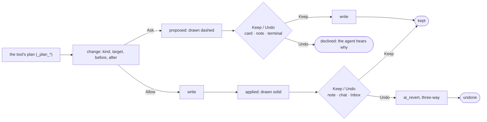

# Reviewing AI changes: one change, drawn where it lands, decided anywhere

**Status 2026-11-27.** The design this note led to was built, then
replaced by an account-wide Editing / Reviewing mode in the page header.
The marks of kept changes, the page's review strip and the asks drawn in
place, MCP's question asked in Gamma too, went with it. In Editing a
change asks first, as the permissions say, and is kept with nothing drawn.
In Reviewing a note or drawing change is made at once as a suggestion,
drawn where it lands with ✓ Accept and ✗ Reject. The journal and the diff
renderers stay. As built: [dev/ai.md](../dev/ai.md#reviewing-an-agents-changes).
The survey below is as it was written.

Asked 2026-11-25. The owner asked three questions about the git-diff view
of AI changes:

1. What should the review look like? The diff should be up before the
   person accepts or rejects a change, and accepting in the chat and
   accepting in the note should be one action.
2. Do changes made over MCP get the same view?
3. What about changes other than note text: a drawing, a highlight, a
   placed or edited picture? What is the cleanest logic, and the best
   way to show each?

Status: **steps 1 and 2 are built, MCP's changes are drawn in the note, and
step 4's proposals on PDF pages and paper** (2026-11-25 and 26, branch
`git-diff-ui`). The owner picked VS Code's words: **Keep** and **Undo**,
**Keep All** and **Undo All**, which this note now uses throughout. Then
(2026-11-26) the owner settled the flow: every change still asks first
(decision 5 below: the defaults stay Ask); while it asks, its diff is drawn
where it would land, in the note or on the PDF, and answering there or on
the card is one decision; once kept, the diff folds away and leaves a
git-like mark on the block, which unfolds the diff again with Undo, as the
change's row in the chat does. So a kept change is not "nothing more
drawn", as the tables below first put it: it is a mark until cleared (Clear
marks) or until its time is up, which the owner made a setting (a minute by
default, up to a day, or until cleared). As built:
[dev/ai.md](../dev/ai.md#reviewing-an-agents-changes). Since built too:
asking in both places for MCP (first answer wins, the client's question
withdrawn), a kept object's mark on its PDF page, and the picture compare
of step 5 for a picture an edit replaces in a note. Still to build: Review
after for clients that cannot be asked, the Inbox section,
press-and-hold compare, and the composer's chip.
Before it was built, the mechanics were in
[dev/ai.md](../dev/ai.md#asking-before-a-call-approvals) (the approval
card), [dev/ai.md](../dev/ai.md#watching-the-agent-work-live-footprint)
(tracked changes in the note), [dev/ai_tools.md](../dev/ai_tools.md#reverting-a-note-change)
(revert records) and [dev/mcp.md](../dev/mcp.md#undoing-a-change) (MCP's
journal). This note covers what those leave out, the model that closes the
gaps, and the steps to build it.

## The answer in short

- **A change becomes an object on the server.** Every changing tool's plan
  already works out what undoing it needs (the `revert` record) and what
  the card shows (the `preview`). Together these are one record: what the
  thing was before and what it is after. Kept as one row per change, for
  every agent, the record is what all the surfaces draw and decide on.
- **The note draws it as soon as it exists.** Under Ask that is when the
  call is planned, before anything is written. Under Allow it is when the
  call is written. Either way it is drawn the same, before → after. A
  dashed outline means not written yet, a solid one written and waiting.
- **One verb pair, one decision.** Every drawn change gets **Keep** and
  **Undo**. The chat card, the note's bar, the page's review strip, the
  Inbox and the assistant's terminal are views of one row. An answer in
  one updates the rest, in any tab and on any device.
- **MCP joins as just another agent.** Its changes go into the same rows
  and are drawn in the note under the agent's name. Its question can be
  answered in the terminal or in the note, whichever comes first.
- **Other kinds reuse the record.** Each kind needs one renderer and
  nothing else. A highlight, a drawing, a text box or a picture is outlined
  where it sits, with the same Keep and Undo. A changed picture is
  compared by swipe. Comments are not reviewed: they are messages from the
  agent, not edits to the person's content.

## What Gamma did on 2026-11-25

Before the steps below were built.

| Change | Under Ask, before it is written | Under Allow, after it is written | Taken back from |
|---|---|---|---|
| `edit_block` | the chat card's word diff, also drawn in the note with the card's four answers (`noteReview.ask`) | drawn in the note as tracked changes, with Revert, Hide and Hide all (`noteReview.landed`) | the chat row, the note's bar, the Revert… dialog |
| `create_block` (one block or a paste) | the chat card only | drawn in the note, tinted whole | the chat row, the note's bar |
| `move_block`, `delete_block` | the chat card only | nothing in the note | the chat row |
| `draw`, `add_text_box`, `place_picture`, `add_sheet` | the chat card, with the server's picture of the page | nothing on the page; the chip's picture in the chat | the chat row |
| `highlight` | the chat card (the place and the text) | nothing | nowhere: the person deletes it |
| `comment`, `resolve` | the chat card | nothing (the thread shows it) | nowhere |
| page, folder and label tools | the chat card | nothing in the library | the chat row ("Changed in your library") |
| any of these over MCP | the client's question (elicitation: a text diff in the terminal) | nothing anywhere in Gamma | Settings → AI → Integrations → Changes, or the agent's `undo_change` |

Five gaps follow from this.

1. **Two vocabularies for one decision.** Before the write, the note's bar
   says "Waiting for your approval" and offers Allow once, Allow in this
   chat, Always allow and Don't allow, which are words about permission.
   After the write it offers Revert and Hide. The chat's rows use revert
   and redo icons. The person is deciding one thing every time: keep the
   change or not.
2. **What the note keeps depends on the gate.** An edit allowed on its
   card is never drawn after it lands (`noteReview.js`, "allowed on its
   card, seen there"), but an edit that ran without asking is. So the trail
   in the note depends on which permission the edit went through, not on
   whether the person looked at it.
3. **Most kinds are never drawn in place.** Before the write, only
   `edit_block` is drawn. After it, only `edit_block` and `create_block`
   are. Moves, deletions, drawings, highlights and page changes show only in
   the chat.
4. **The drawing lives in one tab.** `chat/noteReview.js` holds at most 200
   changes in memory and saves none. A reload, a second window or the iPad
   draws nothing; only a press on the chat row draws a change again. The
   note's bar answers a card through the dock's function in that same tab
   (`ChatDock.jsx`), so a note open in another window cannot answer.
5. **MCP is a second implementation.** `gamma/mcp_changes.py` (since
   renamed `agent_changes.py`, the shared journal) journals what
   a connection changed so it can be undone, beside the chat's actions that
   carry the same revert records. Nothing in the note reads either one.

Behind all five: **a change is not an object.** It exists as an in-memory
approval waiting on a card, as an action saved in a conversation, as an
`agent_changes` row for MCP, and as an entry in one tab's `noteReview`
store. Each surface reads a different copy, so each can only offer what
its copy knows.

## How others do it

- **Claude Code in VS Code and JetBrains.** Before a write, the permission
  prompt opens the IDE's diff of the proposed file. Accept or reject in the
  diff, or in the chat panel; both are the same answer. The write waits.
- **Cursor's agent, Copilot's agent mode in VS Code.** The edit is written
  to the working copy at once. The editor marks each hunk inline with Keep
  and Undo. A floating bar steps through hunks and files ("2 of 5"), and
  the chat lists the changed files with Keep all and Undo all. The editor
  and the chat share one state. The agent does not wait.
- **Google Docs suggestions, Word's track changes, Overleaf's review.**
  Changes are kept as suggestions, drawn inline in the author's colour, and
  accepted or rejected on a card in the margin, one at a time or all at
  once. AI assistants in these editors can write as suggestions.
- **Notion AI.** The generated text is shown in place, highlighted, with
  Accept, Discard and Try again before it enters the page.
- **GitHub's image diff.** A changed picture is compared in three modes:
  2-up (side by side), swipe (a divider dragged across), and onion skin (an
  opacity slider). Added and removed files get green and red frames.

All of them draw the change where it lands, as a diff against what was
there, and treat the chat's button and the editor's button as one
decision. They differ only in whether the write happens before the
decision or after. Gamma has both gates already (Ask and Allow). It should
keep both, and draw and decide them the same way.

## The model: one change record



A change is one row:

- `id`, `at`, `agent` (the stamp: Gamma AI, Claude Code, Codex),
  `for` (the account it acted for), and `source`: a chat reply
  (conversation, message, action index), an MCP connection (token), or a
  computer agent's turn.
- `tool`, `kind`, `page_id` and `block_id`. The kinds are today's revert
  kinds (`edit`, `create`, `move`, `delete`, `made`, `pages`, `trash`,
  `tree`), and later the spatial ones below.
- `record`: before and after, which is the `revert` record each tool
  already writes ([ai_tools.md](../dev/ai_tools.md#reverting-a-note-change)'s
  table). Under Ask, the plan's preview gives the same shape, since it is
  built on the same `_plan_*` function.
- `state`, and `decided_at`, `decided_by` and `decided_in` (note, chat,
  terminal, Inbox, Settings).

The drawing reads only the kind and the record. It does not care whether
the write has happened: a proposed change is drawn over a note that still
says *before*, an applied one over a note that says *after*, and the
picture is the same.

| State | In the note | Buttons | Keep | Undo |
|---|---|---|---|---|
| proposed (Ask) | the change drawn as a ghost, **dashed** outline | Keep ▾, Undo | planned again with its digest and written, as allowing does now; nothing more is drawn | nothing written; the agent hears it, with the line of what to do instead |
| applied (Allow) | drawn as tracked changes, **solid** outline | Keep, Undo | stop drawing it, remembered | `ai_revert` (the three-way merge), which may stop with "Undo anyway" as today; the replay tells the model |
| kept, undone, declined, expired | nothing | the chat row keeps Revert or Redo | | |

**The verbs.** Keep and Undo go on every change that can be drawn,
before or after the write. Allow and Don't allow stay only for calls with
nothing to draw: a reading tool set to Ask, or a computer agent's command.
The grants move behind Keep's chevron: *Keep, and allow edits in this
chat* and *Keep, and always allow edits*. Hide goes away: Keep is what
Hide meant (I have looked, keep it, stop marking it), except that it is now
remembered.

**Decisions made without a press.**

- When the change's owner types into a block that has an applied change,
  that change is kept: the text is theirs now, and the diff could not
  be drawn over their words anyway. A collaborator's typing leaves it
  pending. The bar says "Changed since by Ana", and Undo merges as revert
  does now.
- A proposed change whose card went unanswered for 10 minutes, or whose
  reply stopped, is expired, and its ghost goes.
- Keep All and Undo All are on the page strip, the reply and the
  composer's chip.

**The block is the hunk.** Notes are short blocks, so one block's change
is one hunk to accept or reject. Several edits of one block in a row still
draw as one change (`noteReview.withChange` chains them), and Undo takes
the steps back newest first. Keeping only part of one block's edit, as
staging part of a hunk in git does, is left out.

## 1. One decision on every surface

Yes: the diff should be up before the person accepts or rejects, and the
chat and the note should be the same action. With the record on the
server:

- **The diff is up as soon as the change exists:** when it is planned
  (Ask) or written (Allow). Nothing is decided before it is drawn.
- **One row, many views.** The chat card, the note's bar and the page strip
  all show one change id. An answer posts to one route. The page's room
  sends the new state to every open tab, which redraws, and the iPad updates
  the same way.
- **One component.** The card and the bar render the same thing: the head
  (the agent and what it does), the diff, then Keep ▾ and Undo. The
  card adds *Show in note*, and the bar adds *Open in chat*.

```
Chat (Ask)                                   Note
┌──────────────────────────────────────┐     ▍ We measured the ~~resistance~~
│ ⛨ Approval needed · Edit note blocks │     ▍ conductance at 4 K.
│ ✎ Edit a note in “Paper”   Show ↗    │     ┆ ┌─────────────────────────────┐
│ We measured the ~~resistance~~ …     │     ┆ │✦ Gamma AI wants to edit this │
│ [Keep ▾]                 [Undo]  │ ═══ ┆ │[Keep ▾]          [Undo] │
└──────────────────────────────────────┘     ┆ └─────────────────────────────┘
                     same change id, same state, either answers both
```

The page strip sits at the foot of the notes pane while the page holds
changes to review, and replaces Hide all:

```
┌────────────────────────────────────────────────────────────────┐
│ ✦ 4 AI changes to review   ‹ 2 of 4 ›      Undo All  Keep All │
└────────────────────────────────────────────────────────────────┘
```

‹ and › scroll to the previous and next change and focus it. Keys for
next, previous, accept and reject are to be chosen against
[hotkeys.md](../dev/hotkeys.md). A focused change shows its bar at the
block's right edge. Every changed block keeps its gutter mark and inline
diff, but the bar shows only for the focused one (hover, a key step, or a
tap on touch). Today a bar under every changed block stacks up when a
reply changes many.

In the chat, a reply's "Changed in your notes" becomes the reply's review
list:

```
Changed in your notes · 3 to review               Undo All   Keep All
  ✎ “Paper”: edited a note                                       ✓   ✕
  + “Paper”: added 2 notes under Methods                         ✓   ✕
  ↷ “Notes”: moved a note                         Kept       ⟲
```

While the conversation holds changes to review, the composer shows a chip,
"3 to review", which scrolls to them. The Revert… dialog stays for taking
back changes across the whole conversation.

## 2. MCP

Not on 2026-11-25. The client asked in its own terminal (elicitation, plain
text diff lines), the change landed in the note without a mark, and the
person's only review was the connection's Changes list in Settings.

With the shared record:

- **Drawn like the chat's.** The connection's changes go into the shared
  journal (built: `run_agent_tool` journals them, `gamma/agent_changes.py`),
  so the note draws the change with the agent's name on the bar
  ("Claude Code"). `undo_change` is Undo, and `list_changes` reads the
  same rows, with their states. So an agent can learn that the person
  undone its change, as the chat's replay tells Gamma AI.
- **Asked in both places, first answer wins.** `GammaMCP._ask` makes a
  proposed change before it sends the elicitation. A note open on that page
  draws it with Keep and Undo while the terminal shows the question.
  Whichever is answered first decides, and the other says so ("Kept in
  Gamma", "Kept in Claude Code"). After an answer in Gamma, the server
  sends `notifications/cancelled` for its elicitation request. Whether
  Claude Code and Codex close the form when they get it is still to be
  checked.
- **Review after, for clients that cannot be asked.** claude.ai, Claude
  Desktop and any stateless client get `CANNOT_ASK` today unless asking is
  turned off. Turn the connection's switch *Ask me before each change* into
  a choice: **Ask first** (elicitation, plus the note) or **Review after**
  (written at once, kept as applied, drawn for review). Keeping a stateless
  call open while Gamma asks is not recommended: clients' tool timeouts are
  unknown and short.
- **A place for changes made while Gamma was closed.** The Inbox gets a
  section, "AI changes to review", grouped by page and agent. Each entry
  opens the page with that change focused. Settings' Changes list stays as
  the connection's history, read from the same rows.

## 3. Other kinds of change

**What gets reviewed.** A change to the person's content gets reviewed:
blocks (notes, highlights, drawings, text boxes, pictures, sheets), pages,
folders and labels. Speech does not: comments, replies and resolves are
signed messages from the agent. They sit in their thread, the Inbox tells
the person about them, and the person deletes a comment or reopens a
thread. A highlight made by `highlight` is content, a block in the notes,
so it gets reviewed. On 2026-11-25 it could not be taken back. Under this
design (built) its revert is a created block's: Undo deletes it, and stops
when a thread has been opened on it since. The highlight that a comment on a quote makes
is the comment's anchor, so it goes with the comment.

**One renderer per kind.** Each kind's record already holds before and
after. Each kind needs a renderer and nothing else.

| Kind | Record, before → after | In the notes outline | On the PDF page, the paper or the library |
|---|---|---|---|
| text edit | text → text | the word diff in the block (`editor/mdDiff.js`, built), amber gutter | |
| new blocks | ∅ → blocks | green gutter, tinted; a paste is one change over its rows | |
| deleted blocks | blocks → ∅ | ghost rows where they were, struck, red gutter, cut to the first line and "and 4 notes under it" | |
| moved block | (parent, position) → (parent, position) | where it went: blue gutter, "Moved from “Methods”"; where it was: a one-line ghost, "Moved to “Results” ↓", which jumps there | |
| highlight | ∅ → highlight block | its row tinted | its wash drawn with the change's outline and the agent's tag |
| drawing, text box, placed picture, sheet | ∅ → properties | its row tinted | the object drawn, an outline around its box, the toolbar on it |
| changed object (later: a move, resize or recolour of an object, a redraw of handwriting) | properties → properties | chips in the bar: "colour: red → blue" | the old frame as a faint outline, the new one drawn; press and hold to see the old |
| replaced picture (later: an AI edit of a picture) | file → file | | a swipe divider in the picture's frame; expanded: 2-up, swipe, onion skin |
| page renamed, moved, labelled, made or deleted | field before → after | the page header: the old title struck, the new one; Recently deleted: "Deleted by Gamma AI", with Restore as Undo | the library row: a dot, and the title's diff on hover |
| folder or label | tree before → after | | the library |

**On a page.** A spatial change is drawn as itself, with an accent outline
around its box and the agent's tag at the corner. Pressing or hovering
shows a small toolbar where the lasso's menu would sit: ✓ Keep, ✕ Undo,
and an eye to press and hold to see the page without the change (or with
the old picture). Press-and-hold covers every spatial kind, from an added
arrow to a recoloured picture, and is easier to read on a PDF than two
copies side by side.

```
   ┌ ─ ─ ─ ─ ─ ─ ─ ─ ─ ┐ ✦ Gamma AI
   │   ⟶  (an arrow)    │ [✓] [✕] [👁 hold]
   └ ─ ─ ─ ─ ─ ─ ─ ─ ─ ┘      dashed: proposed; solid once written
```

A proposed drawing is shown at reduced opacity with a dashed outline. To
draw it before it is written, the preview must carry the object's
properties, with the ink's strokes inline rather than as a stored file.
The chat card keeps the server's picture of the page as well.

**Pictures inside a note.** `mdDiff` treats a picture as one word, so a
picture replaced in a block's text drew as the old one struck out above
the new one. When two pictures pair up in one place (one removed, one added
there), they should draw as one compare frame, the swipe above (built:
`editor/PictureDiff.jsx`). The same
component serves a replaced picture on a page.

Handwriting the person converts themselves (Redraw as shapes, Convert to
text) is not an agent change. If an agent ever redraws handwriting, that is
a changed object.

## Data and routes

The plan below was built with other names
([dev/ai.md](../dev/ai.md#reviewing-an-agents-changes)). The table gained
`account`, `source`, `kept_at` and `cleared_at` (step 73), and the state is
read from those times. The routes are `GET /api/ai/changes?page_id=` or
`?ids=`, `POST /api/ai/changes/{id}` with a decision, and `POST
/api/ai/changes/keep` and `/clear`. The tabs hear `{t: "ai_changes"}`
through the account's sockets. The journal keeps the newest 500 changes per
account and connection, none older than 30 days.

- **One table.** Extend `agent_changes` (each workspace's `pages.db`,
  already private: no backup or mirror carries it) to every agent. Add
  `source`, `conversation`, `message`, `idx`, `for`, `state`, `decided_at`,
  `decided_by` and `decided_in`; `revert` serves as the record. Columns on
  an existing table make this a migration step
  ([migrations.md](../dev/migrations.md)).
- **One writer.** `ai_tools.registry.run_agent_tool` records every applied
  change, from the chat and from MCP, instead of `mcp_server._call` alone.
  The action carries `change_id`. A proposal's row is made where the gate
  asks (`ApprovalGate`, `GammaMCP._ask`). The wait itself stays in memory
  (`ai_permissions.wait_for`), and the decision route answers it.
- **Routes.** `GET /api/ai/changes?page=…&state=open` returns what a page
  draws; `?conversation=…` gives the chat its rows' states; `?token=…`
  serves Settings. `POST /api/ai/changes/{id}/accept`, `…/reject` (with
  `force`: today's `/api/ai/revert`) and `…/redo`.
- **Live.** The page's room carries a `change` event (id and state) to
  every tab that has the page open. The chat reads states by id when it
  draws a reply.
- **The conversation keeps its copy.** An action keeps its `revert`. That
  copy is the conversation's own and lasts longer than the journal. Where a
  row exists, its state replaces the action's `reverted` mark. Older
  actions, and those past the journal's retention, fall back to the mark.
- **Retention.** Rows waiting for review stay until decided, capped per
  account and workspace (for example 2,000, past which the oldest are
  kept). Decided rows go after `KEEP_DAYS`, as now.
- **Who decides.** Only the account the change was for. Undo needs write
  access, as a revert does.

**What it replaces:** `noteReview`'s in-tab store (`changes`, `asking`,
`MAX`) becomes a per-page read plus socket events. `NoteReviewBar`'s two
modes become one bar. Hide and Hide all become Keep and Keep All.
MCP's own journal becomes the shared one. Settings' `ConnectionChanges`
keeps its view, now over the shared rows. All of this lives in the shared
layer, the record and one renderer per kind, so the desktop, the iPad and
the share view draw the same thing.

## Steps

1. **The record.** The shared journal, `change_id` on actions, the routes
   and the room's event. The chat's rows read their states. No visible
   change yet, apart from states that survive a reload.
2. **Note blocks.** Gutter marks, one bar, the page strip, Keep and Undo
   everywhere, Keep ▾ on the card, ghost rows for proposed creates, moves
   and deletions, all drawn again after a reload and on other devices.
3. **MCP.** Its changes drawn in the note, first-answer-wins asking with the
   cancel, the Review after mode, and the Inbox section.
4. **Pages and paper.** A revert for `highlight`, the outline and toolbar
   on PDF pages and paper, proposed overlays, and press-and-hold compare.
5. **Pictures.** The compare frame, once a tool edits pictures. Until then
   it serves only a picture replaced in a note's text.

## Decisions (taken by the owner)

1. **Keep and Undo**, VS Code's words (decided by the owner: "use
   git/vscode language"), rather than Accept and Reject. Keep and Undo
   read the same before and after a write.
2. **Who sees the marks in a shared workspace:** only the change's owner,
   as recommended (built: the journal's reads and decisions are the
   account's alone). A muted "unreviewed AI change" gutter for every editor
   was left out.
3. **Typing keeps:** the owner's typing in a changed block keeps it (built).
4. **The block is the hunk:** no partial keep inside one block (built).
5. **Defaults.** Once review after the write lasts and Undo always
   works, Edit note blocks, Draw on pages and Comments and highlights could
   default to Allow: the agent goes on without waiting, and the person
   reviews after. Ask would stay the default for deletions and library
   changes. This is a product choice, not something the design requires,
   and the defaults are unchanged so far: still Ask for every change.

## Still open

- Whether Claude Code and Codex close an elicitation form when they get
  `notifications/cancelled`.
- An Unlimited reply that makes thousands of changes: the strip and the
  lists must page, and Keep All must be one request.
- How many ghost rows to draw for a proposed paste of up to 500 blocks:
  draw the first few, then "and 480 more".
- A deletion or a page made without asking waits for review with nothing
  in a note to draw it on: it is kept or undone from its row, the reply's
  in the chat or the connection's Changes in Settings, and the page's
  strip leaves it out. A struck ghost row where the note was, or a line in
  the strip, would bring it into the note; journaling it as kept would
  hide it from review, so it is not.
- A computer agent's file edits in a synced folder ("Changed in the synced
  folder") are diffs of text files on disk, a different store. The same
  bar could review them once a file's page can show a diff. They are left
  out here.
