# Gamma user guide

Read papers, keep what you learn. This guide shows each part of Gamma in a short animation and a few lines. Installing it is in the [README](../../README.md).

| Section | What it covers |
|---|---|
| [Getting started](#getting-started) | Sign in, add a paper, read it |
| [Highlight and annotate](#highlight-and-annotate) | Highlights and their notes, area screenshots |
| [Draw and type on the page](#draw-and-type-on-the-page) | Pens, the lasso, text boxes, pictures |
| [Record audio](#record-audio) | A lecture in step with your notes; tap anything to hear that moment |
| [Notebooks](#notebooks) | Sheets of paper to write on |
| [Follow links and translate](#follow-links-and-translate) | Citations, Back, translation in place |
| [Notes](#notes) | Markdown and math that render as you type |
| [Outline and links between pages](#outline-and-links-between-pages) | Nesting, moving notes, `[[` links, `@` mentions and reminders |
| [AI chat](#ai-chat) | Ask about the paper, with clickable citations; every AI service you can connect |
| [The library agent](#the-library-agent) | Let the AI organize and edit, with your approval; what each tool does |
| [Library](#library) | Labels or folders and how to file a paper, Recently deleted |
| [Search](#search) | Everything at once, Ctrl+P to jump |
| [Metadata and citations](#metadata-and-citations) | Title, authors, BibTeX |
| [Share a page](#share-a-page) | Links for viewers and editors |
| [Workspaces](#workspaces) | Personal and shared libraries, editing together |
| [Comments and inbox](#comments-and-inbox) | Threads on notes, highlights and pages; mentions, replies and shares in one inbox |
| [Offline copies](#offline-copies) | A synced copy on your laptop or iPad |
| [Gamma Connector](#gamma-connector) | Save papers from the browser |
| [Assistants](#assistants) | Codex, Claude Code, DeepSeek Harness and other MCP clients; the tools they get |
| [Import and export](#import-and-export) | Zotero, Notability, Obsidian, Notion, PDF, BibTeX |
| [Backups and upgrades](#backups-and-upgrades) | Snapshots, exports, what a new version does |
| [Install as an app](#install-as-an-app) | iPad, phone, desktop |
| [Settings](#settings) | Where things are |
| [Shortcut cheat sheet](#shortcut-cheat-sheet) | Every default key |

## Getting started


1. **Sign in** with the account your administrator gave you, or **Continue as guest** where the server allows it (a guest workspace is deleted after a while; the button says when).
2. **Add a paper**: press **+** and paste any link (arXiv, DOI, a publisher page). Gamma finds the PDF. Or upload PDFs, or drag files and folders into the window.
3. **Read it.** The paper opens with a Notes panel beside it. Select text to highlight, type under the highlight to add a note. Everything else builds on that.

A new account starts with a **Welcome** page to practise on, and a **Sketchbook**: a notebook whose drawings show what to try with the pen and circle where each button is. **Tours** in the account menu walk you through each part on the real controls.

## Highlight and annotate


- **Highlight**: select text, and pick one of four colors in the bar that opens beside the pointer. The highlight becomes a note block, ready for your note. The tools after the colors comment on the passage, link it to a paper and translate it.
- **Area screenshot**: hold **Ctrl** and drag a rectangle. The region goes to the AI chat as an image, and a color keeps it as an area highlight.
- **Click a highlight** to jump to its note; click the note to jump back. **Right-click** to recolor, link, comment on or delete it.
- Highlights, drawings, typed notes and image stamps made in other PDF apps are imported when the paper is added. An image stamp becomes a picture on the page.
- **Zoom** with Ctrl+wheel or pinch; **dark pages** in Settings → Appearance.

## Draw and type on the page


The pen button in the viewer's zoom column opens the tool strip: pens and highlighters, an eraser, a lasso, the Text tool, the Picture button, undo and redo.

- A **stylus** draws right away, with pressure, while fingers scroll. The mouse draws once the strip is open.
- The **lasso** moves, resizes, recolors, flips, copies, duplicates or deletes strokes. Ctrl+C / X / V copy, cut and paste them; to paste at a point, hold the pen still on the page, or right-click there. **New note** in the lasso's menu gives the selection a note of its own.
- **More** (⋯) on the strip holds the **ruler** (a straight edge: a pen along its edge draws a straight line), **Shapes** (drag a line, an arrow, a rectangle or an ellipse) and the **zoom window** (write large in a panel under the page, on PDF pages). A shape you select has handles to reshape it and can be filled.
- The pen's **Style** menu offers Pen, Ballpoint, Brush, Pencil and **Calligraphy**, a flat nib whose angle you set.
- The strokes on a page become **one ink block** in the notes, with a caption under it. Its play button replays the writing.
- **Transcribe with AI** in the block's menu turns handwriting into text, math as LaTeX; **Transcribe** in the lasso's menu does it for just the selected strokes.


The **Text** tool puts typed text on the page like a text box in Acrobat: click to place, type, drag the handle to resize. Markdown and math work inside it, and each box is a note with a **T** marker.

The **Picture** button (**I**) on the strip puts photos and images on the page in view, a PDF page or a sheet of paper. A new picture lands in the middle of the page, at most half its width and height, and stays selected. Pictures lie under the handwriting and the text boxes, and each one is a note with a picture marker.

- **Paste or drop** works too: paste an image while no note is being edited, or drop image files on the page where they should go. Several files land stacked, each a little to the right of and below the last. While you type in a note, a paste puts the image in the note instead ([Notes](#notes)).
- **Formats**: PNG, JPEG, GIF and WebP go up as they are, and a GIF keeps its animation. Other images the browser can open (HEIC in Safari, TIFF, BMP, SVG) are converted to JPEG or PNG, and a very large picture is scaled down.
- **Select** a picture with a click or a tap while no tool is armed: the strip closed, or the hand (**V**). Right-click also selects it and opens its menu. With a tool armed, the tool works over a picture that is not selected: a pen writes on it. A stylus writes on it too, until the picture is selected. **Escape** lets go.
- **Move** it by dragging, or with the arrow keys (1 pt a press, 10 with Shift). A finger moves only the selected picture and scrolls elsewhere. A picture stays on its page.
- **Resize and turn** it with the two handles on its corners, as with the lasso. The resize handle keeps the proportions; hold **Alt** to stretch the picture. The turn snaps to right angles, or to 15° steps with **Shift**.
- **Crop** from the menu, or double-click the picture. Drag the corners and sides, or drag inside to move the part kept. **Enter** or the check applies the crop, **Escape** or the cross cancels it. The part kept stays where it was, and the rest of the image is not thrown away: a wider crop or **Reset** brings it back.
- **The menu** of a selected picture holds Crop, Flip horizontal, Flip vertical, Duplicate, Copy image (it needs HTTPS or localhost) and Delete. **More** (⋯) holds Fit to page (centred, as large as the page allows), Reset (the whole picture, upright and unflipped, at its own proportions), Bring to front and Send to back (among the page's pictures) and Show note. **Delete** or **Backspace** deletes the selected picture.
- **In the notes** the picture's block shows it as it is on the page; click it or its marker to find it there. The block's text is the picture's caption. Exports keep the caption: the image's alt text in Markdown, the annotation's comment in the annotated PDF, the caption under the picture in Notability. On a page you can only view, a click on a picture shows its block.
- **Undo**: Ctrl+Z, or the strip's Undo while the picture is selected, takes back each edit.

## Record audio


Press the **microphone** in the viewer's zoom column, after the pen, and keep reading and writing: everything you write or type while it records is linked to the moment you made it.

- The **recording** appears as a block in the notes with its length and date. **Pause** and **Stop** are on the pill at the bottom of the page; **Bookmark** drops a note stamped a few seconds back, for a moment you want to find again.
- **Play** on the recording's card plays it back: handwriting not yet reached is faded and appears as it was written, notes are shaded until their moment, and the page and the notes follow along.
- **Tap any stroke, text box, picture or note** during playback to hear what was being said when you wrote it, from a few seconds before. Outside playback, hover a note for the play glyph in its margin.
- The player has 10-second skips, *Previous* / *Next writing* to jump past the silence, three display modes (Spotlight, Reveal, Static) and speeds from 0.7× to 2×.
- **Transcribe** in the card's menu writes the spoken words under the recording, each paragraph linked to its moment, so you can search them and tap one to hear it. Settings → Reading & editing › Recordings can do this for every recording.
- Recording needs HTTPS, localhost or the desktop app: a browser blocks the microphone on plain HTTP.

Try the [interactive demo](demos/audio-replay.html) of playback.

## Notebooks


A notebook is a page with sheets of paper to write on, and any page can hold them.

- **+ → New notebook**, or type **/note** in a block.
- Write with the same pens as on a PDF; writing near the bottom adds the next sheet.
- **Paper** sets size, orientation and pattern (blank, ruled, grid, dots).
- **Notebook view** shows the sheets large in the viewer; **Notes view** puts them back among your notes.

## Follow links and translate


- **Citations are clickable**: a paper already in your library opens; otherwise choose *Fetch into Gamma* or *Open in browser*.
- **Back** (**Alt+←**) unwinds jumps with their exact scroll positions, across papers too.


- The **文A button** translates the page you are reading, in place. Hold **Alt** to peek at the original; right-click for the whole document.
- Formulas, citations and links keep their printed look inside the translation, and a paragraph that runs on into the next column is translated as one, as is one that runs over a page break when you translate the whole document.
- Select text and press 文A in the popup to translate a passage.
- Settings → Language and Translation picks the language and what translates: a chat model, or a translation service (Microsoft works with no setup).

## Notes


Notes are a nested outline. Highlights and free notes are the same kind of block.

- **Live rendering**: the block you are on stays raw; everything else renders. Headings, lists, to-dos, callouts, tables, code, images, links.
- **Math**: `$…$` and `$$…$$` render with KaTeX, with a live preview while you type and Tab hopping between `{}` arguments.
- **Pictures**: paste or drag an image in; drag its grip to resize. Double-click a picture, or press the zoom button in a picture's or a diagram's toolbar, to see it full size; in a chat reply a click on a diagram does the same. Right-click a picture or a diagram and choose **Copy image** to paste it elsewhere; this needs HTTPS or localhost.
- **Tables** are edited in place; a table from Excel pastes as markdown.
- **"/" menu**: type `/` for headings, callouts, code, colors, a notebook sheet, a new page.
- **Quotes and callouts** keep going over several lines: Enter carries the `>` (and a list inside it) to the next line, and **Ctrl+Shift+.** quotes or unquotes the selected lines. `/callout` on a quote's first line turns it into a callout; on a line inside one it starts a box inside it.
- **Pasting keeps the structure**: pasted lines land at the level of the line you paste onto, in its quote or beside its list item, and a pasted list keeps its sub-items. The **Paste as** menu offers **Nested** (one level in) and **As copied**. The `/` line commands (headings, lists, to-dos, quote, callout) keep a line's quote and indentation.
- **Formatting bar**: select text in the note you are editing and a bar of tools opens above it: bold, italic, underline, strikethrough, code, equation, link, highlight and **Color**, which offers text colors and background tints. A pressed button shows what the selection already has; press it again to take that off. Escape puts the bar away. On a touch screen the same tools sit in the bar above the keyboard.
- **Formatting keys** are Obsidian's: Ctrl+B, Ctrl+I, Ctrl+U, Ctrl+K and so on. Underline and colors are written as the HTML that Obsidian and GitHub show. Rendered notes copy as rich text; math copies as LaTeX.

## Outline and links between pages


- **Enter** inserts a line break, **Shift+Enter** a new note (swap them in Settings → Keyboard). **Tab / Shift+Tab** indent and outdent.
- Drag the **⋮⋮ handle** to reorder or re-nest; **+** under it adds a block.
- **Undo** is one history for the whole page.


- **`[[`** links to a page or a note; the link is a clickable chip, and **Linked from** under a page lists everything that links to it. `![[block]]` embeds a block you can edit in place.
- **`@`** mentions a date, a person or a page, as in Notion: **Today**, **Remind me** (tomorrow at 9, or what you type, such as `@fri 3pm` or `@remind me next mon`; `@remind @bob fri` reminds a colleague), the people of the workspace, and pages by title. A reminder shows a card at its time, and a system notification if you allow them, while Gamma is open.
- **/page** makes a new page from a note and links it where you typed.

## AI chat


Open the chat from the **View menu (≡) → AI Chat**. Gamma has no AI of its own: connect a service in Settings → AI → Connections and the chat uses your account with it. Keys stay on the server and are never sent back to the browser; a server administrator can also add connections everyone on the server shares.

- The chat reads the open paper by itself. The **PDF** button sends the file with every message while it is on, so the model sees figures and tables. The file stays at the start of the conversation, so after the first message the provider can serve it from its prompt cache.
- **Add more**: paste images, Ctrl+drag a region of the page, click highlights to quote them, type **@** to attach another paper.
- **Citations are clickable**: `p. 12` jumps the PDF to the passage and highlights it.
- The **model chip** switches the model, reasoning effort and speed. Each reply says what wrote it and what it cost in tokens.
- Select part of a note and ask for a change: the assistant rewrites only that selection.
- Each paper and folder keeps its own conversation. **New chat** starts over and keeps the old one in History; Alt+click it to throw the old one away.

### AI services you can connect

A connection is a sign-in or an API key plus the address the chat talks to. The dialog checks the key against the service's own model list, and you pick the models the chat offers from that list.

| Service | Sign-in | Address |
|---|---|---|
| **ChatGPT** | Your ChatGPT Plus or Pro subscription, signed in in the browser. No API key | Fixed; nothing to enter |
| **Anthropic** (Claude) | Console API key | `https://api.anthropic.com`, or any service that speaks the Anthropic Messages API |
| **OpenAI API** (GPT) | API key | `https://api.openai.com` |
| **DeepSeek** | API key | `https://api.deepseek.com` |
| **Kimi** | API key, or a Kimi Code subscription | `https://api.moonshot.ai`; China `https://api.moonshot.cn`; Kimi Code `https://api.kimi.com/coding/v1` |
| **Qwen** | API key, or a Coding Plan subscription | Model Studio `https://dashscope-intl.aliyuncs.com/compatible-mode/v1`; China `https://dashscope.aliyuncs.com/compatible-mode/v1`; Coding Plan `https://coding-intl.dashscope.aliyuncs.com/v1`, China `https://coding.dashscope.aliyuncs.com/v1` |
| **GLM** | API key, or a GLM Coding Plan subscription | Z.ai `https://api.z.ai/api/paas/v4`; Zhipu China `https://open.bigmodel.cn/api/paas/v4`; Coding Plan `…/api/coding/paas/v4` on either host |
| **OpenRouter** | API key | `https://openrouter.ai/api/v1` |
| **Custom endpoint** | API key, if the server wants one | Any OpenAI-compatible address: a gateway such as LiteLLM, or a local server such as Ollama, vLLM or llama.cpp |

DeepSeek, Kimi, Qwen, GLM, OpenRouter and the custom endpoint sit under the **Other** tile. A coding-plan subscription is an API key the vendor's console makes for that plan, pointed at the plan's own address; Alibaba allows the Qwen Coding Plan only inside coding tools. There is no Anthropic subscription sign-in, since Anthropic's terms do not allow one: Claude is reached with a Console key.

## The library agent


On the home page or in a folder, the chat can act on your library: list, read and search the papers in view, rename them, file them into folders, search the web for papers and save them, build BibTeX, and edit your notes. On a paper, the same chat reads, searches and edits that paper and its notes.

- **It asks first.** A change shows as a card. **Allow once**, **Allow in this chat**, **Always allow**, or **Don't allow** (with a line on what to do instead).
- Everything it changed is listed under the reply, each with an undo.
- Settings → AI → Tool usage sets each permission below to Allow, Ask or Off, for folder, PDF and notes chats separately, with presets from *Read library* to *Allow all*. Reading is allowed by default; anything that changes your library asks.
- A journal that blocks the server shows a card: open the page in your browser and Gamma Connector sends the PDF back.

### What the chat's tools can do

| Permission | Tools | What they do |
|---|---|---|
| **Read your library** | | |
| List pages | `list_pages`, `list_folders`, `list_deleted` | Browse page titles, folders, metadata and Recently deleted (folder chats) |
| Read pages | `read_page`, `read_chats`, `cite` | Read PDF text, highlights, notes, earlier chats and citation records (metadata, BibTeX) |
| Read note blocks | `read_block` | Read individual notes and their outline |
| View pages and handwriting | `view_pdf_page`, `view_ink`, `view_image` | Look at figures, tables, scanned pages, your handwriting and the pictures in your notes and on your pages |
| Search library | `search_library` | Find text in your notes and PDFs |
| **Web research** | | |
| Search papers online | `search_papers`, `related_papers`, `search_web` | Find papers on Crossref, arXiv and OpenAlex, follow their citations, and search the web through your AI connection, Brave Search or SearXNG (Tool usage → Online search) |
| Fetch documents | `fetch_paper`, `read_paper` | Read a DOI, arXiv id or URL without saving it; a paywall or sign-in hands the fetch to your browser |
| Use journal sign-ins | | Use the publisher sign-ins Gamma Connector saved when fetching |
| **Make changes** | | |
| Save papers | `save_paper` | Add a paper found online to the library |
| Rename pages | `rename_page` | Change a page's title (folder chats) |
| Move pages | `move_page` | File a page into a folder (folder chats) |
| Restore deleted pages | `restore_page` | Bring a page back from Recently deleted (folder chats) |
| Edit note blocks | `edit_block`, `create_block`, `move_block`, `delete_block`, `clip_region` | Create, edit, move and delete notes, transcribe handwriting, and clip a region of a PDF page into a note |

The agent cannot delete pages, and an assistant connected from outside ([Assistants](#assistants)) gets the reading tools only.

## Library


The home page lists your pages, most recent first, with a **Recently viewed** strip on top.

- **Labels** are words you'll search for. **Folders** are labels that nest, for a topic or a talk. Neither one copies a paper ([which to use](#labels-or-folders)).
- **Select** like a file manager: click, Ctrl+click, Shift+click; double-click opens; right-click for rename, move, label, share, export, delete.
- **Recently deleted** keeps a page for 30 days, with its notes and files.

### Labels or folders?

Neither one copies a paper, and a paper can have as many labels and folders as you like. The difference is how you'll come back to it.

**A label is a word you'll search for.** A paper on PDH locking gets `pdh`. A paper from Vladan's lab on PGC cooling gets `vladan` and `pgc`. Labels are flat, so keep them short: a technique, an author, a lab, a keyword.

- **Add one**: right-click the paper → **Add label** → **New label…**, or type it into the label row under the paper's title and press Enter. You can also drop a paper on a label in the **Labels** view.
- **Find papers with it**: click a label chip to list its papers, or press **Ctrl+P** and type its name. In search, type it and press Tab to get a filter chip. The listing bar's **Labels** view shows every label, with how many papers have it.

**A folder is a label that nests.** Use one for a topic you're studying or something you're preparing.

- **A topic**: make **Quantum computing**, and inside it **Neutral atom**, **Superconducting qubits** and **Ion trap**. A paper filed in Neutral atom shows *Quantum computing / Neutral atom* next to its labels.
- **A talk**: make **gm1** for one group meeting and **gm2** for the next. A paper you present at both sits in both folders. It is still one paper with one set of notes, whichever folder you open it from.
- **Make one**: click **New folder** in the listing (inside a folder, this makes a subfolder), or right-click a folder → **New subfolder**.
- **File a paper**: drag it onto the folder, or right-click it → **Move to folder**. Either way the paper keeps its other folders. Typing the folder's name into the label row works too. If you file a paper into a subfolder of a folder it is already in, it moves down into the subfolder instead of staying at both levels. To take it out, drop it on the back row, or use **Move to folder** → **Remove from**.
- **Use it as a whole**: share the folder, export it with a `.bib` of its papers, or ask the AI about everything in it. Each of these includes the subfolders. A folder chip in search limits the results to that folder.
- **Deleting a folder** never deletes its papers. They stay in their other folders, or at the library root.

A simple test: if you'd type it into search, make it a label. If you'd open it and work through it, make it a folder.

Coming from Zotero? A folder is a collection (subfolders are subcollections) and a label is a tag. A [Zotero import](#import-and-export) turns collections into folders and tags into labels, and a Zotero export turns them back. One difference: Zotero keeps an item in the parent collection when you add it to a subcollection, while Gamma moves it down into the subfolder.

## Search


- **Ctrl+F** on a page, **Ctrl+Shift+F** anywhere: titles, notes, highlights and the full text of every PDF, at once. "3000" finds "3,000-qubit".
- Type a folder or label name and press Tab for a **filter chip**.
- **Ctrl+P** jumps to any page, folder or label by name. Shift+Enter creates a page with what you typed.

## Metadata and citations


- Title, authors, venue and year are filled in when a paper is added (arXiv, then DOI, then AI). The **(i) button** in the Notes title row shows and edits them, with **↻ refetch**.
- A red **!** means nothing tied the record to this PDF: a supplement, for one, prints only the DOIs of papers it cites. Type the right DOI or arXiv id and press **Save metadata**: the rest of the fields fill in from doi.org or arXiv.
- The share popover holds the **BibTeX** entry and a slide-ready citation, each with a copy button.
- **Type** says what the paper is: journal article, conference paper, preprint, book chapter, book, thesis and so on, with the same names Zotero uses. It decides the BibTeX entry (a conference paper is an `@inproceedings`) and which fields the popover shows.
- **Cite key** is the name LaTeX cites the paper by: made from author and year, or pinned by you. Zotero imports keep their keys.

## Share a page


The **link button** in the top bar shares the open page.

- **Share** makes the link. **Copy link** carries the workspace, so a teammate lands in the right library.
- **Who has access**: invite people by name, each with **View** or **Edit**. They find the page in their Inbox.
- **Gamma Cloud**: on a server with Gamma Cloud sign-in, the switch beside Who has access invites someone by their Gamma Cloud username, even without an account here yet. They show as **pending** until they sign in with Gamma Cloud, then the page is theirs to open. If someone here already goes by their username, they get a name like *tim-2*, with their Gamma Cloud name shown beside it.
- **Requests to join**: on a server that admits invited people only, someone who signs in from your link without an invitation asks to join instead. The request heads Who has access with **Approve** and **Decline**, and comes to your Inbox; they sign in again once you approve.
- **General access**: anyone with the link, signed-in users, or invited people only, with View or Edit for that audience.
- Editors edit alongside you with live cursors. **Stop sharing** ends the link.
- **Share a folder** the same way: the link opens every page filed in it.

## Workspaces


A workspace is a separate library. The account menu lists yours and switches between them.

- **Personal** workspaces are yours alone; make more for separate projects.
- **Shared** workspaces are created by an administrator, with **owners**, **editors** and **viewers**.
- Edits and cursors appear live; two people in the same block merge by span.
- Open tabs, pinned folders and reading positions follow your account across devices.

## Comments and inbox

Comments are a conversation about a note, a highlight or a page. They sit beside the notes and change none of them, and everyone who can open the page can read them.

- **On a note**: hover it and click the speech bubble at the right of its row, choose **Comment** in the ⋮⋮ handle menu, or press **Ctrl+Shift+M** while you edit it. A note with open comments shows how many on the bubble.
- **On a passage of the PDF**: select it and click the speech bubble after the colors. The passage is highlighted and the comment field opens beside it; close it without sending and the highlight goes again. A passage with comments and no note is underlined in its color.
- **On a highlight**: right-click it in the PDF and choose **Comment**. A badge in the accent color then marks it on the page; click the badge to read the comments.
- **In the PDF's margin**: when there is room beside the page (zoom out from fit to width, or widen the PDF pane), a highlight's comments show as cards to the right of the page, level with the passage, and a new comment on a passage opens there too. A card shows the first comment and how many replies follow; click it, or the highlight, to read the whole thread and reply. Click elsewhere or press **Escape** to put it back. Without room, the badge and its popover work as above.
- **On the page**: the speech bubble beside the title.
- **Click a thread** to reply: its reply field opens under it. The field is a note's editor: `@` mentions someone, `[[` links a page or note, `$…$` writes math, and `/` opens the command menu with the commands that write text (headings, lists, to-dos, quotes, callouts, equations, tables, code, diagrams, the date, colors). **Enter** breaks the line, continuing a list as in a note, and **Shift+Enter** (or Ctrl+Enter) sends; the send button's hint names the key. On an on-screen keyboard Return breaks the line and the button sends. **Resolve** a thread once it is settled and **Reopen** it later. The **⋯** on a comment edits or deletes your own, and **Copy link** gives a link that opens the page at that thread.
- **View → Comments** opens the Comments window: the page's threads, **Open** or **Resolved**, the latest first. A click goes to the thread. On a phone it is under **More**.
- **Who can comment**: anyone signed in who can open the page, viewers too, and people a share link lets in. Without an account, a share link shows the comments with **Sign in to comment**.
- Deleting a note hides its comments, and undoing the delete within seven days brings them back. Backups and Gamma zips keep comments; offline copies, published pages and the other export formats leave them out.

The **bell** in the top bar is your **Inbox** (on a phone, **More → Inbox**). Its number counts what you have not read yet, across every workspace and share you can open.

- It tells you when someone mentions you in a note or a comment, replies in a thread you wrote in or were mentioned in, resolves a thread you started, shares a page or a folder with you, adds you to a workspace, or asks to join through a link you shared (a click opens its Share popover).
- **Unread**, **All** and **Archived** sort the items; **Mark all read** clears the count. Each item's buttons mark it read or unread and archive it or move it back.
- **Click an item** to go there: the page opens at the note, with the thread showing for a comment, in another workspace or through the share link when that is how you reach it. An invitation opens its workspace.
- An item whose page, note or comment is gone, or that you can no longer open, moves to **Archived** by itself.
- **Inbox notifications** in Settings → Appearance also shows new items as system notifications on that device while Gamma is open (not in the iPad app).
- Guest accounts have no Inbox, and mentions typed in an offline copy tell no one.

## Offline copies


Your library lives on your server. For the train or a lab without Wi-Fi, keep an **offline copy**: a workspace on a Gamma on your own laptop that holds a full copy and keeps the two in step.

- **Desktop app**: open the server, open the workspace switcher, click **clone** on the workspace's row.
- Pages, highlights, ink, files, folders and labels travel; comments stay on each server, and chats and reading positions on each device.
- Edits made offline go with the next sync. Edits to the same words show a **merge chip**: pick local, remote or merged.
- The **sync pill** in the page header shows the state and opens the log and settings.
- **Update both sides.** When an update changes how Gamma stores a library, a copy and its server on different versions pause, and the sync pill says which one to update. Edits made meanwhile wait and go once both are updated.
- **A folder on this computer** (desktop app): right-click a folder in the library and choose *Keep on this computer…*, or use *Keep a folder…* in the sync button's panel at the right of the title bar. Pick a directory, and the folder is kept there as PDFs beside Markdown notes. On your NAS's workspace this needs no clone: only that folder's files come down, read with a key the app makes for it. The sync button shows how your clones and folders stand.
- **The sync panel** lists each clone and kept folder with *pause* (then *resume*), *sync* and, for a folder, *stop*. A paused folder isn't touched until you resume or sync it; pausing a clone detaches it, and resuming merges what both sides did meanwhile. *Stop* asks whether to keep or remove the files.
- **Keep running in the background**: a switch in the launcher's settings and the tray. Gamma then stays in the tray when the window closes, so clones and folders on disk keep syncing; *Start at login* starts it there.

## Gamma Connector


The browser extension saves the paper you are reading in one click: PDF, metadata, folder and labels. Add it from the [Chrome Web Store](https://chromewebstore.google.com/detail/gamma-connector/njpeklephhndnpakmlaancinpnabcomn) (Chrome, Edge and other Chromium browsers), then click its toolbar button and enter your Gamma's address. Each [release](https://github.com/tim4431/Gamma/releases/latest) also carries it as a zip to load unpacked at `chrome://extensions`.

- The badge lights up on a page with a paper. Click it, pick a folder and labels, **Save to Gamma**. **Ctrl+Shift+S** saves with the default folder.
- Right-click to save a link, a page, or clip a selection as a quote.
- With several libraries, pick which one saves go to in the popup's **Workspace** row.
- **Publisher sign-ins**: the cookie button sends your browser's sign-in for that journal to your server, so it can fetch that publisher's PDFs by itself from then on.

## Assistants


Codex, Claude Code, DeepSeek Harness and any MCP client can search and read your papers, notes, highlights and PDF text, read-only, for one workspace you approve. Gamma runs an MCP server at `<your Gamma>/mcp`; the assistant connects to it and brings its own model. Gamma's own chat does not connect to outside MCP servers.

- Settings → AI → Integrations shows the setup for each assistant: run it where you use the assistant, approve the workspace in the browser, then ask: *"@Gamma, in the blockade paper, how is the blockade radius measured?"*
- Paste a Gamma page, block or share link into the question and the assistant reads that page.
- A remotely hosted Gamma needs its **Public server URL** confirmed once in Settings → Server. A connection expires after 90 days; the same pane disconnects one.

### Connect an assistant

| Assistant | How it connects |
|---|---|
| **Codex CLI** | One setup command from the Codex CLI tab: it installs the Gamma plugin and opens the browser sign-in. By hand: `codex mcp add gamma --url <your Gamma>/mcp`, then `codex mcp login gamma` |
| **Claude Code** | `claude mcp add --transport http --scope user gamma <your Gamma>/mcp`, then `/mcp` → **gamma** → sign in. The optional plugin from a [release](https://github.com/tim4431/Gamma/releases/latest) adds the `/gamma:gamma` workflow |
| **DeepSeek Harness** | No browser sign-in: create a read-only token in its tab, run the install command once, then the start command, which asks for the token |
| **Any other MCP client** | Add the MCP URL with the client's sign-in option (OAuth in the browser). A client without OAuth gets a token from **Manual setup (advanced)** and sends it as a bearer token |

### What an assistant can use

| Tool | What it returns |
|---|---|
| `list_folders` | The folder tree, each folder with its path and page counts |
| `list_pages` | Pages with titles, folders, labels and metadata; filter by folder, label or title |
| `search_library` | Full-text hits in notes and PDF text, with where each one is |
| `read_page` | A page's notes, highlights, properties and PDF text in windows |
| `read_block` | One note block or a page's note outline |
| `read_chats` | The AI chat kept with a page or folder |
| `view_pdf_page` | One PDF page as a picture: a scan, a figure, a table |
| `view_ink` | Your handwriting as a picture |
| `view_image` | The pictures a note embeds, or a picture placed on a page |
| `cite` | The citation record kept with a page: metadata and BibTeX |
| `read_gamma_link` | A pasted page, block or share link, read in place; a folder share lists its pages |
| `export_page` | A page as Markdown, or as a PDF: the annotated paper or the notes typeset |

The first ten are the chat's own reading tools. An assistant never gets the write tools or the web tools: the connection is read-only, and the assistant has web access of its own.

## Import and export


Both are in the **View menu (≡)**, on a page or on the home library (with a folder open, Export takes the whole folder).

- **Import**: a Zotero library (RDF with files: pick or drop the export folder, or a .zip of it), Notability notes, an Obsidian vault or Notion export, Markdown, Logseq, annotations embedded in a PDF (an image stamp becomes a picture), or a Gamma export from another Gamma.
- **From Notability**: export the notes with File Format **Note** or **NTB** (in a note: the options icon → Export Options; in the library: press and hold a note → Export Options). Then pick the .note or .ntb files, or a .zip of them, under **Notability notes**. Each note becomes a page. A note with PDF pages keeps them as its PDF, its paper pages printed into it; a note on paper alone becomes a notebook. Handwriting, shapes, sticky notes, text boxes, math, pictures (with their crop, turn, flips and caption) and recordings come along (from an NTB export, all but its recordings), and the text typed on the page itself becomes the page's notes. A recording plays, but the handwriting does not replay with it. Notes already imported are skipped.
- **Export**: **Annotated PDF** (highlights, ink, text boxes and pictures as real annotations), **Notes as PDF** or **Markdown**, a **Notability** note, **BibTeX**, an **Obsidian vault**, a **Logseq graph**, a **Zotero library**, or a **Gamma zip**.
- **To Notability**: choose **Notability** in Export. The page becomes a .note: its PDF or its sheets of paper, the handwriting with its pressure and tilt, shapes, text boxes, pictures (with their crop, turn, flips and caption), your notes as the note's typed text, and recordings (.m4a). Open it on the iPad or the Mac with Notability (from Files, or AirDrop it). Highlights stay behind, since Notability keeps none on a PDF's text; the export says what else a note could not keep. Imported back into Gamma, the .note is the page it was, until Notability saves it: from then on Gamma gets what Notability keeps (no stroke times, one paper for every page).
- **Keep a bibliography up to date**: share a folder, then Export → BibTeX → *Keep this .bib up to date* gives a link Overleaf can refresh.
- **Keep a folder on your disk**: in the desktop app, a folder's *Keep on this computer…* writes its papers as PDFs beside Markdown notes into a directory you pick and keeps it up to date. One way: what you change there is neither sent back nor overwritten.

## Backups and upgrades

- **A workspace** exports as one zip from Settings → Workspaces; **Import** there restores or merges it.
- **Snapshots** in Settings → Backups roll back a workspace; **Add task** schedules them. Administrators snapshot the whole server and can keep **off-site copies** in an S3 bucket.
- **A new version** upgrades your data by itself after taking a snapshot. If the data is too old for one step, Gamma changes nothing and shows a page naming the release to run once first. If an older Gamma opens data a newer one already upgraded, it shows a page too, changes nothing, and the fix is to update that Gamma.

## Install as an app

- **iPad / iPhone**: open your Gamma in Safari, Share → **Add to Home Screen**. The Apple Pencil writes right away.
- **Android**: Chrome → ⋮ → **Install app**. **Desktop browsers**: the install icon in the address bar.
- **Desktop app** (Windows, macOS, Linux): a self-contained Gamma with local libraries, which also opens your servers and keeps [offline copies](#offline-copies). From the [Microsoft Store](https://apps.microsoft.com/detail/9N8WGWR2J2MV) or the [releases](https://github.com/tim4431/Gamma/releases/latest). A PDF opened with Gamma (**Open with → Gamma**, or Gamma chosen as your default PDF app) goes into the library the app shows and opens there, with any annotations another reader saved in it; a library other people see asks first.
- **The Gamma iPad app** keeps a copy of one workspace on the iPad for handwriting with no connection.

On a phone everything becomes full-screen views behind one bottom bar: Library, PDF, Notes, Chat, Add, Search, Share and More. On a desktop the Notes and Chat windows dock left, right or bottom by dragging their grip, and tabs sync to your account.

## Settings

Account menu → **Settings**, or **Ctrl+,**; the card with your name at the top of the account menu opens **Account & sync**. The search box at the top finds any setting by name. A red dot on the account button means something needs a look; the menu says what.

| Pane | What's there |
|---|---|
| Account & sync | Your account, storage, the Gamma Cloud link, settings sync |
| Appearance | Theme, dark PDF pages, library cards, interface size, Inbox notifications, the top bar's buttons |
| Reading & editing | Imported annotations, open-access fallback, handwriting, how search opens |
| Language and Translation | Interface language, what translates and into what |
| Keyboard | Every shortcut, rebindable; what Enter makes |
| AI → Connections, Chat, Tool usage, Integrations | Providers and keys, defaults, agent permissions, assistants |
| Workspaces, Backups, Maintenance | Workspaces and clones, snapshots, storage and index health |
| Users, Server (administrators) | Accounts, public URL, Gamma Cloud sign-in and requests to join, shared workspaces, server backups, the log |
| Help & diagnostics | Session log, **Report a problem…** (adds what a maintainer needs, never your notes) |

**Top bar** in Appearance hides a button you never use, or shows Background tasks and the Inbox only when they have news. A hidden button becomes a row of the account menu, and its shortcut still works.

## Shortcut cheat sheet

**Ctrl+Shift+P** runs any command by name. Settings → Keyboard changes any key. On a Mac, Ctrl is ⌘ and Alt is ⌥.

| Keys | Does |
|---|---|
| Ctrl+F / Ctrl+Shift+F | Search everything (on the home page: filter the listing / the full search) |
| Ctrl+P | Quick open: a page, folder or label (Ctrl+Enter searches, Shift+Enter creates a page) |
| Ctrl+Shift+P | Command palette |
| Ctrl+, | Settings |
| F2 / Del | Rename / delete the selected page |
| Ctrl+Z / Ctrl+Y (or Ctrl+Shift+Z) | Undo / redo |
| Alt+← | Back through link jumps |
| Enter / Shift+Enter | Line break / new note (swappable); in search: next / previous match; in chat: send / newline; in a comment: newline / send |
| Tab / Shift+Tab | Indent / outdent a note; accept a filter chip; hop `{}` arguments or table cells |
| ↑ / ↓ | On a note's first / last line: move into the note above / below |
| ← / → | At the text's edge: collapse / expand the note's children |
| Ctrl+Shift+K | Delete the line (children stay) |
| Backspace | On an empty note: delete it |
| Ctrl+B / Ctrl+I / Ctrl+U / Ctrl+E / Ctrl+Shift+X / Ctrl+Shift+H | Bold / italic / underline / code / strike / highlight |
| Ctrl+K | Link the selection (URL from the clipboard) |
| Ctrl+Shift+. | Quote or unquote the selected lines |
| Ctrl+Shift+M | Comment on the note being edited |
| Ctrl+C / Ctrl+X / Ctrl+V / Ctrl+D / Ctrl+A | With the pen strip open: copy / cut / paste / duplicate the selected handwriting; select all handwriting on the page |
| 1–9 · P / H · [ / ] · E · L · T · I · V · R · S · Z | Pen strip: a preset by number · next pen / highlighter (Shift: previous) · thinner / thicker · eraser (hold it to erase once) · lasso · text · picture (the file picker) · hand · ruler · shapes · zoom window (Enter in it: a new line) |
| `/` · `[[` · `@` | Command menu (in a comment, the commands that write text) · page link · in a note or a comment, mention a date, person or page; in chat, attach a paper |
| Ctrl+wheel | Zoom the PDF at the cursor |
| Ctrl+drag on the page | Capture a region for the chat, and an optional area highlight |
| Ctrl+click a highlight | Quote it into the chat |
| Ctrl+drag across note text | Attach that passage to the chat |
| Double-click | Open a library card; collapse a window (on its grip) |
| Right-click a tab | Pin it, or pin its page to the library |
| Ctrl+Shift+S | In the browser extension: save this page to Gamma |
| Esc | Close popups, clear selections, cancel modes |
