# Gamma user guide

Read papers, keep what you learn. This guide shows each part of Gamma in a short animation and a few lines. Installing it is in the [README](../../README.md).

| Section | What it covers |
|---|---|
| [Getting started](#getting-started) | Sign in, add a paper, read it |
| [Highlight and annotate](#highlight-and-annotate) | Highlights and their notes, area screenshots |
| [Draw and type on the page](#draw-and-type-on-the-page) | Pens, the lasso, text boxes, pictures |
| [Record audio](#record-audio) | A lecture in step with your notes; tap anything to hear that moment |
| [Notebooks](#notebooks) | Sheets of paper to write on |
| [Follow links and translate](#follow-links-and-translate) | Citations, Back, translation in place |
| [Notes](#notes) | Markdown and math that render as you type |
| [Pages side by side](#pages-side-by-side) | A paper in one pane, your notes in the other; split, drag, join |
| [Outline and links between pages](#outline-and-links-between-pages) | Nesting, moving notes, `[[` links, `@` mentions and reminders |
| [AI chat](#ai-chat) | Ask about the paper, with clickable citations; every AI service you can connect |
| [The library agent](#the-library-agent) | Let the AI organize and edit, with your approval; what each tool does |
| [Library](#library) | Labels or folders and how to file a paper, pages inside pages, Recently deleted |
| [Search](#search) | Everything at once, Ctrl+P to jump |
| [Metadata and citations](#metadata-and-citations) | Title, authors, BibTeX |
| [Share a page](#share-a-page) | Links for viewers and editors |
| [Workspaces](#workspaces) | Personal and shared libraries, editing together |
| [Comments and inbox](#comments-and-inbox) | Threads on notes, highlights and pages; mentions, replies and shares in one inbox |
| [Offline copies](#offline-copies) | A synced copy on your laptop or iPad |
| [Zotero link](#zotero-link) | A workspace in step with a Zotero library, both ways; what travels, PDFs, conflicts |
| [Gamma Connector](#gamma-connector) | Save papers from the browser |
| [Assistants](#assistants) | Codex, Claude Code, DeepSeek Harness and other MCP clients; the tools they get |
| [Import and export](#import-and-export) | Zotero, Notability, Obsidian, Notion, PDF, BibTeX |
| [Backups and upgrades](#backups-and-upgrades) | Snapshots, exports, what a new version does |
| [Install as an app](#install-as-an-app) | iPad, phone, desktop |
| [Settings](#settings) | Where things are |
| [Shortcut cheat sheet](#shortcut-cheat-sheet) | Every default key |

## Getting started


1. **Sign in** with the account your administrator gave you, or **Continue as guest** where the server allows it (a guest workspace is deleted after a while; the button says when).
2. **Add a paper**: press **+** and paste any link (arXiv, DOI, a publisher page). Gamma finds the PDF. Or upload PDFs, or drag files and folders into the window.
3. **Read it.** The paper opens with a Notes panel beside it. Select text to highlight, type under the highlight to add a note. Everything else builds on that.

A new account starts with a **Welcome** page to practise on, and a **Sketchbook**: a notebook whose drawings show what to try with the pen and circle where each button is. **Tours** in the account menu walk you through each part on the real controls.

## Highlight and annotate


- **Highlight**: select text, and pick one of four colors in the bar that opens beside the pointer as you move the mouse on. The highlight becomes a note block, ready for your note. The tools after the colors comment on the passage, link it to a paper and translate it.
- **Underline, wavy line, strikethrough**: besides the wash, a passage can be marked with a line in its color: an underline, a wavy underline or a strikethrough. Use them to tell definitions, open questions and statements you dispute apart. The arrow after the colors opens **Mark as**, whose style the colors then draw and make, for that one passage. A line is drawn in a deeper shade of the color, so the light highlight colors stay readable as a thin line. In the notes, such a highlight shows its style in place of the colored dot. To change a highlight's style later, right-click it: its style buttons restyle it in place, keeping its notes, comments and place, and the menu stays open for a color.
- **Text highlighters**: a highlighter is a style and a color, named if you like, such as *Definition* as a blue underline or *Question* as a red wavy line. Each is a button on the viewer's strip (up to four; more are kept hidden, a menu away) and in the bar after the colors, with its key: **1** to **9**. Click one on the strip and what you select with the mouse or a pen is marked with it as soon as you let go, its note open for typing; click it again to turn it off (or press **Esc** once you have left the new highlight's note). Pressing a key while the bar is open marks the passage with that highlighter. With a finger, the bar opens with the highlighter you turned on ringed, so one tap marks it. Opening the pen's strip turns the highlighter off, and turning one on closes the strip.
- **Making more**: right-click (or hold) a highlighter on the strip for its menu: rename it, change its style or color, move it, **Duplicate** it (the copy is on, and the menu goes on to it), hide it from the strip, remove it, or **Add Definition, Question and Disputed**. A highlight you like can become one: right-click it, **Save look as highlighter**. **Edit highlighters…** (in that menu, or the bar's arrow) opens Settings → Appearance › Text highlighters, the whole list to reorder by dragging, show on the strip or hide, edit, duplicate or remove; Reset goes back to the one highlighter you started with.
- **The bar over a new highlight**: move the mouse on after the highlighter marked a passage and a bar opens over it: a color changes its color (keeping its style), a highlighter gives it that one's look, its arrow restyles it or saves its look as a highlighter, the trash removes it, and its tools comment on it and link it. None of it changes the highlighter.
- **Color groups**: the arrow after the colors also switches the group of colors the bar offers, between the groups you keep in Settings → Appearance › Colors; a highlighter's menu does too.
- **Area screenshot**: hold **Ctrl** and drag a rectangle. The region goes to the AI chat as an image, and a color keeps it as an area highlight.
- **Click a highlight** to jump to its note; click the note to jump back. **Right-click** to restyle, recolor, link, comment on, see the properties of, or delete it.
- **Export → Annotated PDF** writes underlines, wavy underlines and strikethroughs as the PDF's own underline, squiggly and strikeout annotations, which other PDF readers show and edit; importing the PDF again brings them back in their style and color, as it does those another PDF app made.
- Highlights, drawings, typed notes and image stamps made in other PDF apps are imported when the paper is added. An image stamp becomes a picture on the page.
- **A new version of the PDF**: the paperclip menu's *Replace the PDF…* swaps the file and finds each highlight's text in the new one, moving the highlight there (an area highlight follows the caption or figure the PDF draws inside it). *Find highlights in this PDF* in the same menu runs the search again at any time, and places the highlights when the status says they were not placed. In the desktop app, *Push from a file on this computer…* in the same menu does the replacing for you each time a PDF on your disk changes, such as a LaTeX build's `main.pdf` (a [synced vault](#synced-vaults) of one file).
- **A dashed highlight** is one whose text changed a little in the new version (a renumbered citation, a reworded phrase), or an area whose place is an estimate: it sits where the closest match is, for you to check. Hover it (tap it on a touch screen) to see how closely it matched, a picture of where it was in the previous version (on a page opened through a share link, its old text instead) and the words that changed, with the note it carries (and how many notes are under it and comments on it). **Accept** keeps it where it is and draws it solid, **Move…** puts it on your next selection, and **Discard** takes it off the PDF (below). If you replace the PDF again before checking it, the highlight is looked for again by the text it had before it turned dashed, not by its dashed guess: it turns solid where that text is word for word, and hollow where it was then when that text is gone. An area whose place is an estimate stays dashed wherever its text or picture turns up, unless you put back the very PDF it was last solid on: then it turns solid where it was. Right-clicking a dashed highlight offers *Accept* too. How alike a changed passage must read to be moved, and how short a passage must match exactly, are set in Settings → Reading & editing › Replacing a PDF.
- **A hollow highlight**'s text was not found in the new version, so it stays where it was. Hover or tap it for its card: a picture of where it was in the previous version, its text and the note it carries. When the new version has a passage that reads at least half like it, but not alike enough to be moved, the card shows that **closest match**, how alike it reads and the words that differ: **Show** outlines it on the page, and **Use closest match** puts the highlight there and takes its text; press **Accept** to keep it there. Otherwise **Move…** on the card, or *Move to a selection…* when you right-click it (or the same button beside its row in the notes), lets you select the text where it belongs (even text that is highlighted already), or drag an area, and press *Move the highlight here* in the bar that opens; back on the card, press **Accept** to keep the new place. Until you move it or use its closest match, **Accept** on a hollow highlight's card is greyed out. *Move to a selection…* also fixes any highlight that sits wrong. If you no longer want a dashed or hollow highlight on the PDF, **Discard** on its card takes it off: a highlight with no note, nothing written under it and no comments is deleted; one that has any of these stays in your notes with its quote, and only leaves the PDF. Hover Discard to see which it will do.
- **Reviewing them in turn**: every card has its buttons in one row in the same order (Accept, Use closest match when there is one, Move…, Discard), with the arrows and the count on a line of their own under them. After Accept, Use closest match, Discard or a move from it, the card stays open and looks the same, so nothing jumps under the pointer. Only the button you pressed changes: it shows a check and reads *Accepted*, *Placed*, *Discarded* or *Moved*, and pressing it again undoes that step. On a hollow highlight's card with a closest match, **Move…** and **Discard** are icons only, so pressed they show the check alone; hover one to see its name. Buttons that no longer apply are greyed out. The arrows beside the count go to the page's previous and next dashed or hollow highlight, round from the last to the first. The ones you already handled stay in that list where they were, so the count does not change, and you can go back to one and undo it. **Accept** and **Discard** decide a highlight: a moment later the card goes on by itself to the next one still to check, and the notes panel scrolls to that highlight's note, as it does for the arrows (a card you only hover leaves the notes where they are). Press anything on the card during that moment, its pressed button to undo for one, and it stays. A moved highlight, or one on its closest match, is still to check until you accept it, on the card and in the paperclip menu's count; once you go to another page or file, or reload, it counts as reviewed where you put it. When none is left to check, the count reads *All reviewed* and the card stays. While its highlight is scrolled out of view, the card hides, and it comes back when you scroll back. A highlight from a page the new version no longer has is reached this way too: its card says the page is gone and still offers its picture, its closest match and **Move…**. The paperclip menu shows *Review 3 highlights* while a page has some left to check, which opens the first one's card, and *Accept all 3 rough matches*, which accepts every dashed one on the page at once (Undo takes it back).
- **Zoom** with Ctrl+wheel or pinch; **dark pages** in Settings → Appearance.

## Draw and type on the page


The pen button in the viewer's zoom column opens the tool strip: pens and highlighters, an eraser, a lasso, the Text tool, the Picture button, undo and redo.

- With a tool picked on the strip, a **stylus** or the mouse writes, a stylus with pressure, while fingers scroll.
- With no tool picked, a stylus on a PDF does what the mouse does: it selects text (the text highlighter then highlights it), or draws the rectangle in rectangle mode. On notebook paper a stylus always writes. To have it write on PDFs too, turn on **Stylus draws on PDFs right away** in Settings → Reading & editing.
- The **lasso** moves, resizes, recolors, flips, copies, duplicates or deletes strokes. Ctrl+C / X / V copy, cut and paste them; to paste at a point, hold the pen still on the page, or right-click there. **New note** in the lasso's menu gives the selection a note of its own.
- **More** (⋯) on the strip holds the **ruler** (a straight edge: a pen along its edge draws a straight line), **Shapes** (drag a line, an arrow, a rectangle or an ellipse) and the **zoom window** (write large in a panel under the page, on PDF pages). A shape you select has handles to reshape it and can be filled.
- The pen's **Style** menu offers Pen, Ballpoint, Brush, Pencil and **Calligraphy**, a flat nib whose angle you set.
- The strokes on a page become **one ink block** in the notes, with a caption under it. Its play button replays the writing.
- **Transcribe with AI** in the block's menu turns handwriting into text, math as LaTeX.
- **Convert** (✦, in the lasso's menu beside Copy) opens a menu for just the selected strokes. **Transcribe in the chat** asks the chat for their text. **Redraw as shapes** has the AI turn hand-drawn lines, arrows, boxes, circles and curves into clean shapes you can reshape, leaving words and numbers as written. **Convert to text** puts a text box with the handwriting's text in its place, at its size and in its colour. **Copy as SVG** and **Download SVG** give the strokes to other apps as a picture. One undo takes back a redraw or a conversion. While the AI works the strokes shimmer, as a paragraph being translated does. Redraw and Convert to text use the chat's model, leave highlighter strokes as they are, and Convert to text needs a model that reads pictures.


The **Text** tool puts typed text on the page like a text box in Acrobat: click to place, type, drag the handle to resize. Markdown and math work inside it, and each box is a note with a **T** marker.

The **Picture** button (**I**) on the strip puts photos and images on the page in view, a PDF page or a sheet of paper. A new picture lands in the middle of the page, at most half its width and height, and stays selected. Pictures lie under the handwriting and the text boxes, and each one is a note with a picture marker.

- **Paste or drop** works too: paste an image while no note is being edited, or drop image files on the page where they should go. Several files land stacked, each a little to the right of and below the last. While you type in a note, a paste puts the image in the note instead ([Notes](#notes)).
- **From another app on the iPad**: share a photo or an image to the Gamma iPad app (the share sheet, Files' *Open in*, AirDrop), and it lands on the page in view. With no PDF page or sheet of paper in view, Gamma asks you to open one and share the image again.
- **Formats**: PNG, JPEG, GIF, WebP and SVG go up as they are, and a GIF keeps its animation. An SVG stays sharp at any size and in the annotated PDF; Notability gets a picture of it. Other images the browser can open (HEIC in Safari, TIFF, BMP) are converted to JPEG or PNG, and a very large picture is scaled down.
- **Select** a picture with a click or a tap while no tool is armed: the strip closed, or the hand (**V**). Right-click also selects it and opens its menu. With a tool armed, the tool works over a picture that is not selected: a pen writes on it. A stylus writes on it too, until the picture is selected. **Escape** lets go.
- **Move** it by dragging, or with the arrow keys (1 pt a press, 10 with Shift). A finger moves only the selected picture and scrolls elsewhere. A picture stays on its page.
- **Resize and turn** it with the two handles on its corners, as with the lasso. The resize handle keeps the proportions; hold **Alt** to stretch the picture. The turn snaps to right angles, or to 15° steps with **Shift**.
- **Crop** from the menu, or double-click the picture. Drag the corners and sides, or drag inside to move the part kept. **Enter** or the check applies the crop, **Escape** or the cross cancels it. The part kept stays where it was, and the rest of the image is not thrown away: a wider crop or **Reset** brings it back.
- **The menu** of a selected picture holds Crop, Flip horizontal, Flip vertical, Duplicate, Copy image (it needs HTTPS or localhost) and Delete. **More** (⋯) holds Fit to page (centred, as large as the page allows), Reset (the whole picture, upright and unflipped, at its own proportions), Bring to front and Send to back (among the page's pictures; the notes keep their order), Opacity, Lock and Show note. **Delete** or **Backspace** deletes the selected picture.
- **Opacity** offers 100 %, 75 %, 50 % and 25 %, so the page shows through a faded picture. The annotated PDF keeps it. Notability shows the picture opaque, and the export says so. Copy image copies the picture as faded as it shows.
- **Lock** keeps a picture where it is, say a worksheet you write on: it can't be moved, resized, turned, cropped, flipped, faded or deleted on the page. A click still selects it, and its menu offers **Unlock**, Copy image and Show note. Its caption can still be typed in the notes. The lock stays in the annotated PDF and in Notability, both ways.
- **With the lasso**: a loop round strokes and pictures takes both, and they move, resize, turn, flip, duplicate and delete together. One undo takes the whole step back. Copy, cut, recolor and the other stroke edits leave the pictures as they are. A locked picture is never taken. Turn **Pictures** off in the lasso's options (tap the armed lasso) to select strokes alone.
- **In the notes** the picture's block shows it as it is on the page; click it or its marker to find it there. The block's text is the picture's caption. Exports keep the caption: the image's alt text in Markdown, the annotation's comment in the annotated PDF, the caption under the picture in Notability. On a page you can only view, a click on a picture shows its block.
- **Undo**: Ctrl+Z, or the strip's Undo while the picture is selected, takes back each edit.

## Record audio


Press the **microphone** in the viewer's zoom column (after the pen, unless you moved it) and keep reading and writing: everything you write or type while it records is linked to the moment you made it.

- The **recording** appears as a block in the notes with its length and date. **Pause** and **Stop** are on the pill at the bottom of the page; **Bookmark** drops a note stamped a few seconds back, for a moment you want to find again.
- **Play** on the recording's card plays it back: handwriting not yet reached is faded and appears as it was written, notes are shaded until their moment, and the page and the notes follow along.
- **Tap any stroke, text box, picture or note** during playback to hear what was being said when you wrote it, from a few seconds before. Outside playback, hover a note for the play glyph in its margin.
- The player has 10-second skips, *Previous* / *Next writing* to jump past the silence, three display modes (Spotlight, Reveal, Static) and speeds from 0.7× to 2×.
- **Transcribe** in the card's menu writes the spoken words under the recording, each paragraph linked to its moment, so you can search them and tap one to hear it. Settings → Reading & editing › Recordings can do this for every recording.
- Recording needs HTTPS, localhost or the desktop app: a browser blocks the microphone on plain HTTP.

Try the [interactive demo](demos/audio-replay.html) of playback.

## Notebooks


A notebook is a page with sheets of paper to write on, and any page can hold them.

- **+ → New notebook**, or type **/note** in a block.
- Write with the same pens as on a PDF; writing near the bottom adds the next sheet.
- **Paper** sets size, orientation and pattern (blank, ruled, grid, dots).
- **Notebook view** shows the sheets large in the viewer; **Notes view** puts them back among your notes.

## Follow links and translate


- **Citations are clickable**: a paper already in your library opens; otherwise choose *Fetch into Gamma* or *Open in browser*.
- **Back** (**Alt+←**) unwinds jumps with their exact scroll positions, across papers too. The mouse's back button does the same, and once there is no jump left it goes to the library; it never takes you out of Gamma.


- The **文A button** translates the page you are reading, in place, and then switches between the original and the translation of every page. Hold **Alt** (⌥ on a Mac, or the key set in Settings → Keyboard) to peek at the original. Right-click it for the whole document, the language and the translation settings. **Ctrl+Shift+O** shows the original or the translation from the keyboard while the PDF is open, and the command palette has **Translate this page** and **Translate whole document**. With Settings → Language and Translation › **Translation button** off, its row in the viewer's **⋯** menu opens the same menu.
- While a page translates, a bar under the 文A button fills up; pressing the button then stops the translation.
- The first paragraphs appear at once. The rest wait while Gamma reads the paper, so its terms are translated the same way throughout. The first ones are redone with those terms at the end when they went without them, and paragraphs that failed along the way are tried once more then.
- A whole-document translation goes on when you open another page. **Background tasks** shows how far it is and can stop it, and the PDF shows its translation when you come back.
- Formulas, citations and links keep their printed look inside the translation, and a paragraph that runs on into the next column is translated as one, as is one that runs over a page break when you translate the whole document.
- The reference list and the labels inside figures stay in the original: names and journals read as printed, and a plot keeps its marks. Once a translation has left a reference list in the original, right-click the 文A button and choose **Translate references too** to translate the references, or right-click one label or entry for **Translate this paragraph**.
- Select text and press 文A in the popup to translate a passage.
- Translated text selects and copies like any text, column by column. A highlight, comment or link made from it covers the whole original paragraphs you selected, with their original words, so it stays where it belongs when you hide the translation and in an export. Selecting that paragraph again brings up the highlight's own bar instead of making a second one. Over the translation a highlight does not get in the way of selecting: right-click the paragraph and its **Highlight** row has the highlight's colours, comment, link and **Delete**.
- **Right-click a paragraph** of a translated page (on a tablet, select some of its text and press **⋯** in the bar that opens) to copy its translation or its original, **Translate again** a paragraph that came out badly, **Show original here** for one paragraph while the rest stays translated, or **Translate this paragraph** for one left in the original: a reference, text in a figure, or one that failed. A paragraph that could not be translated has a thin orange bar at its left edge; press it for the same menu. A paragraph that runs on into the next column counts as one.
- Settings → Language and Translation picks the language and what translates: a chat model, or a translation service (Microsoft works with no setup).
- The **Glossary** in the same settings says how your workspace translates a term, for example "Rydberg blockade → 里德堡阻塞", for everyone in it and in every paper, when a chat model translates (a translation service takes no glossary). It has its own list for each language. To add a term while reading, select it, press 文A in the bar, then the book button beside the translation: the term and its translation are filled in, ready to correct, and **Add** saves them. Case does not matter, except in an acronym: "LED" is not "led". A term also finds its plural ("qubit" finds "qubits") and its hyphenated form ("Rydberg blockade" finds "Rydberg-blockade"). Viewers of the workspace see the glossary but cannot change it. Paragraphs already on the screen keep their words after you change a term: **Translate again** on one of them uses the term, and so does every paragraph translated from then on. When you open the paper again, the paragraphs that use the changed term are in the original, and 文A translates just those, with the term.
- A PDF stored in the workspace keeps its translation on the server: the next time you press 文A on it, the kept paragraphs come back at once, with no tokens spent. A paper you left showing its translation opens translated again in this browser, without a press and without an AI connection (even after you remove the connection, or set it up again); one you switched to the original opens in the original, and a paper only a colleague translated opens in the original until you press 文A. Only what the workspace keeps comes back: a viewer's translation, and one made with **Keep translations** off, are not kept, so such a paper opens in the original. A page with paragraphs that were never translated still offers 文A for those. **Keep translations** in the same settings turns this off; the line under it says what is kept, with **Clear**. To translate one paper afresh, right-click the 文A button and choose **Forget this paper's translations…**: after you confirm, its translations in every language are gone for everyone in the workspace.
- **Export → Annotated PDF** while the translation is shown writes the PDF as you see it: the translation in place of the original text, on every page the workspace keeps a translation of, formulas as printed, your highlights, notes and handwriting on top. The first translation you finish in a session says so, with an **Export…** button. Show the original first to export it.

## Notes


Notes are a nested outline. Highlights and free notes are the same kind of block.

- **Plain text** is a paragraph, with no bullet; write `- `, `1. ` or `- [ ] ` for a list. A note placed on the PDF shows its page, such as **p.3**. An empty row stays blank until you point at it or click it, and on a page you can only read it stays blank.
- **Live rendering**: the block you are on stays raw; everything else renders. Headings, lists, to-dos, callouts, tables, code, images, links.
- **Math**: `$…$` and `$$…$$` render with KaTeX, with a live preview while you type and Tab hopping between `{}` arguments. Math pasted as `\( … \)` and `\[ … \]`, the way ChatGPT and LaTeX write it, turns into `$…$` and `$$…$$` as it goes in; **Paste as → As copied** keeps it as it was. An escaped bracket such as `\[1\]` stays a bracket.
- **Pictures**: paste or drag an image in; drag its grip to resize. Double-click a picture, or press the zoom button in a picture's or a diagram's toolbar, to see it full size; in a chat reply a click on a diagram does the same. Right-click a picture or a diagram and choose **Copy image** to paste it elsewhere; this needs HTTPS or localhost.
- **Tables** are edited in place; a table from Excel pastes as markdown.
- **"/" menu**: type `/` for headings, callouts, code, colors, a notebook sheet, a new page.
- **Quotes and callouts** keep going over several lines: Shift+Enter carries the `>` (and a list inside it) to the next line, and **Ctrl+Shift+.** quotes or unquotes the selected lines. `/callout` on a quote's first line turns it into a callout; on a line inside one it starts a box inside it.
- **Pasting keeps the structure**: pasted lines land at the level of the line you paste onto, in its quote or beside its list item, and a pasted list keeps its sub-items. The **Paste as** menu offers **Nested** (one level in) and **As copied**. The `/` line commands (headings, lists, to-dos, quote, callout) keep a line's quote and indentation.
- **Formatting bar**: select text in the note you are editing and a bar of tools opens above it: bold, italic, underline, strikethrough, code, equation, link, highlight and **Color**, which offers text colors and background tints. A pressed button shows what the selection already has; press it again to take that off. Escape puts the bar away. On a touch screen the same tools sit in the bar above the keyboard.
- **Formatting keys** are Obsidian's: Ctrl+B, Ctrl+I, Ctrl+U, Ctrl+K and so on. Underline and colors are written as the HTML that Obsidian and GitHub show. Rendered notes copy as rich text; math copies as LaTeX.

## Pages side by side

Read a paper on one side while you write up your notes on the other, each in a pane of its own with its own tabs.

- **Split**: right-click a tab → **Split right**, or right-click an empty part of the top bar → **Split right**, and the page gets a pane of its own on the right, with its own tab strip. Or drag a tab onto the left or right side of the page: the half that lights up is where it lands. The screen splits once, into two panes: once split, right-click a tab → **Move to the other pane**, or drag it onto the other pane's page or strip. **Split right** and **Join tab groups** are in the command palette too.
- **Only the pages split.** The Notes, Chat and Comments windows stay where you docked them, beside the panes, at their own size.
- **One pane is live**, the one with the coloured outline: the page you are working on, with its tools. The other pane shows its page as it is, with its highlights, handwriting and notes, where you left it and at its zoom. Click into it, or its tab, to work on it there: nothing moves, and a click on a note opens that note with the cursor where you clicked. Opening a page from the library, a link or Ctrl+P puts it in the live pane, and a page already open in the other pane brings that pane forward.
- **Each pane has its own buttons**: Search, Share and the View menu sit at the right end of each pane's tabs and act on that pane's page. Pressing one in the other pane makes that pane live and opens it there in one go. Right-click a button → **Show on the top bar** or **Show in each pane** to choose where it goes; Add, Background tasks and the Inbox can move into the panes the same way, and the sync status always stays on the top bar.
- **The Notes window** shows the notes of the paper on screen. While you write in a page of notes beside a paper, it keeps showing that paper's notes and highlights.
- **Resize** by dragging the bar between the panes. Close a pane's last tab and the pane goes; **Join tab groups** (in a tab's menu, or a right-click on a pane's strip) puts every tab back in one strip. A tab alone in its strip splits off an empty pane, with the library in it, to pick a page for.
- Your open tabs still follow your account. How they are arranged is this browser's, like your window layout; another device shows the same tabs in one strip until you split them there. A phone shows one page at a time.

## Outline and links between pages


- **Enter** starts a new note, **Shift+Enter** inserts a line break (swap them in Settings → Keyboard). In code and in `$$…$$` both insert a line break. **Tab / Shift+Tab** indent and outdent. On a touch screen the bar above the keyboard has **New block below** and **Line break**.
- **Enter in a line** splits the note at the caret. At the very start of a note it adds an empty note above. A note with open notes under it takes the new one as its first; a folded one takes it after them.
- **Enter in a list** starts the next item: the next number, or an open box after a to-do. On an empty item it ends the list and leaves plain text; `/text` does the same to any line.
- **Backspace** right after a `- `, `1. ` or `- [ ] ` takes the marker off in one press. At the start of a note it joins the note to the one above, unless one of the two is anything but plain text, or the note has comments. In an empty note it removes the note and keeps the notes under it.
- These splits and joins are for plain notes. On a highlight, a text box, a picture, a recording or a drawing, Enter adds an empty note below and the text stays where it is.
- Drag the **⋮⋮ handle** to reorder or re-nest; **+** beside it adds a block.
- **Select whole notes**, as in Notion. Drag from one note into another and the notes from the first to the one under the pointer are selected; within one note a drag still selects its text. Drag from the blank beside or below the notes to draw a box: the notes it touches are selected. **Shift+click** selects from the note you are writing in to the one you click, **Alt+Shift+click** (⌘⇧ on a Mac) adds or removes one, **Esc** in a note selects it, and **Ctrl+A** in a note whose text is all selected selects every note. A selected note takes the notes under it along.
- **With notes selected**: **Delete** or **Backspace** removes them (Undo brings them back), **Tab / Shift+Tab** indent and outdent them, **Ctrl+Shift+↑ / ↓** move them, **Ctrl+D** duplicates them, **Ctrl+C / Ctrl+X** copy or cut them as Markdown (pasted back, they are notes again), **↑ / ↓** select the note above or below, **Shift+↑ / ↓** grow or shrink the selection, **Enter** opens the last one picked, and **Esc** or a click anywhere lets them go. Dragging the **⋮⋮** of a selected note moves them all, and its click (or **Ctrl+/**) opens one menu for all of them: Copy as markdown, Add to chat, Duplicate, Move to page…, Delete. A click on the **⋮⋮** of any note selects it.
- Click the **⋮⋮ handle** → **Properties** to see what a block is and everything it stores: a highlight's color and where it sits on the PDF, when a note was written, a page's file, paper details, folders and labels. Nothing in it can be changed. Each row has a copy button, and its **⋯** button (or right-clicking the row, or holding a finger on it) copies its value or its name. **JSON** shows the raw data. You also find it when you right-click a highlight on the PDF, a tab (**Page properties**), or a paper, a folder or a label in the library, and in the command palette (**Block properties**, **Page properties**). On a page shared with you to view, use the command palette.
- **Undo** is one history for the whole page.


- **`[[`** links to a page or a note; the link is a clickable chip, and **Linked from** under a page lists everything that links to it. `![[block]]` embeds a block you can edit in place.
- **`@`** mentions a date, a person or a page, as in Notion: **Today**, **Remind me** (tomorrow at 9, or what you type, such as `@fri 3pm` or `@remind me next mon`; `@remind @bob fri` reminds a colleague), the people of the workspace, and pages by title. A reminder shows a card at its time, and a system notification if you allow them, while Gamma is open.
- **/page** makes a new page inside the open one and links it where you typed ([pages inside pages](#pages-inside-pages)).

## AI chat


Open the chat from the **View menu (≡) → AI Chat**. Gamma has no AI of its own: connect a service in Settings → AI → Connections and the chat uses your account with it. Keys stay on the server and are never sent back to the browser; a server administrator can also add connections everyone on the server shares.

- The chat reads the open paper by itself. The **PDF** button sends the file with every message while it is on, so the model sees figures and tables. The file stays at the start of the conversation, so after the first message the provider can serve it from its prompt cache.
- **Add more**: paste images, Ctrl+drag a region of the page, click highlights to quote them, type **@** to attach another paper.
- **Citations are clickable**: `p. 12` jumps the PDF to the passage and highlights it.
- The **model chip** switches the model, reasoning effort and speed. Each reply says what wrote it and what it cost in tokens.
- Select part of a note and ask for a change: the assistant rewrites only that selection.
- Each paper and folder keeps its own conversation. **New chat** starts over and keeps the old one in History; Alt+click it to throw the old one away.

### AI services you can connect

A connection is a sign-in or an API key plus the address the chat talks to. The dialog checks the key against the service's own model list, and you pick the models the chat offers from that list.

| Service | Sign-in | Address |
|---|---|---|
| **ChatGPT** | Your ChatGPT Plus or Pro subscription, signed in in the browser. No API key | Fixed; nothing to enter |
| **Anthropic** (Claude) | Console API key | `https://api.anthropic.com`, or any service that speaks the Anthropic Messages API |
| **OpenAI API** (GPT) | API key | `https://api.openai.com` |
| **DeepSeek** | API key | `https://api.deepseek.com` |
| **Kimi** | API key, or a Kimi Code subscription | `https://api.moonshot.ai`; China `https://api.moonshot.cn`; Kimi Code `https://api.kimi.com/coding/v1` |
| **Qwen** | API key, or a Coding Plan subscription | Model Studio `https://dashscope-intl.aliyuncs.com/compatible-mode/v1`; China `https://dashscope.aliyuncs.com/compatible-mode/v1`; Coding Plan `https://coding-intl.dashscope.aliyuncs.com/v1`, China `https://coding.dashscope.aliyuncs.com/v1` |
| **GLM** | API key, or a GLM Coding Plan subscription | Z.ai `https://api.z.ai/api/paas/v4`; Zhipu China `https://open.bigmodel.cn/api/paas/v4`; Coding Plan `…/api/coding/paas/v4` on either host |
| **OpenRouter** | API key | `https://openrouter.ai/api/v1` |
| **Custom endpoint** | API key, if the server wants one | Any OpenAI-compatible address: a gateway such as LiteLLM, or a local server such as Ollama, vLLM or llama.cpp |

DeepSeek, Kimi, Qwen, GLM, OpenRouter and the custom endpoint sit under the **Other** tile. A coding-plan subscription is an API key the vendor's console makes for that plan, pointed at the plan's own address; Alibaba allows the Qwen Coding Plan only inside coding tools. There is no Anthropic subscription sign-in, since Anthropic's terms do not allow one: Claude is reached with a Console key.

## The library agent


On the home page or in a folder, the chat can act on your library: list, read and search the papers in view, rename them, file them into folders, move them to Recently deleted or bring them back, rename folders, make and apply labels, delete a folder or a label (never its pages), search the web for papers and save them, build BibTeX, and edit your notes. On a paper, the same chat reads, searches and edits that paper and its notes.

- **It asks first.** A change shows as a card — many pages renamed, filed or labelled together show on one card that lists them all. **Allow once**, **Allow in this chat**, **Always allow**, or **Don't allow** (with a line on what to do instead). A deletion's **Allow once** is red.
- **Plan first.** With **Plan** on in the composer, the chat reads and looks things up but changes nothing, and ends with a numbered plan of the change. **Approve plan** carries it out under your usual Allow, Ask and Off, so changes set to Ask still show their cards. **Revise** keeps Plan on so your next message asks for a different plan. A change it tried while planning shows as "Kept for the plan". The switch shows in chats that can change something, and a new chat starts with it off.
- Everything it changed is listed under the reply. A note change, a rename, move or label change (one page or many at once), deleted or restored pages, or a deleted folder or label (its chats included), can be undone there; pages you changed since are left as they are. **Revert…** lists every change of the conversation with a checkbox, to take back the ones you tick, or all of them, at once.
- A reply stops after 32 tool rounds or 200 changes (Settings → AI → Tool usage → Tool limits), or when the conversation is too long for the model; **Continue** under it carries on, as it does under a reply cut off at the output limit. With **Unlimited rounds** it runs until it is done or you press Stop, in its chat or in Background tasks; longer jobs cost more tokens. On a shared AI connection without a daily allowance the usual limits stay, unless you are an administrator.
- Settings → AI → Tool usage sets each permission below to Allow, Ask or Off, for folder, PDF and notes chats separately, with presets from *Read library* to *Allow all*. Reading is allowed by default; anything that changes your library asks.
- A journal that blocks the server shows a card: open the page in your browser and Gamma Connector sends the PDF back.
- Some models can't call tools on some connections (a local model without tool support, a route that refuses them). Gamma checks a model the first time a chat with tools uses it; one that fails answers as a plain chat. The message box then says **No tools**, with the reason on hover, and a click checks the model again once its server is fixed. Settings → AI → Connections marks each model the same way.

### What the chat's tools can do

| Permission | Tools | What they do |
|---|---|---|
| **Read your library** | | |
| List pages | `list_pages`, `list_folders`, `list_deleted` | Browse page titles, folders, metadata and Recently deleted; a long library in batches (folder chats) |
| Read pages | `read_page`, `read_chats`, `cite` | Read PDF text, highlights, notes, earlier chats and citation records (metadata, BibTeX) |
| Read note blocks | `read_block` | Read individual notes and their outline |
| View pages and handwriting | `view_pdf_page`, `view_ink`, `view_image` | Look at figures, tables, scanned pages, your handwriting and the pictures in your notes and on your pages |
| Search library | `search_library` | Find text in your notes and PDFs |
| **Web research** | | |
| Search papers online | `search_papers`, `related_papers`, `search_web` | Find papers on Crossref, arXiv and OpenAlex, follow their citations, and search the web through your AI connection, Brave Search or SearXNG (Tool usage → Online search) |
| Fetch documents | `fetch_paper`, `read_paper` | Read a DOI, arXiv id or URL without saving it; a paywall or sign-in hands the fetch to your browser |
| Use journal sign-ins | | Use the publisher sign-ins Gamma Connector saved when fetching |
| **Make changes** | | |
| Save papers | `save_paper` | Add a paper found online to the library |
| Rename pages | `rename_page` | Change pages' titles, many in one call (folder chats) |
| Move pages | `move_page` | File pages into a folder, many in one call (folder chats) |
| Restore deleted pages | `restore_page` | Bring pages back from Recently deleted (folder chats) |
| Delete pages | `delete_page` | Move pages to Recently deleted, with the pages inside them, many in one call; you can revert it from the reply (folder chats) |
| Organize folders and labels | `rename_folder`, `create_label`, `rename_label`, `label_page` | Rename folders, and make, rename and apply labels — to many pages in one call (folder chats) |
| Delete folders and labels | `delete_folder`, `delete_label` | Delete a folder or a label, never its pages; you can revert it from the reply (folder chats) |
| Edit note blocks | `edit_block`, `create_block`, `move_block`, `delete_block`, `clip_region` | Create, edit, move and delete notes, transcribe handwriting, and clip a region of a PDF page into a note |

The agent never deletes a page for good: a deleted page stays in Recently deleted for 30 days, and deleting a folder or a label leaves its pages in your library. An assistant connected from outside ([Assistants](#assistants)) gets the reading tools only.

## Library


The home page lists your pages, most recent first, with a **Recently viewed** strip on top.

- **Labels** are words you'll search for. **Folders** are labels that nest, for a topic or a talk. Neither one copies a paper ([which to use](#labels-or-folders)).
- **Select** like a file manager: click, Ctrl+click, Shift+click; double-click opens; right-click for rename, move, label, share, export, properties, delete. Done to many pages at once, the change shows in **Background tasks** as it goes, page by page, with **Stop**. It runs in the tab: closing or reloading the tab stops it part way.
- **Recently deleted** keeps a page for 30 days, with its notes and files.

### Labels or folders?

Neither one copies a paper, and a paper can have as many labels and folders as you like. The difference is how you'll come back to it.

**A label is a word you'll search for.** A paper on PDH locking gets `pdh`. A paper from Vladan's lab on PGC cooling gets `vladan` and `pgc`. Labels are flat, so keep them short: a technique, an author, a lab, a keyword.

- **Add one**: right-click the paper → **Add label** → **New label…**, or type it into the label row under the paper's title and press Enter. You can also drop a paper on a label in the **Labels** view.
- **Find papers with it**: click a label chip to list its papers, or press **Ctrl+P** and type its name. In search, type it and press Tab to get a filter chip. The listing bar's **Labels** view shows every label, with how many papers have it.

**A folder is a label that nests.** Use one for a topic you're studying or something you're preparing.

- **A topic**: make **Quantum computing**, and inside it **Neutral atom**, **Superconducting qubits** and **Ion trap**. A paper filed in Neutral atom shows *Quantum computing / Neutral atom* next to its labels.
- **A talk**: make **gm1** for one group meeting and **gm2** for the next. A paper you present at both sits in both folders. It is still one paper with one set of notes, whichever folder you open it from.
- **Make one**: click **New folder** in the listing (inside a folder, this makes a subfolder), or right-click a folder → **New subfolder**.
- **File a paper**: drag it onto the folder, or right-click it → **Move to folder**. Either way the paper keeps its other folders. Typing the folder's name into the label row works too. If you file a paper into a subfolder of a folder it is already in, it moves down into the subfolder instead of staying at both levels. To take it out, drop it on the back row, or use **Move to folder** → **Remove from**.
- **Use it as a whole**: share the folder, export it with a `.bib` of its papers, or ask the AI about everything in it. Each of these includes the subfolders. A folder chip in search limits the results to that folder.
- **Deleting a folder** never deletes its papers. They stay in their other folders, or at the library root.

A simple test: if you'd type it into search, make it a label. If you'd open it and work through it, make it a folder.

Coming from Zotero? A folder is a collection (subfolders are subcollections) and a label is a tag. A [Zotero import](#import-and-export) turns collections into folders and tags into labels, and a Zotero export turns them back; a [Zotero link](#zotero-link) keeps the two in step. One difference: Zotero keeps an item in the parent collection when you add it to a subcollection, while Gamma moves it down into the subfolder.

### Pages inside pages

A page can live inside another page, as in Notion: the minutes of each group meeting inside the project's page, say, or a draft inside the paper it answers. It is still a whole page, with its own notes, PDF, chat and share, but the library shows only the page it is in.

- **Make one**: type **/page** in a note. The new page opens with its title ready to type, and its link stays where you typed. **New page inside** does the same without a link: it is at the bottom of a page's list of pages inside, and in the right-click menu of a page in the library or of its tab.
- **Find it again**: under a page's notes, **3 pages inside** lists them; click one to open it, and Back brings you back. Right-click one, or press its **⋯**, for the same menu a page has in the library. Click the heading to fold the list. A page someone makes inside the page you have open, on another device or in another window, joins the list when you come back to this window. Above the title of a page inside another, the pages it is in lead back up, one click each. Ctrl+P names the page it is in under its title, and search shows it as *Project › Minutes*. The library's **Filter by title or label** box finds it too, by its title, a label or the page it is in, with that page's name beside it.
- **Move one in or out**: right-click a page, in the library or on its tab → **Move into page…** and pick where it goes. **Move to library** takes it out again, into the folders the page around it was filed in. Or drag it: drop a page on another page in the library, on a row of a page's list of pages inside, or on a name above the title, and it goes inside that page; drop a page inside another on the **Home** button and it goes back to the library.
- **Move notes into one**: a block's handle menu → **Move to page…** lists the pages inside the open page first, then the pages you viewed lately; type to find any other, a page inside another included. The block and its sub-blocks go to the end of the page you pick.
- **Folders and labels**: a page inside another is filed with it, so a folder, its share, its export and the folder chip in search all include it. Labels are its own: a label lists the pages that carry it, wherever they are.
- **Delete and restore**: deleting a page takes the pages inside it along, and the question says how many. Recently deleted shows one entry, *with 3 pages inside*, and **Restore** brings them all back where they were.
- **Share**: sharing a page shares the pages inside it too. The people you share with open them from the list, the links and the names above the title, but never see the pages around the one you shared.
- **Export and import**: exporting a page leaves out the pages inside it unless you turn on **Include pages inside** on Export's second step (it is off at first, as Notion's *Include subpages* is, and Export remembers your choice); exporting a folder always takes them. A Markdown, Obsidian, Notion, annotated PDF or Notability zip, and a folder kept on your disk, put a page inside another in a folder named after it, beside its file, as Notion and Obsidian do. Importing that Markdown zip, or an export from Notion, puts the pages back inside each other: a Notion page's pages, and a Notion database's rows, come in as pages inside it, and the review shows each under the page it goes in.

## Search


- **Ctrl+F** on a page, **Ctrl+Shift+F** anywhere: titles, notes, highlights and the full text of every PDF, at once. "3000" finds "3,000-qubit".
- Type a folder or label name and press Tab for a **filter chip**.
- Narrow with **qualifiers** beside the words. They work in the search popover (Ctrl+F on a page, Ctrl+Shift+F anywhere); typed in the home page's filter box or Ctrl+P, Enter hands them over to it. Spaces mean all of them, commas list alternatives (`year:2019,2021`), a leading `-` leaves out, and quotes hold a name with spaces (`label:"quantum optics"`). Start typing a key and the list under the box completes it with Tab.

  | Type | To find |
  |---|---|
  | `label:toread` | pages with the label |
  | `folder:Rydberg` | pages in the folder or below it (`Physics/Rydberg` for one of several) |
  | `-label:read` | pages without the label |
  | `is:pdf`, `is:pinned` | papers, pinned pages |
  | `no:label`, `no:folder` | pages with no label, filed nowhere |
  | `author:Lukin`, `venue:nature` | words in a paper's authors or journal |
  | `year:>=2020` | papers from 2020 on (also `2020`, `<2015`, `2019..2021`) |
  | `updated:>=@today-7d` | pages edited in the last week (also `created:`, `2025-03`, `@today`) |
  | `in:highlights` | the words only in highlights (also `title`, `notes`, `links`, `pdf`) |
  | `-in:pdf` | the words only in your own writing |

  Words with a colon that are not qualifiers, like `arXiv:2301.12345` or `10:30`, are searched as text. So is a qualifier Gamma cannot apply, such as a label name that does not exist, and a line under the box says why.
- **Ctrl+P** jumps to any page, folder or label by name. Shift+Enter creates a page with what you typed.

## Metadata and citations


- Title, authors, venue and year are filled in when a paper is added (arXiv, then DOI, then AI). The **(i) button** in the Notes title row shows and edits them, with **↻ refetch**.
- A red **!** means nothing tied the record to this PDF: a supplement, for one, prints only the DOIs of papers it cites. Type the right DOI or arXiv id and press **Save metadata**: the rest of the fields fill in from doi.org or arXiv.
- The share popover holds the **BibTeX** entry and a slide-ready citation, each with a copy button.
- **Type** says what the paper is: journal article, conference paper, preprint, book chapter, book, thesis and so on, with the same names Zotero uses. It decides the BibTeX entry (a conference paper is an `@inproceedings`) and which fields the popover shows.
- **Cite key** is the name LaTeX cites the paper by: made from author and year, or pinned by you. Zotero imports keep their keys.

## Share a page


The **link button** in the top bar shares the open page.

- **Share** makes the link. **Copy link** carries the workspace, so a teammate lands in the right library.
- **Who has access**: invite people by name, each with **View** or **Edit**. They find the page in their Inbox.
- **E-mail**: on a server whose Gamma Cloud sign-in allows it, the **This server / E-mail** switch beside Who has access invites someone by their e-mail address, even without an account here yet. Gamma Cloud mails them a link to create a free Gamma Cloud account or sign in with theirs. They show as **invited**, with **View** or **Edit**, a resend and a withdraw button, until they accept; then the page is theirs to open. Only the mailed link lets anyone in, so someone who already has an account here gets the mail too and accepts the same way. If someone here already goes by their Gamma Cloud username, they get a name like *tim-2*, with their Gamma Cloud name shown beside it.
- **Requests to join**: on a server that admits invited people only, someone who signs in from your link without an invitation asks to join instead. The request heads Who has access with **Approve** and **Decline**, and comes to your Inbox; they sign in again once you approve.
- **General access**: anyone with the link, signed-in users, or invited people only, with View or Edit for that audience.
- Editors edit alongside you with live cursors. **Stop sharing** ends the link.
- **Share a folder** the same way: the link opens every page filed in it.
- **Copy a shared page or folder into your library**: paste its link into **+** in your own Gamma, or press **Add to my library** on the shared page or folder. A folder comes with its pages and subfolders, as a folder of your library's own; from another Gamma server this works for links open to anyone.

## Workspaces


A workspace is a separate library. The account menu lists yours and switches between them.

- **Personal** workspaces are yours alone; make more for separate projects.
- **Shared** workspaces are created by an administrator, with **owners**, **editors** and **viewers**. An owner invites people from the workspace's **Manage** page: an account on this server or, where Gamma Cloud sign-in allows it, an e-mail address, which gets a link to join as an editor or a viewer.
- Edits and cursors appear live; two people in the same block merge by span. On a network that blocks live connections, others' edits still arrive within a couple of seconds, without cursors.
- **Deleting** a workspace (its Manage page → Delete…) first keeps one final copy of it on the server, which an administrator can restore. For a big workspace that takes minutes: it runs in **Background tasks**, where you can stop it until the copy is written. Stopped, nothing is deleted.
- Open tabs, pinned folders and reading positions follow your account across devices.

## Comments and inbox

Comments are a conversation about a note, a highlight or a page. They sit beside the notes and change none of them, and everyone who can open the page can read them.

- **On a note**: hover it and click the speech bubble at the right of its row, choose **Comment** in the ⋮⋮ handle menu, or press **Ctrl+Shift+M** while you edit it. A note with open comments shows how many on the bubble.
- **On a passage of the PDF**: select it and click the speech bubble after the colors. The passage is highlighted and the comment field opens beside it; close it without sending and the highlight goes again. A passage with comments and no note is underlined in its color.
- **On a highlight**: right-click it in the PDF and choose **Comment**. A badge in the accent color then marks it on the page; click the badge to read the comments.
- **In the PDF's margin**: when there is room beside the page (zoom out from fit to width, or widen the PDF pane), a highlight's comments show as cards to the right of the page, level with the passage, and a new comment on a passage opens there too. A card shows the first comment and how many replies follow; click it, or the highlight, to read the whole thread and reply. Click elsewhere or press **Escape** to put it back. Without room, the badge and its popover work as above.
- **On the page**: the speech bubble beside the title.
- **Click a thread** to reply: its reply field opens under it. The field is a note's editor: `@` mentions someone, `[[` links a page or note, `$…$` writes math, and `/` opens the command menu with the commands that write text (headings, lists, to-dos, quotes, callouts, equations, tables, code, diagrams, the date, colors). **Enter** breaks the line, continuing a list, and **Shift+Enter** (or Ctrl+Enter) sends; the send button's hint names the key. On an on-screen keyboard Return breaks the line and the button sends. **Resolve** a thread once it is settled and **Reopen** it later. The **⋯** on a comment edits or deletes your own, and **Copy link** gives a link that opens the page at that thread.
- **View → Comments** opens the Comments window: the page's threads, **Open** or **Resolved**, the latest first. A click goes to the thread. On a phone it is under **More**.
- **Who can comment**: anyone signed in who can open the page, viewers too, and people a share link lets in. Without an account, a share link shows the comments with **Sign in to comment**.
- Deleting a note hides its comments, and undoing the delete within seven days brings them back. Backups and Gamma zips keep comments; offline copies, published pages and the other export formats leave them out.

The **bell** in the top bar is your **Inbox** (on a phone, **More → Inbox**). Its number counts what you have not read yet, across every workspace and share you can open.

- It tells you when someone mentions you in a note or a comment, replies in a thread you wrote in or were mentioned in, resolves a thread you started, shares a page or a folder with you, adds you to a workspace, or asks to join through a link you shared (a click opens its Share popover).
- **Unread**, **All** and **Archived** sort the items; **Mark all read** clears the count. Each item's buttons mark it read or unread and archive it or move it back.
- **Click an item** to go there: the page opens at the note, with the thread showing for a comment, in another workspace or through the share link when that is how you reach it. An invitation opens its workspace.
- An item whose page, note or comment is gone, or that you can no longer open, moves to **Archived** by itself.
- **Inbox notifications** in Settings → Appearance also shows new items as system notifications on that device while Gamma is open (not in the iPad app).
- Guest accounts have no Inbox, and mentions typed in an offline copy tell no one.

## Offline copies


Your library lives on your server. For the train or a lab without Wi-Fi, keep an **offline copy**: a workspace on a Gamma on your own laptop that holds a full copy and keeps the two in step.

- **Desktop app**: open the server, open the workspace switcher, click **clone** on the workspace's row.
- Pages, highlights, ink, files, folders and labels travel; comments stay on each server, and chats and reading positions on each device.
- Edits made offline go with the next sync. Edits to the same words show a **merge chip**: pick local, remote or merged.
- The **sync pill** in the page header shows the state and opens the log and settings.
- **Update both sides.** When an update changes how Gamma stores a library, a copy and its server on different versions pause, and the sync pill says which one to update. Edits made meanwhile wait and go once both are updated.
- **The sync button** at the right of the desktop app's title bar shows how your clones, Zotero links and synced vaults stand, and its panel lists each with *pause* (then *resume*) and *sync*. Pausing a clone detaches it, and resuming merges what both sides did meanwhile.
- **Keep running in the background**: a switch in the launcher's settings and the tray. Gamma then stays in the tray when the window closes, so clones, Zotero links and synced vaults keep syncing; *Start at login* starts it there.

### Synced vaults

In the desktop app, a **synced vault** keeps a folder of your library and a directory on this computer in step: each page is a Markdown note, each paper its PDF beside its note, each subfolder a directory. Obsidian, a text editor or an AI agent can work in the directory, and Gamma takes what they change. The words are git's: your Gamma server is the *remote* and the directory is *local*. **Pull** writes Gamma's changes to the disk, **push** brings the disk's changes into Gamma, and **sync** does both, push first.

- **From a folder**: right-click a folder in the library and choose *Sync with this computer…*, or use *Sync a folder of …* in the sync panel. Pick a directory: an empty one, or one whose notes and PDFs the folder should take in. A dialog shows what the directory holds, the switches **Pull** and **Push** (*off*, *PDFs* or *everything*), and in one sentence what the first sync will do. *Sync* starts it. A folder that has pages starts with Pull on and Push off.
- **From a directory**: *Add a synced vault…*, in the sync panel or in the launcher. The directory becomes a new folder of the same name, its notes and PDFs pushed in and Gamma's changes pulled back. It lands in the workspace the window shows when that is one only you see on this computer, otherwise in your personal workspace there.
- **A folder of your NAS** (any Gamma server the app opens) needs no clone: only that folder's files come down, with a key the app makes for it there. Such a vault pulls, and pushes PDFs at most.
- **What is written in the directory**: your notes and PDFs, the pictures your notes show, and one hidden directory of Gamma's own, `.gamma/`, which holds the vault's marker and its trash. Nothing else: no ids in your files, no database. What Gamma knows about the files stays in its own data on this computer. If the disk is unplugged the vault waits for it, and if `.gamma/` goes the vault stops: neither reads as files deleted.
- **What a note holds**: its text and outline, `tags`, `aliases` and the paper's fields in front matter, links as your vault writes them (wikilinks or Markdown links), and each highlight as a `> [!quote]` callout linking its page of the PDF. Ink, text boxes, a highlight's place on the page, chats and comments stay in Gamma.
- **Edits**: change a note in Gamma and its file is changed only where you changed it; the rest keeps its bytes. Change the file and its page takes the change a moment later. If writing a change would alter how other apps read the text around it, Gamma writes nothing: the page says *Not written to disk* and why, and you make that change in the file.
- **Conflicts**: when the file and Gamma changed the same words since the last sync, the file wins. Gamma's text is kept on the block's merge chip, *This file* beside *Gamma*, for you to take back. No conflict copy is written into the directory.
- **Renames and deletions**: a page renamed in Gamma renames its file, one moved to another folder moves it, and one deleted moves its files to `.gamma/trash` (a restore brings them back). In a vault that pushes everything, a new file becomes a page, a file renamed or moved on disk takes its page along, and a file deleted sends its page to Recently deleted. When many files go at once, the vault waits for you instead: *Go on…* in its menu, or put the files back.
- **One way only**: with Push off, what you change in the directory stays as you left it and is reported, never pushed; *Force pull…* replaces it with Gamma's. With Pull off and Push *everything*, the files are left alone, and the notes are edited in the files: in Gamma only the highlights are. With Pull off and Push *PDFs*, the notes stay yours to edit in Gamma, and a note changed in the directory is kept and reported, never pushed.
- **Edit the file**: a page of a vault shows a sync icon among its header buttons, *Synced: Paper.md* when you rest the pointer on it, and its card opens from there. Its card has *Show in folder* and, where the vault pushes everything, *Edit the file*: the whole Markdown file in an editor. What you save is written to the file, and the page takes it. A file your cloud drive keeps online only is not opened there: keep it on this device first.
- **The vault's menu** (*⋯* on its row in the sync panel): the two switches, then *Sync now*, *Pull now*, *Push now*, *Pause* and the directory as a row of buttons, each named when you rest the pointer on it, and *Locate…* when the directory moved or its disk came back under another name, *Force pull…* (every file becomes what Gamma holds) and *Force push…* (every page becomes what its file says), both after a count, and *Remove the vault…*. Removing keeps the pages, and keeps the files too, or moves the ones the sync wrote to `.gamma/trash`. The switches, the forces, *Locate…* and removing are for whoever made the vault, since the directory is on their computer; a vault you made stays in your panel, to pause, sync or remove, even if you no longer edit in its workspace.
- **One file**: a page's Document menu → *Push from a file on this computer…*, then pick a PDF, such as the `main.pdf` your LaTeX build writes. Each time the file changes it becomes the page's PDF: the notes stay, and the highlights move to where their text now is. Gamma never writes the file or anything beside it. When two files of one directory are pushed this way already, a third asks whether to sync the folder instead.
- **Without the app**: [`gamma_sync.py`](../../backend/gamma/gamma_sync.py), one Python file, keeps a folder on any computer with a token from Settings → Integrations. `pull DIR` writes Gamma's changes, `sync DIR` pushes the PDFs you changed (for a directory linked with `init --push`) and then pulls, and `push FILE --page ID` makes a PDF a page's file, from a build script say. It pushes no notes, and keeps its own `.gamma-sync.json` in the directory.

### PDFs read where they are

- **Opening a PDF** in the desktop app (*Open with → Gamma*, Gamma as your default PDF app, or *Server → Open a PDF…*) reads it where it lies: nothing is copied, and the file is never sent to another server. Its page opens under *Opened files* in the workspace the window shows. When the window shows another server, a clone or a workspace you cannot add to, the page there that has the same PDF opens, if one does (only a fingerprint of the file is sent to ask), and otherwise the file opens in your personal workspace on this computer; a workspace others see asks first. A PDF inside a synced vault opens that vault's page, and one you opened before opens its page again.
- **The page** works as any other: highlights, ink, notes and chat, all kept in Gamma and none written into the file. Its header shows a disk icon, *On this computer*. If the file moves, the page says so, with *Locate…* and *Remove*. An opened PDF you never marked, commented on or chatted about is forgotten after 90 days untouched; the file stays.
- **Add to library…** (the header's card, or the page's menu) stores the PDF and files the page in the folder you pick, in this workspace or another you edit. Into another workspace the page goes with its notes, highlights, comments, chat and the pages inside it, and the page here goes to Recently deleted, where you can still restore it; opening the file again makes a new page. *Keep pushing from the file* makes each new version of it the page's PDF. *Another server…* adds it to the library of another Gamma server the app knows, with its notes, highlights, comments, chat and the pages inside it; the page here then goes to Recently deleted, as for another workspace, and the file stays as it is. If you write on the page here while it is being taken there, nothing here is deleted: it is in both places, and the app says so. Keeping it pushing and taking it to another workspace or server are for whoever opened the file, since it is on their computer: for a PDF someone else opened, the dialog offers this workspace's folders only.
- **To store every PDF you open**, as before, turn on *Add opened PDFs to the library* in Settings → Reading & editing › PDFs. The Mac App Store build always does.

## Zotero link

<!-- Animation to come: a tools/user_guide scene, zotero-link.svg. Link a Zotero library… shows its counts, a highlight made in Gamma appears in a Zotero reader, and a colour changed there is redrawn here. -->

A Zotero link keeps a workspace in step with a Zotero library through zotero.org, both ways: what you read, highlight and file in Gamma shows up in Zotero and on your other computers, and what you change in Zotero arrives here. Zotero stays the catalogue and Gamma becomes its PDF reader. Zotero itself need not be open, or even installed.

### Connect your Zotero account

Settings → Account & sync › **Zotero**; the link dialog offers the same buttons when no account is connected yet.

- **Connect Zotero** opens zotero.org in a new tab: approve the key there, and the row updates by itself. It is offered on the desktop app, and on a server that uses Gamma Cloud sign-in (or has a Zotero app of its own) and whose Public server URL is confirmed in Settings → Server.
- **Use an API key…** works everywhere: create a key at [zotero.org/settings/keys/new](https://www.zotero.org/settings/keys/new), tick *Allow library access*, *Allow notes access* and *Allow write access*, choose *Read/Write* under *Default Group Permissions*, and paste it. Gamma checks it with Zotero first. The key stays on the server.
- The row then names your Zotero user and what the key may do: Read · Notes · Write · Files · Groups. Without **write** access a link only receives (*receive only · your Zotero key cannot write*), as it does in a group the key may only read, or whose own settings do not let you edit it; without **notes** access notes travel neither way; without **file** access the PDFs stay in Zotero.
- **Connect again** (where signing in is offered) or **Use an API key…** replaces the key, for one with more access or after Zotero stopped taking it (*key no longer works*). **Disconnect** pauses every link until you connect again; nothing is deleted.

### Link a library

Settings → Workspaces › Clones and Zotero links → **Link a Zotero library…**

- **Library**: My Library or one of your groups. The line under it says what the library holds, such as *1,930 PDFs · 8.1 GB in Zotero Storage · 120 linked files Gamma cannot download* ("at least" for a library too large to count ahead), and what the key may not do there.
- **Into**: a new workspace, named after the group (*Zotero* for My Library) unless you fill in **Name here**, or one of your personal workspaces. There its papers pair with Zotero's items by Zotero key, DOI, arXiv id or the PDF itself, then by title and year, and its folders with collections of the same name and nesting. The dialog says what the first sync will do: *412 papers match, 37 will be added to Zotero (210 MB)*, and *Also sent to Zotero: 3 folders as collections · 120 tags from your labels on matching papers · 40 pages' notes as Zotero notes · 812 highlights as annotations*. **If a page differs** picks the side that wins where a matched paper differs: **Take Zotero's** or **Keep Gamma's**. The log counts what it replaces, and a Zotero PDF that Gamma's goes over is kept under Conflicts. Zotero's version still wins for a note holding what Gamma cannot write back (citations, tables, colours…) and for a PDF whose Zotero annotations Gamma cannot carry over.
- Then **Direction** (below), **PDFs from Zotero** ([below](#pdfs-from-zotero)), **Send PDFs to Zotero** (on for a new workspace, off for an existing one: a PDF added or replaced here goes to Zotero, unless the paper's PDF there is a linked file or not in Zotero Storage; off, your PDFs stay in Gamma), **Automatic tags as labels** (Zotero's automatic tags, publishers' keywords among them; off, they stay in Zotero untouched) and, into an existing workspace, **PDFs without a record**: a PDF whose paper record is not found stays in Gamma (**Keep in Gamma**) or goes to Zotero as a document (**Send as documents**).
- **Link** opens the linked workspace and starts the first sync in the background: the workspace fills as you watch, and the pill says how far it is. A large library comes in many short rounds: the pill counts them (*First sync 300 / 2,000*) and its popover the PDFs (*PDFs 1.2 GB / 8.0 GB*).

### Directions and the sync pill

- **Two-way**: your changes go to Zotero and Zotero's arrive here. **Receive only**: Zotero's changes arrive, and yours stay here until you switch back to two-way, when they go. **Detach** stops both for now, and **Reattach** merges what both sides did meanwhile.
- The **sync pill** in the page header reads the link as it reads a clone (*Up to date · 14:02*, *Local edits not synced yet*, *3 changes queued · 14:02*, a badge for conflicts) and says when something needs you: *Reconnect Zotero*, whose **Reconnect** opens your Zotero account, *Zotero unreachable · your edits wait here*, *This key no longer reaches Lab papers*, *Zotero storage is full · 4 PDFs wait*, *12 PDFs not in Zotero Storage*. Its log lists what each round pulled from Zotero and pushed to it.
- The pill's gear holds the link's settings: **Automatic sync**, when Zotero's changes come in (**Live**, the default: Zotero tells Gamma when something changes; or every 30 s, every 5 min, or **Manual**: no schedule, Zotero's changes come with the next round, on **Sync**, after an edit or for a change still queued), **Sync after an edit** (a round 3 s after your last change; a page's *Notes from Gamma* note goes once the page has been still for 60 s), **Direction**, the PDF and tag settings, **Force pull**, **Force push**, **Detach** and **Remove link**. The link's row in Settings → Workspaces › Clones and Zotero links has the same under **More** (the settings behind **Link settings…**).
- On the **desktop app** the sync button in the title bar lists Zotero links beside clones, with pause, resume and sync, and a local server that holds a link starts when the app does, so the link syncs without opening that server.

### What travels

| Gamma | Zotero | |
|---|---|---|
| Folders | Collections | Names, nesting and filing |
| Labels | Tags | Your own tags; automatic ones with **Automatic tags as labels** |
| A paper and its record | An item and its fields | Field by field |
| A page from a standalone PDF (a PDF and no record) | That standalone PDF | Gets a parent item once you save its record under the **(i) button**, or press **Verify** there |
| The paper's PDF | The item's PDF | The one Zotero's reader opens |
| A note from Zotero, as blocks in the notes | That note | Block by block |
| The paper's other notes | One note, *Notes from Gamma* | Sent once the page has been still for a minute |
| A note page from Zotero | A standalone note | Note pages made in Gamma stay in Gamma |
| Highlights, area highlights | Highlights (an underline comes in as an underline; a wavy underline or a strikethrough goes to Zotero as an underline), image annotations | Colour, place and text; a highlight's notes are its comment, bold and italic kept |
| Handwriting on a PDF page | Ink annotations | One per colour and width, without pressure or timing |
| Text boxes on a PDF page | Text annotations (a sticky note comes in as a yellow box) | The text, without Markdown |
| Recently deleted | Zotero's trash | Both ways |

- **A paper you add** in Gamma becomes a Zotero item once its record is found, in the collections of its folders and with its PDF when **Send PDFs to Zotero** is on.
- **Deleting** a page sends its item to Zotero's trash, and an item trashed in Zotero goes to Recently deleted here; restoring either brings it back on both. A folder, a note or an annotation deleted on one side goes on the other too, into Zotero's trash when you deleted it in Gamma: Gamma never removes anything from Zotero for good. Something edited on one side while deleted on the other is kept on both (*Kept: edited after a delete*; a page whose item Zotero removed for good after you changed it goes back to Zotero as a new one where it can), and a folder whose collection Zotero trashes stays here while it is shared or kept on disk.
- **A text box synced with Zotero** takes Zotero's font and no padding, so it wraps as Zotero shows it, at the same words, blank lines included. A box you type on a linked paper starts out that way; one made before the link moves its edge to its text the first time it syncs. Markdown still shows here, and Zotero gets the plain text.
- **Annotations travel while both sides hold the same PDF.** One waits while its PDF is not here yet, while the two PDFs differ, or while it is dashed after a PDF replacement (until you accept it); the pill's tooltip counts what waits, and why.
- **What stays where it is**: in Gamma, comment threads (*Discussion threads stay in Gamma*), AI chats, note pages made in Gamma, notebooks and sheets, recordings, pictures placed on a PDF page, and the pictures you add to notes (Zotero's note pictures come here and go back); in Zotero, an item's other attachments (a second PDF, a web snapshot, a link) and their annotations.

### PDFs from Zotero

- **All** brings every PDF in Zotero Storage with its annotations. **When opened** brings the records, notes, folders and labels whole, a PDF and its annotations when you open its page, and the 50 newest at once; it is the default above 1,000 PDFs, for a library too large to count ahead, and on the iPad or Android app's own server.
- Until its PDF is here, a paper's paperclip is a cloud whose card reads *PDF in Zotero · 2.4 MB*, with **Download now**; opening the page puts its PDF first in line. Gamma takes Zotero's file rather than one you attach, so the annotations on both sides stay on one PDF.
- A PDF Gamma cannot download stays in Zotero with its annotations, and its card says why (*a linked file in Zotero*, *not in Zotero Storage (WebDAV)*, *your Zotero key cannot read files*). You can attach your own copy there. For a linked file or one not in Zotero Storage, it stays in Gamma and is not sent to Zotero. When the PDF only waits (a download that failed, a key without file access, this server's storage full), your copy goes to Zotero once Gamma can read Zotero's file, with **Send PDFs to Zotero** on, and Zotero's is kept under Conflicts.
- **Replace the PDF…** in Gamma sends the new file to Zotero when **Send PDFs to Zotero** is on: it waits while your highlights are moved onto it (the pill's tooltip says so), then goes over Zotero's file with them. When highlights are left dashed or lost, or the old file carries annotations Gamma may not move (another group member's), the new one goes beside it instead. A paper whose Zotero PDF is a linked file or not in Zotero Storage keeps the new file in Gamma. A PDF replaced in Zotero comes here, and Gamma's highlights move onto it.

### Conflicts

- When both sides changed the same thing (a field of the record, a note, a highlight's colour or comment, the PDF), Gamma's version is kept on both sides and Zotero's waits beside it, so nothing is lost. The pill counts them, the block or the paper's record carries a chip, and the account menu says *2 sync conflicts to look at in your Zotero link*.
- The card shows **Gamma** (*changed here*) and **Zotero** (*changed in Zotero*). Pick Zotero and press **Apply** to take its version, here and in Zotero; **Apply** with Gamma's picked keeps it and marks the conflict resolved. **Keep all** in the pill's Conflicts view keeps Gamma's for every one. For a PDF replaced on both sides, Gamma's went to Zotero and Zotero's file is kept here to take instead; when Gamma's went beside Zotero's as a second PDF, taking Zotero's puts the paper back on Zotero's own PDF, its newest file. If Zotero changed the thing again since, its newer version has already come here, and taking the old one is refused.
- On a **receive-only** link, Gamma's version stays in Gamma and goes to Zotero once the link sends changes again; the card says so.
- **Kept in Gamma**: a Zotero note with citations, tables or colours that Gamma cannot write back carries a badge (*Zotero note with citations: edits stay in Gamma*), and the editor warns before your first edit. Its card offers **Send to Zotero anyway**, losing what Gamma cannot hold, or Zotero's version. A conflict that only reports something (*Kept: edited after a delete*, *Another member's annotation*, *Change not synced*, which says why Zotero refused) has **OK**.
- **Force pull** takes Zotero's version of everything both sides have, its trash included: a page whose item is in Zotero's trash goes to Recently deleted, where you can restore it for 30 days, and a note or annotation Zotero trashed is deleted here, even one edited here. **Force push** sends Gamma's, and an item whose page is in Recently deleted goes to Zotero's trash; a note Gamma cannot write back and a PDF whose Zotero annotations Gamma cannot carry over still take Zotero's version. Each asks first. The records, notes and annotations a force replaces are counted in the log and listed, read-only, under the link's Conflicts › Resolved in Settings. A Zotero PDF a push writes over is kept under Conflicts instead. Gamma keeps no earlier version of a page: only a backup made before brings one back.
- **Resolved**: the link's **Conflicts** in Settings → Workspaces → Clones and Zotero links has **Open** and **Resolved**. Resolved lists the conflicts you resolved and the differences the first link or a force decided, the most recently recorded first, up to 500. Each shows when it arose and both versions. A note's or an annotation's card also says what the sync round did then, such as which side it took. A changed record's or folder's card says so only on a receive-only link. A choice you made later is not shown. Nothing there changes the workspace.

### Detach, remove, link again

- **Detach** pauses the link and **Reattach** resumes it, merging what both sides did meanwhile. A PDF still in Zotero waits for the reattach.
- **Remove link** ends it for good: the workspace stays an ordinary workspace of yours and the library stays in Zotero. A PDF that never came stays in Zotero, and the page takes one you attach. To link the library again later, pick that workspace under **Into**: its papers pair with their items by Zotero key, so nothing is doubled.
- **Rolling back** a linked workspace from a snapshot (Settings → Backups) sends the restored version to Zotero; what Zotero changed meanwhile waits under Conflicts.

### Limits

- **Zotero Storage only.** PDFs kept on WebDAV and linked files cannot be downloaded through zotero.org, so they and their annotations stay in Zotero. When Zotero's storage is full, the PDFs it lacks wait: Gamma tries again after a day, on **Sync now**, or when the link's settings change, and more room is at [zotero.org/storage](https://www.zotero.org/storage).
- **Group libraries**: Zotero lets no one edit another member's annotations. Gamma shows them with a badge (*Maya's annotation: read-only in Zotero*), keeps your changes to them in Gamma, and puts back one you delete. What Gamma writes into a group is yours in Zotero.
- **Notes**: after an edit in Gamma, a Zotero note's paragraphs go back as list items.
- **Text boxes** wrap as Zotero's do when both draw the same font on one computer: checked on Windows, not yet on macOS, Linux or the iPad.
- **Annotations** travel on a paper's own PDF only: a second PDF, an EPUB or a web snapshot keeps its annotations in Zotero, and a highlight that runs onto the next page comes in on its first page only.
- **One link per workspace**: only a personal workspace links, a library links into one workspace of yours, and a clone cannot be linked. *Import → Zotero library* into a linked workspace is refused, since its items arrive by themselves. An offline copy of a linked workspace works as any clone: its edits reach Zotero through the server's link.

## Gamma Connector


The browser extension saves the paper you are reading in one click: PDF, metadata, folder and labels. Add it from the [Chrome Web Store](https://chromewebstore.google.com/detail/gamma-connector/njpeklephhndnpakmlaancinpnabcomn) (Chrome, Edge and other Chromium browsers), then click its toolbar button and enter your Gamma's address. Each [release](https://github.com/tim4431/Gamma/releases/latest) also carries it as a zip to load unpacked at `chrome://extensions`.

- The badge lights up on a page with a paper. Click it, pick a folder and labels, **Save to Gamma**. The folder field opens your folders as a tree: a folder's arrow shows what is inside it, its **+** makes a subfolder there, and **New folder…** makes one at the top. Type in either field to find a folder or label, or to name a new one; **New label…** names one too. **Ctrl+Shift+S** saves with the default folder.
- On a page that isn't a paper (a blog post, an article, an issue), choose **Save as**: **Article** keeps its text, headings, pictures and math as notes, without the site's menus; **Selection** keeps the text you selected; **Link** keeps only the link.
- Right-click to save a link, a page, or clip a selection as a quote.
- With several libraries, pick which one saves go to in the popup's **Workspace** row.
- **Publisher sign-ins**: the cookie button sends your browser's sign-in for that journal to your server, so it can fetch that publisher's PDFs by itself from then on.

## Assistants


Codex, Claude Code, DeepSeek Harness and any MCP client can search and read your papers, notes, highlights and PDF text, read-only, in the workspaces you choose. Gamma runs an MCP server at `<your Gamma>/mcp`; the assistant connects to it and brings its own model. Gamma's own chat does not connect to outside MCP servers.

- Settings → AI → Integrations shows the setup for each assistant: run it where you use the assistant, tick the workspaces it may read, then ask: *"@Gamma, in the blockade paper, how is the blockade radius measured?"*
- One connection can read several workspaces, or all of them (those you add later too). A search covers them all; the **Choose workspaces** button on a connection's row changes them without connecting again.
- To remove Gamma from an assistant, open **Remove Gamma from …** at the end of its tab and run the commands there (for DeepSeek Harness, with the app quit: it takes the plugin out and deletes the saved connection), then **Disconnect** the connection under **Connected assistants**.
- Paste a Gamma page, block or share link into the question and the assistant reads that page, in whichever of the connection's workspaces it is.
- A remotely hosted Gamma needs its **Public server URL** confirmed once in Settings → Server. A connection expires after 90 days; the same pane lists every connection of your account and disconnects one.

### Connect an assistant

| Assistant | How it connects |
|---|---|
| **Claude Code** | `claude mcp add --transport http --scope user gamma <your Gamma>/mcp`, then `/mcp` → **gamma** → **Authenticate**, and tick the workspaces in the browser. The optional plugin from a [release](https://github.com/tim4431/Gamma/releases/latest) adds the `/gamma:gamma` workflow |
| **Codex** | One setup command from the Codex tab: it installs the Gamma plugin and opens the browser sign-in. By hand: `codex mcp add gamma --url <your Gamma>/mcp`, then `codex mcp login gamma` |
| **DeepSeek Harness** | No browser sign-in: tick the workspaces in its tab, quit DeepSeek Harness, and run the setup command it shows once. The command adds the Gamma plugin to the DeepSeek Harness app (and `dsh web`) and saves the connection, so it is there every time DeepSeek Harness starts |
| **Any other MCP client** | Add the MCP URL with the client's sign-in option (OAuth in the browser). A client without OAuth gets a token from **Tokens (advanced)** and sends it as a bearer token |

### What an assistant can use

| Tool | What it returns |
|---|---|
| `list_folders` | The folder tree, each folder with its path and page counts |
| `list_pages` | Pages with titles, folders, labels and metadata; filter by folder, label or title |
| `search_library` | Full-text hits in notes and PDF text, with where each one is |
| `read_page` | A page's notes, highlights, properties and PDF text in windows |
| `read_block` | One note block or a page's note outline |
| `read_chats` | The AI chat kept with a page or folder |
| `view_pdf_page` | One PDF page as a picture: a scan, a figure, a table |
| `view_ink` | Your handwriting as a picture |
| `view_image` | The pictures a note embeds, or a picture placed on a page |
| `cite` | The citation record kept with a page: metadata and BibTeX |
| `list_workspaces` | The workspaces the connection may read |
| `read_gamma_link` | A pasted page, block or share link, read in place; a folder share lists its pages |
| `export_page` | A page as Markdown, or as a PDF: the annotated paper or the notes typeset |

The first ten are the chat's own reading tools; each takes an optional workspace. An assistant never gets the write tools or the web tools: the connection is read-only, and the assistant has web access of its own.

## Import and export


Both are in the **View menu (≡)**, on a page or on the home library (with a folder open, Export takes the whole folder). To keep a Zotero library and Gamma in step instead of moving files between them, use a [Zotero link](#zotero-link).

- **Import**: a Zotero library (RDF with files: pick or drop the export folder, or a .zip of it), Notability notes, GoodNotes notebooks, an Obsidian vault, a Notion export (Markdown & CSV or HTML), Markdown, Logseq, annotations embedded in a PDF (an image stamp becomes a picture), or a Gamma export from another Gamma. For a Zotero library, Notability notes, GoodNotes notebooks, Markdown (an Obsidian vault or Notion export too) or a Gamma export, a review lists what you uploaded beside the library it will make, in the same order, before anything is imported; click a name on either side to find its match on the other.
- **From Notability**: export the notes with File Format **Note** or **NTB** (in a note: the options icon → Export Options; in the library: press and hold a note → Export Options). Then pick the .note or .ntb files, or a .zip of them, under **Notability notes**. Each note becomes a page. A note with PDF pages keeps them as its PDF, its paper pages printed into it; a note on paper alone becomes a notebook. Handwriting, shapes, sticky notes, text boxes, math, pictures (with their crop, turn, flips, caption and lock) and recordings come along (from an NTB export, all but its recordings), and the text typed on the page itself becomes the page's notes. Sticky notes lie over pictures and text boxes, and text boxes over pictures: a picture or box Notability shows on top of one comes in under it, which the import says. A recording plays, but the handwriting does not replay with it. Notes already imported are skipped.
- **From GoodNotes**: on an iPad, iPhone or Mac, export the notebooks in GoodNotes' own format (a document's menu → **Export** → **GoodNotes**; a folder exports as one .zip). Then pick the .goodnotes files, or the .zip, under **GoodNotes notebooks**. Each notebook becomes a page. One on GoodNotes' papers becomes a notebook of sheets on the same papers, one on a PDF keeps the PDF. Handwriting (pressure widths, highlighters, pencils, shapes and their fills), text boxes, pictures and recordings come along; tape becomes an opaque band, and Shape tool objects and sticky notes are left out, which the import says. GoodNotes on Android, Windows and the web exports PDF only: add that PDF as a paper, then **Import** → **Annotations in this PDF**. Notebooks already imported are skipped.
- **From Notion**: in a page's **•••** menu choose **Export** and turn on **Include subpages**, or use **Settings → General → Export all workspace content**. Choose Markdown & CSV or HTML; only HTML keeps toggles and colours. Then pick the .zip under **Notion pages**. Pages inside pages stay [inside each other](#pages-inside-pages), databases become tables, and pages already imported are skipped.
- **Export**: **Annotated PDF** (highlights, ink, text boxes and pictures as real annotations), **Notes as PDF** or **Markdown**, a **Notability** note, a **Notion** zip (Markdown and images for Notion's Settings → Import → ZIP; PDFs and recordings stay out, what Notion keeps of the rest is up to its importer, and importing it again adds the pages a second time), **BibTeX**, an **Obsidian vault**, a **Logseq graph**, a **Zotero library**, or a **Gamma zip**. A page with pages inside it offers **Include pages inside**, to export [them with it](#pages-inside-pages).
- **To Notability**: choose **Notability** in Export. The page becomes a .note: its PDF or its sheets of paper, the handwriting with its pressure and tilt, shapes, text boxes, pictures (with their crop, turn, flips, caption and lock), your notes as the note's typed text, and recordings (.m4a). Open it on the iPad or the Mac with Notability (from Files, or AirDrop it). Highlights stay behind, since Notability keeps none on a PDF's text; the export says what else a note could not keep. Imported back into Gamma, the .note is the page it was, until Notability saves it: from then on Gamma gets what Notability keeps (no stroke times, one paper for every page).
- **Keep a bibliography up to date**: share a folder, then Export → BibTeX → *Keep this .bib up to date* gives a link Overleaf can refresh.
- **Keep a folder in step with a directory**: in the desktop app, a [synced vault](#synced-vaults) keeps a folder and a directory on your disk in step, Markdown notes beside PDFs, pulled from Gamma, pushed to it, or both. Unlike an export, it goes on after the first time.
- **Push a PDF from your disk**: *Push from a file on this computer…* in a page's Document menu (desktop app), or `gamma_sync.py push` from a build script, makes each new version of a PDF there, a LaTeX build say, the page's PDF.

## Backups and upgrades

- **A workspace** exports as one zip from Settings → Workspaces; **Import** there restores or merges it.
- **Snapshots** in Settings → Backups roll back a workspace; **Add task** schedules them. Administrators snapshot the whole server and can keep **off-site copies** in an S3 bucket.
- **A new version** upgrades your data by itself after taking a snapshot. If the data is too old for one step, Gamma changes nothing and shows a page naming the release to run once first. If an older Gamma opens data a newer one already upgraded, it shows a page too, changes nothing, and the fix is to update that Gamma.

## Install as an app

- **iPad / iPhone**: open your Gamma in Safari, Share → **Add to Home Screen**. The Apple Pencil writes with a tool picked on the strip.
- **Android**: Chrome → ⋮ → **Install app**. **Desktop browsers**: the install icon in the address bar.
- **Desktop app** (Windows, macOS, Linux): a self-contained Gamma with local libraries, which also opens your servers and keeps [offline copies](#offline-copies). From the [Microsoft Store](https://apps.microsoft.com/detail/9N8WGWR2J2MV) or the [releases](https://github.com/tim4431/Gamma/releases/latest). A PDF opened with Gamma (**Open with → Gamma**, or Gamma chosen as your default PDF app) is [read where it is](#pdfs-read-where-they-are) and opens under *Opened files*, with any annotations another reader saved in it; a library other people see asks first, and *Add to library…* keeps it.
- **The Gamma iPad app** (beta) keeps a copy of one workspace on the iPad for handwriting with no connection. Install Apple's TestFlight app, then open [the TestFlight invitation](https://testflight.apple.com/join/nTmSHDx6) on the iPad. The chevron at the right end of its server bar hides the bar (⌘⇧B with a keyboard), and **View → Server bar** brings it back (**More** when the iPad is upright).
- **The Gamma Android app** does the same on an Android phone or tablet (Android 10 or later, 64-bit ARM), with a stylus (S Pen, USI, Wacom) captured natively. Download `Gamma-<version>-android-arm64.apk` from the [releases](https://github.com/tim4431/Gamma/releases/latest) on the device, open it, and allow your browser to install apps when Android asks; install the next release's APK over it to update. It will also be on Google Play once listed there. A click of the pen's button with the tip off the screen switches to the eraser and back, and holding the button down while the tip touches the screen erases; **Settings → Reading & editing → Stylus** says what the buttons do. The chevron at the right end of its server bar hides the bar (Ctrl+Shift+B with a keyboard), and **View → Server bar** brings it back.

On a phone everything becomes full-screen views behind one bottom bar: Library, PDF, Notes, Chat, Add, Search, Share and More. On a desktop the Notes and Chat windows dock left, right or bottom by dragging their grip, tabs sync to your account, and tabs split into [groups side by side](#pages-side-by-side).

## Settings

Account menu → **Settings**, or **Ctrl+,**; the card with your name at the top of the account menu opens **Account & sync**. The search box at the top finds any setting by name. A red dot on the account button means something needs a look; the menu says what.

| Pane | What's there |
|---|---|
| Account & sync | Your account, storage, the Gamma Cloud link, your Zotero account, settings sync |
| Appearance | Theme, dark PDF pages, library cards, interface size, Inbox notifications, the top bar's buttons, the viewer's tools |
| Reading & editing | Imported annotations, open-access fallback, how a new version of a PDF moves its highlights, handwriting, how search opens |
| Language and Translation | Interface language, what translates and into what |
| Keyboard | Every shortcut, rebindable; what Enter makes |
| AI → Connections, Chat, Tool usage, Integrations | Providers and keys, defaults, agent permissions, assistants |
| Workspaces, Backups, Maintenance | Workspaces, clones and Zotero links, snapshots, storage and index health |
| Users, Server (administrators) | Accounts and invitations by e-mail, public URL, Gamma Cloud sign-in and requests to join, shared workspaces, server backups, the log |
| Help & diagnostics | Session log, **Report a problem…** (adds what a maintainer needs, never your notes) |

**Top bar** in Appearance hides a button you never use, or shows Background tasks and the Inbox only when they have news. A hidden button becomes a row of the account menu, and its shortcut still works. **Viewer tools** does the same for the column of buttons beside a PDF or a notebook: a hidden tool moves into the **⋯** at the column's end, and one you are using (a recording, a translation, the pen's strip, the text highlighter) stays on the column until you are done. In both lists, drag a row by its **⋮⋮** grip to change the order, or focus the grip and press ↑ / ↓; **Reset** puts the default order and buttons back. To get there from the bar itself, right-click (or long-press) an empty part of the top bar, a button on it, or the viewer's column, and choose **Customize top bar…** or **Customize viewer tools…**. Each top bar row also says where the button stands while [pages are side by side](#pages-side-by-side): on the **Top bar**, or in **Each pane**.

**Invite by e-mail…** in Users mails someone who has no account yet a link to make a free Gamma Cloud account, or sign in with theirs, and join this server. The **Invitations** list under the accounts sends one again or withdraws it.

## Shortcut cheat sheet

**Ctrl+Shift+P** runs any command by name. Settings → Keyboard changes any key, including the key held to box a region of the PDF and the key held to see a translation's original. On a Mac, Ctrl is ⌘ and Alt is ⌥.

| Keys | Does |
|---|---|
| Ctrl+F / Ctrl+Shift+F | Search everything (on the home page: filter the listing / the full search) |
| Ctrl+P | Quick open: a page, folder or label (Ctrl+Enter searches, Shift+Enter creates a page) |
| Ctrl+Shift+P | Command palette |
| Ctrl+, | Settings |
| F2 / Del | Rename / delete the selected page |
| Ctrl+Z / Ctrl+Y (or Ctrl+Shift+Z) | Undo / redo |
| Alt+← | Back through link jumps |
| Enter / Shift+Enter | New note / line break (swappable); in search: next / previous match; in chat: send / newline; in a comment: newline / send |
| Tab / Shift+Tab | Indent / outdent a note; accept a filter chip; hop `{}` arguments or table cells |
| ↑ / ↓ | On a note's first / last line: move into the note above / below |
| ← / → | At the text's edge: collapse / expand the note's children |
| Ctrl+Shift+K | Delete the line (children stay) |
| Backspace | On an empty note: delete it |
| Drag across notes · Shift+click · Alt+Shift+click · Esc | Select whole notes: from the note the drag starts in (from the blank beside them, a box) · from the note you are on to the one clicked · one more or one less · the note you are writing in |
| ↑ / ↓ · Shift+↑ / Shift+↓ · Ctrl+Shift+↑ / Ctrl+Shift+↓ | With notes selected: select the one above / below · grow or shrink the selection · move them |
| Del / Backspace · Tab / Shift+Tab · Enter | With notes selected: delete them · indent / outdent them · edit the last one picked |
| Ctrl+C / Ctrl+X / Ctrl+D · Ctrl+A · Ctrl+/ | With notes selected: copy / cut as Markdown, duplicate · select every note · their menu |
| Ctrl+B / Ctrl+I / Ctrl+U / Ctrl+E / Ctrl+Shift+X / Ctrl+Shift+H | Bold / italic / underline / code / strike / highlight |
| Ctrl+K | Link the selection (URL from the clipboard) |
| Ctrl+Shift+. | Quote or unquote the selected lines |
| Ctrl+Shift+M | Comment on the note being edited |
| Ctrl+C / Ctrl+X / Ctrl+V / Ctrl+D / Ctrl+A | With the pen strip open: copy / cut / paste / duplicate the selected handwriting; select all handwriting on the page |
| 1–9 · P / H · [ / ] · E · L · T · I · V · R · S · Z | Pen strip: a preset by number · next pen / highlighter (Shift: previous) · thinner / thicker · eraser (hold it to erase once) · lasso · text · picture (the file picker) · hand · ruler · shapes · zoom window (Enter in it: a new line) |
| `/` · `[[` · `@` | Command menu (in a comment, the commands that write text) · page link · in a note or a comment, mention a date, person or page; in chat, attach a paper |
| Ctrl+wheel | Zoom the PDF at the cursor |
| Ctrl+drag on the page | Capture a region for the chat, and an optional area highlight |
| Hold Alt | On a translated page: see the original |
| Ctrl+Shift+O | On a PDF: show the original or the translation (with nothing translated, translate the page) |
| Ctrl+click a highlight | Quote it into the chat |
| Ctrl+drag across note text | Attach that passage to the chat |
| Double-click | Open a library card; collapse a window (on its grip) |
| Right-click a tab | Pin it, pin its page to the library, split it into a group of its own, join the groups, or see the page's properties |
| Ctrl+Shift+S | In the browser extension: save this page to Gamma |
| Esc | Close popups, clear selections, cancel modes |
